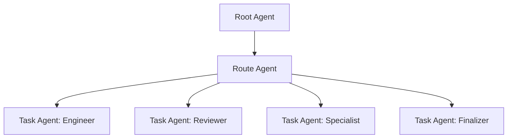
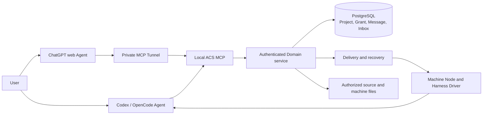
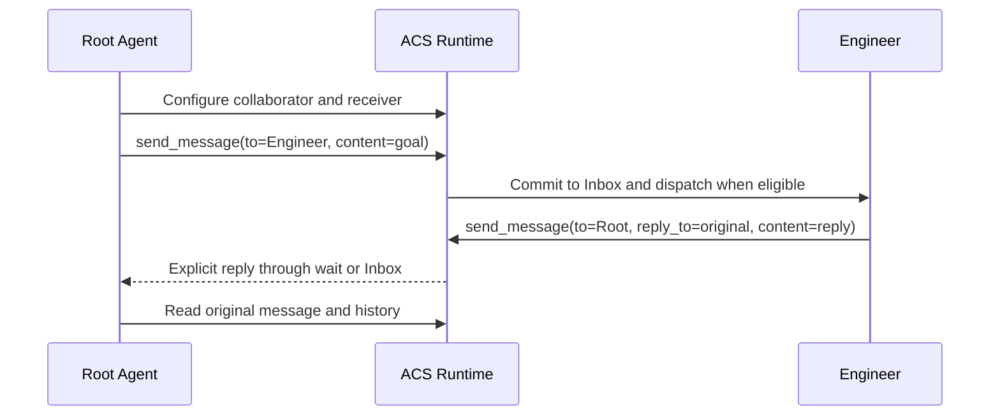

<div align="center">
  
  <h1>Agent Collaboration System</h1>
  <p>Durable communication for AI agents across sessions, machines and Harnesses.</p>
  <p><a href="README.zh-CN.md">简体中文</a> · <a href="docs/GETTING-STARTED.md">Get started</a> · <a href="docs/runtime/UPGRADE-CONTRACT.md">Runtime architecture</a></p>
</div>

ACS connects independent Agents through stable contacts, natural messages,
explicit replies and a durable Inbox. A project keeps its **Management Root**
and **Routes**; Codex and OpenCode decide how to perform and review work.
ACS authenticates participants, preserves communication and starts a permitted
Native request when requested.

ACS v2.0.0 provides the communication core described in the
[communication contract](docs/runtime/COMMUNICATION.md). The
[implementation and support record](docs/runtime/COMMUNICATION-STATUS.md)
binds tested environments and limitations to their evidence. Existing v1.x
installations require the [guided upgrade](docs/RELEASE-NOTES-v2.0.0.md);
automatic updates do not activate this major version.

## Start with an AI assistant

Send this repository URL to Codex or OpenCode on your machine:

```text
https://github.com/D1ChangGeng/Agent-collaboration
```

Then ask:

> Inspect this repository and guide me through installing ACS. First confirm
> where the Runtime should run: this Linux machine, a remote machine through
> SSH, or a WSL distribution. Confirm which Codex/OpenCode client hosts should
> connect. Ask whether to enable ChatGPT web now, use local Harnesses only, or
> configure web later. Probe the selected host, install the verified Release and
> configure the selected connections. Ask me for these choices and required
> authorizations.
> Verify services and actual MCP calls, report the machine and account binding,
> and explain the installed capabilities. For selected web access, complete AI
> configuration and guide account actions in my external browser on my client
> machine using my setup authorization, or give me exact steps to complete and
> confirm. I can initialize
> projects later with the setup Skill.

The [getting started guide](docs/GETTING-STARTED.md) starts with Runtime host
selection and client connection verification. Once the machine installation is
ready, the [setup Skill](SKILL.md) can create or adopt a project's Management
Root and lead into Route/Team setup. On the current communication core, use
ordinary messages to delegate work and recover replies from Inbox.

## Standard release installation

Use the [v2.0.0 Release](https://github.com/D1ChangGeng/Agent-collaboration/releases/tag/v2.0.0)
and its `acs_bootstrap.py` asset to start verified installation.
See the [release notes](docs/RELEASE-NOTES-v2.0.0.md) for the upgrade path.

The Release Bootstrap uses an explicit Runtime destination: local Linux,
a named remote SSH target, or a named WSL distribution. It probes the selected
machine and account, downloads the selected GitHub Release, verifies
`SHA256SUMS.txt` and the embedded file manifest, then installs services and
private credentials on that host. Versioned private directories and the active
version pointer provide an upgrade and rollback record.

The Agent previews the install, binds apply to the observed machine identity,
account and home directory, and configures the selected Codex/OpenCode clients
on their own hosts. SSH and WSL install services through `--runtime-only` and
return a caller-side stdio MCP connection descriptor. The Agent installs Skills
and configures that descriptor on each selected client. Service
health and actual `tools/list`, `read_profile` and `list_projects` calls establish
machine readiness. A new installation can start with an empty project list.

ChatGPT web setup is an explicit installation choice: `enable`, `skip` or
`later`. For enabled web access, the Agent prepares the Runtime-host Tunnel
client, runs diagnostics and service setup, and guides required owner permissions,
private-key entry and ChatGPT connection confirmation. Account pages use your
external browser on your client machine. The Agent can help navigate when its
Harness has verified browser control, within your given setup authorization.
You confirm
required login, permissions, secret entry and connection consent. Guided steps
provide official links, exact page labels, actions and expected results; the
Agent waits for completion and then verifies actual MCP calls. The
[web setup runbook](docs/runtime/P2-PRIVATE-TUNNEL-PROFILE.md) provides the full
sequence and official documentation index. The installation report records
the choice, observed Tunnel/web state and any remaining owner action.

When you start a project, ask the setup Skill to initialize or adopt its
Management Root. Project identity, Source registration and Root Agent startup
follow the [project setup path](docs/GETTING-STARTED.md#start-a-project).

The installation report records Runtime machine identity and account, selected
transport, client hosts, version/commit/tree, services, enabled Harnesses,
credential references and rollback state. Runtime Node enrollment and execution
capabilities have their own live verification.

## Automatic upgrades

ACS v1.3.0 enables automatic upgrades by default for new installations. ACS
checks the latest stable Release daily on the installed Runtime host and
activates compatible updates after archive, installed-file, service and existing
authorization checks. The owner account's systemd timer is preferred, with cron
as a fallback and a background catch-up check on new MCP connections. The
installation report identifies the actual scheduling backend and its state.

Use `--no-auto-update` during installation to opt out or `--auto-update` to
enable it explicitly. A regular upgrade preserves an existing opt-out when
neither flag is supplied. The installed Bootstrap's
`--set-auto-update on|off|status` manages the setting. Stable
launcher commands follow the active version for future local, SSH, WSL and
Tunnel connections; existing sessions continue on their current version.
Compatibility changes require an AI-guided upgrade. A previous version remains
available for rollback.

Existing v1.2.0 installations need one AI-guided upgrade using the verified
v2.0.0 Release Bootstrap before these checks are available. See
[automatic upgrades](docs/AUTOMATIC-UPDATES.md) for controls, verification and
recovery.

## What you can manage

| Need | ACS capability |
| --- | --- |
| Organize a project | Stable Project and Management Root identity, Route registry and scoped project context |
| Build a team | Stable AgentSlots, roles, scoped Grants and actual receiver preparation through `configure_team` |
| Delegate work | Natural `send_message` content, explicit reply relationships and durable handles |
| Continue later | Reply waits, optional observation timeouts, Inbox history and Session replacement recovery |
| Inspect source | Authorized SourceBinding and machine-file reads; Agents assess work and review evidence |
| Connect clients | Profile-filtered MCP tools for Codex, OpenCode and a single-owner private ChatGPT Tunnel |

The Runtime tool catalog is [machine-readable](docs/runtime/p2-mcp-tool-contract.json).
Knowledge Skills under [docs/runtime/skills](docs/runtime/skills/README.md)
explain project identity, communication, continuity, source access and policy
as an Agent needs them.

## Agent organization

Root Agent carries project responsibility; Route Agent carries development-line
responsibility. **Task Agent** is the proposed collective term for an external
Agent carrying explicit task responsibility. Engineer, Reviewer, Specialist and
Finalizer describe duties that can be combined under actual authorization.



Organization extent, Role, Profile and Grant have separate meanings. Stable
Slots retain authorship when replaceable Native Sessions change. Agents can
ask a reviewer to inspect a particular commit and send findings using ordinary
messages. The [organization model proposal](docs/runtime/AGENT-ORGANIZATION-MODEL.md)
retains its historical design scope; the current tool contract defines runtime
behavior.

## Architecture



External Agents choose goals, delegation and review decisions. The Domain
checks identity, project scope and current authorization before committing
messages. The default MCP entries maintain pending delivery with bounded
concurrency. Node and Driver integrations prepare real Sessions and report
Native admission. Git commits and trees identify repository content.

## A collaboration cycle



For example, a Root Agent sends an Engineer a goal and repository location,
retains the returned message handle across a Session restart, then reads the
Engineer's associated reply. The Engineer supplies its own commit and test
evidence. The [communication support record](docs/runtime/COMMUNICATION-STATUS.md)
links current implementation and actual cross-machine runs; older Gate records
retain the versions and capabilities they measured.

## Install and connect

The Source/CAS Runtime service runs on Linux. Choose local Linux, a remote
Linux host through SSH, or a named WSL distribution; Windows Codex/OpenCode
connect through the selected service host's MCP process. Installation uses
Python 3.12+, Git, uv and Docker Compose for PostgreSQL and Temporal. The Agent
checks the selected host and performs setup; you choose the destination and
complete machine privilege or account consent prompts.

Use `scripts/acs_bootstrap.py` from the selected Release for the machine
installation. Its destination flags are `--runtime-host local|ssh|wsl`,
`--ssh-target` and `--wsl-distribution`. Supply the preview's
`--expected-machine-id`, `--expected-account` and `--expected-user-home` before
apply; select clients with `--harness codex opencode`. The bounded Linux
`acs_install.py` entry
requires `--host-confirmed`. It installs the locked Python environment, starts
owner-local services and initializes a private owner Authority. Local Linux
setup installs nine Skills and configures selected clients on that host by
default; `--runtime-only` selects service setup. For SSH/WSL, the Agent installs
Skills and configures MCP on the selected client hosts, verifies their actual
connections, and can then offer project setup.
See [getting started](docs/GETTING-STARTED.md) and
[troubleshooting](docs/TROUBLESHOOTING.md).

For ChatGPT web, the [single-user private Tunnel
profile](docs/runtime/P2-PRIVATE-TUNNEL-PROFILE.md) connects an installation
owner's Linux MCP process through their OpenAI Platform organization and
ChatGPT workspace. Follow the current [official Tunnel
guide](https://developers.openai.com/api/docs/guides/secure-mcp-tunnels)
for platform permissions and connection steps.

## Project and source boundaries

The preferred layout keeps the Management Root inside the project's Git source
checkout. Root and Route instructions, knowledge and project metadata travel
with the repository; Runtime observations and credentials stay in private local
storage. Message delivery and Git synchronization are recorded independently.
The [setup Skill](SKILL.md) provides guarded bootstrap, adopt, repair, upgrade
and validation operations for the project files.

## Development and support

The repository includes [contribution guidance](CONTRIBUTING.md),
[security reporting](SECURITY.md), [change history](CHANGELOG.md) and a
[Sustainable Use License 1.0](LICENSE). The license permits free public
distribution under its stated use and redistribution terms. Release packages
carry a source-bound manifest and SHA-256 digest list.
