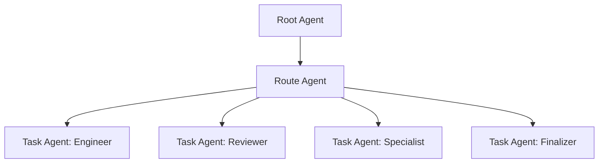
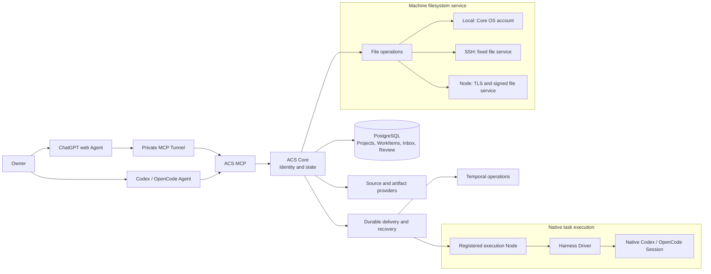
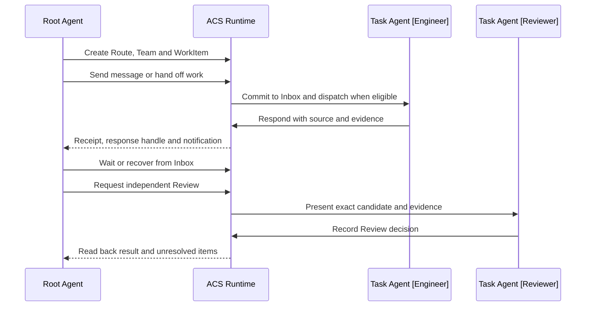

<div align="center">
  
  <h1>Agent Collaboration System</h1>
  <p>Durable project coordination and machine access for AI agents across sessions, machines and Harnesses.</p>
  <p><a href="README.zh-CN.md">简体中文</a> · <a href="docs/GETTING-STARTED.md">Get started</a> · <a href="docs/runtime/UPGRADE-CONTRACT.md">Runtime architecture</a></p>
</div>

ACS connects an owner's projects, collaborators, native Codex/OpenCode Sessions
and machine files. A stable **Management Root** and **Routes** keep long-lived
project responsibility. Agents organize teams and WorkItems, send durable
messages, recover responses from Inbox, inspect source and artifacts, and
request independent Review. The Runtime persists identity, state and recovery;
external Agents decide how the work proceeds.

## Start with an AI assistant

Send this repository URL to Codex or OpenCode on your machine:

```text
https://github.com/D1ChangGeng/Agent-collaboration
```

Then ask:

> Inspect this repository and guide me through installing ACS. First confirm
> where the Runtime should run: this Linux machine, a remote machine through
> SSH, or a WSL distribution. Confirm which Codex/OpenCode client hosts should
> connect. Ask whether to enable ChatGPT web now, use local Harnesses only, or
> configure web later. Probe the selected host, install the verified Release and
> configure the selected connections. Execute the installation and verification
> commands, and ask me for these choices and required authorizations.
> Verify services and actual MCP calls, report the machine, account and access
> mode, and explain the installed capabilities. For selected web access, complete
> AI configuration and guide account actions in my external browser on my client
> machine using my setup authorization, or give me exact steps to complete and
> confirm. I can initialize projects later with the setup Skill.

The [getting started guide](docs/GETTING-STARTED.md) starts with Runtime host
selection and client connection verification. Once the machine installation is
ready, the [setup Skill](SKILL.md) can create or adopt a project's Management
Root and lead into Route/Team setup, WorkItem delivery, Inbox recovery and
independent Review.

## Standard release installation

Use the [v1.5.3 Release](https://github.com/D1ChangGeng/Agent-collaboration/releases/tag/v1.5.3)
and its `acs_bootstrap.py` asset to start verified installation.
See the [release notes](docs/RELEASE-NOTES-v1.5.3.md) for capabilities and the
guided upgrade path.

The Release Bootstrap uses an explicit Runtime destination: local Linux,
a named remote SSH target, or a named WSL distribution. It probes the selected
machine and account, downloads the selected GitHub Release, verifies
`SHA256SUMS.txt` and the embedded file manifest, then installs services and
private credentials on that host. Versioned private directories and the active
version pointer provide an upgrade and rollback record.

The Agent previews the install, binds apply to the observed machine identity,
account and home directory, and configures the selected Codex/OpenCode clients
on their own hosts. SSH and WSL install services through `--runtime-only` and
return a caller-side stdio MCP connection descriptor. The Agent installs Skills
and configures that descriptor on each selected client. Service health and
actual `tools/list`, `read_profile` and `list_projects` calls establish machine
readiness. A new installation can start with an empty project list.

New single-owner installations use `access_mode: owner`. Trusted credentials,
tenant and Authority identity, active objects, explicit revocation, request
deduplication and expected revisions govern operations. Project, Machine, Node,
Connection and Endpoint registrations persist until an explicit lifecycle
change; execution checks the actual process, transport and native Session.
Shared deployments use their configured per-subject Grants, Policies and budgets.
The [owner contract](docs/runtime/OWNER-RUNTIME.md) explains mode selection and
existing installation adoption.

ChatGPT web setup is an explicit installation choice: `enable`, `skip` or
`later`. For enabled web access, the Agent prepares the Runtime-host Tunnel
client, runs diagnostics and service setup, and guides required owner permissions,
private-key entry and ChatGPT connection confirmation. Account pages use your
external browser on your client machine. The Agent can help navigate when its
Harness has verified browser control, within your given setup authorization.
You confirm required login, permissions, secret entry and connection consent.
Guided steps provide official links, exact page labels, actions and expected
results; the Agent waits for completion and verifies actual MCP calls. The
[web setup runbook](docs/runtime/P2-PRIVATE-TUNNEL-PROFILE.md) provides the full
sequence and official documentation index.

When you start a project, ask the setup Skill to initialize or adopt its
Management Root. Project identity, Source registration and Root Agent startup
follow the [project setup path](docs/GETTING-STARTED.md#start-a-project).
The installation report records machine/account binding, client hosts,
version/commit/tree, actual access mode, service and transport health,
native Harness configuration, visible tools, credential references and rollback
state.

## Automatic upgrades and startup recovery

New installations enable automatic upgrades by default. ACS checks the latest
stable Release daily on the Runtime host and activates compatible updates after
archive, installed-file, service and current authorization checks. The owner's
systemd timer is preferred, with cron as a fallback and background catch-up on
new MCP connections. The installation report identifies the actual backend and
its state.

Use `--no-auto-update` during installation to opt out or `--auto-update` to
enable it explicitly. A regular upgrade preserves an existing opt-out when
neither flag is supplied. The installed Bootstrap's
`--set-auto-update on|off|status` manages the setting. Stable launch commands
select the active version for new local, SSH, WSL and Tunnel MCP processes.
Startup restores the existing owner Core services; configured private SSH and
Tunnel profiles supervise their processes and reconnect after interruption.
Read back each service and connection to confirm readiness.

For a Windows client using WSL, the Agent configures an owner login task with
`scripts/acs_windows_startup.ps1`. Its GUI host keeps recovery in the background
and invokes the stable launcher's `--maintain-startup` entry. Preview, apply and
check bind the task to the confirmed distribution, Linux account and machine.
Existing task migration verifies the selected installation's maintainer and
hands off its recovery lock while Core, SSH and web processes retain their
existing supervision.
The [startup recovery guide](docs/runtime/STARTUP-RECOVERY.md) covers task
migration and Docker/containerd diagnosis, including a reviewed repair plan,
explicit authorization for shared services and a private backup.

The v1.5 Runtime schema and MCP catalog transition uses an AI-guided upgrade
with the verified v1.5.3 Bootstrap. The Agent preserves
identity, projects, configuration, keys, explicit revocation and rollback data,
then verifies the actual mode and Receiver bindings. Reconnect Codex/OpenCode
after activation. For ChatGPT, restart the configured Tunnel/MCP process,
select **Refresh** on the existing connection in ChatGPT Plugins, and start a
new chat. See [automatic upgrades](docs/AUTOMATIC-UPDATES.md) for the complete
controls and recovery steps.

## What you can manage

| Need | ACS capability |
| --- | --- |
| Organize a project | Stable Project and Management Root identity, Route registry and scoped project context |
| Build a team | AgentSlots, roles and Harness requirements through `configure_team`; shared Grants, Policies and budgets where configured |
| Delegate work | WorkItems, durable messages, handoff acknowledgement and response handles |
| Continue later | Condition waits, optional caller timeouts, notifications, Inbox reads and Session replacement recovery |
| Use native Agents | Selected user's Codex/OpenCode tools, MCP servers, plugins, project settings, provider, models and approval configuration |
| Work with machine files | Read, discover, search and change current files through Local, SSH or registered Node file services |
| Review a result | Source observations, captured versions, Artifacts, Evidence, independent Review and accepted state |
| Connect clients | MCP tools for Codex, OpenCode and a single-owner private ChatGPT Tunnel |

Async submission returns committed Message, response and notification handles.
Sync sends and response waits observe the selected condition; optional caller
timeouts return pending handles while tracking continues. Owner requests remain
valid while their service, identity and targets are active, with an optional
business deadline. Read the [Send/Wait lifecycle](docs/runtime/SEND-WAIT-LIFECYCLE.md)
for wait and recovery behavior.

The [MCP catalog](docs/runtime/p2-mcp-tool-contract.json) and
[Runtime Skills](docs/runtime/skills/README.md) explain the available tools and
the project, collaboration, continuity, source, policy and Review models.

## Machine files and source versions

Start with `filesystem_context` to discover the actual machine, OS account,
platform, home, working directory and connected choices. `select_filesystem`
sets the default machine and directory for that MCP connection. Each file tool
also accepts optional `machine_id` and `cwd` for one call.

| Action | Owner file tool |
| --- | --- |
| Read text or binary bytes | `read_file`, with only `path` required |
| Discover files | `list_directory` and `glob` |
| Search contents | `grep` |
| Create or change files | `write_file`, `edit_file` and `apply_patch` |

The selected OS account's permissions cover hidden, ignored and untracked
files, paths outside repositories, large files and binaries. Text and Base64
output paginate with `complete` and `next_cursor`; continuation retains the
original machine and path. The default Local target is Core's OS account and
home directory, including the WSL account when Core runs in WSL. SSH uses an
installed fixed file service; registered Nodes use TLS pinning, signed identity,
owner authorization and request journaling. File service readiness is
independent of a native Harness Session's busy state. See the
[machine filesystem guide](docs/runtime/MACHINE-FILESYSTEM.md).

SourceBinding supplies repository, location and version guidance. Agents choose
an available machine, native tool, Git or repository reader and record the
actual source observed. Current product Source reads resolve the repository's
physical primary worktree and its actual edits. `read_source_file`,
`list_source_files`, `search_source_files`, `read_source` and `read_diff`
provide Project Source observations and explicit captured versions; Source
pagination retains `view_revision`. Shared mode retains its established Source
schemas and permission contracts. Review and acceptance bind the exact
candidate and Evidence.

## Agent organization

Root Agent carries project responsibility; Route Agent carries development-line
responsibility. **Task Agent** is the proposed collective term for an external
Agent carrying explicit task responsibility. Engineer, Reviewer, Specialist and
Finalizer describe duties that can be combined under actual authorization.



Organization extent, Role and Profile have separate meanings. Existing Slots,
WorkItems and replaceable Sessions provide the bindings. Independent Review
checks candidate participants; acceptance checks current authority, exact Source,
Evidence, Review and readbacks. The
[organization model proposal](docs/runtime/AGENT-ORGANIZATION-MODEL.md) defines
terminology, compatibility and observable context fields.

## Architecture



External Agents choose goals, delegation and Review decisions. Core checks
trusted identity, active scope, explicit revocation and revisions before
committing state; shared mode applies its configured Grants and Policies.
Execution Drivers observe actual native Sessions and use the selected user's
environment. Machine file services operate directly under their connected OS
accounts. Source providers report the actual repository view used for evidence.

## A collaboration cycle



A Root Agent can ask an Engineer to change one feature, keep the WorkItem and
message handle across a Session restart, inspect the resulting source and test
evidence, and route that candidate to a Reviewer. The
[owner workflow](docs/runtime/OWNER-RUNTIME.md) describes collaboration,
execution, file access and acceptance.

## Install and connect

The Core and Source/CAS services run on Linux. Choose local Linux, a remote
Linux host through SSH, or a named WSL distribution; Windows Codex/OpenCode
connect through the selected service host's MCP process. Installation uses
Python 3.12+, Git, uv and Docker Compose for PostgreSQL and Temporal. The Agent
checks the selected host and executes setup commands; you choose the destination
and complete required machine privilege or account confirmations.

Use `scripts/acs_bootstrap.py` from the selected Release. Its destination flags
are `--runtime-host local|ssh|wsl`, `--ssh-target` and `--wsl-distribution`.
Supply the preview's `--expected-machine-id`, `--expected-account` and
`--expected-user-home` before apply; select clients with
`--harness codex opencode`. The bounded Linux `acs_install.py` entry requires
`--host-confirmed`. It installs the locked Python environment, starts owner
services and initializes a private Authority. Local Linux setup installs nine
Skills and configures selected clients on that host by default;
`--runtime-only` selects service setup. For SSH/WSL, the Agent installs Skills,
configures MCP on selected client hosts and verifies their actual connections.
See [getting started](docs/GETTING-STARTED.md) and
[troubleshooting](docs/TROUBLESHOOTING.md).

The [single-owner private Tunnel profile](docs/runtime/P2-PRIVATE-TUNNEL-PROFILE.md)
connects the owner's Linux MCP process through their OpenAI Platform organization
and ChatGPT workspace. The runbook includes the
[official Tunnel guide](https://developers.openai.com/api/docs/guides/secure-mcp-tunnels)
for platform permissions and connection steps.

## Project and source boundaries

The preferred layout keeps the Management Root inside the project's Git source
checkout. Root and Route instructions, knowledge and project metadata travel
with the repository; Runtime observations and credentials stay in private local
storage. Message delivery, source reading and Git synchronization have their
own readbacks. The [setup Skill](SKILL.md) provides guarded bootstrap, adopt,
repair, upgrade and validation operations for project files.

## Development and support

The repository includes [contribution guidance](CONTRIBUTING.md),
[security reporting](SECURITY.md), [change history](CHANGELOG.md) and a
[Sustainable Use License 1.0](LICENSE). The license permits free public
distribution under its stated use and redistribution terms. Release packages
carry a source-bound manifest and SHA-256 digest list. Distribution v1.5.3,
setup Skill v0.4.0 and Runtime package v0.1.0 are independently versioned.
