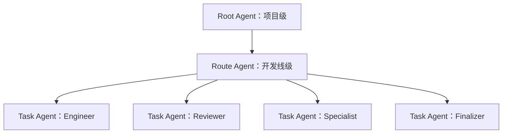
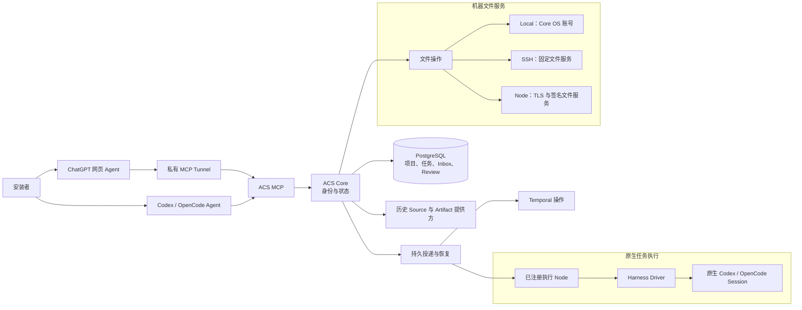
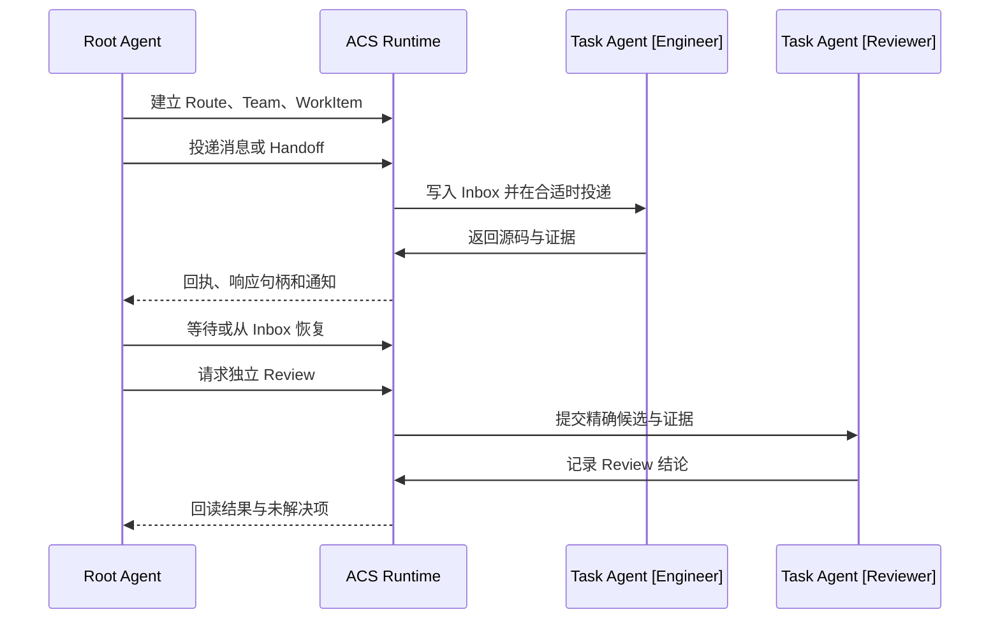

<div align="center">
  
  <h1>Agent Collaboration System</h1>
  <p>为跨会话、跨机器、跨 Harness 的 AI 协作提供持久项目协调与机器访问能力。</p>
  <p><a href="README.md">English</a> · <a href="docs/GETTING-STARTED.md">开始使用</a> · <a href="docs/runtime/UPGRADE-CONTRACT.md">运行架构</a></p>
</div>

ACS 连接安装者的项目、协作者、原生 Codex/OpenCode Session 和机器文件。稳定的
**Management Root** 和 **Route** 承载长期项目责任。Agent 可以配置 Team、管理
WorkItem、投递持久消息、从 Inbox 恢复响应、检查源码与产物，并发起独立 Review。
Runtime 保存身份、状态和恢复记录，外部 Agent 决定工作如何推进。

## 把仓库链接交给 AI

将以下链接发给本机 Codex 或 OpenCode：

```text
https://github.com/D1ChangGeng/Agent-collaboration
```

然后告诉它：

> 请检查这个仓库并带我安装 ACS。先确认 Runtime 的安装位置：本机 Linux、
> 通过 SSH 访问的远程机器，或指定的 WSL 发行版；再确认哪些机器上的
> Codex/OpenCode 需要连接。接着询问是否现在接入 ChatGPT 网页、仅使用本地
> Harness，或稍后配置网页。对选定主机做只读检查，安装经过校验的 Release
> 并配置所选连接。执行安装与验证命令，只就这些选择和必要授权提问。
> 安装后实际验证服务与 MCP 调用，报告机器、账号和访问模式，说明已安装能力。
> 选择网页接入时，由 AI 完成配置，在我的客户端机器上的外部浏览器中，
> 按我已有的设置授权协助导航，或提供准确步骤，由我完成并确认。
> 项目可以之后通过 setup Skill 初始化。

[首次使用指南](docs/GETTING-STARTED.md)从 Runtime 主机选择和客户端连接验证
开始。机器安装就绪后，可以调用 [setup Skill](SKILL.md)创建或接入项目
Management Root，随后使用 Route/Team、WorkItem 投递、Inbox 恢复和独立 Review。

## 协作能力

| 需求 | ACS 能力 |
| --- | --- |
| 管理项目 | 稳定的 Project、Management Root、Route 与项目上下文 |
| 配置团队 | 通过 `configure_team` 绑定 AgentSlot、职责与 Harness 要求；shared 部署使用其 Grant、Policy 和预算 |
| 交付工作 | WorkItem、持久消息、Handoff 确认与响应句柄 |
| 异步继续 | 条件等待、可选调用方超时、通知、Inbox 和 Session 替换恢复 |
| 使用原生 Agent | 选定用户的 Codex/OpenCode 工具、MCP、插件、项目配置、provider、模型与审批配置 |
| 操作机器文件 | 通过 Local、SSH 或已注册 Node 文件服务读取、发现、搜索和修改当前文件 |
| 审查结果 | Agent 源码回读、Artifact、Evidence、独立 Review 和接受状态 |
| 连接客户端 | 面向 Codex、OpenCode 与安装者私有 ChatGPT Tunnel 的 MCP 工具 |

异步提交返回已持久化的 Message、响应和通知句柄；同步投递与响应等待持续观察所选
条件。可选调用方超时可以提前返回待完成句柄，后台追踪继续。owner 请求在服务、
身份与目标保持 active 时有效，也可以明确指定业务 deadline。
[Send/Wait 生命周期](docs/runtime/SEND-WAIT-LIFECYCLE.md)说明等待与恢复行为。

[MCP 工具目录](docs/runtime/p2-mcp-tool-contract.json)给出机器可读接口；
[Runtime Skills](docs/runtime/skills/README.md)提供项目、协作、连续性、源码、
授权和 Review 的按需知识。

## 机器文件与源码版本

先调用 `filesystem_context`，读取实际机器、OS 账号、平台、主目录、工作目录和
可选连接；`select_filesystem` 设置本次 MCP 连接的默认机器与目录。
每个文件工具也接受单次调用的可选 `machine_id` 和 `cwd`。

| 操作 | owner 文件工具 |
| --- | --- |
| 读取文本或二进制字节 | `read_file`，必填参数只有 `path` |
| 发现文件 | `list_directory`、`glob` |
| 搜索内容 | `grep` |
| 创建或修改文件 | `write_file`、`edit_file`、`apply_patch` |

选定 OS 账号的权限决定可访问的路径，包括隐藏、忽略、未跟踪文件、仓库外路径、
大文件和二进制文件。文本与 Base64 输出通过 `complete`、`next_cursor` 分页，
续读保留原始机器与路径。Local 默认指 Core 服务的 OS 账号和主目录；Core 运行在
WSL 时使用该 WSL 账号与路径。SSH 使用已安装的固定文件服务，已注册 Node 使用
TLS 固定校验、签名身份、owner 授权与请求日志。文件服务直接执行文件请求，
其就绪状态独立于原生 Harness Session 的忙闲状态。详见
[机器文件工具指南](docs/runtime/MACHINE-FILESYSTEM.md)。

owner 项目注册保存当前管理文档所在的机器与目录，管理目录可以位于 Git checkout
或其他已授权位置。`load_project` 通过机器文件读取当前指令与知识索引；
`configure_project` 设置、替换或清除该位置及其文档路径。日常文件操作使用上面的
标准机器工具。

Agent 选择实际可用的机器、原生工具、Git 或仓库读取器，并记录实际观测的源码。
owner `WorkItem.source_baseline` 可以省略或为 null；在允许修订工作意图时，
`revise_work` 可以选择、改变或清除该工作版本。Review 和接受操作将 Agent 主动
报告的 commit/tree 与精确候选及已记录 Evidence 核对，并保留 Reviewer 独立性
和授权身份检查。

历史 Source 记录通过明确选择 `source_id` 和 `revision` 查询；捕获版本的分页
沿用 `view_revision`。shared 保留既有 Source 接口与权限契约。
[owner 契约](docs/runtime/OWNER-RUNTIME.md)说明项目上下文和接受流程，
[Runtime 接管契约](docs/runtime/UPGRADE-CONTRACT.md)记录 schema 迁移。
实际安装的工具 schema 与回读结果决定可用能力。

## Agent 组织模型

Root Agent 负责项目级范围，Route Agent 负责开发线级范围。**Task Agent**
是承担明确任务的外部 Agent 的候选统称；Engineer、Reviewer、Specialist、Finalizer
表示职责，可在实际授权允许的情况下组合。



组织责任范围、Role 与 Profile 各有独立含义。现有 AgentSlot、WorkItem
和可替换 Session 承载具体绑定。独立 Review 核对候选参与者身份；接受操作核对
当前授权与精确 Source、Evidence、Review、回读证据。
[组织模型提案](docs/runtime/AGENT-ORGANIZATION-MODEL.md)说明术语、兼容关系和上下文表达。

## 架构



外部 Agent 负责目标、委派与 Review 决策；Core 在写入前核对可信身份、active
范围、显式撤销和修订号，shared 同时应用其 Grant 与 Policy。执行 Driver
观察真实原生 Session，并使用选定用户的环境。机器文件服务在连接的 OS 账号下
直接操作文件并读取当前项目文档。Agent 报告实际审查的候选源码，Source 归档
保留历史捕获视图。

## 一个完整协作流程



Root Agent 可以将一次功能改动交给 Engineer，在会话重启后继续追踪同一 WorkItem
与消息句柄，再核对实际源码、测试证据并送交 Reviewer。
[owner 工作流](docs/runtime/OWNER-RUNTIME.md)说明协作、执行、文件访问与接受流程。

## 安装与接入

### 标准 Release 安装

使用 [v1.5.3 Release](https://github.com/D1ChangGeng/Agent-collaboration/releases/tag/v1.5.3)
提供的 `acs_bootstrap.py` 入口，开始经过校验的安装流程。
能力与升级路径见[发布说明](docs/RELEASE-NOTES-v1.5.3.md)。

Release Bootstrap 使用明确的 Runtime 安装目标：本机 Linux、指定的远程 SSH
目标，或指定的 WSL 发行版。它检查选定机器与账号，下载指定 GitHub Release，
校验 `SHA256SUMS.txt` 和发行包内文件清单，再在该主机安装服务与私有凭据。
版本目录和当前版本指针记录升级状态，并保留回滚目标。

AI 先预览安装计划，将执行绑定到已观测的完整机器身份、账号与主目录，再在各客户端
所在主机配置选定的 Codex/OpenCode。SSH 和 WSL 通过 `--runtime-only` 安装服务，
返回调用方可用的 stdio MCP 连接描述。AI 在选定客户端安装 Skills 并配置连接。
服务健康状态及实际 `tools/list`、`read_profile`、`list_projects` 调用共同验证机器
就绪；新安装可以从空项目列表开始。

新单用户安装记录 `access_mode: owner`。操作持续核对可信凭据、tenant 和
Authority 身份、active 对象、显式撤销、请求去重与预期修订号。Project、Machine、
Node、Connection、Endpoint 注册保留到明确的生命周期变更；执行前读取实际进程、
连接和原生 Session。shared 部署使用其按主体配置的 Grant、Policy 与预算。
[owner 契约](docs/runtime/OWNER-RUNTIME.md)说明模式选择与已有安装接管。

ChatGPT 网页接入是明确的安装选项：现在启用（`enable`）、仅用本地客户端
（`skip`）或稍后配置（`later`）。启用时，AI 在 Runtime 主机安装和配置 Tunnel
客户端、运行诊断并配置服务，向用户说明需要亲自完成的权限确认、私有密钥录入
和 ChatGPT 连接确认。账号页面使用你在客户端机器上的外部浏览器。当前 Harness
具备已验证的浏览器控制能力时，AI 可在已有设置授权范围内协助导航。登录、权限、
密钥录入和连接同意由你确认。你也可以按官方链接、准确页面标签、操作和预期结果
自行完成；AI 等待确认后再实际验证 MCP 调用。
[网页接入手册](docs/runtime/P2-PRIVATE-TUNNEL-PROFILE.md)提供完整步骤与官方文档索引。

开始项目时，调用 setup Skill 初始化或接入 Management Root。项目身份、Source
注册和 Root Agent 启动按[项目设置路径](docs/GETTING-STARTED.md#start-a-project)完成。
安装报告记录机器与账号绑定、客户端主机、版本和 commit/tree、实际访问模式、
服务与连接健康状态、原生 Harness 配置、可见工具、凭据引用与回滚状态。

Core 和 Source/CAS 服务运行在 Linux。可以选择本机 Linux、通过 SSH 访问的
远程 Linux 主机，或指定的 WSL 发行版；Windows Codex/OpenCode 通过选定服务
主机上的 MCP 进程连接。服务安装使用 Python 3.12+、Git、uv、Docker Compose、
PostgreSQL 和 Temporal。AI 检查选定主机并执行安装命令；你选择目标，完成必要
的系统权限或账号确认。

机器安装使用选定 Release 的 `scripts/acs_bootstrap.py`。目标参数为
`--runtime-host local|ssh|wsl`、`--ssh-target` 和 `--wsl-distribution`。
执行时传入预览返回的 `--expected-machine-id`、`--expected-account` 和
`--expected-user-home` 三项身份绑定参数；`--harness codex opencode` 选择客户端。
受控 Linux 入口 `acs_install.py` 要求 `--host-confirmed`；它安装锁定的 Python
环境、启动 owner 服务并建立私有 Authority。本机 Linux 默认安装九个 Skills 并
配置该主机上选定的客户端，`--runtime-only` 选择服务安装。SSH/WSL 的客户端 Skills
与 MCP 由 AI 在选定客户端主机配置，实际验证连接后再引导项目设置。
详见[首次使用指南](docs/GETTING-STARTED.md)和[排错指南](docs/TROUBLESHOOTING.md)。

[单用户私有 Tunnel Profile](docs/runtime/P2-PRIVATE-TUNNEL-PROFILE.md)连接安装者的
Linux MCP 进程、OpenAI Platform organization 与 ChatGPT workspace。手册收录
[官方 Tunnel 文档](https://developers.openai.com/api/docs/guides/secure-mcp-tunnels)，
用于核对平台权限与连接步骤。

## 自动升级与启动恢复

新安装默认启用自动升级。ACS 在已安装的 Runtime 主机上每天检查最新稳定 Release，
完成发行包、现有安装文件、服务健康和当前授权校验后，激活兼容更新。优先使用
安装者账号的 systemd 用户计时器，cron 作为后备；新 MCP 连接也会在后台补查。
安装报告记录实际调度方式及其状态。

安装时可用 `--no-auto-update` 关闭自动升级，或用 `--auto-update` 明确启用。
普通升级未指定这两个参数时，保留已有的关闭设置。安装后通过 Bootstrap 的
`--set-auto-update on|off|status` 管理设置。稳定启动命令让新的本机、SSH、WSL
和 Tunnel MCP 进程使用已激活版本。启动时恢复既有 owner Core 服务；
已配置的私有 SSH 和 Tunnel profile 监督所属进程，并在中断后重新连接。
实际就绪状态通过服务和连接回读确认。

Windows 客户端使用 WSL 时，AI 通过 `scripts/acs_windows_startup.ps1`
配置安装者的登录任务。GUI host 在后台运行恢复进程，调用稳定启动器的
`--maintain-startup` 入口。预览、执行与核对绑定已确认的发行版、Linux 账号和
机器身份。迁移既有任务时，脚本核验当前安装维护锁的持有进程并完成交接；
Core、SSH 和 Web 进程继续由既有监督机制管理。[启动恢复指南](docs/runtime/STARTUP-RECOVERY.md)说明既有任务迁移、
Docker/containerd 诊断和修复流程；共享服务变化需要审阅计划、明确授权与私有备份。

v1.5 Runtime schema 与 MCP 工具目录的迁移使用经过校验的 v1.5.3 Bootstrap
进行 AI 引导升级。AI 保留身份、项目、配置、密钥、显式撤销与回滚数据，
随后验证实际模式及 Receiver 绑定。激活后重新连接 Codex/OpenCode；ChatGPT
需要重启所配置的 Tunnel/MCP 进程，在 Plugins 中对既有连接选择 **Refresh**，
再开始新聊天。控制命令、验证与恢复步骤见[自动升级指南](docs/AUTOMATIC-UPDATES.md)。

## 项目与源码边界

推荐把 Management Root 放在项目 Git checkout 内。Root/Route 指令、知识与
项目元数据随仓库同步；运行观测和凭据留在本机私有存储。消息投递、源码读取与 Git
同步各自保留回读证据。owner 注册也支持其他已授权管理目录，并保存当前机器与路径。
[setup Skill](SKILL.md)提供受控的建立、接管、修复、升级和验证。

仓库提供[贡献说明](CONTRIBUTING.md)、[安全报告方式](SECURITY.md)、
[变更记录](CHANGELOG.md)与 [Sustainable Use License 1.0](LICENSE)。许可允许在其
用途和再分发条款内免费公开分发。发行包附带源码绑定清单和 SHA-256 摘要。
产品发行 v1.5.3、setup Skill v0.4.0 与 Runtime package v0.1.0 分别版本化。
