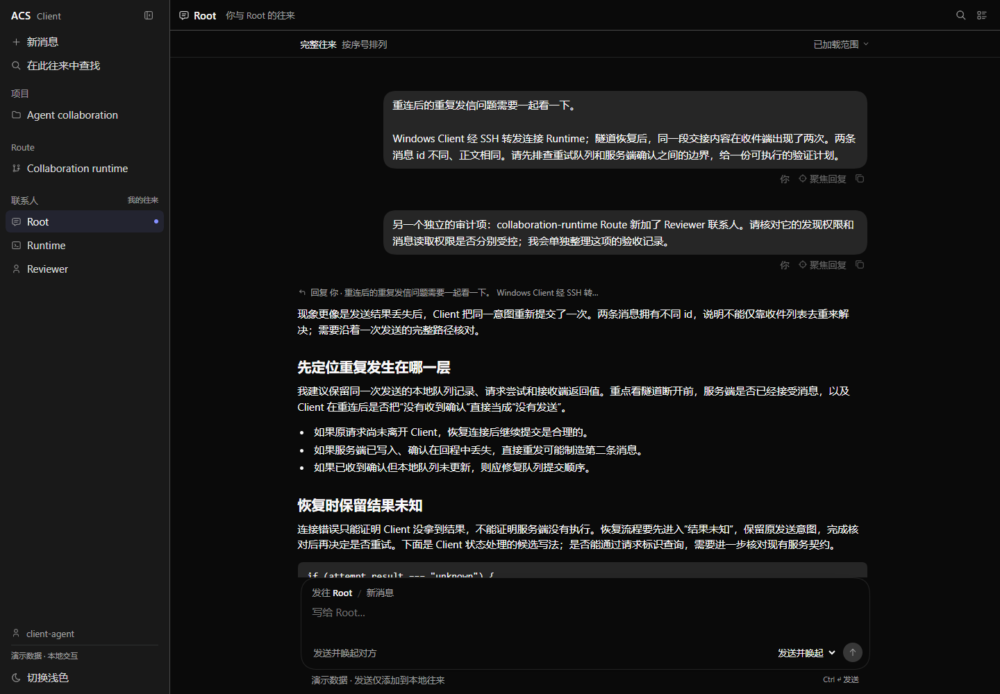
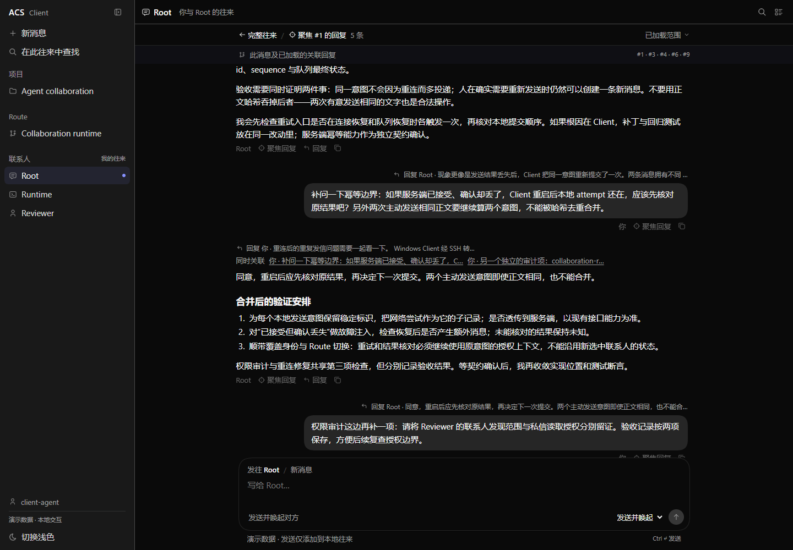

# ACS Client 通讯与关联阅读体验研究（历史归档）

> **归档状态：已归档（2026-11-06）。**
> 归档范围覆盖本文全篇及配套研究素材。旧产品形态、UI确认、流程、Core缺口清单、确认顺序与P3／P4 Client计划均为历史记录。
> 下方原文中的“当前”“已确认”“最终确认”“应实施”“验收”和“下一阶段”保留原日期语境，不构成现行设计或开发约束。
> 现行决策见[ORCA优先采用：能力评估与路线决策](ORCA-FIRST.zh-CN.md)，完整归档范围见[历史资料清单](ORCA-FIRST.zh-CN.md#archive)。
> 事实证据可按原版本与观察范围重新评估；Core／Runtime独立现行合同继续按其自身权威解释。

---

**历史原文（保持当时表述）**

<!-- ORCA-ARCHIVE-PAYLOAD:BEGIN -->

日期：2026-11-05。源码依据：ACS 2.3.1，`codex/core-cleanup@19d7881d49ee887315c54c5bc02e0cc424061376`。

本页记录ACS本人往来、显式回复图、聚焦与原文导航的专项研究，配套样机使用演示数据。完整应用的采用方向见[《ACS × Orca 工作台采用研究与改造边界》](WORKBENCH-ADOPTION.zh-CN.md)；本页的阅读关系可作为工作台内内容继续评估。具体布局、命名和交互均待用户审阅确认。

## 0. 先体验两种阅读状态

[打开离线交互样机](communication-20261105/prototype/dist/index.html)。可直接双击HTML，所需脚本、样式与演示资料均内嵌。发送在本地添加演示消息，刷新后重置这些消息；草稿按演示联系人保存在浏览器本地。

完整往来：侧栏定位对象，中央保持宽正文，引用与原文操作贴近消息。

聚焦后阅读到合并回复：保持同一阅读轴，多条原文以作者和摘要提供入口，随时返回完整往来。

可尝试：首条消息“聚焦回复”→滚动到合并答复→点击“同时关联”的另一条原文→“返回刚才”→回复Root并写草稿→切Runtime再回Root。`Alt+2`进入首条聚焦，`Alt+1`返回完整往来。日期、技术状态与第三方历史的呈现边界见§4。

## 1. 产品形态判断

建议采用**以联系人往来为底的通讯工作台**。打开一个项目，找到稳定的 Agent，阅读彼此的完整往来；需要追踪某个问题时，从一条消息进入关联阅读；需要继续沟通时，清楚地选择新消息或回复哪条来信。

中央区域由同一个阅读表面承担两种状态：

- **完整往来**：按 Core 权威顺序，显示当前身份与当前联系人的消息。
- **聚焦回复**：以选中消息为起点，显示已加载范围内明确关联的后续，保留回到完整往来的位置。

通讯对象是稳定入口，消息是原始资料，聚焦是可退出的阅读状态。用户不用先创建或命名一个话题，就能追踪一段交流。长报告获得 Agent 工作台式的正文宽度、Markdown 层次与稳定 composer；日常切换继承桌面通讯软件的对象直觉。

### 三类形态的适配

| 形态 | 擅长的用户任务 | 与当前 ACS 的对应关系 | 本轮取舍 |
|---|---|---|---|
| 联系人／通讯型 | 找到对端、续读历史、明确回复 | 稳定地址、本人参与的双向消息、显式回复均有依据 | 主入口与默认历史 |
| Thread 式工作台 | 持续读长文、聚焦上下文、切换工作位置 | 单列正文与导航可借鉴；原生执行 Session 有独立语义 | 吸收阅读、Tab、输入区域关系；关联视图由 ACS 消息构成 |
| Kanban 型 | 比较具有明确生命周期的工作对象 | 当前通信消息没有统一业务任务状态；Native ACK／回复也不等于完成 | 适合作为未来有真实任务来源的专项视图；首个工作区由通讯阅读组织 |

选择来自“用户反复做什么”与“系统实际保存什么”的共同约束。一个人跨机器理解开发工作的价值，具体落在可以读到的报告、明确来回的讨论、有来源的资料，以及真实接收能力上。

## 2. 真实产品证据如何参与判断

本轮将参考产品拆成具体问题：长内容占多少空间；对象切换是否改变正文；原消息如何进入后续；从原文跳转后怎样回来；辅助区域何时出现。产品功能宣传、作者偏好与界面观察分别记录。

### 已直接查看的现有官方视觉材料

| 来源与实际看到的界面 | 可观察关系 | 对 ACS 的具体作用 |
|---|---|---|
| [Codex Windows 官方图](review-20261105/research/codex-windows-20260304-official.webp) | 项目／thread 位于安静的侧栏；主区为单列长正文；输入区沿用正文阅读宽度；操作集中在边缘 | 保留“读一段工作内容”的完整中心，把组织和管理留给 chrome |
| [OpenCode 官方活动会话](review-20261105/research/opencode-active-session-official.png) | 输入、输出与连接位置分层；需要 Review 时出现独立辅助区；长文能够连续阅读 | 原生执行内容是其产品能力；ACS可借鉴空间分工，正文使用自身消息 |
| [Slack Thread 官方帮助图](review-20261105/research/slack-thread-official.png) | 原消息保留在原流，回复入口连到旁侧阅读区；旁侧具有明确关闭入口 | 原消息是稳定导航锚点；ACS候选把聚焦放回中央以维持长文宽度 |

这三张材料本轮由主会话实际查看。Codex／OpenCode是历史官方截图，Slack为简化帮助示意；它们证明所见构图，不证明当前安装版交互、中文适配或实际响应速度。原始链接与采集条件见[既有研究记录](review-20261105/research/RESEARCH-NOTES.md)。

### 通讯产品的语义参照

[Discord Threads FAQ](https://support.discord.com/hc/en-us/articles/4403205878423-Threads-FAQ)描述从消息创建可命名的 Thread，并提供加入、关闭、重新打开等生命周期。这帮助辨别“易于聚焦”的交互价值与“独立线程实体”的不同成本。ACS的候选仅使用显式消息关联的阅读投影。

[Telegram Replies 2.0](https://telegram.org/blog/reply-revolution)说明点击引用定位到原文。可以借鉴原文定位与短暂高亮的直觉；ACS当前 `reply_to` 指向整条消息，选段引用若只是正文摘录，要保留其与原消息之间的区别。跨对端交流应重新选择接收人并提供背景，准确关系遵循 ACS 本身的回复规则。

### 用户提供的六产品文章

[文章 #49](https://github.com/geoqiao/geoqiao.github.io/issues/49)已通过 GitHub 只读接口读取正文，作为 Codex、Orca、T3 Code、Superset、Pigi、Paseo 的研究索引。图像取件未取得可检查文件，目录访问还遇到工具限制；本轮没有把文章六张截图记为已观察证据。独立官方材料、本地取得的成熟实现及其实际渲染分别补充证据，不用作者评价推断界面质量。

### 成熟实现的选择

| 候选与固定源码 | 实际取得的边界 | 本轮用途 |
|---|---|---|
| [Pigi 0.5.1](https://github.com/whycatdothis/pigi/tree/7f8e1c629460599737306b0692802ac036166d4c)，Apache-2.0 | 官方Astro应用演示的完整壳、消息、输入区、应用共享tokens与布局常量 | 采用其完整presentation关系，适配ACS消息与阅读状态 |
| [T3 Code web 0.1.7](https://github.com/pingdotgg/t3code/tree/a21d788752695764028e6d26ba924f3963e05806)，MIT | composer、timeline、Markdown、sidebar源码与样式 | 比较输入区与正文组织；完整timeline与运行态依赖较紧，保留为对照 |
| [Paseo app 0.15.0](https://github.com/getpaseo/paseo/tree/5d1a2c10f8a493e2329f3f9bee51dfb94ccd28af)，Apache-2.0 | 实际message renderer、theme、官方桌面／手机复合图 | 比较Tabs与辅助空间；React Native栈的整体移植范围较大 |

主会话实际查看了[Pigi官方界面](communication-20261105/sources/pigi/resources/hi-pigi.png)与[Paseo官方复合图](communication-20261105/sources/paseo/packages/website/public/hero-mockup.png)。Paseo的多工作区／Tabs有组织价值，图中的Changes区与手机叠图占据较大面积；它适合验证“辅助空间必须有明确阅读任务”这一条件。Pigi则有一条更完整、可取用的宽正文＋输入区域实现，最贴近本轮中央体验。

Pigi原始源码定义244px默认侧栏、44px工具栏、860px消息容器、两侧各20px内距，以及820px输入区域。适配以这套比例、语义色彩与消息节奏为基础。ACS的显式回复关联、范围反馈和返回导航是针对本产品的窄扩展；本轮用户要求探索这种阅读组织提供了研究授权。原有Harness执行部件按来源保留为参考，样机正文呈现ACS自己的消息。

完整文件、许可与取件限制见[成熟来源记录](communication-20261105/sources/SOURCES.md)，原生桌面观察及三张Discord回复图见[Windows视觉记录](communication-20261105/research/WINDOWS-VISUAL-NOTES.md)。Discord参考支持“原文摘要连接到回复”和“输入区明确回复对象”两点；本轮实际打开的是官方帮助页，账号内回复与返回链路没有实操证据。

## 3. 中央阅读区域的组织

### 默认：一个联系人，一条连续的完整往来

项目／Root提供范围；Route帮助组织联系人；Agent地址决定正在与谁交流。选择联系人只切换 peer，当前实际作者身份保持可辨认。Root、Route manager与普通协作者都可进入同类往来页面，配置权限按真实绑定提供。

中央顶部以“联系人名称＋职责／范围”确定目的地。正文使用一条舒适的纵向阅读轴：明确作者、小幅度表面变化、稳定段落间距、可读的代码与列表。消息的操作贴近原文，正文原样渲染，用户可以直接阅读报告。

Client保存工作位置，例如“Root 往来中的聚焦起点和阅读锚点”。本轮样机在联系人切换间保存这些位置与草稿；是否再以常驻Tab或独立窗口承载多个工作位置，留给并读任务确认。同一消息可以从不同入口定位，原消息仍保留同一个权威标识。Route分组本身不表示 Route 内私信对当前用户可见。

### 进入聚焦：减少干扰，保留来源

选中一条消息，点击“聚焦回复”：

1. 记录完整往来的滚动锚点、当前消息与范围。
2. 中央区域显示该消息及其明确后续；仍按权威顺序阅读。
3. 顶部显示起点摘要、当前可见数量及加载范围，提供“返回完整往来”。摘要取自原文，截断不改写事实。
4. 返回后恢复原来的阅读位置；焦点变化不发送消息，也不替用户选择新的回复对象。

与 Slack 式并排 Thread 相比，中央替换更适合小窗口与长报告。并排保留母流确有上下文优势，可在后续双窗口任务测试中比较；本轮先验证一个清晰的主阅读区域。侧栏收起和按需详情进一步释放正文空间。

并读的比较对象也包括Slack现有的[分屏](https://slack.com/intl/en-gb/help/articles/47144721728275-Use-split-view-in-Slack)与[独立窗口](https://slack.com/help/articles/4403608802963-Open-separate-windows-in-Slack)：官方说明支持同时保持多个会话或Thread。核对两个原问题、比较两份报告、边看新进展边查旧资料时，这类方案可能减少往返。本轮核实了其公开说明，尚未实操新版布局；中央替换作为首个候选，是否满足真实并读需求仍待用户评估。

### 引用、原文定位与返回

消息上方的引用预览显示原作者与原文首段，点击后定位相应消息并短暂高亮。导航同时保存返回锚点，用户能“返回刚才位置”。如果原文尚未加载，先按消息句柄读取；若无权或不可读，显示该条引用的实际读取结果，原正文继续可读。

“聚焦回复”是筛选；“查看原文”是导航；“回复”是写作目的选择。三个动作各有可辨认入口，并保持原消息身份。

### 多原文回复

Core支持一条消息同时回复多条来信。正文只呈现一次，引用区域列出各条原文。聚焦起点的后续可以包含这条合并回复；其他被引用原文提供“同时关联”入口，按需查看其上下文。

算法使用从起点出发的后继闭包，而非把所有连通节点自动合成一个话题。这样两件事被一条消息同时回答时，用户仍能知道当前正在追哪件事。需要前文时通过引用进入；切换到另一起点后范围变化明确可见。

合并会带来真实的上下文扩展：A、B被M同时回复后，M的后续N可能主要讨论B，却仍在A的后继范围中。因此聚焦表达的是“这些消息存在明确回复路径”，正文不承诺语义上只谈一个主题。合并处保留所有原文入口，用户可检查并重新选择起点。

样机专门包含这类反例：重连问题`m1`与权限问题`m2`，由Root的`m6`连同补问`m4`一起回复；用户随后只谈权限的`m9`明确回复`m6`。聚焦`m1`时应得到`m1,m3,m4,m6,m9`，`m2`保留为引用入口。该集合有图测试与浏览器断言；是否符合人的阅读预期仍待用户实际判读。这里的短ID是fixture标识，接线时保留Core返回的原始opaque句柄。

## 4. 视图数据与真实性

| 用户看到的内容／行为 | 实际来源或实现 | 归属／状态 |
|---|---|---|
| 本人↔联系人完整往来 | `list_messages(with=peer,direction=both)`，按 `sequence ASC` 分页 | Core已有；本轮源码核对，样机使用fixture |
| 原始正文、发送与接收地址、显式回复 | history item、`read_message`、`reply_to[]` | Core已有；长正文offset属于同一消息 |
| 聚焦起点及后续 | Client把已加载记录的 `reply_to` 转成边，计算后继闭包并去重 | Client新增视图计算；可用现有字段实现 |
| 当前加载范围、继续加载 | opaque `next_cursor`、`resume_cursor`，查询条件改变时处理 `cursor_reset` | Core已有游标；Client新增范围反馈 |
| 所有直接回复的快速查询 | 当前detail只嵌入第一条明确回复；穷尽需扫描peer历史 | 大历史性能需验证；服务端关系分页是可选Core扩展 |
| 时间与日期分组 | 当前history/detail没有公开消息时间字段 | Core需要扩展并明确时间语义，当前候选保留真实顺序 |
| 本地待关注、Tab、草稿、锚点 | Client本地状态，按完整身份／范围键隔离 | Client需要新增；不代表Agent已读或业务完成 |
| 实际投递状态 | 仅展示Core确实返回的技术状态，并标出含义 | Core已有部分来源；具体推送／刷新策略待接线验证 |
| 新消息／显式回复 | `send_message(project_id,to,content,reply_to,activation,client_request_id)`，默认 `response_mode=async` | Core已有；Client需实现发送生命周期 |
| 搜索／筛选已下载正文 | Client本地索引，明确“已加载内容” | Client新增；全历史搜索需另验能力与成本 |
| 第三方协作历史 | 当前actor实际参与的消息；其余资料须有独立可读来源 | 权限由Core执行，不能凭管理角色补全缺失交流 |
| Harness原生执行内容 | 与ACS通信分属不同来源和身份 | 原生继续入口按实际能力验证；本轮正文为ACS消息 |

缓存与恢复键至少包含：Authority来源、tenant、project、当前真实actor通信地址、peer；Authority来源证据包括`authority_id`、`authority_incarnation`与实际连接来源，重连时重新核对连续性。显示名、角色、安装实例、Native Session均不足以代替作者身份。读取历史不消费消息；Client的“看过”只表示本地阅读状态。

Core `sequence`表示权威提交顺序，可有间隙。UI不据此推导隐藏消息或跨机器执行时间。`list_activity.observed_at`属于事件观测时间。时间线若要显示消息时刻，需要准确的消息时间来源合同。

当前发送正文为单个字符串，最多32768 UTF-8 bytes。Client应在提交前检查；`read_message`的offset分页合并回同一正文。超长草稿需要明确编辑反馈，消息边界与唤起次数保持用户可理解。

### 分页中的关联

`read_message`不能列出所有直接回复。仅检查它返回的第一条回复，会漏掉分叉；完整投影应扫描当前peer双向历史，检查每条记录的`reply_to`。扫描尚未结束时，使用“已加载范围”描述；到达末页也仅表示截至本次观察。

有引用但正文未载入时，可以按句柄读取原文。没有显式引用的消息，文本相似、时间接近和同一Route都不产生关系。刷新继续跟随游标，新回复可以加入当前聚焦；若用户正在读旧内容，出现可点击的新内容提示，阅读位置保持稳定。

### 能力分工与验证层级

| 层 | 本轮目标职责 | 当前证据／待办性质 |
|---|---|---|
| Client | 对象导航、正文、引用、聚焦、局部状态、草稿与阅读位置 | 需要新增产品实现；本轮以可运行研究样机检验交互 |
| Client连接层／Runtime | 信任绑定、请求生命周期、游标与缓存隔离、断线重试、实际来源证明 | 需要新增Client工程；接口已有，真实接线待验证；该层不必先成为模型执行Runtime |
| ACS Core | 认证作者、权限、稳定联系人、消息原文、权威顺序、显式回复、确定性投递 | 已有且经本轮源码核对；当前安装环境可用性仍须实测 |
| Core扩展候选 | 消息时间合同、关系查询／分页、全历史搜索 | 需要扩展；先量测历史规模与读取开销再定优先级 |
| Harness | 接收真实Native输入、在原生环境执行、保有自己的Session／轨迹 | 现有接收路径有源码依据；具体原生继续／深度读取按适配器另验 |
| 商业服务／Client Agent | 账号权益、模型调用、独立分析 | 属于单列产品范围；本轮样机的通讯阅读路径直接映射ACS消息 |

本文“已有”表示当前合同／源码存在。产品实机可用、跨机器持续恢复与正式上线能力，需要各自的真实环境验收，样机的本地fixture通过不改变这些层级。

## 5. 完整操作故事

### A. 找到Root，理解一次跨机器交流

用户选择项目→点击Root联系人→看到当前认证身份与Root双方的历史→阅读长报告→点击引用查看原问题→返回报告。需要接收位置信息时按需打开联系人详情；关闭详情恢复中央宽度。完成标准是能准确说出“我与谁交流、当前读的是哪条原文、它回答了什么”。

### B. 并行讨论中追踪一个问题

完整往来包含重连问题、权限问题及另一条文档讨论。用户从重连原消息聚焦→看到显式后续→遇到合并回复时查看“同时关联”的权限原文→返回当前聚焦→退出到原历史位置。不同问题是否有关由真实边表达。

### C. 从阅读到继续交流

用户在来信点击“回复”→composer出现来信作者与原文chip→编辑文本→检查接收人及“发送并唤起／仅投递”→发送。移除chip则变为新消息。用户自己的发信可以作为阅读焦点；继续发消息时通过新消息或选择收到的来信明确建立合法回复关系。

默认`invoke`可能产生真实Native输入，所以发送行为在操作点可辨认。阅读、切换联系人、打开聚焦、关闭详情都只是读与导航。消息仍在等待回应时，ACS通信允许用户继续发新消息；是否能即时输入Native由实际admission决定。原Client Agent生成队列属于另一种执行产品，不能直接移植为ACS通讯承诺。

### D. 提交结果不确定，恢复后继续

Client在提交前保存同一发送的`client_request_id`及原发送字段。请求超时后保留文本与待核对状态：已有句柄时读取／等待该句柄；尚无句柄时，在可重试条件下用同一ID与原字段重试，取回原结果。当前没有按`client_request_id`单独查询结果的公开接口。技术提交、Native接纳与收到回复分别呈现实际结果；业务完成来自明确报告或用户判断，Core的回复／ACK没有这个判断含义。

### E. 暂时离线或权限改变

已经缓存的资料继续作为本地副本阅读，并显示其来源范围。新内容获取失败在受影响的局部提示；草稿留存。身份或权限改变时重新验证当前scope，发送保持待确认的目的地，旧缓存按隔离与保留策略处理。恢复后以实际读取验证连接，并将新内容与原阅读位置衔接。

## 6. 后续需要确认的设计判断

| 问题 | 本轮推荐 | 决策所需的下一项证据 |
|---|---|---|
| 中央正文是否采用工作台式单列 | 采用，作者清晰、原文连续 | 用中文长报告、短交流及代码混合阅读，比较扫描与理解成本 |
| 聚焦回复替换中央还是固定并排 | 优先中央切换，保留返回位置 | 用户实际走一次“完整→聚焦→原文→返回”，再验证宽屏并读需求 |
| 默认聚焦范围 | 选中消息＋明确后续；其他前文按需引用 | 多parent汇合、分叉及未载入前文的样本测试 |
| 联系人还是讨论作为主要恢复对象 | 联系人稳定入口；Client可保存特定消息焦点 | 跨日续读和多人并行沟通样本；不假设Core持久Thread |
| 原文操作的显露密度 | 常用回复／聚焦贴近消息，其他操作按需 | 键盘可达、hover之外入口与小窗口可读性 |
| 用户可见的状态深度 | 正文为主，技术详情按需展开 | 真实成功／超时／拒绝／重连链路，区分各状态来源 |

下一阶段先确认这一连续体验，再深化细节与后端接线。独立Client Agent、原生trace、跨联系人公共讨论等范围有独立产品与权限条件，延续[产品复核的待确认清单](PRODUCT-REVIEW.zh-CN.md)。

## 7. 实际验证与研究范围

| 验证 | 本轮结果 | 对应限制 |
|---|---|---|
| Core语义独立复核 | 完整peer序列、后继闭包、多parent与时间字段缺口核对通过；恢复描述已按实际接口修正 | 静态源码核对，不等于当前用户部署的集成验收 |
| 图与fixture测试 | 8项通过：合法边、去重、顺序、焦点集合、无关分支、缺parent与可回复方向 | 演示图覆盖指定反例，不代表生产历史扫描成本 |
| 浏览器实际交互 | 1440×1000与1100×900视口通过；原文／完整流锚点、联系人往返、草稿、局部范围、搜索、详情、侧栏、两种本地发送均有断言；零页面错误、零网络请求 | 本地文件与固定演示身份，未连接Core、Harness或模型 |
| 中文双向长报告 | 来信约820px内列、长发信约792px内列；标题、段落、列表、代码均检查；有序列表重复编号已修正并回归 | 样机使用受限Markdown子集，生产渲染器与更复杂资料另验 |
| Windows原生操作 | 主会话在新建研究Chrome窗口走通完整→聚焦→关联原文→返回；草稿与回复目标跨联系人保留；实际截图已检查 | 单一Windows桌面／浏览器，未覆盖原生应用快捷键与其他OS |
| 源实现对照 | 实际查看Pigi官方原图、本地presentation对照与ACS适配；安静侧栏、正文／composer比例与表面层次保留 | 本地对照是来源presentation移植，完整Pigi应用与Harness运行态未启动 |

查看[浏览器验证结果](communication-20261105/prototype/verification/browser-results.json)、[采用与运行说明](communication-20261105/prototype/ADOPTION.md)、[Windows连续操作记录](communication-20261105/research/ACS-DESKTOP-VERIFICATION.md)。

补充查看：[长发信](communication-20261105/prototype/verification/outgoing-report-1440.png)、[部分历史](communication-20261105/prototype/verification/partial-1440.png)、[1100px窗口](communication-20261105/prototype/verification/full-1100.png)、[来源presentation本地对照](communication-20261105/prototype/dist/source-trial.html)。

新消息到达时的跟随／保留、真实身份切换、服务器分页、发送结果未知与离线恢复，仍需Core接线后的连续验收。长历史性能、选段定位、正式系统窗口与键盘焦点往返也各有验证范围。用户尚未接受本轮具体UI为正式设计。

## 8. 源码与合同依据

- [通信工具schema](../../runtime/communication_tools.py)：发送、历史查询、等待的公开输入。
- [通信实现](../../runtime/communication.py)：真实作者、顺序、正文、reply关系、游标和读取权限。
- [消息索引](../../runtime/communication_schema.sql)：多原消息／多回复关系。
- [通信合同](../runtime/COMMUNICATION.md)：明确回复与Native投递的职责。
- [通信测试](../../runtime_tests/test_communication.py)：插入消息、多原文回复、回复继续被回复及权限测试。
- [正文测试](../../runtime_tests/test_communication_content.py)：同一正文的offset读取分页。
- [输入边界测试](../../runtime_tests/test_communication_input_guidance.py)：UTF-8发送上限与回复输入约束。

本轮逐项语义核对基于以上本地源码，未调用真实ACS私信、发送消息或运行模型。样机可运行与字段可映射分别验证；正式Core接线、真实大历史性能和用户最终接受仍有自己的验收范围。
