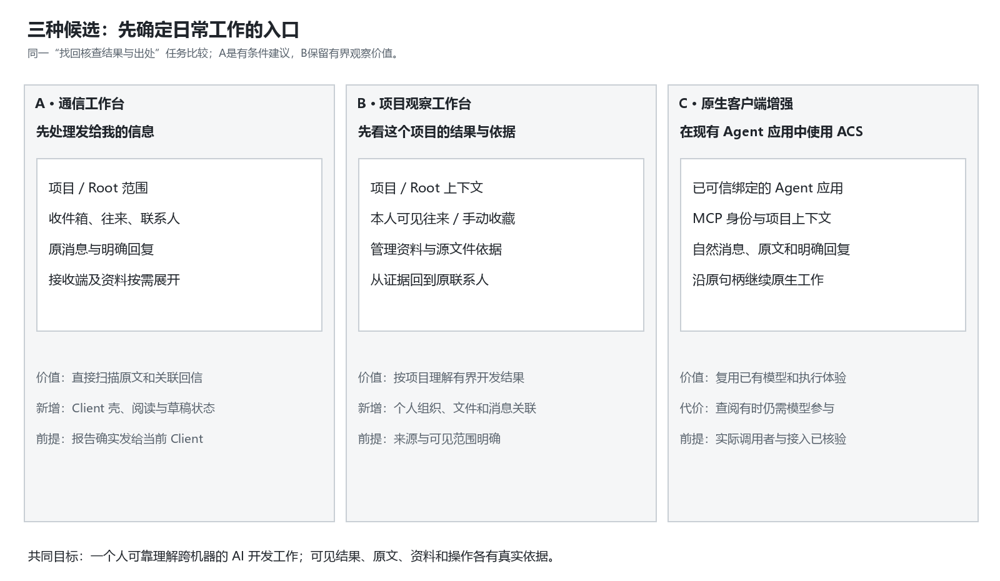
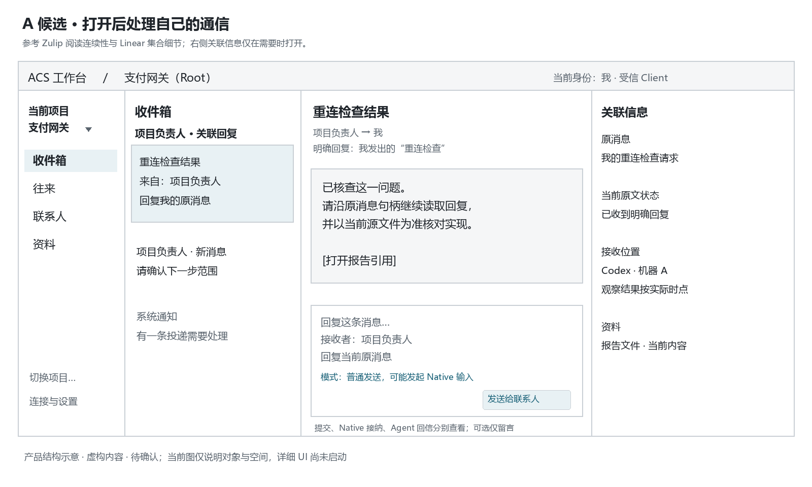
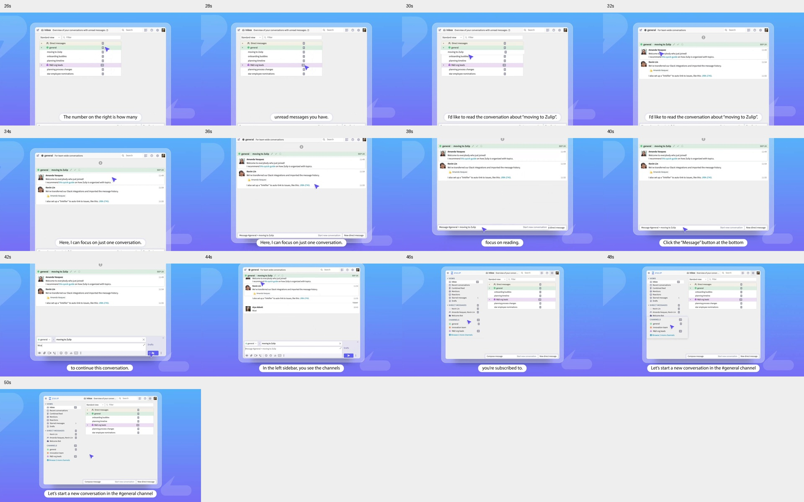
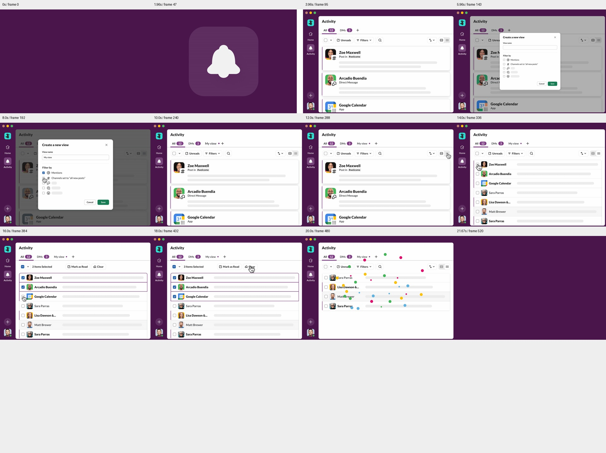
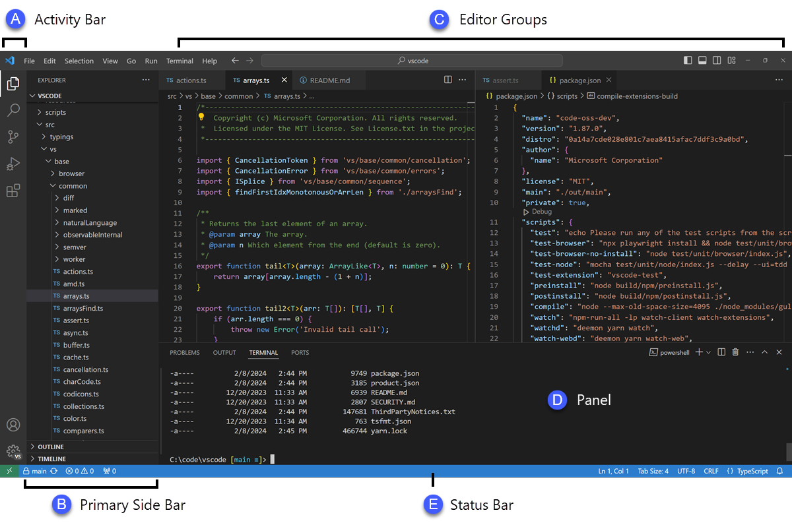
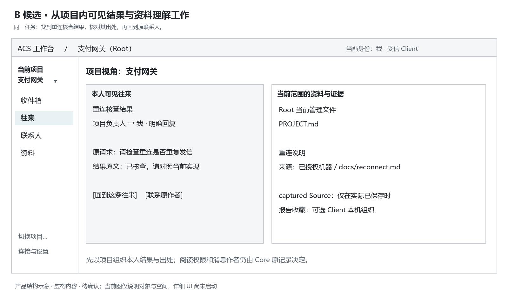
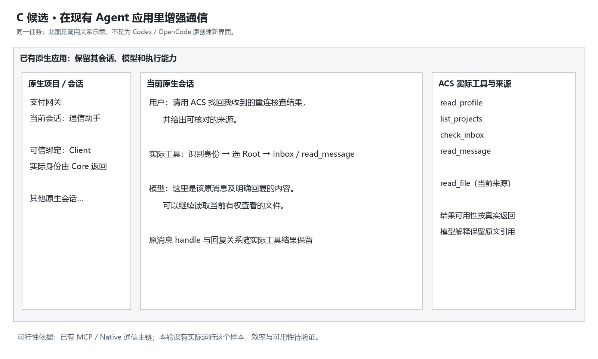
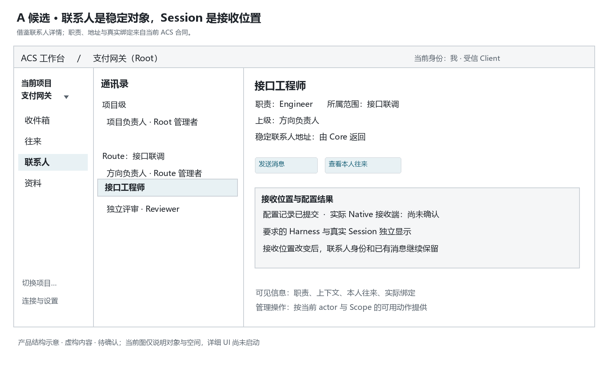
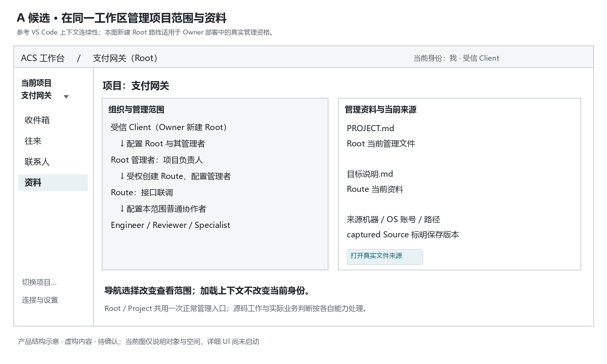
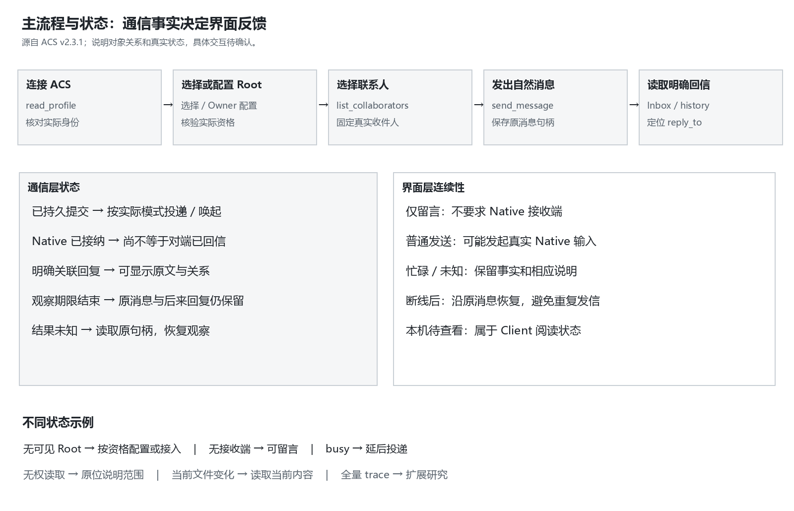

# ACS Client 产品形态复核与目标方案（历史归档）

> **归档状态：已归档（2026-11-06）。**
> 归档范围覆盖本文全篇及配套研究素材。旧产品形态、UI确认、流程、Core缺口清单、确认顺序与P3／P4 Client计划均为历史记录。
> 下方原文中的“当前”“已确认”“最终确认”“应实施”“验收”和“下一阶段”保留原日期语境，不构成现行设计或开发约束。
> 现行决策见[ORCA优先采用：能力评估与路线决策](ORCA-FIRST.zh-CN.md)，完整归档范围见[历史资料清单](ORCA-FIRST.zh-CN.md#archive)。
> 事实证据可按原版本与观察范围重新评估；Core／Runtime独立现行合同继续按其自身权威解释。

---

**历史原文（保持当时表述）**

<!-- ORCA-ARCHIVE-PAYLOAD:BEGIN -->

| 属性 | 本轮范围 |
|---|---|
| 日期／状态 | 2026-11-05 · 产品定义与目标形态候选，待用户确认 |
| 源码基线 | `codex/core-cleanup@19d7881d49ee887315c54c5bc02e0cc424061376`；`pyproject.toml` 为 2.3.1 |
| 上游核对 | 2026-11-05 经 GitHub 只读接口核对：公开 main 同为 `19d7881`，最新 Release 为 [v2.3.1](https://github.com/D1ChangGeng/Agent-collaboration/releases/tag/v2.3.1)，发布于 2026-11-02；Release target 为 `684f306`，源码 HEAD 与发行／生产证据分别解释 |
| 审阅开始时工作树 | 分支领先 upstream 86 commits；README 两份有既有修改，`docs/client/` 等未跟踪。未提交、合并或部署本轮材料 |
| 历史输入 | UX 1.52、Flows 0.59，均截至 2026-10-13；历史“已确认”在本轮重新评估 |
| 交付性质 | 实现事实审计、35项决策复核、6产品视觉研究、目标形态与信息架构、文档重组及待确认清单 |
| 观察边界 | 本轮未运行真实 ACS／模型／部署测试。参考产品采用官方实图与录屏有序帧；亲自GUI操作受环境策略阻断 |

## 0. 先看结论与目标图

**当前采用研究：** [《ACS × Orca 工作台采用研究与改造边界》](WORKBENCH-ADOPTION.zh-CN.md)记录2026-11-06的完整工作台方向、源码采用与直接替代比较。本报告保留11月5日的ACS事实与历史决策复核；[通讯与关联阅读研究](COMMUNICATION-EXPERIENCE.zh-CN.md)继续作为工作台内往来内容的专项候选。具体采用范围与UI均待用户确认。

**建议将首个独立 ACS Client 定义为“个人 Agent 通信工作台”：用户在自己的项目／Root 范围内，联系稳定 Agent、阅读本人参与的消息与明确回复、理解接收位置、管理受权组织配置，并打开有真实来源的资料。**

原始目标仍是“一个人方便、可靠地理解和管理跨机器的 AI 开发工作”。当前可行的有界观察包括本人可见的报告往来、受权管理资料、源文件／保存版本和来源时点。A把通信作为第一入口，B把这些结果和依据按项目组织，两者都可以保留观察价值；完整原生轨迹与团队私信总览则有不同的数据与权限条件，需要单列研究。核心能力决定可行边界，不能代替用户价值判断。

本轮建议有两个尚需确认的层次：**是否值得形成独立工作台，而非主要增强现有 Agent 应用；独立工作台以通信还是项目组织为第一入口。** 下文给出推荐 A 及同粒度替代 B、C，所有空间和首页均为候选。

推荐 A 的一幅完整工作区示意如下。图中文字与记录均为虚构样例，展示的是产品对象和空间关系，不是现有桌面应用，也不是下一阶段的控件或视觉规范。

**阅读顺序**：§1核实当前 ACS → §2复核历史取舍 → §3查看研究证据 → §4–6审阅形态、对象和主流程 → §7–9审阅能力、文档和未决事项。

## 1. 最新 ACS：哪些事实真正改变产品设计

本报告的新建／配置Root路线以Owner部署及实际管理资格为条件：受信Client可建立Root，Root manager可配置自己的既有Root；Shared Client不能仅凭Client身份调用该Owner入口。选择已有Root与其他授权操作仍按其实际资格提供。

判断优先使用当前公开合同、关闭式工具 schema、实现和资格记录。源码存在、测试场景、历史实机通过和当前安装可用分别成立。本轮只对公开文件静态核对；README 的当前工作稿不冒称该 HEAD 已提交文本。

| 事实ID | 当前可核实事实 | 产品含义 | 来源 |
|---|---|---|---|
| C01 | Runtime 版本2.3.1；wheel为Python runtime／runtime_deployment，提供Runtime／project／receiver console | 现有 trusted Client 是协议身份，桌面产品壳仍需建设 | [pyproject](../../pyproject.toml)、[支持记录](../runtime/COMMUNICATION-STATUS.md) |
| C02 | Project为通信隔离键，Root为管理责任及当前文件来源，二者现有存储一对一 | 用户侧用一个项目／Root管理入口；不再组织两个独立生命周期 | [Root管理](../runtime/ROOT-MANAGEMENT.md)、[root_management](../../runtime/root_management.py) |
| C03 | trusted Client无固定Slot或Native Session；`read_profile.actor`来自真实可信绑定，加载上下文不改变身份 | Client不是一个伪造的Root Agent；选择Root只改变查看范围 | [Root管理](../runtime/ROOT-MANAGEMENT.md)、[profile实现](../../runtime/project_service.py) |
| C04 | Client、Root manager、Route manager有明确管理边界，普通协作者职责不增加第四管理层 | 组织／配置动作按当前身份和Scope出现；不能根据角色名或Profile猜权限 | [Root管理](../runtime/ROOT-MANAGEMENT.md)、[权限](../../runtime/communication_permissions.py) |
| C05 | AgentSlot保留稳定地址及作者身份，实际Native接收位置可替换 | 联系人是稳定主对象；Session信息属于接收能力及可选原生继续 | [通信合同](../runtime/COMMUNICATION.md)、[communication](../../runtime/communication.py) |
| C06 | `send_message`是自然非空文本；默认invoke+async，message_only可只持久留言 | 从Client联系Agent可以成为主流程；发送可能发起真实Native输入，应在操作点表达 | [工具schema](../../runtime/communication_tools.py)、[通信合同](../runtime/COMMUNICATION.md) |
| C07 | 明确reply仍是普通send；to与原对端匹配，reply_to建立准确关系；Native final／ACK不能替代 | UI分别呈现提交、Native接纳、明确回复；回信不等于业务验收 | [communication](../../runtime/communication.py)、[retirement回归](../../runtime_tests/test_communication_retirement.py) |
| C08 | Inbox／历史读取不消费；历史可按本人incoming/outgoing及peer查询，保持提交顺序游标 | 可形成可靠阅读与恢复；本机已读／待关注／隐藏是Client新状态 | [communication](../../runtime/communication.py)、[工具schema](../../runtime/communication_tools.py) |
| C09 | 私信仅参与者可读；list_activity也只含受权配置事件与本人通信事件 | 管理者不能看到所有成员私信；全项目开发时间线没有自动成立基础 | [资源投影](../../runtime/project_resources.py)、[retirement测试](../../runtime_tests/test_communication_retirement.py) |
| C10 | wait_for_response沿原句柄观察明确回复；超时结束观察，不撤销通信 | 重连后找回原请求和后来回信；不能把超时变成自动重新发任务 | [通信合同](../runtime/COMMUNICATION.md)、[communication](../../runtime/communication.py) |
| C11 | `list_harnesses`当前只读观察注册端点与Session快照；unknown不等于idle，不prepare／invoke | 旧ED26“该列表可能准备环境”是旧版本事实，当前需重新分类，不能照搬旧差额 | [communication: list_harnesses](../../runtime/communication.py)、[Root边界](../runtime/ROOT-MANAGEMENT.md) |
| C12 | 默认通信目录／Domain已退出Work、Review、Watcher、task Attempt／结果投影；旧数据按archive保留 | 删除以旧Task/验收域为前提的当前要求，保留历史材料 | [采用及历史](../runtime/COMMUNICATION.md)、[退役回归](../../runtime_tests/test_communication_retirement.py) |
| C13 | Native正常主链是一条text input，按实际idle admission；公开目录无全量trace、steer或统一审批控制 | ACS工作台不自动获得原生Agent应用的完整执行能力；深度观察需单独产品／适配研究 | [Native投递](../../runtime/native_delivery.py)、[Codex Driver](../../runtime/codex_driver.py)、[OpenCode Driver](../../runtime/opencode_driver.py) |
| C14 | 管理文档与机器文件读实际OS/account；current文件与captured Source版本不同 | 文件视图标明来源和版本类型；不宣称任意历史版本或会话使用关系 | [机器文件](../runtime/MACHINE-FILESYSTEM.md)、[Root跨主机文件](../runtime/ROOT-MANAGEMENT.md) |
| C15 | 配置提交与真实Native准备分开；部分更新、可选team_revision及字段条件均有真实语义 | 保存成功、准备成功、Session观测各自反馈；失败留编辑并从原配置读回 | [当前工具schema](../../runtime/communication_tools.py)、[管理实现](../../runtime/communication_management.py) |
| C16 | 当前有真实跨Harness／角色／生产验收报告，但绑定具体版本、主机及模式 | 可支持有界可行性判断；不据此称本轮已验证所有平台或现有用户环境 | [支持记录](../runtime/COMMUNICATION-STATUS.md)、[生产验收](../../integration_evidence/acs-client-role-production-20261102/REPORT.md) |
| C17 | LICENSE明确为Sustainable Use License 1.0，README也标示该许可 | “Core开源＋闭源Client”不能作为未经复核的商业前提；具体许可、分发及收费由对应权利人与商业决策明确 | [LICENSE](../../LICENSE) |
| C18 | 同一实际存储、Authority、Tenant、Project及Principal的有效trusted Client绑定可跨入口访问同一Client地址参与的历史；Slot和其他Principal是不同作者 | 桌面安装不自动新增或导入报告；先核实当前身份和旧消息参与者，不能按“同一用户／Web／Native”名称合并 | [Client地址与历史](../../runtime/communication.py)、[通信索引](../../runtime/communication_schema.sql) |

**当前材料中的冲突也需记录**：`TEAM-CONFIGURATION.md`仍含较早candidate的exact revision／deadline与任务术语；`MACHINE-FILESYSTEM.md`部分历史Work/Review叙述也不应恢复为当前产品对象。本轮以C02、C04、C12、C15对应当前合同和实现为准，并建议由各Runtime文档负责人另行纠正；不在产品研究中重写运行契约。

## 2. 历史设计决策复核：35项处置

UX指[历史页面与交互基线](UX-DESIGN.zh-CN.md)，Flows指[历史用户流程规划](USER-FLOWS.zh-CN.md)。处置是本轮专业建议，待用户确认；“删除／停止”针对当前产品要求，不物理删除原始证据。主处置一列避免同一内容同时被当作既定要求和未决研究。

| ID | 历史取舍与依据 | 主处置 | 本轮判断及后续归属 |
|---|---|---|---|
| D01 | 单用户跨机器／多项目的观察目标（UX1） | 调整 | 保留跨机器理解工作与结果的目标；本人报告／受权文件的有界观察可继续，通信和管理是候选主路径。C01–C09/C14 |
| D02 | Client Agent只读，用户配置／维护走独立授权路径（UX1；Flows1.1） | 调整 | 旧方案本已允许表单配置；需重新区分产品助理与可信Client协议身份，并把真实通信／组织管理纳入主体验。C03–C06 |
| D03 | 外部Agent自主推理、委派和评审（UX1） | 保留 | 业务判断继续在外部Agent；Core确定性通信。C06/C12/C13 |
| D04 | Project接入和Root建立各自管理（Flows2.29–32） | 合并 | 一个Root管理入口，Project作隔离键；资料关联与Git操作分开。C02 |
| D05 | Project/Root→Route长期组织（UX2/9/10） | 调整 | 保留真实组织边界，Route可作分组／过滤，不强制独立主页面。C02/C04 |
| D06 | 稳定Agent、职责与临时Session分离（UX2/11） | 保留 | 联系人／Scope／实际接收位置分别解释。C05 |
| D07 | 新聊天、Overview、Machine&H作为固定主导航（UX3/4） | 调整 | 不沿用为新壳；比较消息中心、项目组织与原生增强。C01/C06/C08 |
| D08 | 每个对象占全局tab，右侧再建资源tab（UX3.3/13） | 合并 | 保留对象身份和阅读连续性，按任务合并为工作区与按需详情，窗口粒度再测。R1/R4 |
| D09 | 自建Client模型Runtime、四类分析工具与材料账本（Flows2.37–43） | 删除／停止首版推进 | 作为独立模型产品再研究；首版通信可利用现有Agent，无需先自研生成平台。C01/C13 |
| D10 | 首版ACS托管模型＋BYOM（Flows2.44–47） | 删除／停止首版推进 | 模型连接、费用及取消是另一套产品；若证明独立付费价值，再明确纳入。C01/C17 |
| D11 | 首次强制商业ACS账号登录（UX3.1/FlowsF01） | 删除／停止前置 | 当前需真实Runtime信任与认证，商业账号不是Core既有必备项。C03/C17 |
| D12 | 强制环境→Overview→新聊天三步引导（Flows2.48） | 调整 | 从已有Root和可用对象进入；引导是否有用及默认页重验。C02/R1/R4 |
| D13 | 原生trace作为Agent普遍阅读入口的目标，仍须逐来源验证（UX11/12） | 重新研究 | 公共通信API不提供此承诺；先用消息与真实接收信息。C08/C13 |
| D14 | Reasoning/ToolCall单元及5项分组阈值（UX12） | 删除／停止当前细化 | 依赖未建立的观察产品；阈值不约束整体形态。C13 |
| D15 | Context全量子代理树（UX13.1） | 重新研究 | 原生子会话不是ACS团队；按Harness数据和授权验证。C05/C13 |
| D16 | 文档、知识、仓库文件阅读（UX13/FlowsF09） | 调整 | 保留当前管理资料和受权文件，出处及读取位置明确。C14 |
| D17 | 所有旧版本、会话使用文件及每次模型输入均可回溯（UX15/16） | 调整 | 只承诺已保存且可读取的版本／原文；模型输入账本随D09另议。C14 |
| D18 | Task/WorkItem/Review/acceptance主对象（UX2/14/15） | 删除／停止推进 | 当前正常业务域已退休；工程任务和接受决定留外部。C12 |
| D19 | Project/Route按Task及report_progress组成进展线（UX14） | 合并 | 原文和关联价值合入本人通信／报告；不为旧UI新建任务投影。C07–C09 |
| D20 | 原生响应可据可靠关联入协作链，无需另发send_message（UX14.1） | 删除／停止推进 | 当前等待只由明确关联reply满足；原生响应继续保留其原生观察含义。C07 |
| D21 | 固定工作/阻塞/完成指标和48字预览（UX8） | 调整 | 指标仅从明确字段推导；阅读标记和摘要是Client投影，细节重验。C08/C09 |
| D22 | 点击Agent先进入Session目录（UX9–11） | 调整 | 优先联系人往来与真实职责；Session作为接收位置和可选原生继续。C05/C13 |
| D23 | 完整Machine&H资产管理常驻主导航（UX3/Flows2.10–13） | 合并 | 将相关信息放到联系人接收端和连接设置；机器资产台另证价值。C05/C11 |
| D24 | Core统一改所有Harness默认provider/model/effort（Flows2.14–16） | 重新研究 | 接收端沿用原生用户环境，不等于已有统一默认模型编辑能力。C13/C15 |
| D25 | 默认授予整个Harness所有历史读取（Flows2.26） | 删除／停止默认 | 通信接收与全量轨迹读取是不同目的，按具体观察能力另授权。C05/C13 |
| D26 | 自动完整Agent↔历史Session索引（Flows2.33–36） | 调整 | 保留真实绑定与稳定地址，不沿退役WorkItem绑定构建必需前提。C05/C11/C12 |
| D27 | 跨设备安装、网页／外部Agent接入及平台覆盖（Flows2.18–24/F06/8.3） | 调整 | 保留真实连接能力与回读；网页/外部Agent、首发平台、多Core并发分别研究，2–3点击目标需明确前提实测。C03/C16 |
| D28 | Client安装任意第三方Harness并接入全部观察服务（Flows2.28） | 删除／停止首版推进 | 先复用既有安装与连接，第三方生命周期管理另资格化。C01/C13 |
| D29 | 项目接入同卡涵盖既有目录、新建、可选Git初始化和克隆（FlowsF07） | 调整 | Root配置和当前资料关联是产品主对象；代码工作走独立流程。C02/C14 |
| D30 | FIFO模型队列、下一modelstep注入、停止生成（UX5–7） | 删除／停止当前规则推进 | 不等同ACS Inbox/投递/等待；若另建生成器再设计。C06/C10/C13 |
| D31 | 默认新聊天、恢复全部tabs和模型运行（Flows2.49） | 调整 | 以原消息、原回复关系恢复通信；本机草稿与阅读状态按价值保留，默认页待确认。C08/C10/R4 |
| D32 | 通用流程包办迁移/撤销/卸载/回滚（FlowsF15/16/19） | 调整 | 保留结果未知先回读；安装、信任、Native停止、物理删除各自验证。C16 |
| D33 | 开源Core/闭源Client与订阅托管作为既定商业路线（FlowsF17） | 重新研究 | 按实际LICENSE与用户价值重定收费边界，商业服务不成为当前壳前置。C17 |
| D34 | 跨层保留、导出、备份与模型材料记录统一管理规划（FlowsF18） | 调整 | 旧文已标部分导出和覆盖缺口；保留该原则，按当前各层记录重定实际范围。C08/C14 |
| D35 | 状态、权限、配置与恢复准确分层（UX15/16） | 保留 | 当前身份、配置提交、Native接纳、明确回复和业务完成分别呈现。C03/C07/C11/C15 |

**本轮应退出当前推进清单的依赖链**：旧任务域、默认全量Harness观察、自研模型运行器作为前提、强制商业登录、以模型步注入为基础的队列。对应历史分析仍保留，不能据投入过讨论恢复其现行效力。

## 3. 外部产品研究及视觉证据

研究不是把相似界面拼成新壳。问题是：人如何从集合找回具体对象，查看上下文、形成回复、返回未完工作，以及哪些状态属于阅读、通知、执行或业务对象。

| R | 已实际查看的证据 | 观察所得关系 | 对ACS的设计判断与边界 |
|---|---|---|---|
| R1 Zulip | 官方116.52秒tour的有序帧，另有channel/topic关系图 | 26–50秒从Inbox进入话题、展开输入、回到集合；位置与收件目标持续可见 | 采用集合→往来→原文的连续性；Route不是公共频道，也不继承其自动已读。 |
| R2 Slack | 官方21.79秒Activity GIF的有序帧及thread帮助图 | 视图创建、密度变化、选择、Mark as Read/Clear各是不同动作 | 同一消息可由不同集合进入；Client阅读／清除不能修改Core原消息或伪称已回复。 |
| R3 Linear | Inbox局部官方图；Inbox行为文档 | 通知行依附issue，通知类型与issue状态并存 | 借鉴事件行的可解释性；以issue为主模型不适合当前ACS。局部图不能证明全产品布局。 |
| R4 VS Code | 官方完整workbench、并排及浮窗示例图 | 稳定工作区容纳多个内容对象，局部视图和窗口有独立职责 | 领域层次不必层层独立页面；分屏／浮窗按真正同时工作需求提供。未实操拖动恢复。 |
| R5 OpenCode | v1官方新会话、活动会话、server modal图 | 会话、执行位置、原生步骤和diff同框但各有位置 | 原生执行可由原生界面承担；绿灯不证明ACS联系端空闲。仅为v1实图，未声称最新v2。 |
| R6 Codex | 2026-11-05取得的官方Windows／basic图 | 项目、并行thread、原生review及Open/Hand off相邻 | 借上下文持续性，不把thread当Slot或重建完整执行工具；图片文件名日期不是build证明。 |

完整来源、原图、素材版本局限和逐帧观察见[研究附件](review-20261105/research/RESEARCH-NOTES.md)。代表性原始来源：[Zulip入门与tour](https://zulip.com/help/getting-started-with-zulip)、[Slack Activity](https://slack.com/help/articles/19693583638803-Get-your-work-done-from-the-Activity-view)、[Linear Inbox](https://linear.app/docs/inbox)、[VS Code UI](https://code.visualstudio.com/docs/editing/getting-started/userinterface)、[OpenCode v1 Web](https://opencode.ai/docs/web/)、[Codex项目与聊天](https://learn.chatgpt.com/docs/projects)。

**研究实际边界**：亲自GUI交互因浏览器／桌面URL策略受限而未完成。已查看6种官方界面图及两种录屏的时间采样，证据支持所见对象关系、状态和变化顺序；自然速度的连续性、真实延迟、键盘、窄窗和失败恢复仍待验证。参考产品图与ACS候选结构图分别标注其来源和作用。

## 4. 三个目标形态候选与建议

| 判断维度 | A 通信工作台 | B 项目观察工作台 | C 原生客户端增强 |
|---|---|---|---|
| 第一个有价值动作 | 查看给我的信息／联系人发起请求 | 理解Root组织、资料及已有通信 | 在已有Agent应用中用ACS联系人和消息工具 |
| 主要对象 | 稳定联系人、原消息、明确reply | Root/Route、本人可见往来、源文件／版本证据 | 原生chat＋MCP动作／必要薄管理视图 |
| 与当前核心贴合 | 高：直接复用主链 | 中高：配置／资料可行，开发总进度仍无来源 | 高：已有真实MCP与Native链 |
| 主要新增价值 | 无需消耗模型去查询历史，直接读、找回、管理 | 在项目内连起本人报告往来、管理资料与源码出处，不依赖全trace | 最大复用现成模型和执行体验 |
| 主要成本 | 客户端壳、连接、阅读标记／草稿、本机恢复 | 项目页容易再次扩成大量概览 | 仍分散在原生应用，跨项目查看有时需要询问 |
| 适用条件 | 人频繁查看报告、发指示、跟进多条往来 | 主要问题是“这个项目有哪些可见结果和资料依据” | 独立Client价值尚未证明，优先验证Core协作 |
| 本轮建议 | 推荐作为独立Client的首个形态候选 | 作为A内的项目／联系人组织视图，保留独立首页选择 | 保留为基准与配套入口，不能假设一定要替换它 |

**A的供给前提**：只有当前Client实际参与或被明确发给它的报告，才能直接进入本人原文视图。团队Agent之间的报告不自动出现。没有本人报告时，可以联系管理者取得一份新报告，该发送可能invoke并消耗原生模型；一份报告也只是其作者的表达及证据。尚无本轮真实样本证明这种报告流量足够支撑首页，Q10必须补匿名往来。同一可信Client身份可以跨Web／桌面入口续读自身通信；Native Slot即使与其Principal相同仍是不同地址，不能自动汇入。若实际工作大多是Slot之间私信，A/B可能缺少直接可读的结果，C仍是可用基准；独立工作台是否值得建设须先验证，不能为填充首页强造汇报。

**为什么暂推荐A**：当前最可验证且原生应用仍不易统一呈现的是“通信和组织的持久视角”。原文与精确回复可以直接读取，联系人不随Session更换；人类不必每次向管理Agent询问。A同时允许从Root侧看组织（B的价值），保留在原生应用执行（C的优势）。这是设计判断，尚需使用频率和代表性操作验证。

若用户需要查看团队内部协作而其消息并未发给当前Client，必须先明确新的受权审阅目的、参与者可见性和治理合同；现有管理资格不能作为代读接口。这个问题属于产品与Core边界决定，不能仅靠UI聚合解决。

若用户主要想要的是完整执行监控，A只能满足其中的通信和受权资料部分。此时应选择明确的观察产品立项和Harness适配边界，而不能用A的截图宣称解决了全部AI开发观察。

### 同一用户任务下的完整比较

任务：“找回支付网关的重连核查结果，核对出处，必要时继续问原联系人。”

| 路线 | 操作路径 | 模型与来源 | 主要取舍 |
|---|---|---|---|
| A | 当前Root收件箱／往来 → 选原请求或reply → 原文与出处 → 回复原对端 | UI直接读当前Core原文；新指示可能invoke | 最短通信路径，项目材料是辅助上下文 |
| B | 当前Root项目工作区 → 本人往来／手动保存的结果 → 旁边对照资料 → 回原联系人 | 同样可直接读取，收藏／组织是Client新增，不虚构Core报告类型 | 更贴近项目观察，但收藏、分类与资料关联要保持来源 |
| C | 在已可信绑定的原生Agent会话提出读取请求 → 实际ACS工具取本人原文 → Agent呈现引用 → 继续原生会话 | 复用已有模型，读取与解释仍有其上下文／模型成本 | 无需先建完整新壳，跨应用组织与直接扫读较弱 |

B与C均需比较回到原往来的路径：B在资料旁保留所选消息身份，C在原生会话中保留工具取得的原handle；返回时读取同一原文或当前可读来源。

B的完整项目内观察候选如下。这里的“本人往来”严格受参与者权限约束；如需“报告收藏”，由Client新增个人组织标记，不作为Core新业务事实。

C保留原生应用自己的界面和执行能力。下图只是其ACS通信关系示意，不伪称当前Codex/OpenCode已有新的ACS专属面板。

### 4.1 A的整体空间

- **连接／身份层**：明确当前ACS连接和真实Client actor；身份由可信绑定确定，查看范围切换不切换作者。
- **项目／Root范围层**：初次选择或配置一个Root；以后可进入最近使用范围。建议日常落到所选Root的收件箱；“默认首页”仍是Q02，不沿用旧新聊天默认。
- **稳定导航**：收件箱、往来、联系人、资料。Root/Route并非每层都占主导航或全局tab；Route优先作为联系人分组、上下文及过滤。
- **主工作面**：一个集合与选中内容，保留阅读位置、回复对象和草稿；具体双列／三列、密度与宽度以后验证。
- **按需上下文**：原消息、明确回复、参与者、接收信息与资料来源；右侧辅助区可收起，窄窗和浮窗行为不在此锁定。
- **连接与设置**：服务接入、真实身份和接收障碍可定位；完整机器资产及Harness默认模型编辑不作为日常主对象。

图中的“往来”是Client根据Root、本人参与者／peer和明确reply关系形成的视图，不新增Core Conversation/Channel/Topic或群聊权限。首版可读原消息与首条明确回复，更多相关历史按实际接口继续读取。

### 4.2 联系人与接收位置

联系人详情优先回答“这是谁、属于什么范围、我和它说过什么”。接收位置回答“目前如何收到Native输入、状态由何时的什么观测证明”。Stable Slot、所需Harness、已提交配置、真实Session和当前idle/busy/unknown分别表达。打开联系人不先要求用户挑一个临时Session。

原生继续入口只有在具体应用、路径和Session关联已经验证时才提供；通用deep link／打开任意远端Native窗口目前没有统一公开接口。基础版本可以展示可复制的真实接收信息与必要的连接修复入口，不能绘一个按钮就宣称已经可用。

### 4.3 项目组织与资料

项目配置面复用一个Root入口，展示当前管理者、Route及可见成员。配置动作按当前actor和服务器实际资格出现；Owner部署中的受信Client建立／配置Root与管理者，Root manager配置自己的Root；受权Client／Root manager建立Route并配置其管理者，Route manager只配置本Scope普通协作者。示意层级是管理边界，不是要求用户逐层打开四张页面。

资料从当前Root/Route的管理文件与授权文件来源打开，标清机器／OS账号／路径／当前内容。Captured Source另标其保存版本。消息中的文件引用是指向，不保证对端必有该源权限；图片附件、通用文件上传和任意旧版回读不当作现有message文本能力。

### 4.4 来源分类：事实、借鉴、ACS调整和未决

| 设计点 | 分类 | 依据／后续动作 |
|---|---|---|
| 真实Client身份、Root、Route、Slot、消息与reply | Core事实 | C02–C10；界面必须忠实表达 |
| 集合→详情→返回、稳定上下文、按需辅助区 | 成熟经验 | R1/R2/R4实际所见关系；具体像素与行为仍需验证 |
| 将Route用于过滤、把接收端放在联系人详情 | ACS调整 | 对象层次与参与者权限约束；需要代表性使用比较 |
| 原消息与明确回复并列，技术投递在辅助信息 | ACS调整＋Core事实 | C07–C10；不能把收到回复画成任务完成 |
| 阅读标记、草稿、收藏、布局恢复 | Client新增 | 非当前Core既有业务状态；存储与跨设备策略待Q06 |
| 跨Root统一收件箱、原生打开、完整trace | 未决扩展 | Q03/Q05/Q07；不能作为当前主图已经实现的能力 |
| 双/三列比例、主题／品牌、全部控件和动效 | 后续设计 | 本轮草图只确定关系；待用户确认整体形态后展开 |

## 5. 信息架构与对象关系

| 层 | 对象 | 用户看到的表达 | 权威与范围 |
|---|---|---|---|
| 接入 | ACS连接、可信调用者 | 当前连接／身份／可访问项目 | 实际信任配置、read_profile、当前授权 |
| 管理 | Root（与Project namespace一对一）、Route | 项目及其长期方向 | Core配置／当前管理资料；一次正常Root管理入口 |
| 人员 | AgentSlot／Client地址、角色与上级 | 联系人、职责、本人、所属范围 | Core通讯录与可信绑定；显示名不是地址 |
| 通信 | Message、explicit reply、Inbox/history | 给我的来信、本人往来、原消息与关联回复 | Core持久事实，私信参与者可见 |
| 接收 | Node／Runtime／Endpoint／NativeSession | 联系人的实际接收位置和观察状态 | 实际Adapter/Node记录；配置要求不能冒充观测 |
| 资料 | current管理文件／机器文件、captured Source | 可读资料、当前来源／保存版本 | 文件提供方及既有授权，不是消息中的新权限 |
| 本机使用 | 阅读位置、待查看、草稿、窗口布局 | 找回未完工作 | Client新增状态，保留／同步政策另定 |

同一Root里的成员通信不自动成为全体可读频道。“我的Inbox”与团队管理目录是不同投影；技术通知也独立于对端Agent文字。跨Root聚合需要逐Root取得授权数据、保存独立游标和时点；不同Authority的commit序号不能拼成一个原子全局顺序。

桌面空间建议：以一个主要Root上下文的窗口起步，列表／消息／资料按需打开；只有确需并行比较的消息或文件才考虑独立窗口。跨Root多窗口、恢复、拖放和中文窄窗均为研究验证题，当前不把“所有对象全部tab化”继承为必要条件。

## 6. 典型完整使用过程与状态

### J1 已有ACS，第一次打开工作台

从本机可信配置发现或手动指定实际Runtime连接 → 核对服务身份与`read_profile.actor` → 列出可访问Root → 进入一个Root的本人收件箱／联系人。无Root且当前为Owner部署中的受信Client时，使用`configure_root`建立通信范围，并可关联现有管理文件、配置Root管理者。无联系人／无来信是真实空态，不伪造开发数据。其他身份按其实际资格接入已有Root或联系管理者，不静默提权。取消连接保留普通输入；凭据更新走实际信任机制，不要求先注册商业账户。

### J2 联系Root管理者并得到可回读报告

已有本人报告时可直接读取；没有时，通讯录选管理者 → 输入自然目标／资料指向 → 核对收件人及本次发送模式 → `send_message`持久提交并保留句柄 → 显示实际投递／Native状态 → 从Inbox/历史取得对端显式reply → 打开原消息和第一条明确回复，必要时继续查看往来或受权文件。报告是Agent原文和其证据，不能自动提升为Core验收事实。

“仅留言”对应message_only，不要求立即有Native接收端。普通发送按当前策略可能invoke。最终文案、默认模式及首次费用／启动效果说明为Q04；不能沿用旧自研模型的“下一modelstep直接注入”规则。

### J3 临时断线或等待结束后继续

保留原消息／Client请求身份 → 恢复同一可信连接与当前身份范围 → 读取原handle、Inbox或历史 → 看见晚到明确回复及技术状态。等待结束不撤回消息；结果未知先读回，不自动重发同样目标。用户若真要发一个新的相同请求，以新消息明确提交。页面关闭和远端Agent工作分别处理。

### J4 配置Root、Route与接收信息

Client选择或建立Root → 核对当前管理者与动作资格 → 用实际配置入口改指定字段 → 展示已提交设置与接收准备结果 → 受权Client／Root manager建立Route并配置Route manager；Route manager配置自己Scope内的普通协作者 → 联系人详情显示真实Session或未知／需处理。修复只针对实际缺口；保存失败保留编辑，版本冲突解释字段，不盲目替换条件或重写整支团队。

### J5 查看管理文件与引用

从Root/Route资料或消息引用进入 → 核对来源机器／账号／路径及当前／captured类型 → 有界读取并保持出处 → 返回原消息、联系人及阅读位置。当前文件改变后重新读取并显示新时点；原保存版本不可取得时明确缺口。读取引用没有授予对端或当前用户额外权限。

### J6 同时处理两个Root

在选择器明确切换Root → 加载该范围的联系人与本人历史 → 保存各自阅读／草稿 → 返回原范围时用稳定对象与原消息定位。新视图不改变真实Client身份。若要并排两个Root，另开窗口还是局部分屏由Q08及实际体验验证；首版不默认全局汇总所有事件。

| 关键状态 | 页面表现与可继续动作 | 事实来源 |
|---|---|---|
| 无Root／无联系人／无消息 | 对应空态与真实配置／新消息入口 | 当前目录，不把未读完分页当确空 |
| 配置保存，准备失败 | 保留提交事实，接收区显示原因与修复 | 配置与实际Node返回分别显示 |
| receiver unknown/busy | 保留消息／等待状态，解释Native准入，允许受权留言 | 真实观察，unknown不当idle |
| Native已接纳，尚无reply | 显示投递事实和仍可继续观察的原消息 | ACK与明确reply分开 |
| 当前用户无权读取 | 当前对象局部说明，其他可见资料保留 | Core实时授权，隐藏私信不从缓存补出 |
| 长正文／部分页 | 说明已取得范围并可继续读取 | 字节预算和稳定游标，原文不二创 |
| Core或来源断连 | 保留本机编辑与已允许查看的资料，恢复后读原handle | 当前权限和可得结果；离线保留政策Q06 |

## 7. 能力对应：薄客户端需要建设什么

| 产品行为 | 可复用的Core面 | Client新增／需要研究 |
|---|---|---|
| 接入并识别本人 | read_profile、既有可信stdio/OAuth绑定 | 连接壳、凭据接续；商业登录不作为前置 |
| 选择／建立Root | list_projects、load_project；Owner管理资格下的configure_root | 用户语言、表单、来源与结果分层 |
| 管理Route／团队 | create_route/update_route/configure_team、当前资格 | 允许动作投影、字段条件、冲突与保存反馈 |
| 查联系人与本人往来 | list_collaborators、list_messages | 集合/peer视图、局部查找、稳定阅读位置 |
| 发消息、读reply、继续等待 | send/read/check_inbox/wait_for_response | 原文编辑、发送mode、句柄持久、未知恢复 |
| 查看接收信息 | read-only list_harnesses、list_connections | 把登记／观测／准备区别转成易懂状态 |
| 当前管理资料与源文件 | load_project/read_file/filesystem_context等 | 来源选择、只读呈现、不同文件来源隔离 |
| 本机未读／收藏／草稿／布局 | 无同名业务事实 | 新增Client状态；不能改Core原消息语义 |
| 新消息观察 | 有界history游标、Inbox查询和通知 | 可先有界轮询；前端专用push协议另评估，不为UI先扩整个核心 |
| 跨Root全局Inbox | 各Root授权与独立目录 | 聚合、游标、新鲜度及错误隔离；Q03 |
| 全Native trace／审批／steer／统一cancel | 当前无统一公开面 | 独立Harness适配与产品需求；Q07 |
| 托管模型与订阅 | 当前无该产品服务实现 | 独立商业／模型服务；Q09 |

旧CG-01–CG-14是历史设计的差额台账，不能原样当作最新版本的开发任务。应在目标形态确认后按上述行为重新建最小能力清单：例如当前list_harnesses已经只读、list_messages已存在、Work域已退休，旧差额有的已解决、有的应退出、有的仍需独立研究。

## 8. 文档体系调整方案

### 8.1 本轮实际整理

- 新增本报告，作为唯一当前复核入口，集中承载六项交付；研究素材与结构图是它的附件，HTML为同一内容的阅读导出。
- 旧UX和Flows保留正文及旧证据，在文首标明历史适用范围并链接本报告，避免继续以旧“已确认”自动驱动新版。旧Flows有5个已退出当前树的源码路径（11处引用），按各条原commit回看；不把历史链接替换成语义不同的现行实现。
- README中Client入口改为本报告，并将旧两份归为历史设计资料；其他既有README修改保留。
- 当前没有建立一份未经批准的新正式UX基线、实现计划或组件规范；本轮候选等待用户确认。

### 8.2 用户确认形态后的最小文档大纲

| 文档职责 | 建议承载 | 旧材料处理 |
|---|---|---|
| 当前产品定义 | 一份产品定位／对象／信息架构／核心场景／能力边界文档 | 从本报告已确认项提炼，不复制全部研究日志 |
| 详细UX与验收 | 一份完整流程＋页面区域＋状态＋交互＋验收基线 | 将旧UX/Flows中仍有效内容合并重写；不再平行维护两份相同状态清单 |
| 研究与历史 | 复核报告、官方素材、旧UX/Flows | 可移入archive并修复链接；保留原日期／版本和测量证据，不当作现行要求 |
| Core运行契约 | docs/runtime当前合同／schema／支持记录 | 保持其权威，纠正旧candidate冲突由对应负责人另行处理 |

实际文件名、旧文件搬迁和合并执行，在产品方向确认后决定。旧模型平台／任务域分析可作为背景阅读，停止把它们自动转成新版必需功能；重复的状态索引随当前定义统一，不靠继续叠加多份设计地图解决。

## 9. 待确认决定与研究闭环

| Q | 需要用户或进一步研究作出的决定 | 本轮建议 | 必须补充的依据／影响 |
|---|---|---|---|
| Q01 | 首要价值是消息优先、有界项目观察优先，还是原生应用增强？ | A为有条件建议；保留B的本人报告／资料证据观察价值 | 用真实工作样本比较A/B/C，不能仅因Core提供通信就替用户决定目标 |
| Q02 | 首屏为当前Root的Inbox、联系人，还是Root概览？ | 有既有往来时Inbox，首次无来信时联系人/Root空态 | 新用户与回归用户各一次真实操作研究 |
| Q03 | 是否首版跨Root聚合，是否支持同时连接多个Core？ | 先明确单一可信连接内的Root切换；多Core独立研究 | 两者不同：Core切换须重新识别actor／权限；还需通知、逐Root游标及不同Authority测试 |
| Q04 | 默认发送与Native发起如何说明？ | 明确区分普通发送与仅留言；不隐含业务完成 | 真正busy/unknown/无端点/Native ACK后无reply的交互观察 |
| Q05 | 是否需要独立产品助理或复用现有Agent？ | 先复用已有Root/Agent | 只有证明额外分析价值后再定模型、账号、费用、操作权限 |
| Q06 | 阅读标记、草稿、布局保存及跨设备策略？ | 首先定义本机状态，服务端原文不变 | 数据位置、撤权、导出、恢复及跨设备使用研究 |
| Q07 | 多深的原生trace、子代理与原生打开？ | 不作为通信主流程先决；精确native信息优先 | 各Harness实际API、权限、保留、正确往返；不可从截图断言支持 |
| Q08 | Route、标签与窗口的最终空间粒度？ | Route先作组织/过滤，按需上下文 | 中文、窄窗、键盘、连续阅读和双Root并行的实际体验 |
| Q09 | 商业、分发许可与收费对象？ | 与产品价值一同重定，不强加托管模型／商业账号前置 | 实际许可及权利人决策、支持成本、服务范围与付费研究 |
| Q10 | 真实报告流量、身份与可操作研究环境？ | 先取匿名真实往来，核实是否为同一可信Client地址参与、报告频率与出处，再补关键操作episode | 当前GUI策略阻断；须验证收发身份、原文权限与A/B/C效率，不能以官方图或管理资格推定 |

### 进入下一阶段的条件

本报告的源码结论与历史复核可供逐项审阅；A/B/C是待确认产品方向。先确认Q01–Q05及实际可用范围，并补Q10所需的匿名真实消息供给样本，再决定下一轮产品形态的深入设计。Q06–Q10按会影响的范围补证据，任何高影响未决项保留责任与验证动作。

**本轮没有进入新Client的详细UI或产品实现。** 下一阶段由用户确认整体形态后启动，继续从真实用户情境、页面与对象关系、数据证据、职责及验收逐层推进。

## 10. 本轮材料与验证记录

- 源码静态核对：本地HEAD及公开main一致，最新Release标签经GitHub只读接口核对，合同／实现／测试按相应版本解释；本轮未调用真实ACS、未发消息、未产生模型费用。
- 历史审查：覆盖旧UX／Flows的定位、对象、导航、49个区域及19类流程的主要产品取舍，归并为35项决定；旧正文与证据保留。
- 外部研究：6产品实图、2种官方连续媒体有序帧；根代理实际查看关键图及相邻状态，亲自操作和自然速度播放未验证。
- 目标视觉：7张原创产品结构示意，已渲染为PNG供本轮审阅；不构建原生Client交互或宣称像素视觉已获批准。
- 视觉来源：真实产品用于对象／空间／交互参考，未把截图当已取得UI源代码；SVG/PNG结构图是用户明确要求的ACS特定关系表达。阅读HTML采用GitHub Markdown CSS（MIT），许可证随附件保存。HTML已做生成与内容检查，本轮浏览器渲染因同一GUI限制未实测；PNG结构图均已实际查看。
- 结构验证：检查新增本地链接、图像、决策ID、资料角色、主报告与导出一致性及改动范围；历史原文中的已退出源码路径另按原版本标记，这些检查不代替真实产品体验或业务验收。
