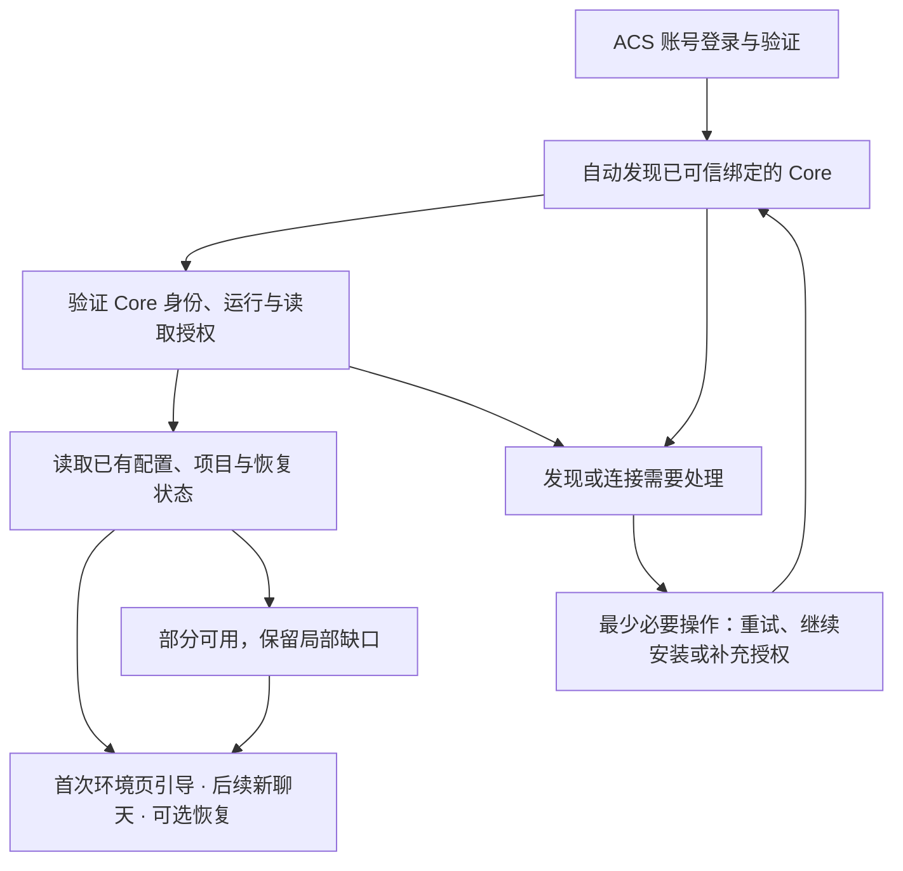

# ACS Client 用户流程与能力规划（历史归档）

> **归档状态：已归档（2026-11-06）。**
> 归档范围覆盖本文全篇及配套研究素材。旧产品形态、UI确认、流程、Core缺口清单、确认顺序与P3／P4 Client计划均为历史记录。
> 下方原文中的“当前”“已确认”“最终确认”“应实施”“验收”和“下一阶段”保留原日期语境，不构成现行设计或开发约束。
> 现行决策见[ORCA优先采用：能力评估与路线决策](ORCA-FIRST.zh-CN.md)，完整归档范围见[历史资料清单](ORCA-FIRST.zh-CN.md#archive)。
> 事实证据可按原版本与观察范围重新评估；Core／Runtime独立现行合同继续按其自身权威解释。

---

**历史原文（保持当时表述）**

<!-- ORCA-ARCHIVE-PAYLOAD:BEGIN -->

> **文档角色：历史设计记录（0.59，截至 2026-10-13）。**
> 2026-11-05 基于 ACS v2.3.1 的整体复核见 [产品形态复核与目标方案](PRODUCT-REVIEW.zh-CN.md)。
> 本文的“已确认”保留当时讨论语境；当前产品方向以本轮复核及用户后续确认为准。
> 文内部分源码路径已退出当前工作树，历史证据须按各条记录的原 commit 回看。

| 文档属性 | 值 |
|---|---|
| 版本 | 0.59 |
| 日期 | 2026-10-13（Asia/Tokyo） |
| 状态 | 按用户流程逐区域确认；§4 为 UX 流程确认地图，§8 维护剩余决策；分析工具合同已确认至 §2.42 |
| 既有静态证据基线 | `main` / `a56521d448bff13d069a63ea6631b93c22b58ba2`；EA01–ED23 仍按各条记录的版本与范围解释 |
| 本轮增量核对基线 | `codex/core-cleanup` / `03193767632daf5191eef8435cd32d4f5c4bc8a7`；机器状态与配置核对见 ED26，ED24–ED25 保留其原核对基线 |
| 适用范围 | 首次进入、环境接入、项目观察、Client 分析、日常维护、商业账户及退出恢复 |

既有证据中“同本文源码基线”沿用既有静态证据基线；本轮增量核对单列版本，具体测试与运行结论仍按各条记录的范围解释。

本文与 [ACS Client 页面与交互设计基线](UX-DESIGN.zh-CN.md) 配套使用。基线负责 sidebar、Overview、Agent 会话与 trace、composer、队列、资源标签和时间线的已确认规则；本文定义用户如何进入、完成、退出和恢复这些流程，以及需要补齐的配置界面与服务能力。

产品化方向以可开源的 ACS Core 为基础构建闭源 Client；具体许可、发布／打包边界及商业方案见 §8.3。

确认状态见下表；其余页面入口、操作流程、商业权益处理和具体服务契约为设计提案。源码中存在某个组件，只证明该组件的边界；产品入口、真实环境联通和完整用户流程分别验收。P3／P4 的发布范围与交付顺序另行确认，当前 Runtime Gate 的含义继续由 [Runtime adoption contract](../runtime/UPGRADE-CONTRACT.md) 定义。

本文维护一份产品确认记录：下表记录逐项确认，§1.7 定义 UX 推进方法与八维模板，§4 按用户起点索引页面和下一设计区域，§8 汇集剩余决策。实施分工、Core 缺口及证据分别见 §3、§6、§9；已确认页面规范由配套 UX 基线承载。

## 确认状态与使用方式

新增流程按区域、逐层确认。正文给出可复用的候选路径和能力证据；尚未确认的页面、默认行为和商业政策保持候选状态，实施时以确认后的条目为准。

| 产品状态 | 含义 | 下一步 |
|---|---|---|
| 已确认 | 用户已确定的职责、页面结构、行为或工具语义 | 按已定规则做技术设计、实现及验收 |
| 待深化 | 所属方向已确认，仍需确定局部控件、数值、子流程或详细合同 | 聚焦该子项继续逐层讨论；新增细化方案在接受前保持候选 |
| 待确认 | 完整产品选择、页面方案或流程尚为候选 | 先明确目标、边界及默认路径，再进入区域细化 |

一个模块可以同时含有三类子项。实现状态另用本文 §3.1 的 **已有且验证／已有待验证／需要扩展／需要新增**；每项验证绑定其版本、环境和证据。本文的产品确认状态不声明整条流程已开发或已通过真实环境验收。

| 确认项 | 当前依据与候选 | 状态 |
|---|---|---|
| 主体阅读 UX | sidebar、Overview、Agent 会话／trace、Context、composer／队列和时间线沿用 UX 基线 | 已确认 |
| 首次入口与正常接入 | 呈现 ACS 账号登录与验证页面；登录后自动发现、连接 Core 并读取已有配置，再进入工作区 | 已确认 |
| Core 安装的接入责任 | 安装流程准备可信的自动发现、身份校验与授权连接条件，让正常接入由系统完成 | 已确认；具体技术契约待细化 |
| 系统浏览器登录 | 桌面“登录 ACS”打开系统浏览器统一账号页，完成登录／注册／验证后返回 Client 并自动连接 Core | 已确认 |
| 桌面登录页与状态呈现 | 左侧登录区域、右半贴图／动态背景；点击登录后全屏依次呈现等待浏览器、验证账号、准备工作空间，完成后自动进入工作区 | 已确认 |
| 浏览器统一账号页 | 邮箱在上、密码在下，其后为登录／注册操作，底部 GitHub；Google 后续加入同一区域 | 已确认 |
| 注册与密码恢复的验证方式 | 新账号验证邮箱、忘记密码均使用邮箱验证码；日常登录使用邮箱与密码 | 已确认 |
| 注册与密码恢复路径 | 验证组件提供验证码输入、验证、重发／修改邮箱／返回；注册验证后创建账号并返回 Client，找回验证后设置密码并回登录页 | 已确认 |
| 认证参数与会话策略 | 验证码位数、有效期、重发限制、密码恢复后的旧会话失效范围 | 待细化 |
| 自动准备工作空间 | §2.8 的后台顺序、基础进入条件、部分可用与局部恢复 | 已确认 |
| Machine & Harness 入口与首次引导 | 常驻项位于 Overview 下方；首次工作区依次经过 Machine & Harness → Overview → 新聊天 | 已确认 |
| 日常启动 | 默认进入新聊天；上次页面和工作视角由用户选择恢复 | 已确认 |
| Machine & Harness 页面结构 | 主区直接展示机器矩形容器，Harness 以内部卡片呈现；每个容器持续展示其卡片内容 | 已确认 |
| 机器容器字段 | 机器名称、本机／远程、系统、ACS 接入状态、更多入口 | 已确认 |
| 机器容器状态与操作 | §2.11 的状态浮层、检查连接、详情与共享重命名 | 待确认，当前 UX 讨论区域；五个字段及容器结构已确认 |
| Harness 卡片单位 | 按同一机器上的独立接入环境分卡，临时运行实例和原生会话放在对应详情中 | 已确认 |
| Harness 卡片信息层级 | 主体展示接入状态和模型配置；查看详情打开较大卡片，承载版本、来源和必要信息 | 已确认 |
| Harness 主卡片 | 名称与图标、接入状态、实际模型配置和“查看详情”入口；配置按真实范围表达 | 已确认 |
| Harness 较大详情卡 | 居中浮层，上部模型配置、下部环境资料；按范围查看、刷新并关闭回原位置 | 已确认 |
| Harness 模型配置操作 | 用户可通过 Client → Core 修改 Harness 的模型、模型服务商和推理强度 | 已确认；首批可修改字段限定为这三项 |
| 配置控件与修改范围 | 服务商 → 模型 → 推理强度联动，首版修改当前接入环境的默认配置，展示实际影响范围 | 已确认 |
| 统一配置保存反馈 | 未保存成功的字段或关联组合保留编辑值，并显示就近的红色提示；成功部分按真实结果更新 | 已确认 |
| 保存操作与核实细节 | §2.16 的字段／组合结果、草稿与已提交计划隔离、结果查询及恢复 | 继续细化 |
| 新增环境入口与完成定位 | §2.17 的页面右上角常驻添加机器按钮、机器容器内接入 Harness 操作卡；机器接入后可继续检测添加 Harness，完成后自动滚动到对应位置 | 已确认；接入主路径见 §2.18–2.28，目标网页主操作和平台余项继续细化 |
| 机器接入操作预算 | 从“＋ 添加机器”到结果可见的完整正常路径以 2–3 次真实点击／确认为目标，跨端操作和系统提示计入 | 用户已明确目标；逐路径实施与验证 |
| 添加机器统一接入面 | §2.18 的同卡目标选择、两种方式、原位输入及一次计划提交 | 已确认；字段与平台细节逐层确定 |
| 两种接入方式 | 在目标机器上接入、通过 SSH 接入；按 §2.19 共用连续执行与恢复 | 方式、融合交互及自动推进已确认；实现与点击数待验证 |
| 目标侧材料与状态 | §2.20 的链接／命令、复制、真实状态与退出恢复，按操作预算组织主流程 | 内容、真实性及主流程组织已确认；具体协议与平台行为待验证 |
| 目标机器接入网页 | §2.21 的账号核验、接入上下文、组件证明与真实状态；当前主操作按阶段呈现 | 字段与真实性已确认；主操作融合待确认 |
| 目标组件准备与续接 | §2.22 的推荐计划、连续安装／启动与原流程恢复 | 连续执行规则已确认；具体安装器与权限界面继续细化 |
| SSH 目标与连接字段 | §2.23 的单目标框、本机认证复用、按需连接选项和原位补充信息 | 已确认；必要输入与状态交互见 §2.24，协议及平台适配待验证 |
| SSH 连接过程与必要输入 | §2.24 的目标摘要、真实阶段、首次信任／认证补充及取消恢复 | 已确认；协议、提示有效期和平台适配待验证 |
| Harness 发现结果与接入入口 | §2.25 的原位发现卡、按状态进入既有详情卡及读取范围计划 | 已确认；计划控件见 §2.26，范围选择器与原生适配继续细化 |
| Harness 首次默认读取范围 | 当前选定独立环境的全部会话与执行记录；预填后由“确认接入”提交对应观察授权，允许更改 | 用户已确认；实际权限与读取能力逐来源验证 |
| Harness 详情中的接入计划 | §2.26 的来源摘要、读取范围与更改、必要连接条件及一次提交 | 已确认；范围选择器与原生能力逐项验证 |
| 手动补充 Harness 来源 | §2.27 的所属机器、Harness 选择、自动查找与手动来源、安装分支 | 已确认；原生来源类型与安装细节继续验证 |
| 第三方 Harness 安装并接入 | §2.28 的同卡安装计划、推荐版本／位置／环境、连续执行与恢复 | 已确认；推荐版本、目标平台与原生安装能力待实施验证 |
| 项目接入入口与首屏 | §2.29 的 Overview 常驻添加入口、同卡机器／目录选择和自动身份识别 | 已确认；管理目录与变更计划交互见 §2.30，默认目录名及登记实现继续细化 |
| 项目识别后的接入计划 | §2.30 的项目名称、协作管理目录、逐文件变更与一次提交 | 已确认；具体目录命名、统一文件计划与登记接口待实施验证 |
| 新建项目表单与创建计划 | §2.31 的名称、父目录、最终路径、可选 Git 初始化与一次创建登记 | 已确认；具体命名、Git 参数及最小登记合同待实施验证 |
| 新项目 Git 默认策略 | 默认初始化本地 Git 仓库，用户可取消；首次提交和远程仓库分别处理 | 用户已确认 |
| 仓库地址接入与克隆计划 | §2.32 的机器、地址、目标目录、分支选择、条件化计划与连续接入 | 已确认；克隆适配、阶段授权与最小登记合同待实施验证 |
| 项目视图与自动会话归属 | §2.33 的真实项目结构、Core／项目侧 Agent 维护归属、Client 自动呈现与阅读路径 | 已确认；完整归属核验及索引能力待实施验证 |
| Agent 会话目录的排序与读取状态 | §2.34 的统一列表、时间排序、新内容提示、局部状态与阅读恢复 | 已确认；完整索引、分页和原生状态读取待实施验证 |
| Agent View 进入与读取恢复 | §2.35 的首次落点、引用定位、分区加载、历史／实时接续及退出恢复；状态融入标题图标、定位与刷新控件 | 已确认；观察接口、原生能力及恢复合同待实施验证 |
| Context 文件与子代理点击路径 | §2.36 的条目内容、文件版本阅读、直接子会话进入及父级返回 | 已确认；来源索引、原生关系及版本读取待实施验证 |
| 从观察发起 Client Agent 分析 | §2.37 的对象／选区入口、独立草稿、上下文检查、发送及引用返回 | 已确认；上下文与工具沿 §2.38 实施，内部输入记录沿 §2.39 实施 |
| 分析上下文与读取工具 | §2.38 的焦点、最小定位背景、按需取证、四类工具、读取预算与来源记录 | 已确认；具体字段、API 名称及模型配额待实施细化 |
| 一次询问的上下文包与模型输入 | §2.39 的输入受理版本、初始准备、读取记录和逐次模型输入映射 | 已确认；具体存储与接口实现待细化 |
| 定位焦点工具合同 | §2.40 的类型化引用、轻量字段、命名空间分组、定位状态与后续读取入口 | 已确认；接口名与具体 schema 随实施确定 |
| 发现资料工具合同 | §2.41 的范围检索、匹配依据、可读引用、查询覆盖与分页预算 | 已确认；接口名与具体 schema 随实施确定 |
| 读取证据工具合同 | §2.42 的原文范围、版本保障、来源覆盖、部分交付与续读 | 已确认；接口名与具体 schema 随实施确定 |
| Client Agent 模型来源 | 首版同时提供 ACS 托管模型和用户自带模型服务 | 用户已确认；服务范围、费用及具体接入方式继续细化 |
| Client Agent 模型选择入口 | §2.44 的 composer 入口、双来源浮层、选择和返回路径 | 已确认；实际目录、权益与模型可用性逐来源验证 |
| 添加自带模型服务 | §2.45 的服务选择、动态认证字段、连接保存、结果与返回 | 已确认；认证、目录与保存能力按接入方式验证 |
| 自带模型目录与手动添加 | §2.46 的连接内目录状态、模型 ID 表单、添加与选择返回 | 已确认；实际模型能力与请求结果分别验证 |
| 首次使用与可选验证生成 | §2.47 的正常发送、必要授权说明、测试入口及结果恢复 | 已确认；实际生成、停止与费用按来源证据验证 |
| 首次认知引导的推进与恢复 | §2.48 的页面内控件、稍后处理、完成与主动续接 | 已确认；持久进度与真实页面恢复待实施验证 |
| 日常工作视角与草稿恢复 | §2.49 的菜单入口、页面合并、草稿列表与当前状态恢复 | 已确认；真实数据与持久恢复能力待实施验证 |
| 追踪关系工具合同 | §2.43 的单跳关系、证据类别、目标引用、权限与覆盖分页 | 候选待确认，按 F13 具体场景继续深化 |
| 视觉细节 | 贴图／动效风格及异常操作的视觉细节继续细化 | 待确认 |
| 每步实施面与 Core 缺口 | 每个区域分别记录 Client、Client Runtime、配套账号服务、Core／安装器和 Harness 责任；Core 缺口在本文维护编号与证据 | 已确认 |
| 用户配置权限 | Harness 三项模型配置由用户通过独立配置授权提交，Client Agent 保持只读；其他安装与维护动作按所属流程细化 | 模型配置边界已确认；其他操作范围待确认 |
| 设置导航与组件 | 候选：一个配置工作区、五组内部导航；首次与恢复复用同一组件 | 待确认 |
| 支持平台、多 Core、商业与存储策略 | 见第 8.3 节；实际底层支持受第 9 节证据约束 | 待逐层确认 |

每轮从用户起始情境、目标与完成标准出发，补齐进入、完成、退出和恢复，再按区域逐层确定可见内容、控件、点击结果及下一层视图。所需数据、权限和来源能力与区域设计同步核对；据此明确 Client、Client Runtime、Core、Harness 及配套服务分工，记录 Core 缺口并定义验收。页面数量按流程复用关系确定。每个起始点按八维检查，原始要求与固定模板见 §1.7；区域确认后更新正文及状态，再进入下一层。

## 1. 流程共同约定

### 1.1 用户操作与 Agent 分析

Client 提供两种有独立权限的操作路径：

- **观察与分析**：页面和 Client Agent 读取获授权项目数据、引用原文、生成用户对话中的分析。沿用 UX 基线的只读边界。
- **用户配置与维护**：用户在配置表单中发起安装、连接、认证、登记、授权、升级或移除。受限配置服务执行已确认的动作、记录操作身份，并回读结果。

配置服务可以作为 Client Runtime 的独立模块；本机安装通过受限本地辅助进程执行，远端操作通过明确授权的管理通道执行，Core 仍负责其领域内的身份与命令校验。Client Agent 的工具集保持只读；它可以解释问题并打开带有上下文的配置入口。用户确认配置操作也不自动授权模型执行新的项目开发任务。

### 1.2 状态分层

| 信息 | 状态与可信来源 |
|---|---|
| 安装 | 未安装、已下载、已安装、残留／不完整；依据安装清单、文件和摘要回读 |
| 进程与网络 | 未启动、启动中、运行、不可达；依据目标主机进程与实际传输探测 |
| 身份与授权 | 未认证、待确认身份、已认证、过期、撤销；依据可信身份、证书及服务端授权校验 |
| 配置 | 未配置、部分配置、已配置、需要调整；依据实际对象与设置回读 |
| 数据 | 未检查、确空、部分、可读、不可读、不支持；依据具体读取范围与覆盖证据 |
| 产品能力 | 可用、受版本限制、受权限限制、受权益限制、待验证；各限制独立显示 |

用户能看到可理解的结论、影响对象、最后检查时间和下一步。详情中提供脱敏的版本、位置、范围及诊断依据。安装成功、HTTP 响应、商业账户登录、模型可用分别证明不同事项。

### 1.3 共用操作生命周期

所有有副作用的配置操作使用同一条路径：**准备 → 检查 → 确认变化 → 执行 → 回读验证 → 完成或保留可恢复状态**。

操作记录至少包含 operation ID、用户主体、目标身份与位置、原配置版本、计划摘要、幂等键、阶段、实际完成项、错误类别、恢复入口和可清理资源的归属。设置页与首次引导查看同一份操作记录。

- **跳过**：仅跳过可选项；标出因此尚不可用的能力，保存剩余步骤。
- **取消**：尚未开始时取消计划；执行中请求在可安全停止的阶段结束。界面显示实际结果与保留内容。
- **关闭界面**：关闭视图与停止操作分别提供。明确任务在本地进程、远端服务或后台继续运行的条件。
- **异常退出后重开**：按 operation ID 回读实际执行结果，再决定继续、重试或清理。无法确认的步骤显示“结果待确认”。
- **重试**：重试受影响且可重入的步骤；新参数形成新计划。结果未知的写入先读回，凭据变更后重新校验作用域。
- **清理**：按本次操作登记的资源清单选择清理范围。列出代码仓库、第三方 Harness、共享依赖和既有数据的归属，提供清楚的实际影响说明。

操作进度使用阶段列表、当前动作、实际已完成字节／数量、可用日志及失败定位。无法测量的阶段显示活动状态。Core 安装或升级的技术日志出现在维护详情中；项目“开发进展”仍遵循 Agent 原文规则。

### 1.4 权限与确认

| 操作 | 默认交互 |
|---|---|
| 查看状态、在用户选择范围内发现、重新读取 | 直接执行，保留检查范围与时间 |
| 修改显示名、保存 Client 偏好 | 明确保存并支持纠正，保持稳定对象身份 |
| 安装／启动、添加远端信任、新增机器／项目登记、改变数据访问范围 | 提交前展示位置、对象、数据流及权限变化，由用户明确发起 |
| 已授权的原生会话归属维护 | Core、项目侧 Agent 与原生适配按 F08 的证据及权限合同自动处理，Client 读取结果 |
| 产生模型费用、公开网络入口、扩大授权、升级重启 | 明确说明费用或中断／暴露范围，使用对应操作确认 |
| 删除数据、撤销正在使用的授权、移除共享组件、购买或取消订阅 | 展示影响清单与保留项，执行前确认；需要外部系统授权时进入其原生流程 |

同一已确认操作计划内的安全重试复用原授权；目标、权限、费用或影响范围变化时重新确认。敏感凭据使用安全输入与私有存储引用，诊断、对话、队列及普通导出均保存脱敏信息。

### 1.5 每步的实施面与缺口记录

每个区域的设计条目同时包含用户可见状态、进入／完成／退出／恢复行为、实施责任和数据来源。ACS Client 实现面细分为桌面页面、Client Runtime 和配套账号／商业服务；ACS Core 实现面包含领域授权、项目事实与 Core 安装接入契约。Harness 的原生能力单独标识。

Core 缺口统一记录在第 3.3 节，使用稳定编号。每项保留触发该需求的页面／流程、现有证据、具体差额、实施状态和关闭条件；相同缺口在其他区域复用编号。源码已有、目标环境可用、Client 完整流程已验收分别记录。只有目标契约和实际验收证据齐备时，缺口才可关闭。

新增页面方案在获得确认前保持候选状态；已确认的产品要求与实现能力的四态分类分别维护。每一步完成讨论后同步本文的确认表、区域条目与相关缺口，避免页面承诺和 Core 实现范围失配。

### 1.6 配置表单的统一保存反馈

配置表单对一次保存尝试中未成功的字段或关联组合保留编辑值，并在原位置显示红色提示。用户继续在同一表单中处理这些修改；已核实保存成功的部分恢复正常样式，并更新其配置基线。

红色提示包含文字原因，并与受影响字段或组合关联。正常编辑与正在保存使用各自状态；保存结果尚未确定时，保留编辑并以“尚未确认保存”等准确文案提示，后台继续核实原操作。颜色表达保存尚未完成，实际原因和是否可重试仍由结果证据决定。

字段间有依赖时，按服务返回的组合结果呈现，不能仅凭部分物理写入就判定整组成功。重新输入、关闭重开和迟到结果分别保留草稿身份、提交快照与当前配置；成功核实不会覆盖用户随后输入的新值。敏感字段的保留继续遵循原有权限与安全存储规则。

### 1.7 从用户流程推进区域设计

本节引文来自本会话中的用户原话，其余内容据此整理为后续设计方法。

**产品目标**：让一个用户方便、可靠地观察和管理分布在不同机器、不同 Harness 上的 AI 开发工作。Client 汇集真实项目资料并提供可对话分析；用户配置与项目 Agent 执行按各自已确认职责处理。

**页面设计方法原话**：

> 后续按照这种方式进行页面设计:分区域,逐步确认各区域的应该有什么内容,然后进入递归,明确确认需要怎样的数据视图/看到哪些数据

**完整流程任务原话**：

> 现在继续补齐完整用户流程、对应的页面设计，以及 ACS Core、Client、Harness 的能力对应关系与待验证缺口。已有 UX 基线作为各流程的页面基础，重点确认用户如何进入、完成、退出和恢复这些流程。

**复用原则原话**：

> 页面数量由流程复用关系决定

> 首次引导、日常设置和故障恢复可以共享同一套配置组件，再根据进入情境提供不同的说明与操作顺序。

**实施责任原话**：

> 以后每一步都需要像这样,清楚划分是属于acs-core的实现面还是acs-client的实现面,若acs-core存在缺口,明确同步记录在client文档中

#### 1.7.1 每轮推进路径

```text
用户起始情境、目标和完成标准
    ↓
进入 → 正常完成 → 退出／取消 → 失败／重试／恢复
    ↓
复用已有页面，选定本轮区域
    ↓
可见内容 → 控件 → 点击结果 → 下一层视图与状态
    ↕
所需数据、真实来源、当前权限与能力可得性
    ↓
Client／Client Runtime／Core／Harness／配套服务分工
    ↓
必要合同、Core 缺口、操作影响与验收场景
    ↓
用户确认该区域，更新区域正文与确认记录，再进入下一层
```

每轮先描述一条用户能走完的操作故事，再用线框或明确的区域与状态说明 UI。进入下一层时继续说明该视图有哪些内容、数据来自哪里、点击后发生什么、如何返回。数据和能力核对与区域设计同步进行，已证实的能力支持具体呈现，能力缺口对应可实现的扩展及准确的局部状态。

交互方案优先复用既有 sidebar、composer、页面标签、阅读面板、对象详情及配置组件。十九类起始点用于检查流程覆盖；页面数量取决于实际对象、操作与复用关系，具体设置分组仍按其确认状态处理。

#### 1.7.2 每个起始点的固定八维

| 维度 | 必须回答的问题 |
|---|---|
| 用户目标与完成标准 | 用户为什么进入？什么可观察结果表示这件事完成？ |
| 入口与前置条件 | 从哪里开始？已有账号、Core、机器、Harness、项目或授权有哪些？ |
| 完整流程 | 正常步骤以及可跳过、取消、失败、重试、恢复各如何处理？ |
| 页面与交互 | 复用哪个页面和区域？看见什么、操作什么、去哪里、如何返回？ |
| 数据与真实性 | 字段和状态来自哪里？如何核实？未知、缺失、部分或不可读怎样呈现？ |
| 能力归属与缺口 | Client、Client Runtime、Core、Harness、商业服务分别承担什么？按四种工程状态登记，并同步 Core 缺口。 |
| 操作权限与影响 | 修改哪些对象、影响哪些范围？什么变化需要用户明确提交或确认？ |
| 验收场景 | 如何在真实环境走完进入、完成、退出和恢复，并验证实际结果？ |

#### 1.7.3 技术细化与确认范围

技术合同按当前用户流程的数据与操作需要展开。影响当前页面真实性、权限或恢复行为的关键合同在该区域同步细化；API 名称、schema、存储和调度细节作为对应实施设计继续落实。

例如，F13“从观察发起 Client Agent 分析”引出了焦点、查询范围、材料记录和四类观察工具。§2.40–2.42 的已确认合同继续有效，§2.43 关系查询保持候选，并按具体分析场景需要继续深化。

每轮交付一组可核对内容：用户故事与区域 UI、各状态及导航、所需数据／来源、实施分工与缺口、影响和验收。确认同时落实到区域正文与本文确认表，§4 和 §8 分别索引流程及剩余区域；产品确认与真实能力验证各自留证。

## 2. 页面复用与共享组件

### 2.1 配置工作区

建议在 sidebar 底部固定提供“设置”入口，进入一个可复用的全局页面 tab。设置内部按五组组织；具体对象采用“列表 → 详情 → 编辑／检查”的同一布局。

| 设置分组 | 内容 | 复用流程 |
|---|---|---|
| 连接与环境 | Core、机器、Harness、网页／外部 Agent 接入 | F01–F06、F14–F16、F19 |
| 项目与资料 | 项目接入、管理目录、项目身份与会话来源状态、仓库及资料范围 | F07–F09、F14–F16、F19 |
| Client Agent | 模型服务、账号／API 凭据、默认模型、项目读取范围、用量入口 | F10、F13–F15、F17 |
| 账号与订阅 | 商业账号、方案、试用、订单、续费、取消与权益详情 | F17、F19 |
| 数据与维护 | 存储位置、保留与导出、备份恢复、版本、配置操作记录 | F11–F12、F14–F16、F18–F19 |

对象详情只展示与该对象相关的操作；诊断和恢复入口回到同一个对象。ProjectOverview 可通过项目操作入口进入该项目的设置详情，完成后恢复原来的阅读位置。

### 2.2 共用页面结构

```text
全局标签：当前项目 | Agent 会话 | 设置
┌──────────────┬──────────────────────────────────────────┐
│ 设置分组      │ 对象名称 · 当前位置 · 检查状态             │
│              │                                          │
│ 连接与环境    │ 现有配置 / 检查结果 / 可用能力              │
│ 项目与资料    │                                          │
│ Client Agent │ 当前需要填写的字段或确认的变化             │
│ 账号与订阅    │                                          │
│ 数据与维护    │ [返回] [稍后处理]          [验证并保存]     │
└──────────────┴──────────────────────────────────────────┘
```

详情页保留“当前已生效配置”和“正在编辑的变化”两份状态。字段旁显示本机或远端归属；远端目录选择器由目标机器提供列表，路径始终带机器标识。正常首次接入在后台完成检查；需要用户补充信息或授权时才呈现对应组件，日常设置允许直接跳到同一组件。

| 共享组件 | 核心内容与交互 |
|---|---|
| 连接编辑器 | 地址／入口类型、目标名称、可信身份、认证方式、检查与保存；检测结果绑定本次输入 |
| 位置与来源选择器 | 机器、目录／仓库、管理目录、读取范围、来源指纹与版本 |
| 认证组件 | 外部登录／API 凭据输入、作用域、有效期、撤销、重新认证；显示脱敏账号 |
| 能力检查列表 | 能力、结果、范围、版本、检查时间、影响和修复入口；支持未检查与部分可用 |
| 会话来源状态 | 已核实身份与原生关系、证据范围、读取状态及对应来源的恢复入口 |
| 变化预览 | 修改对象、文件、服务、网络、权限、费用及受影响会话；执行前确认 |
| 操作进度 | 阶段、实际输出、错误、继续／重试／清理、后台状态；重开复用 operation ID |
| 就绪清单 | 已可用能力、缺失能力、可跳过项和最合适的进入页面 |

### 2.3 登录与自动准备

首次入口呈现 ACS 账号登录与验证页面。正常路径中，用户完成账号登录后，由系统自动发现可信 Core、确认运行与兼容性、完成 Core 授权握手、读取已配置机器／Harness／项目和恢复状态，再进入工作区。已有有效会话可自动验证并接续准备。

桌面登录页采用左右分区，左侧承载登录操作，右半展示贴图或动态背景。点击“登录 ACS”后打开系统浏览器统一账号页，Client 切换到全屏状态视图，依次呈现“等待浏览器登录”“正在验证账号”“正在准备工作空间”，完成后自动进入工作区。全屏状态占满 Client 当前窗口的内容区域；更深诊断放入按需展开的详情。统一账号页采用邮箱密码与 GitHub，注册验证和密码恢复细节继续按区域确认。



登录中取消回到登录区域；验证失败保留可安全保留的输入并提供重试。账号验证完成、Core 暂未连接时保留有效账号会话，修复相应连接后自动续接。关闭后重新打开，先校验会话与操作记录，再从可验证阶段恢复。

F01–F11 的检查清单供系统、设置与异常恢复复用。已登记项目和权威绑定自动读取；新增信任、未知项目归属、第三方账号登录或有副作用的安装属于需要额外输入的分支。尚未安装 Core、多 Core 默认选择、没有项目或模型配置的后续区域分别确认。正常已安装路径的目标是用户只需完成 ACS 账号登录。

### 2.4 安装端自动接入契约

Core 安装必须准备让 Client 能够自动接入的条件。下表是实现建议，具体认证协议和发现载体待技术设计确认。

| 安装侧责任 | Client 自动执行 | 能力状态 |
|---|---|---|
| 写入受保护的本机安装发现记录，标识 installation、机器、Core authority、入口及版本 | 从可信范围定位安装，校验来源和运行状态 | 安装收据／连接描述已有；可供 Client 消费的发现协议需要扩展（EA01、ED03） |
| 为跨机器接入建立经所有者证明的 ACS 账号与 Core 绑定，登记必要连接元数据 | 登录后获取该账号获准接入的 Core，并校验实际可达路径 | 账号设备目录与绑定服务需要新增；安全传输需逐环境验证 |
| 建立面向 Client 观察的主体／授权映射和受保护凭据交接 | 自动取得允许的读取范围并实际握手 | Core 授权基础已有待验证；Client 最小权限授权与交接需要扩展 |
| 明确安装完成、仅下载、启动状态、自动启动授权和未完成步骤 | 在已授权范围内恢复或启动；按真实状态转入必要处理 | 安装状态基础已有，自动准备与恢复编排需要扩展 |
| 保存可更新的入口、版本、身份绑定和退役状态 | 重开、更新与地址变化时刷新信息并恢复已有工作视角 | 版本激活基础已有；Client 发现记录更新及失效处理需要扩展 |

安装完成的回执分别给出发现材料已准备、服务与身份检查结果，以及 Client 实际握手是否已验证。Client 尚未参与时，其最终端到端验证保持待测。

账号绑定必须具有 Core 所有者的授权证据；建议在安装流程中完成一次绑定，使后续 Client 登录能够自动接入。ACS 账号身份与 Core 的实际 Grant 在后台共同校验。发现记录使用身份和安全引用；当前 `root_manager` 安装描述不能直接成为 Client Agent 的观察凭据。

本机发现与远程账号目录分别解决位置问题；远程接入还需要可用传输。设备目录按最小必要范围保存连接与身份元数据，项目源码和 trace 的托管另有显式数据授权。已有有效授权的连接正常续接；未关联安装的首次所有权证明和绑定方式属于后续细化项。

### 2.5 登录区域：页面、验证与返回

左右分区初态、系统浏览器登录路径和点击后的全屏状态呈现已确认。统一账号页提供邮箱密码与 GitHub，注册验证和账号恢复路径按 §2.7 已确认规则实施；验证码参数与会话失效策略继续细化。账号验证由实际认证政策决定，已有有效浏览器会话可复用。

**桌面初态**采用左右两部分。左侧登录区域包含 ACS 标识、标题“登录 ACS”、说明“连接你的 AI 开发工作空间”和主按钮“登录 ACS”，按钮下方说明将在浏览器中继续。右半为贴图或动态背景视觉区域，具体素材与动效风格待细化。进入工作区后采用已确认的 sidebar 与主体布局。

```text
┌──────────────────────────┬──────────────────────────┐
│                          │                          │
│           ACS            │                          │
│         登录 ACS          │       贴图／动态背景      │
│ 连接你的 AI 开发工作空间    │                          │
│                          │                          │
│       [ 登录 ACS ]        │                          │
│     将在浏览器中继续       │                          │
│                          │                          │
└──────────────────────────┴──────────────────────────┘
```

**点击后的呈现**切换为占满 Client 窗口内容区域的状态视图，当前阶段文字作为主体，保留必要的取消、重试或恢复操作。状态顺序为：**等待浏览器登录 → 正在验证账号 → 正在准备工作空间 → 自动进入工作区**。转换由真实认证和准备结果驱动；快速完成的阶段直接接续，完成后实际打开工作区。

右侧视觉素材由 Client 加载和渲染，独立于认证与接入状态。建议素材加载失败时采用静态背景，并遵循系统减少动态效果的偏好；窄窗口布局与具体转场效果在视觉细化时确认。

**统一账号页**承载登录、创建账号、账号恢复和认证要求的验证步骤。浏览器完成授权后返回 Client；若系统未自动切回，浏览器提供“返回 ACS”入口。具体回跳机制按受支持平台验证。

| 状态 | 页面主体 | 用户动作与下一步 |
|---|---|---|
| 未登录 | 左侧登录区域与右半视觉区域 | 点击主按钮，创建一次登录尝试、打开系统浏览器并切换到全屏状态视图 |
| 等待浏览器 | 全屏显示“等待浏览器登录” | 按需重新打开当前有效登录页；取消后返回左右分区登录页 |
| 账号验证中 | 全屏显示“正在验证账号” | Client 校验当前登录结果；有效后建立本机账号会话 |
| 自动准备 | 全屏显示“正在准备工作空间”，账号摘要可作为辅助信息 | 自动发现、连接与读取已有配置；可按需切换账号 |
| 准备完成 | 自动进入实际工作区 | 首次进入 Machine & Harness 认知引导，后续默认新聊天；上次视角可选恢复 |
| 登录需要处理 | 全屏状态视图显示可理解的原因与主要操作 | 登录过期可重新发起或返回登录页；账号服务不可达时重试 |
| 连接需要处理 | 全屏状态视图保留已登录账号，显示受影响的接入问题 | 重试连接或进入必要处理；成功后继续准备 |

等待浏览器时重复点击复用仍有效的登录尝试。取消或超时使该尝试失效；旧回调不能完成新的登录。回到 Client 的动作只有在当前账号验证完成后才进入自动准备。登录成功后的 Core 连接失败保留有效账号状态，并处理对应接入问题。

关闭窗口与账号退出分别处理：窗口重开先检查仍有效的账号会话和准备记录；浏览器中的过期或已取消尝试重新发起。切换账号先停止当前账号的准备任务、失效其待处理回调，再按新主体重新读取授权对象；缓存和恢复位置按账号与 Core 身份隔离。

**实施面与能力状态**：

| 实施面 | 本区域责任 | 当前能力与关联缺口 |
|---|---|---|
| ACS Client 桌面 | 左右分区登录页、贴图／动态背景、系统浏览器启动、全屏状态与转场、返回应用、错误与切换账号入口 | 需要新增；本区域布局和视觉渲染由 Client 承担 |
| ACS Client Runtime | 登录尝试、回调验证、会话安全保存／刷新、取消／过期、自动准备编排与账号隔离 | 需要新增 |
| ACS Client 配套账号服务 | 统一账号页、账号创建／登录／验证、登录结果签发、会话撤销、账号所属 Core 目录 | 需要新增；计费权益与账号登录分别判定 |
| ACS Core／安装器 | 提供可信安装实例和发现材料，证明账号与 Core 的授权关系，提供 Client 观察主体及真实接入回读 | 已有授权／安装基础待目标验证；需要扩展 CG-01–CG-04 |
| Harness | 账号登录阶段无需参与；接入后按既有配置检查实例与原生会话 | 具体读取能力由 F05／F08 验证 |

贴图、动态背景与全屏呈现属于 Client 桌面实现。Core 负责提供真实身份、权限与接入检查结果，状态视图使用现有 CG-04 追踪其差额；本区域的视觉设计不产生额外 Core 缺口。CG-01–CG-03 继续支撑自动接入。

账号服务的交互登录和凭据签发由 Client 配套服务负责；Core 接受已建立可信映射的身份，并在项目读取时验证自身授权。现有 HTTP resource server 已提供外部账号到 Domain principal／Grant／Profile 的绑定基础（EA03），自动所有者绑定和桌面观察主体仍需扩展。

**技术依据与待实现要求**：若采用 OAuth／OIDC，桌面授权使用系统浏览器、授权码与 PKCE，并验证当前尝试、回调目标、身份来源及有效期；长效凭据通过平台受保护存储管理。外部浏览器方案遵循 [RFC 8252](https://www.rfc-editor.org/rfc/rfc8252.html) 的原生应用授权建议，安全细节参照 [RFC 9700](https://www.rfc-editor.org/rfc/rfc9700.html)。平台回跳方式、账号服务选型和恢复协议由技术设计落实，协议状态保留在内部。

**验收目标**：初态呈现左侧登录与右半视觉区域，点击后以全屏状态视图跟随真实阶段并自动进入工作区；素材加载失败或启用减少动效时，登录流程仍可完成。首次登录与已有浏览器会话均能返回正确 Client；关闭浏览器、取消、超时、重复点击、迟到／重复回调、错误账号与应用重开均有明确结果；账号服务或 Core 分别不可达时状态准确。用两个账号验证发现列表、缓存及恢复位置隔离；用已正确安装并绑定的真实 Core 验证登录后自动进入工作区。以上为待实施验收场景。

### 2.6 浏览器统一账号页

账号页采用 **邮箱与密码表单 + 底部第三方登录区**。邮箱在上、密码在下，其后是登录与注册操作，底部提供“使用 GitHub 继续”。Google 接入后加入同一底部区域；首批渠道为邮箱密码和 GitHub。页面结构、渠道以及注册／密码恢复使用邮箱验证码已确认，验证组件和具体反馈见 §2.7。

**表单结构**：

```text
                 ACS
               登录 ACS

          邮箱 [                ]
          密码 [                ]

           [ 登录 ]   [ 注册 ]

                  或

          [ 使用 GitHub 继续 ]

              协议 · 隐私
```

登录与注册复用同一组邮箱、密码输入，通过各自明确操作进入对应路径。建议登录为主操作、注册为次操作；密码支持显示／隐藏，并提供“忘记密码”的次级入口。第三方登录按钮使用统一规格，按实际已接入的渠道展示，新增渠道在底部区域排列。

**正常路径与已有会话**：

| 用户状态／选择 | 账号页行为 | 完成与返回 |
|---|---|---|
| 已有有效 ACS 浏览器会话 | 显示账号摘要、“继续使用此账号”和“使用其他账号” | 用户继续后返回该账号的验证结果；切换账号进入对应选择过程 |
| 邮箱密码登录 | 用户输入邮箱与密码并点击“登录”，账号服务验证已有账号凭据 | 成功后进入该账号并返回 Client；失败停留表单供纠正或恢复 |
| 邮箱密码注册 | 用户输入邮箱与密码并点击“注册”，通过邮箱验证码验证所有权并完成账号创建 | 满足注册与验证条件后进入新账号，再返回 Client；具体步骤见 §2.7 |
| GitHub | 进入原生登录／授权页，账号服务核验提供方身份和已绑定 ACS 账号；首次用户按明确的创建规则处理 | 已绑定进入原账号；需创建账号时展示相应说明并完成规定步骤，再返回 Client |
| 账号验证完成 | 显示“登录成功，正在返回 ACS”，并提供“返回 ACS” | Client 校验与当前登录尝试的对应关系，再进入全屏准备阶段 |

“登录”执行已有账号的凭据验证；“注册”承载新账号创建。注册遇到已存在或已关联的身份时，提供登录、找回或关联入口。GitHub 首次创建账号的提示方式在该分支继续细化；邮箱相同本身不足以合并不同账号。

账号页完成验证后，Client 从“等待浏览器登录”接续到“正在验证账号”，再按真实 Core 接入结果进入“正在准备工作空间”。直接访问账号网页而没有有效桌面尝试时，显示网页账号状态与“打开 ACS”，通过新尝试完成桌面交接。

**输入、取消与恢复**：

- 密码按敏感输入处理，支持密码管理器与粘贴；由配套账号服务验证，并维护安全的密码校验信息。桌面回调和 Core 只处理授权结果及身份，诊断、普通草稿和页面恢复记录使用安全引用与脱敏信息。
- 凭据错误、输入不完整、注册冲突和请求暂时受限在表单附近反馈。请求处理中保留明确进度，重复提交按操作身份处理。失败后可保留邮箱，页面重开不从普通状态记录恢复密码。
- “忘记密码”进入配套账号服务的找回流程。验证、有效期、限流与重设策略由认证合同定义；恢复后保持原 `acs_user_id`，再发起有效的桌面登录交接。失去全部已绑定验证方式时的恢复政策另行确定。
- 注册与找回通过邮箱验证码验证，发送请求受理、实际送达和验证完成分别记录；失败、过期、修改邮箱或重发均保留可解释的状态，组件细节见 §2.7。
- GitHub 取消／失败返回账号页，保留仍有效的 Client 登录尝试，用户可重试或选择另一渠道。关闭浏览器后可从 Client 重新打开有效尝试；已取消或过期尝试的回调保持失效。
- Client 无法接收回调时，网页保留实际已建立的账号会话并提供返回操作；桌面交接重新校验原尝试。切换账号沿用 §2.5 的取消、账号隔离和状态恢复规则。

**账号与来源真实性**：

配套账号服务维护稳定的 `acs_user_id`，邮箱密码及各第三方渠道以明确关系绑定到该账号。GitHub 的稳定提供方身份用于渠道关联，用户名、显示名和邮箱作为来源属性。密码修改、重设或新增已验证的登录方式保持该 ACS 主体及已有 Core 绑定连续。

新渠道与现有账号邮箱相同时，依据既有绑定和显式身份关联处理。需要增加登录方式时，先验证已有账号，再验证并关联新方式。账号合并、Core 所有权迁移与普通登录分别使用各自的授权与恢复合同。

GitHub 登录申请身份识别所需权限；仓库和组织资料读取在 F09 的来源接入流程按范围授权。具体接入类型与权限依据 [GitHub OAuth scopes](https://docs.github.com/en/apps/oauth-apps/building-oauth-apps/scopes-for-oauth-apps) 和 [授权流程](https://docs.github.com/en/apps/oauth-apps/building-oauth-apps/authorizing-oauth-apps) 实现。Google 的接入、授权与回调验证作为后续渠道扩展。

**实施面与缺口**：

| 实施面 | 责任 | 状态与依赖 |
|---|---|---|
| ACS Client 配套账号服务／网页 | 邮箱密码表单、注册／登录、安全密码校验、密码找回、邮箱验证、GitHub 适配、账号与渠道绑定、会话和返回结果 | 需要新增；首批实现邮箱密码与 GitHub，Google 留在后续扩展范围 |
| ACS Client 桌面／Runtime | 发起原登录尝试、打开浏览器、等待／取消、验证回调、会话保存、错误恢复与自动准备 | 需要新增；沿用 §2.5 的全屏状态规则 |
| ACS Core／安装器 | 验证受信 ACS 主体与经所有者授权的 Domain 主体／Grant 关系，提供最小观察读取 | 需要扩展；复用 CG-02、CG-03；密码验证与恢复由配套账号服务承担 |
| Harness | 接入完成后按明确绑定读取原生事实 | 本区域无需 Harness 登录或模型调用 |

CG-02 继续追踪稳定 ACS 主体与 Core 授权映射；CG-03 继续约束实际读取权限。邮箱密码、GitHub 以及后续其他渠道统一形成受信 ACS 身份，Core 的同一授权边界适用于各渠道。密码体系与底部按钮布局的新增工作归入 Client 实现面。

**验收目标**：检查邮箱、密码、登录／注册操作和底部 GitHub 按钮的顺序；分别完成正确与错误密码登录、新用户注册、邮箱未验证、已有账号冲突、密码恢复、GitHub 已绑定／首次使用与取消。重复提交、邮件失败／过期、Client 取消、迟到回调和浏览器重开均保留正确结果。验证密码管理器、粘贴及敏感输入处理；密码重设与添加登录方式后，ACS 身份和获授权 Core 关系保持连续。Google 实际接入时单独验收其登录、取消、绑定与返回路径。以上为待实施验收要求。

### 2.7 注册、邮箱验证与密码恢复

注册、邮箱验证组件与忘记密码的操作路径已确认：注册验证后完成账号创建并返回 Client，找回验证后设置新密码并回到登录页。日常登录使用邮箱与密码。验证码参数、细部视觉和旧会话失效策略继续细化。

**注册路径**：用户在账号表单填写邮箱、密码并点击“注册” → 检查输入并建立待验证注册申请 → 发送验证邮件并进入“验证邮箱” → 验证成功、原子完成账号创建 → 建立 ACS 账号会话并返回有效的 Client 登录尝试。

注册前仅保留申请所需的安全校验信息和限时操作状态。待验证申请可过期；完成验证时重新检查身份绑定及并发申请，避免重复创建、占用邮箱或覆盖既有账号凭据。注册验证绑定本次申请、目标邮箱和用途，完成时使用该申请中经绑定的密码校验信息；修改邮箱重新开始对应验证。已有账号按登录／恢复路径处理。

**复用验证组件**：

```text
                 验证邮箱
          请检查发往 a***@example.com 的邮件

             验证码 [            ]
               [ 验证并继续 ]

          重新发送 · 修改邮箱 · 返回
```

注册与恢复使用相同的组件结构，标题、说明和操作目的由当前流程确定。验证码采用一个支持粘贴和自动填充的输入区域；具体位数、有效期与重发间隔由后续认证合同确定。重发冷却在按钮旁显示剩余时间，只有实际服务返回有效状态后才更新。

**忘记密码路径**：账号页“忘记密码” → 输入或带入邮箱 → 验证恢复请求 → 展示“设置新密码” → 填写新密码与确认密码 → 保存成功 → 返回账号登录页，保留邮箱并使用新密码登录 → 返回 Client。

```text
                设置新密码

          新密码   [            ]
          确认密码 [            ]
               [ 保存密码 ]
```

恢复请求对外使用一致的受理说明，例如“如果该邮箱可以找回账号，请检查邮件”。邮件受理和实际送达分别记录；密码保存成功有独立结果。建议重置成功后提示用户重新登录，并失效账号服务签发的旧 ACS 登录会话；具体失效范围在本区域确认。此处理参考 [OWASP 密码恢复建议](https://cheatsheetseries.owasp.org/cheatsheets/Forgot_Password_Cheat_Sheet.html)。

忘记密码用于恢复已建立的邮箱密码登录方式。仅通过 GitHub 登录、尚未绑定邮箱密码的账号，应通过既有方式登录后明确添加密码方式；相同联系邮箱本身不构成新增登录方式的授权。失去全部验证方式的账号恢复留待账号管理区域定义。

**状态与恢复规则**：

| 情况 | 用户可见反馈与恢复 |
|---|---|
| 邮件请求已受理 | 提示检查邮件；实际投递失败有证据时再显示对应问题 |
| 验证码错误、过期或验证受限 | 就近说明重试、重新发送或等待；保留已确认的目标邮箱 |
| 重发或修改邮箱 | 新挑战明确替代对应旧挑战；旧挑战失效，用户按当前目标继续 |
| 返回或取消验证 | 回到对应账号表单，保留可安全保存的邮箱与有效上下文；页面重开不恢复密码正文 |
| 关闭浏览器后重开 | 在原申请与 Client 尝试仍有效时恢复验证步骤；已失效则重新发起 |
| 注册／重置成功但响应丢失 | 按原操作身份读取结果；重复提交返回同一结果，账号创建或密码变更只应用一次 |
| 账号操作成功、Client 尝试已取消或过期 | 保留实际账号结果，提示重新从 Client 发起登录；旧回调持续失效 |
| 旧 Client 会话需要重新登录 | 暂停受限读取和待投递队列，保留草稿及阅读定位；重新认证后按真实权限恢复 |

验证记录绑定用途、邮箱、申请／恢复操作身份、有效期和一次性消费状态。注册验证、密码恢复和新增登录方式的挑战分别校验；密码保存使用受限恢复授权。恢复授权不独立授予 Core 数据读取权限。

注册、密码重置和 ACS 登录会话建立分别保存结果。重置保持稳定 `acs_user_id`、已有项目归属和 Core 授权关系；账号服务的登录会话失效与 Core 的永久身份／Grant 生命周期分开处理。Core 接入和 Harness 执行仍遵循各自授权。

**实施面与缺口**：

| 实施面 | 责任 | 实施状态／验证范围 |
|---|---|---|
| Client 配套账号网页 | 注册验证、恢复邮箱、新密码表单、就近反馈、返回与结果页面 | 需要新增 |
| Client 配套账号服务 | 待验证申请、邮件、用途隔离、挑战验证、原子建号、密码重置、幂等回读、账号会话失效 | 需要新增；邮件和身份提供方需真实集成验证 |
| Client 桌面／Runtime | 保持原登录尝试、验证桌面交接、会话失效后的暂停与重新认证、保留个人工作状态 | 需要新增；沿用全屏登录与恢复流程 |
| ACS Core | 在受保护读取和订阅边界反映 Client 观察凭据失效，同时保持稳定身份与既有 Grant | HTTP 检查基础已有待目标验证（EA03）；完整 Client 凭据、各传输和持续订阅的联动需要扩展，复用 CG-02／CG-03 |
| Harness | 按自身授权继续管理原生账号与执行 | 本区域不调用 Harness 账号恢复或执行工具 |

Core 侧新增的验收条件记录到 CG-03：ACS 登录会话失效后，旧 Client 观察凭据在相应检查边界失效；本地连接桥、HTTP、持续订阅和缓存各自验证。现有 HTTP introspection 与通知复查只证明其已定义的范围，不能代替整个 Client 链路的验证。CG-02 负责注册／恢复后的稳定账号与 Core 主体连续性。

**验收目标**：覆盖正常注册、未验证退出／恢复、并发注册、过期申请、邮箱已绑定、验证用途混用、重发旧码及错邮箱；覆盖密码恢复成功、两次输入不一致、重复提交、保存响应丢失和只有第三方登录的账号。按最终确认的会话策略，以真实账号服务和 Core 验证旧观察凭据失效、重新登录的正确恢复、稳定主体和项目／Harness 身份保留。邮件受理、验证成功、账号操作完成、桌面返回与 Core 连接分别记录证据。以上为待实施验收要求。

### 2.8 自动准备工作空间

本区域承接已完成的 ACS 账号验证。全屏“正在准备工作空间”、后台检查顺序、基础进入条件和局部缺口处理已确认；进入后的导航遵循 §2.9 的首次认知引导与日常启动规则。首次在线准备与日常离线读取分别遵循各自权限条件，离线策略见 F12／F14。

**用户可见内容**：主区显示当前准备状态与轻量活动反馈，正常流程自动推进。详情按需展开检查对象、当前步骤、真实失败原因和重试入口。完成后自动切入工作区，取消准备则停止本次 Client 接入尝试并保留有效账号；已完成的安装与外部运行按各自生命周期保留。

**后台顺序与责任**：

| 阶段 | 执行内容 | 权威与实现面 |
|---|---|---|
| 发现目标 | 读取可信安装记录、账号已绑定 Core 目录与上次目标；识别安装实例及当前入口 | 安装器提供可信记录，账号服务提供绑定目录，Client Runtime 选择并验证候选；CG-01／CG-02 |
| 验证连接 | 校验目标 Core 身份、实际可达性、兼容范围、当前主体与观察权限；已授权的受管服务可按安装约定恢复 | Core 提供身份及授权回读，Client Runtime 执行连接与恢复；CG-02–CG-04 |
| 读取入口数据 | 通过当前 Client 观察身份读取首批可见项目、分页信息及已有工作区恢复引用 | Core 的 `list_projects` 与授权读取提供事实，Client Runtime 保存范围和状态 |
| 进入工作区 | 满足基础条件后，首次进入 Machine & Harness 引导，后续默认新聊天；按用户选择恢复上次视角 | Client 桌面与 Runtime；§2.9 |
| 继续加载 | 随页面打开补载 Agent 会话、历史 trace、子代理、资料与模型状态 | Client 按需查询 Core／Harness；各区域独立表达能力和覆盖缺口 |

阶段按依赖推进，独立读取可以并行。已登录账号的有效性与 Core 连通性分别保持；一次 Core 重试复用仍有效的账号会话。当前安装／授权计划已明确允许的操作自动执行，新增部署、未知所有权或扩大权限进入对应的最少必要确认。

**进入工作区的条件**为：账号会话有效；目标 Core 的可信连接、当前观察权限及本次基础读取所需的协议／版本兼容性已验证；项目列表首批读取成功并带有分页／范围信息，或已确认当前授权范围内结果为空。必要兼容信息未知时保持待检查，可选能力的版本缺口在相应区域呈现。每项结论带检查时间与目标身份，变更或过期后只使相关结果失效。

全量项目分页、全部 Harness、完整 trace、所有文件索引和 Client 模型配置按其各自使用需要继续加载。首次 Machine & Harness 页的环境目录也可独立加载并显示覆盖状态；基础准备不等待所有设备完成检测。可用工作区可以同时包含离线机器、不可读的历史或未配置模型；这些情况在相应页面就近展示。

**首次与日常落点**：首次准备完成进入 Machine & Harness，认知引导依次到 Overview 和新聊天。后续普通启动默认新聊天；上次活动页面、标签与阅读状态保留为用户主动恢复的选项。用户明确打开的引用、本次设置或修复的返回对象按相应导航处理。新聊天的居中 composer 结构保持既有定义。

**准备结果与交互分支**：

| 实际情况 | 页面行为 |
|---|---|
| Core 和项目首批读取可用 | 自动进入工作区，分页和当前页面内容继续加载 |
| 当前授权范围内项目确空 | 可以进入工作区，呈现“当前账号暂无可见项目”；按用户配置权限提供项目接入或权限检查入口 |
| Core 可读，部分机器／Harness／文档不可读 | 进入工作区并局部显示缺口，保留可用内容与对应修复入口 |
| 未发现匹配安装或账号绑定 | 说明当前发现范围及结果，进入安装／绑定处理；具体自动部署和首绑流程由 F02／F03 细化 |
| 已找到 Core，但暂不可达 | 保留已登录账号，提供“重试连接”及按需诊断；已有授权允许的启动／重连由 Runtime 执行 |
| 身份不匹配、权限不足或关键版本不兼容 | 在准备区域显示该具体问题并指向授权、身份或兼容处理；成功后续接原准备任务 |
| 检查仍在执行或只取得部分结果 | 显示实际进行中／部分覆盖，保留取消与恢复；超时按失败检查归类 |
| 用户退出后再次打开 | 校验账号与目标并续接有效检查；后续普通启动进入新聊天，继续引导按 §2.48 已确认入口处理，工作视角／草稿恢复按 §2.49 已确认规则实施 |

多个 Core 都有可信绑定时，默认选择／聚合规则仍需单独确认。候选地址、显示名及默认 authority 字符串不足以确定同一安装。未完成发现或读取不能解释为“未安装”或“没有项目”。

**数据与真实性**：现有 `list_projects` 提供分页及 `next_cursor`，并按当前授权过滤；空列表仅说明当前主体可见范围（EA05）。`acs_doctor.runtime_readback` 的检查可作为运维依据，其当前项目摘要未保留完整分页覆盖，不能直接替代 Client 的项目读取与实际握手（EA02）。每个准备结果至少绑定账号、安装／Core 身份、观察主体、输入配置版本、时间、覆盖范围与可恢复原因。

现有 `read_profile` 提供 authority、主体、Grant 与 Domain schema 等信息；Core 产品版本和完整 Client 协议兼容矩阵仍须补齐。实际准备中的兼容结论以已声明且已验证的版本组合为依据，版本或能力未知时保留对应缺口（CG-04）。

**实施面与缺口**：

| 实施面 | 责任 | 能力状态 |
|---|---|---|
| Client 桌面 | 全屏状态、按需详情、进入页面、局部缺口及恢复入口 | 需要新增 |
| Client Runtime | 准备任务、依赖顺序、取消／重试、可信目标校验、恢复状态、分页与按需加载 | 需要新增 |
| Client 配套账号服务 | 已绑定 Core 目录、账号有效性与绑定元数据 | 需要新增 |
| Core／安装器 | 可发现安装身份、所有者绑定、观察授权、版本与可操作检查结果 | 安装／授权基础已有待目标验证；需要扩展 CG-01–CG-04 |
| Core 项目读取 | 按当前主体读取可见项目和分页覆盖 | 已有待目标验证；现有分页由 Client 正确消费 |
| Harness | 被访问会话的原生事实、实时与历史能力 | 逐适配验证；完整索引与流能力按既有读取缺口扩展 |

本区域的自动准备复用 CG-01–CG-04；Machine & Harness 环境目录需求见 CG-05。CG-04 的准备判定验收为：安装未发现、身份错误、连接失败、授权不足、确空与部分结果分别有真实依据；实际 Client 查询结果与页面状态一致。Client 的任务编排、首屏选择和异步加载由 Client 实现面负责。

**验收目标**：已安装且已绑定的真实 Core 在账号登录后自动进入工作区；使用超过一页项目验证首批进入与后续补载，使用无可见项目的主体验证授权范围空态；分别模拟单机离线、Harness 退出、模型未配置和历史缺失，检查局部影响。核心连接失败、权限拒绝、来源身份改变或关键版本不兼容时保留准确的准备状态；取消与重开验证阶段恢复和有效账号复用。未产生新的项目任务、模型调用或未授权安装。以上为已确认规则的待实施验收要求。

### 2.9 常驻环境入口、首次引导与日常启动

sidebar 固定区顺序为 **新聊天 → Overview → Machine & Harness**。Machine & Harness 是常驻的机器与 Harness 页面入口，纳入全局页面标签；项目和最近会话继续位于下方独立滚动区。

首次登录及自动准备完成后，工作区执行 **Machine & Harness → Overview → 新聊天** 的认知引导：先认识机器与 Harness，再认识已接入项目，最后进入 Client Agent 的新聊天页面。引导复用真实页面，展示实际数据与相应空态。

后续普通启动默认进入新聊天。旧工作区、草稿、队列和阅读位置由 Client Runtime 保存，用户通过可选恢复入口找回。新聊天初态遵循已有 composer 规则，尚未正式发送时只保存草稿，不产生 sidebar 会话条目。页面默认落点与后台执行、队列消费分别处理。

**引导交互**：页面内推进、“稍后”、主动续接、完成标记及本机进度保存范围按 §2.48 已确认规则实施。日常 sidebar 导航沿普通页面形态，引导进度与实际安装、连接、项目登记和模型配置状态分别记录，空态与部分可用保留真实状态。

**实现归属**：sidebar、页面、引导提示和可选恢复入口属于 Client；进度、草稿和工作区状态持久化属于 Client Runtime，均需要新增。Core 提供实际机器、Harness、项目与授权读取，Machine & Harness 的环境目录差额见 CG-05。引导本身无需新的 Core 开发任务或模型调用。

### 2.10 Machine & Harness 页面结构

页面主区直接从机器矩形容器列表开始。每台机器占一个容器，容器内部直接展示对应的 Harness 卡片，整体随页面滚动。机器容器与内部卡片的结构已确认，机器标识和状态位于容器内，Harness 的信息和操作位于各自卡片内。详情和接入操作复用 F04／F05 的组件。

```text
┌─────────────────────────────────────────────────────┐
│ 本机 · Windows                           已连接      │
│                                                     │
│ ┌─────────────────────┐  ┌─────────────────────┐    │
│ │ Codex               │  │ OpenCode            │    │
│ │ 已接入               │  │ 已安装，未接入       │    │
│ │ 模型：所配置的模型    │  │ 模型：暂未获取       │    │
│ └─────────────────────┘  └─────────────────────┘    │
└─────────────────────────────────────────────────────┘

┌─────────────────────────────────────────────────────┐
│ 开发机 A · Linux                         暂不可达    │
│                                                     │
│ ┌─────────────────────┐                             │
│ │ Codex               │                             │
│ │ 暂不可达             │                             │
│ │ 模型：最近读取的配置  │                             │
│ └─────────────────────┘                             │
└─────────────────────────────────────────────────────┘
```

此图表达已确认的矩形容器与卡片结构，卡片字段及排布细节仍为示意；实际名称、平台和状态来自受权记录。机器容器持续呈现其内部内容，点击机器信息或操作入口按其独立语义处理。初始视图使用自动发现结果；页面主内容视口右上角常驻“＋ 添加机器”小按钮，每台机器内部提供“＋ 接入 Harness”操作卡，位置和衔接见 §2.17。重新检查沿用对应对象的操作入口。

| 区域 | 内容与确认范围 | 点击与后续路径 |
|---|---|---|
| 机器矩形容器 | 名称、本机／远程、系统、ACS 接入状态与更多入口已确认；状态详情可提供最后观察时间 | 具体菜单与机器详情呈现待确认；容器内容直接呈现 |
| Harness 内部卡片 | Harness 名称、接入状态和模型配置；多环境时使用必要的名称区别 | 查看详情打开较大详情卡，承载版本与来源等信息；具体布局见 §2.12 |
| 环境操作入口 | 主内容视口右上角常驻添加机器按钮、机器内接入 Harness 操作卡，详见 §2.17 | 复用 F04／F05，接续目标机器的 Harness 检测与添加；完成后自动滚动定位 |
| 局部缺口 | 未检查、确空、离线、认证失效、能力不足等明确原因 | 提供对应的检查或接入操作；已有可读历史仍按授权访问 |
| 首次引导提示 | 当前处于认识环境这一步，提供“查看项目 →” | 进入 Overview，并保留本页已读状态；控件与续接按 §2.48 已确认规则实施 |

机器容器采用 §2.11 已确认的五个字段，其具体状态与操作继续确认。Harness 卡片字段、排序、每行卡片数量、窄窗口排列和详情呈现另行细化。设置中的机器与 Harness 配置可从本页到达，共用对象身份和配置服务。

**对象与真实性**：机器、Harness 软件安装、运行实例和原生会话分别建模。已安装软件以安装条目呈现；只有确认未接入时才标记“未接入”。运行实例尚未核实、实例发现未完成、权限不足或机器离线时，保留“实例状态未知”和对应读取缺口。多个已知实例保留各自身份与来源。机器连接正常、Harness 已运行、模型账号有效和 trace 可读取分别由对应证据支持。

Core 已登记但离线、暂未关联项目或暂无 Harness 的机器仍应在授权范围内可达。来源尚未检查或分页未完成时显示覆盖状态。计数仅使用有明确定义且覆盖范围可知的数据；显示名称相同不会自动合并机器，跨项目聚合按 Core 范围和稳定身份去重。

软件扫描、进程探测及原生接口读取由获授权的目标机器接入组件／Node／Driver 提供，Core 保存和投影带来源、时间及有效期的观测。页面使用读取权限；安装、接入、改名或撤销等配置动作另按用户权限和确认范围执行。

**实施面与缺口**：

| 实施面 | 责任 | 状态 |
|---|---|---|
| Client 桌面 | 直接展示机器矩形容器、内部 Harness 卡片、详情与引导操作，处理卡片排布和页面滚动 | 需要新增 |
| Client Runtime／接入适配 | 按权限发现、刷新／分页、准备及配置任务、读取状态恢复 | 需要新增；目标机器实测适配按已有组件扩展 |
| Core | 受授权的跨项目机器目录、离线／零项目记录、Harness 安装／实例／会话关联投影、来源与时效 | 现有登记和项目容量查询已有待验证；环境目录需要扩展／新增，记录为 CG-05 |
| Harness／Node／Driver | 提供实际安装、运行实例、会话与可读能力证据 | 现有实例适配已有待验证；通用发现和观察面需要扩展 |

**已有证据与差额**：`list_connections` 按可读项目及可见 Scope 聚合登记，当前 Owner active 连接可呈现 `registered/not_observed`。Owner `list_harnesses` 还会检查 Runtime readiness，远程路径可触发准备，页面观察需独立核实操作边界。登记／观测投影与完整机器软件目录各有范围；本区域继续补齐零项目、离线目录、可信宿主关联和纯观察检查。当前静态事实见 ED26，ED04 保留其旧基线范围。

**验收目标**：页面主区从机器矩形容器开始，各容器内部直接呈现 Harness 卡片。准备一台零项目已登记机器、一台离线机器、同一机器跨项目使用、软件已安装但没有运行实例、同一 Harness 多实例、未知版本及部分历史可读等真实样本。验证聚合去重、授权缩小、状态时间、局部失败及配置入口；机器名修改后原关联仍可追溯。首次引导从本页到 Overview 再到新聊天；后续启动新聊天，主动恢复时找回原视角。容器与卡片结构、机器容器字段已确认；Harness 主卡、详情与配置字段按 §2.12–2.15 实施，机器状态菜单与保存核实时序见 §2.11／§2.16 的余项，以上为所需实施验收。

### 2.11 机器容器：状态、检查与更多菜单（候选）

**用户目标与完成标准**：用户在 Machine & Harness 中判断一台机器当前的 ACS 接入情况，查看原因、检查连接或修改显示名称。机器名称、本机／远程、系统、ACS 接入状态、更多入口及内部 Harness 卡片持续展示的结构已确认；本节状态浮层、菜单与共享改名交互为候选。完成以实际范围的检查结果或已保存名称的回读为准。

**入口与前置条件**：页面按稳定机器身份及当前可见范围展示容器。右侧状态打开紧凑详情，“⋯”打开该机器的操作菜单；名称和空白区域保持阅读语义。读取、检查和配置各按当前 Core 的可信主体与访问合同核验。

**页面与交互**：宽度足够时使用单行，较窄时将轻量环境信息放到下一行。下方 Harness 卡片继续展示其各自状态。

```text
┌───────────────────────────────────────────────────┐
│ 开发机 A   远程 · Linux     [已连接]        [⋯]  │
│                                                   │
│   [ Harness 卡片 ]       [ Harness 卡片 ]         │
└───────────────────────────────────────────────────┘
                                         ┌────────────────┐
                                         │ 查看机器详情   │
                                         │ 检查连接       │
                                         │ 重命名         │
                                         └────────────────┘
```

名称、系统和状态为示意。机器名称优先使用当前 Core 核实的共享显示名，其次使用有证据的主机名，缺失时为“未命名机器”。“本机／远程”相对当前 Client 宿主，须有可信机器关联；系统按实际 OS／运行位置粒度呈现。WSL、容器和虚拟环境保留自身关系，不能仅从 localhost、相同主机名或文件服务的 local 标记推定 Client 本机。

点击状态打开锚定小浮层，展示当前目标／检查范围、原因、实际观察时间及适用的“检查连接”入口。历史结果与最后成功记录绑定各自范围和时点；关闭或 Esc 恢复原状态入口与阅读位置。默认信息行保留简短状态，具体原因和来源在浮层／详情内查看。

| 状态 | 依据与呈现 |
|---|---|
| 已连接 | 当前声明的所需接入范围已覆盖，身份、访问条件及通信观测仍有效 |
| 正在检查 | 该目标与范围有真实在途检查；可查看先前结果，完成后原位更新 |
| 部分可用 | 同一范围内有已核实可用连接，同时存在已知缺口或未完成部分，分别说明覆盖 |
| 暂不可达 | 实际检查证明所需范围当前均不可达；未检查部分不能计入不可达结论 |
| 需要处理 | 实际身份、认证、权限或配置结果需要处理，详情提供原因和适用入口 |
| 状态待确认 | 尚未检查、观测过期、来源缺失、覆盖不明或 Core 自身不可达；保留仍可合法读取的历史 |

状态按所需范围和实际证据组合，身份／访问问题先限制相关路径。机器的 ACS 通信、文件服务、具体 Harness／Session 运行和模型账号各自留证。Owner 的持续登记、`registered/not_observed` 或旧连接有效期不能单独证明实时通信；Core 断连按观测缺口呈现。

**完整流程**：

| 菜单项 | 点击、完成与退出 |
|---|---|
| 查看机器详情 | 打开按该机器稳定身份定位的居中大卡，资料字段下一层确认；关闭回原机器和列表位置 |
| 检查连接 | 发起或复用允许范围的连接观察，取得结果后更新该容器；与状态浮层的同名操作复用目标、范围及在途结果 |
| 重命名 | 打开小卡，编辑当前 Core 登记机器的 ACS 显示名，提供“取消／保存”与共享范围说明 |

连接检查只观察已登记目标的允许范围。普通网络连接和必要身份核实按原授权处理；环境部署、`prepare_argv`、Harness 会话准备和配置写入属于对应明确配置流程。没有可证明该边界的检查实现时，显示能力限制及可用历史依据，不以会准备环境的 readiness 查询替代。

检查期间关闭浮层保留真实操作及结果；失败保留登记和可读内容，观测过期据实标记。来源或连接配置变化后，迟到结果绑定原身份和版本。安装、连接修复和移除的具体动作继续按 F15／F19 细化。

重命名只编辑 ACS 共享显示元数据，Core 核对当前目标、用户配置权限、版本及输入，成功回读后更新已保存值；同一 Core 下有权读取该机器的 Client 取得同一名称。跨 Core 目录分别遵循自身身份和配置范围。稳定机器身份、系统 hostname、路径及历史引用保持原义。

保存失败或并发冲突时保留编辑并显示就近红色原因；结果未知先回读原提交再决定重试。旧回执不能覆盖较新的编辑。取消未提交编辑返回原名称，保存中关闭保留操作引用并在重开后核实。改名成功后保持当前阅读和排列位置，用户下一次刷新时应用显示名稳定排序。

```text
┌──────────────────────────────────┐
│ 重命名机器                     × │
│ 机器名称 [开发机 A              ] │
│ 用于当前 Core 中该机器的显示     │
│                  [取消] [保存]   │
└──────────────────────────────────┘
```

**数据与真实性**：机器目录提供稳定身份、连接关系、当前可见范围与字段出处。Owner 登记、Runtime 观测、OS 文件上下文和跨端宿主关联各自解释；名称、平台、本机判断、范围和时效分别核实。Core 文件服务的 local OS／account 说明其实际位置，相对 Client 的“本机”仍需可信关联。

2026-10-13 静态事实见 ED26：现有项目连接投影及文件上下文可复用；部分 Owner readiness 和远程文件路径可能准备环境，页面状态检查需补符合上述观察边界的合同。Machine 共享显示元数据需独立配置能力，当前访问校验遵循 Owner Runtime 合同及可信身份。

**能力归属与缺口**：

| 实施面 | 本区域责任 | 状态及依据 |
|---|---|---|
| Client | 信息行、状态浮层、菜单、详情入口、改名卡、红提示和位置保持 | 需要新增；五字段已确认，具体交互为候选 |
| Client Runtime／接入适配 | 相对宿主核实、观察编排、在途复用、状态合并、配置提交与回读 | 需要新增／扩展，采用可验证操作边界的适配 |
| Core 环境读取 · CG-05 | 完整机器目录、可信宿主关联、独立连接观测、范围／时间／覆盖 | 登记及部分上下文基础已有待验证；完整目录和纯观察检查需要新增／扩展，见 ED26 |
| Core 机器配置 · CG-06 | 共享显示名、配置权限、版本冲突、幂等保存和真实回读 | 需要新增／扩展；复用稳定登记和授权，现有 Route 显示名属于另一对象 |
| Node／Runtime／Harness | 各自真实的通信、服务及原生状态 | 已有局部基础按接入模式验证，机器／文件／Harness 观测分别留证 |

**操作权限与影响**：查看状态与详情、检查连接、共享名称保存分别使用各自允许范围；Client Agent 的观察工具和用户配置入口维持各自职责。名称修改作用于当前 Core 的机器显示元数据，其他可读 Client 随真实回读更新。权限不足的入口说明原因，新增授权或配置在相应流程明确提交。

**验收场景**：覆盖同名机器、Client／Core 分居两端、WSL／容器、零项目／离线登记、多连接部分成功、观测过期、Core 断连及单个 Harness 失败。检查实际调用及覆盖，确认观察不执行准备命令或改变原生任务；不支持能力准确呈现。验证两 Client 共享改名、只读主体、并发／失败／未知结果、迟到回执、取消重开，以及名称更新后身份、历史和阅读位置保持。本节为待确认方案，静态事实与真实环境验收分别记录。

### 2.12 Harness 卡片的单位与内容

Machine & Harness 页面直接展示机器矩形容器，容器内排列该机器的 Harness 卡片。
机器名称作为容器的识别信息；页面内容从机器容器开始。
每张卡片代表该机器上的一个独立 Harness 接入环境。
环境以稳定的来源绑定区分，名称与图标帮助用户辨认所接入的工具。
同一 Harness 存在多个接入环境时，名称增加必要的环境标识。
临时运行实例与会话归入所属环境的详情，卡片数量随独立接入环境变化。

#### 主卡片

主卡片帮助用户判断“接入了哪个 Harness、是否可用、配置了什么模型”。
名称、图标、接入状态与模型配置构成主要视觉层级。
以下线框仅示意结构，模型文字与接入状态均为占位说明：

```text
┌──────────────────────────────────────┐
│ [图标] Harness 名称          已接入 │
│                                      │
│ 默认模型：所配置的模型                 │
│                                      │
│                 [ 查看详情 ]         │
└──────────────────────────────────────┘
```

| 主字段 | 显示规则 |
|---|---|
| Harness 名称与图标 | 使用已识别的产品身份；多环境时补充用户可辨认的环境标识。 |
| 接入状态 | 根据当前连接与采集事实显示，与模型配置是否获取分别表达。 |
| 模型配置 | 读取并展示该环境的模型配置，标签随配置语义变化。 |
| 查看详情 | 打开属于这张卡片的较大详情卡。 |

主卡片提供模型配置的读取展示；用户通过详情中的编辑流程提交模型、模型服务商和推理强度修改，权限与写回合同见 §2.14–2.15。
补充字段按实际可获取性和用户价值选择，保持主卡片简洁。

#### 模型值与适用范围

“默认模型”表示指定范围中已读取的默认配置，并说明该默认值所属范围。
“当前有效配置”表示在明确选定的范围内，依据可核实的继承与覆盖关系得到的配置。
展示当前有效配置时，应能说明其范围与配置来源。
环境包含多个 workspace 或 Agent 的模型覆盖时，模型行可显示“按项目／Agent 配置”，详情逐项展开。
只有来源能够证明统一适用时，环境级主卡片才展示一个统一模型值。
来源仅提供默认配置时，使用“默认模型”标签；有效配置须具备解析其覆盖关系的证据。
会话配置和消息所记录的模型分别按原生来源标注；只有对应调用的证据可用于描述该次实际执行。当前或最近持久化的会话设置保留其配置语义。
Harness 模型值绑定该接入环境的配置来源；Client Agent 模型仅描述 Client Agent 自身。
模型服务与原生模型选项是候选补充，仅在来源可获取且对当前判断有用时展示。来源明确提供推理强度时才使用该名称，其他原生 variant 保留其实际语义。
这些补充优先放入详情，并遵循与模型值相同的范围和来源语义。

#### 较大详情卡

详情卡采用居中浮层，模型配置与环境资料的分区已确定，具体规则见 §2.13。
点击“查看详情”后，用户获得比主卡片更充足的阅读空间。
新发现环境的条件入口及同一详情卡中的接入落点见 §2.25，详情接入区见 §2.26，手动来源入口见 §2.27。
详情卡延续 Harness 名称、环境标识与所属机器，便于确认查看对象。
内容按已确认分区及实际可用数据组织；可选补充字段在所属分区细化：

- Harness 版本与必要的环境识别信息。
- 接入来源及其可读说明，帮助用户确认配置从何处读取。
- 模型配置的默认值、范围覆盖与可核实的当前有效配置。
- 各 workspace 或 Agent 对应的模型配置及适用范围。
- 有实际读取来源时的模型服务及可解释的原生模型选项。
- 已获取信息的更新时间、当前获取状态与必要的状态说明。
- 与该环境关联的运行实例、Agent 与会话入口。

详情所需信息由已授权且可用的数据来源决定，缺项按字段说明状态。
关闭详情后回到原机器容器及原滚动位置，键盘焦点回到原“查看详情”入口。
点击 Agent 进入该 Agent 的会话目录。
明确引用某个 session 的入口直接进入对应 Agent View。
未关联的原生会话候选进入 F08，完成识别与绑定；环境接入和修复复用 F05。
历史、实时与子代理读取能力的证据用于服务内部维护或按需诊断。

#### 真实性与采集边界

来源尚未提供模型值时显示“未获取”；范围尚待解析时明确说明适用范围的获取状态。
有范围覆盖且缺少统一环境值时显示“按项目／Agent 配置”，保留可读回的各范围事实。
已采集但暂时无法刷新时，保留最后获取时间及状态，帮助用户判断信息时效。
展示值、接入状态与实际会话事实分别绑定来源，所有示例值只用于设计说明。
字段采集采用 allowlist 白名单，按用户授权读取并在进入投影前脱敏。
后台保存模型事实的 source、scope、revision、time 与 unknown 状态及原因。
revision 或时间缺失时记录其未知状态，来源绑定仍须能够追溯到对应接入环境。
敏感配置由受控采集边界处理，普通模型元数据只包含允许展示与追溯的字段。
密钥、令牌及敏感配置原文保留在其受控来源中。
各 Harness 的数据接口、字段语义与版本兼容性逐版本验证，形成相应支持证据。

#### 实现面与验收

| 实施面 | 责任 | 能力状态 |
|---|---|---|
| Client 桌面 | 主卡片、较大详情卡、模型显示与返回交互 | 需要新增 |
| Client Runtime／Node／Driver | 按授权范围采集、识别配置来源、字段白名单及脱敏、刷新与恢复 | 现有原生读取机制需要扩展；完整 Client 编排需要新增 |
| ACS Core | 按稳定环境身份提供模型配置的只读投影，维护授权、范围及来源 | CG-07 需要新增，与 CG-05 环境目录协作 |
| Harness | 提供原生配置、会话设置或消息记录 | 所核对版本有字段依据，目标环境读取及语义仍待验证（ED05） |

源码证据限定到仓库所存版本：Codex `config/read` 有目录范围的模型／提供方／推理强度及配置来源；Thread 上的模型字段属于当前或最近持久化设置。OpenCode 的配置、Agent 与消息记录分别提供模型信息，原生 variant 含义按实际提供方解析。现有 Driver 配置包含期望选择和特定环境校验，Core 的 `list_harnesses` 未返回模型配置字段（ED05）。采集白名单在记录及输出之前生效；原生 provider 配置中可能包含密钥，普通投影只接受经选择的展示字段。

验收覆盖以下行为：

- 同机多个独立接入环境各有卡片，名称可区分，临时实例归入环境详情。
- 主卡片清楚呈现名称、接入状态与模型配置，模型标签准确表达默认或有效配置。
- 多范围覆盖、会话配置、请求选择和消息声明分别保留语义，实际执行的说明有对应证据。
- 未获取、多配置与时效状态均按真实证据展示，敏感配置受到白名单和脱敏边界约束。
- 详情可阅读版本、来源及已获取的必要信息，关闭后恢复滚动位置与键盘焦点。
- Agent 与明确 session 分别进入会话目录和 Agent View；归属核实按 F08 由项目侧维护，来源状态提供对应读取说明；环境接入使用 F05。

### 2.13 Harness 较大详情卡

点击主卡片的“查看详情”后，展示对应独立接入环境的居中浮层卡片。机器页面保留在背后，关闭后回到原容器和阅读位置。

详情采用上部模型配置、下部环境资料的结构，顶部提供对象识别与关闭入口，底部提供刷新等操作。默认模型、模型服务、来源支持的推理强度，以及所属机器、Harness 版本和配置来源为已确认字段；安装位置等补充数据按可用性在相应区域呈现。

```text
┌─────────────────────────────────────────────────┐
│ [图标] Codex                      已接入    [×] │
│ 所属机器 · 需要时显示环境区别                    │
│                                                 │
│ 模型配置                                        │
│ 查看配置   [ 环境默认 ▾ ]                        │
│ 默认模型   所配置的模型                          │
│ 模型服务   已读取的服务名称                      │
│ 推理强度   已读取的配置值                        │
│                                                 │
│ 环境资料                                        │
│ Harness版本  已读取版本                          │
│ 配置来源     已授权的来源说明                    │
│ 安装位置     已核实位置                          │
│                                                 │
│ [ 刷新信息 ]                    查看关联会话 →  │
└─────────────────────────────────────────────────┘
```

此图展示支持推理强度字段时的结构；“查看配置”仅在存在多个已知范围时出现，推理强度、安装位置等按实际数据提供。其他 Harness 的模型选项使用其真实名称和含义。参数值和来源文字均为占位说明，关联会话入口的具体布局继续细化。

**分区与字段**：

| 分区 | 内容与行为 |
|---|---|
| 对象识别 | Harness 名称与图标、接入状态、所属机器和必要环境区别；关闭入口置于卡片右上 |
| 模型配置 | 展示当前查看范围的默认模型或可核实有效配置、模型服务和有意义的原生模型选项；字段为读取结果 |
| 环境资料 | 展示有来源的 Harness 版本、配置来源、安装位置；工作目录存在时单独标明；来源缺失时明确其状态 |
| 局部操作 | “刷新信息”更新该环境的获授权信息；关联会话入口按既有身份关系导航 |

安装版本、当前连接服务的版本及历史绑定版本有各自含义；值有差异时分别标注来源。配置文件、安装位置、工作目录和远程服务地址按真实类型命名。可复制字段只包含允许展示的信息，敏感凭据留在原有受控来源。

**模型配置与范围查看**：

- 单一可核验的环境默认配置直接展示。存在多个项目／Agent 配置时，使用“查看配置”选择要读取的范围，选项来自当前授权范围；缺少环境默认值时如实说明，并提供实际可查看的范围。
- 选择范围只改变本卡的读取与显示内容，模型值以文本呈现。默认配置、解析后配置、会话设置和消息中的模型记录继续按各自来源说明。
- 原生选项按已知语义命名；明确是推理强度时才显示“推理强度”。原生 variant 或其他选项保留其有依据的含义，读取不到时保留字段缺口。
- 查看与刷新按读取权限执行；用户主动进入编辑态后，模型、模型服务商和推理强度修改按独立配置权限执行，流程见 §2.14–2.15。

**刷新、关闭与跳转**：

每次读取绑定当前账号、Core、机器、稳定环境、查看范围和配置版本／观测时间。切换范围后，迟到响应只归入其原对象和范围，当前卡片按选中范围更新。多个字段来自不同采集批次时保留各自来源与时间，避免表现为未经证实的同一份一致快照。

打开详情时可以展示仍获授权的已有内容并刷新。刷新期间保留可读值与进行状态；失败后保留有依据的旧值及更新时间，提示该局部读取失败。授权失效时按失效范围处理显示与缓存；关闭或切换对象后的响应依其绑定处理。

关闭按钮或在详情范围内按 Esc 返回机器列表的原滚动位置，并恢复“查看详情”入口焦点。Esc 由详情视图消费，遵循既有局部交互优先规则。卡片内容超出空间时在详情内滚动，机器页面的阅读位置保持。

“查看关联会话”进入该环境获授权的会话关联读取，保留项目与 ACS Agent 身份。点击 Agent 进入其会话目录；明确会话引用进入 Agent View；归属尚未核实的记录按 F08 由受权机制处理，并在相应来源状态中说明。建议复用全局页面标签承接目标导航，返回时保留原详情卡和所选查看范围。关联会话列表的具体布局另行细化。

**实施面与缺口**：

| 实施面 | 责任 | 状态与关联 |
|---|---|---|
| Client 桌面 | 较大详情卡、内容分区、只读范围选择、滚动、关闭与焦点恢复、目标导航 | 需要新增 |
| Client Runtime／观察适配 | 按权限读取、刷新和缓存、对象及范围隔离、迟到结果处理、来源与时效绑定 | 需要新增／扩展 |
| ACS Core | 稳定环境与关联目录；安全的模型配置、查看范围及来源投影 | 需要扩展 CG-05，并按 CG-07 新增模型配置读取；完整界面链路待真实验证 |
| Harness／Node／Driver | 对目标环境及目录提供真实配置、版本或原生记录 | 固定版本有字段依据，目标环境支持仍须逐项验证（ED05） |

本区域的读取沿用 CG-05／CG-07，补充范围切换、版本／路径语义和刷新结果归属的验收条件。用户模型配置写入使用 CG-08，并分别核实目标、权限、冲突与生效范围。

**验收目标**：从任意机器容器打开正确环境的详情，分别查看单默认、多项目／Agent 配置、版本差异、缺失字段及远程来源；验证刷新失败、范围快速切换、迟到响应、关闭后返回、账号或权限变化。模型查看范围切换保持原生配置不变；密钥与原始敏感配置不进入页面、剪贴板或诊断输出。会话跳转和返回保持正确身份、原机器列表位置及详情查看范围。以上为待实施验收要求。

### 2.14 Harness 模型配置的编辑边界

用户在 Client 中通过 Core 修改 Harness 配置的能力已确认，首批可修改字段为模型、模型服务商和推理强度。Core 提供受授权的配置通道，由目标适配器完成原生操作与读回，后续字段按独立产品决定和适配契约扩展。读取继续依据 CG-07，配置写入使用 CG-08；Client Agent 的工具职责保持只读观察与分析。

**入口与范围**：详情卡的“模型配置”分区提供编辑入口，首版作用于当前接入环境的默认配置。只有当前用户具备相应配置权限、适配器能够确定原生写入目标和结果核实方式时，才提供可执行保存。进入后，在同一详情卡内使用编辑态，保留 Harness、所属机器和接入环境的识别信息。

```text
模型配置                                      编辑中

修改范围     当前可核实的配置层
写入位置     已授权的原生配置目标
模型服务     已有可用服务
模型         [ 选择模型 ▾ ]
推理强度     [ 来源支持的选项 ▾ ]

生效说明     依据当前 Harness 的实际配置语义

                         [ 取消 ] [ 保存配置 ]
```

模型列表来自当前已授权服务或可核验的原生目录；允许的选项按具体模型与适配版本提供。列表缺失时说明范围，是否允许手动输入模型 ID 在后续控件设计中确定。模型服务选择使用已配置的服务；账号或密钥接入复用对应配置流程。

**查看范围与修改范围**：查看的是某个项目或 Agent 的有效配置时，先解析该值来自哪一层；编辑目标必须明确为真实可写的配置层。写入用户级默认文件可能影响多个项目或接入环境，预览中列出已知影响范围和未覆盖的依赖。纯会话记录、历史快照和无法确认写入位置的结果保持可读，其修改入口依据原生能力另行提供。

**正常保存路径**：

1. 读取目标配置、当前生效来源、允许修改的字段和可用并发保护信息，建立独立编辑草稿。
2. 用户调整模型服务商、模型和来源明确支持的推理强度；展示修改前后值、目标文件／配置范围、已知影响和生效条件。
3. 用户点击保存，Core 校验配置权限及目标绑定，保存操作身份和变更计划；适配器按已验证的原生写入合同执行。
4. 读取写入结果及目标配置，比较实际保存值、有效配置和覆盖来源；分别显示保存结果与生效状态。
5. 已核实的结果更新详情与相应主卡片。用户继续查看其他范围时，按读取语义重新获取；历史会话仍保留其原生来源与模型记录。

保存操作结果、当前配置快照和实际生效分别记录；具体反馈及恢复候选规则见 §2.16。

进入编辑后取消只放弃草稿；保存已提交时，关闭详情保留后台操作记录，重开查询实际结果。更新可读状态以权威回读为依据，失败或结果未知时不以界面乐观值替代真实配置。

**生效与权限边界**：配置保存不启动模型请求。正在执行的模型调用和已有会话是否受影响，取决于经过验证的原生配置语义；保存前需给出该目标的明确说明。需要重载、重建会话或重启服务的操作使用单独计划和用户动作，保存流程不默认推进这些动作。缺少确定写入、并发或运行影响保证的适配范围保持能力受限状态。

本地、远端以及用户托管环境分别验证写入所有权与并发条件。具有原生预期版本机制时使用该机制；未提供时需补充并验证等效保护或清楚限制可支持范围。Core 中的操作锁不能自行保证外部原生应用遵守同一并发边界。受管 Driver 的配置摘要、模型选择及权限 Profile 约束仍须满足其正式运行合同。

**实施面与缺口**：

| 实施面 | 责任 | 状态 |
|---|---|---|
| Client 桌面 | 三项配置的编辑态、范围／差异／生效说明、保存与冲突／失败反馈 | 需要新增；控件规则见 §2.15，反馈细化见 §2.16 |
| Client Runtime／配置适配器 | 原生能力检查、草稿与操作恢复、目标解析、范围绑定、原生写入及读回 | 需要新增／扩展；接口暴露与可可靠执行分别验证 |
| ACS Core | 配置修改授权、环境／目标绑定、三项字段及组合校验、版本条件、变更结果与生效证据记录 | CG-08 需要新增；观察读取继续使用 CG-07 |
| Harness | 原生写入、覆盖规则及配置应用行为 | 指定 Schema 有部分依据，实际支持范围仍需验证（ED06） |

**当前证据**：Codex 的配置写接口有 `filePath`、`expectedVersion` 和批量编辑，响应可区分 `ok`／`okOverridden`；其 `reloadUserConfig` 明确排除模型及推理强度等 session-static 默认项。OpenCode 有目录／workspace 范围和全局配置 PATCH，但所核对 Schema 未声明 CAS 或热重载保证；当前 ACS OpenCode HTTP 适配只承接 GET／POST。现有 Driver 的固定配置校验不能代作通用编辑服务（ED06）。

**验收目标**：在明确授权的测试环境验证三项字段的单项和组合写入、覆盖层、预期版本冲突、外部并发编辑、保存后读回、响应丢失、重复提交及关闭后重开。分别检查新会话、已存在会话和进行中调用的实际行为，记录各 Harness／版本的生效范围。读权限主体不能修改配置；保存只改变批准字段，既有敏感配置、权限和其他用户修改按原生合同保留。编辑能力、三项字段、控件联动与首版默认配置范围已确认，具体规则见下一节。

### 2.15 模型服务商、模型与推理强度的联动

原详情卡模型分区切换到编辑态后，按 **模型服务商 → 模型 → 推理强度** 的顺序排列，底部保留取消与保存操作。三项共同形成一次配置变更计划；首版编辑当前接入环境的默认配置，实际修改层与影响范围在表单中明确显示。Client Agent 自身的模型配置及其输入快照独立管理。

```text
模型配置                                      编辑中

修改范围     当前环境的默认配置
模型服务商   [ 已配置的服务 ▾ ]
模型         [ 该服务下的模型 ▾ ]
推理强度     [ 该模型可调选项 ▾ ]

生效说明     此配置的真实适用条件

                         [ 取消 ] [ 保存配置 ]
```

首版修改范围为当前接入环境的默认配置。服务商选择使用该环境已经配置并获授权的服务；新增服务、服务地址或凭据使用独立接入流程，其入口及首批范围继续细化。

**控件规则**：

| 控件 | 选项与当前值 | 联动规则 |
|---|---|---|
| 模型服务商 | 从当前环境获授权的服务配置中读取名称和稳定提供方标识，按实际接入状态呈现 | 选择变化后重新获取该服务的模型及约束；原模型的归属重新核对 |
| 模型 | 使用与选定环境、范围和服务商明确关联的原生模型目录；保留模型 ID 与可读名称 | 模型变化后重新解析可调推理强度及原生字段映射 |
| 推理强度 | 仅显示该模型有明确语义且被适配器支持的选项 | 旧值仍合法且语义一致时可保留；否则提示重新选择，或展示有来源的默认候选 |

服务商下有明确默认模型时，可以在草稿中预选并显示差异；没有可靠默认值时等待用户选择。相同显示名称或相同 model ID 不足以证明跨服务商的同一模型，选择身份绑定环境、配置范围、provider ID 与原生 model ID。

当前配置不在已获取目录中时，以“当前配置值”保留显示并说明目录覆盖；目录刷新不会自行更改真实配置。列表不可读取或尚未完整获取时显示对应状态。是否允许手动输入自定义 model ID 继续作为控件决策，不从另一个服务的目录填充选项。

明确不提供可调强度的模型显示“不提供可调推理强度”；尚未确认支持情况时显示“暂未获取可用选项”。原生 variant 只有在适配器证明其语义和写入影响对应推理强度时才用于本控件；其他原生选项保持其独立含义。

切换模型后，如果原强度值影响新配置的合法性，保存计划必须说明其处理方式并使用已验证的原生语义；缺少安全处理契约时保持该组合不可保存。恢复默认、删除本层覆盖、写入空值与选择原生 `none` 等选项分别具有原生语义，当前表单不将它们自动视为同一动作。

**修改范围**：首版编辑当前独立接入环境的默认配置，项目／Agent 覆盖在查看状态下仍可读取。用户级默认配置可能被多个环境或项目共享，因此“当前环境”用于定位来源，实际影响由原生写入层决定。更细层级的编辑属于后续扩展。

**保存与反馈**：

1. 服务商、模型和强度只改变本地编辑草稿；界面读取选项期间不通过修改真实配置来切换查询上下文。
2. 保存前重新验证目标、写权限、原配置版本、目录时效和三项组合，展示差异及已知受影响范围。
3. 服务商变化会改变后续请求目标或所用账号时，显示可核验的服务名称、脱敏连接信息和影响说明。已配置、可列模型与实际请求可用分别记录。
4. 点击保存后，由 Core 受理同一变更计划，适配器执行并回读允许的三项字段。一次保存计划的原生原子性按具体适配验证。
5. 仅在结果明确后更新详情和主卡片。部分写入、覆盖、冲突、失败或结果未知沿用 §2.14 的分项状态与恢复路径。

取消放弃编辑草稿并返回最新可读配置；保存提交后的关闭与恢复按操作记录处理。选项刷新、连通性或配置验证均不自动触发模型请求。运行中调用、已有会话和新会话的实际应用行为按 Harness 版本与修改层验证。

**实施面与缺口**：

| 实施面 | 责任 | 状态与关联 |
|---|---|---|
| Client 桌面 | 三控件联动、只改草稿、字段缺口和差异／影响说明、保存反馈 | 需要新增 |
| Client Runtime／配置适配器 | 按服务取得模型目录、验证推理选项映射、绑定请求范围、处理目录过期及原生写读 | 需要新增／扩展 |
| ACS Core | 受授权的服务与模型选项投影、支持约束、三字段写入校验、目标权限与结果核实 | CG-08 补充选项读取和组合校验；当前值及来源继续使用 CG-07 |
| Harness／提供方 | 真实服务配置、模型目录、模型选项及写入行为 | 指定 Schema 有依据，目录归属、选项语义和实际写入仍需验证（ED07） |

当前证据要求分开处理目录归属：Codex `Model` 提供 `supportedReasoningEfforts`，但 `model/list` 未提供按服务商选择的参数，模型项也未携带提供方字段。OpenCode 的 provider／model 数据可表达 provider ID，`variants` 则为开放配置对象；其含义须按模型和提供方解释。Core 不应据此合并成无作用域的通用选项表（ED07）。

**验收目标**：服务商切换、同名模型跨服务、旧强度仍合法／失效、明确不支持／读取未知、目录分页／过期、当前模型未列出、第三方配置变更及权限撤销分别获得正确反馈。验证三字段单一计划、部分写入、原生读回和生效说明；取消或读取选项不写真实配置，不自动发起模型请求。以上为已确认控件与首版范围的待实施验收要求。

### 2.16 配置保存、结果反馈与恢复

本区域沿用已确认的统一规则：未保存成功的字段或关联组合保留编辑值，并在原位置显示红色提示。反馈留在同一张 Harness 详情卡内；成功部分更新已保存基线，仍有未完成修改时保持编辑态。主卡片读取实际配置快照，编辑草稿和保存操作各有独立状态。全部修改确认保存后，回到查看态的具体呈现沿用本区域建议。

**提交前与保存中**：

修改范围、三项差异、已知影响和生效条件在原编辑区呈现；点击保存提交该明确计划。草稿无修改或组合未满足校验时，按钮按实际原因保持不可提交。保存启动后，按钮显示“正在保存…”，本次编辑值和目标固定，防止重复提交不同计划。

首次提交前准备持久的操作身份。Client 尚未确定请求是否被 Core 接收时保留提交状态；Core 受理后返回其持久操作引用，再由适配器执行与核实。两端用相同操作身份及计划摘要关联重试，目标或输入变化构成新的计划。

**统一表单反馈**：

| 保存阶段／结果 | 字段表现 | 操作 |
|---|---|---|
| 正常保存中 | 保留本次提交值和进行状态 | 查询同一操作，等待结果 |
| 部分或全部已核实保存成功 | 成功字段或组合采用正常样式，并更新已保存基线 | 仍未完成的部分继续留在编辑态；主卡按实际读取值更新 |
| 失败、冲突、部分未完成或结果尚未确定 | 受影响字段或组合保留编辑值，并显示红色提示及短原因 | 在原表单继续编辑；再次保存是否可用取决于原操作核实、当前权限与组合校验 |

建议使用字段／组合的红色标记和就近短文案，例如“未保存：连接中断”“未保存：配置已变化”“尚未确认保存，正在核实”。这些原因使用同一反馈结构。用户修正输入后，旧错误原因随草稿版本更新；仍未完成的修改可显示“当前修改尚未保存”，直至核实成功或用户主动放弃该修改。

部分成功按 Core 的字段／组合结果处理。服务商、模型与强度存在依赖时，Core 校验联合结果，Client 对尚未完成的关联组合统一保留编辑和提示。只有可以独立确认成功的部分才更新基线及解除提示。

保存已经成功而运行实例尚未应用，或所查看项目存在配置覆盖时，保存完成状态保持真实，并另行说明生效／覆盖情况。已明确写入但保存回读尚未完成时，文案说明结果仍待核实，保留已知回执信息。

没有明确未受理或未写入的证据时，网络错误不能直接解释为保存失败。单次查询未找到操作也不证明旧请求不会被接收；查询或必要续传继续使用原操作身份及同一输入，直到得到可核实的结果或终局状态。

**三类事实分别维护**：

- **本次操作结果**：原计划是否受理、实际执行到哪一步、有哪些关联回执和恢复条件。
- **当前配置**：当前目标和范围下的最新授权读回，具有配置版本、来源与观测时间。
- **实际应用状态**：哪些原生实例或会话已经采用该值，以及仍待验证或需另行处理的范围。

已成功的操作随后遇到外部配置更新时，保留该次保存结果，页面显示较新的当前值并说明变化。迟到结果只能更新其所属操作或快照；主卡和详情按环境、实际目标、配置范围、版本与观测顺序核对，防止旧值覆盖新事实。用户在待恢复字段中继续编辑时，新的草稿版本与原提交计划分开保存；旧提交成功只能核实原值，新输入仍保留为待保存修改。源信息不足以比较先后时重新读取，保留未知状态。

**关闭与重新打开**：提交前取消放弃草稿并返回读取态；提交后关闭卡片只关闭视图。未保存编辑、提示状态及原操作引用按权限和安全存储规则保留，重开时先校验身份与当前配置，再恢复对应编辑状态。Core／Node 已持久接管的任务按其生命周期继续，Client 查询原操作。仍依赖 Client 进程的阶段要保存恢复信息，并明确退出应用后的续接条件；关闭浮层与退出应用分别验证。

主卡片可在有相关保存任务时提供轻量的“查看保存结果”入口或局部状态。保存反馈与 Harness 接入状态分别表达；配置写权限失败不会自动推导为整个环境读取失效。实际字段值在其授权与新鲜度范围内保留，保存完成不抢占当前页面焦点。

**恢复规则**：前台统一保留受影响的编辑与红提示。后台按实际原因处理：冲突回读最新目标，确定失败核对可重试范围，部分写入核实各字段与组合，结果未知先查询原操作。结果未明时可以保留新的编辑草稿，但不能把它并入原请求或直接产生竞争写入。再次提交前重新校验权限、目标版本及组合依赖；实际提交范围可能包含已保存但参与联合校验的依赖字段。恢复旧值也须防止覆盖较新的外部变更。共享配置的冲突控制及更新按真实目标关联。

**Core 操作结果契约要求**：按权限返回稳定操作 ID、提交主体、环境及真实目标、计划摘要、预期配置版本、受理／执行／核实状态，以及语义字段标识、依赖组合、各字段／组合的成功／失败／待核实结果及原因、当前快照引用、覆盖与应用说明、更新时间和可执行恢复动作。Core 返回事实与约束，Client 将相应未完成结果映射为编辑状态和红提示。敏感配置与凭据继续使用安全引用，Client Agent 的读取权限与用户配置写权限分别校验。

**实施面与缺口**：

| 实施面 | 责任 | 状态与关联 |
|---|---|---|
| Client 桌面 | 统一保留未完成编辑、字段／组合红提示与文字原因、保存按钮及重开反馈 | 需要新增 |
| Client Runtime | 草稿版本与提交快照隔离、请求恢复、结果查询、成功基线更新、迟到响应与提示关联 | 需要新增／扩展 |
| ACS Core | 持久受理、目标／权限／版本校验、操作查询、语义字段与依赖组合结果、恢复准入 | 继续补充 CG-08；通用 Domain／Effect 基础不能代作已完成的模型配置服务 |
| 原生适配器／Node／Harness | 按被授权目标执行写入，保留实际回执和原生读回，提供可验证的应用范围 | 需要扩展并逐版本验证 |

保存回执和维护诊断属于配置操作视图，项目开发进展继续依据 Agent 协作原文。正常成功保持简短反馈，更深操作细节由用户按需查看。

**验收目标**：失败、冲突、部分未完成与结果待核实均在原表单保留编辑和红提示，成功部分依据字段／组合证据恢复正常样式；正常处理中保持进行状态。覆盖重发、受理前后断网、部分写入、外部更新、共享目标、权限变化、关闭重开，以及核实期间继续编辑后收到旧成功响应。验证草稿不丢失、原操作可追踪、未知结果不盲重发、依赖组合完整、已保存但未生效不误标为保存失败，红提示与文字原因一致。界面统一规则已确认，服务端核实与恢复合同须通过实际适配验收。

### 2.17 添加机器与接入 Harness 的入口

本区域的入口位置、机器接入后可继续检测添加 Harness、完成后自动滚动定位已确认。页面直接展示机器容器，正常已接入环境由自动发现和读取呈现；用户需要扩展环境时使用以下入口。具体接入表单、检测推进控件和提交步骤继续按 F04／F05 细化。

**入口位置**：

- “＋ 添加机器”是页面主内容视口右上角独立常驻的小按钮，尺寸与返回按钮等轻量导航控件协调；机器列表滚动时保持可见，页面切换时随所属页面隐藏。布局为按钮保留点击空间，并与全局标签及浮层交互分层。
- “＋ 接入 Harness”放在每台机器内部，作为 Harness 卡片区域最后一张操作卡。
- 操作卡属于 Client 界面控件，其显示与真实机器／环境的数量和状态分开处理。

```text
                                       [ ＋ 添加机器 ] ← 固定

┌─────────────────────────────────────────────────────┐
│ 机器 A                                              │
│                                                     │
│ [ Codex 卡片 ] [ OpenCode 卡片 ] [ ＋ 接入 Harness ] │
└─────────────────────────────────────────────────────┘

┌─────────────────────────────────────────────────────┐
│ 机器 B                                              │
│                                                     │
│ [ Codex 卡片 ]                  [ ＋ 接入 Harness ] │
└─────────────────────────────────────────────────────┘

```

图中表示已确认的操作入口位置，实际卡片排列依容器宽度和后续响应式规则确定。右上角按钮作用于整个机器目录，容器内操作卡作用于所属机器。

**点击与返回**：

| 入口 | 带入的上下文 | 打开的流程与完成结果 |
|---|---|---|
| 添加机器 | 当前账号、Core 查看范围及原页面位置 | 进入 F04，首屏见 §2.18；实际登记与回读成功后，可携带该机器身份接续 F05 的 Harness 检测和添加，流程完成返回时自动滚动到目标容器或卡片 |
| 机器内接入 Harness | 当前机器的稳定身份、接入路径与授权范围 | 进入 F05，先读取该机器上允许发现的候选；完成后刷新所属机器并自动滚动到对应独立接入环境卡片 |
| 已发现但未接入的 Harness 条目 | 机器和明确的来源候选 | 使用同一 F05 流程并预填来源；已接入的对象按稳定身份打开原卡或详情 |

点击新增入口先进入对应流程。发现已有对象时展示当前范围内的真实结果；选择目标后再形成安装、配对、登记、授权或原生接入的具体计划。各类计划的字段与提交界面在 F04／F05 后续层级确认。

机器接入与 Harness 接入共享上下文，分别保存操作结果。机器登记回读成功后，可继续检测该机器上的 Harness；检测结果按已有接入、可接入候选及真实读取缺口呈现，后续添加复用 F05。用户跳过后续步骤或 Harness 接入失败时，机器登记继续保留，恢复从对应未完成步骤开始。检测的推进方式与具体选择控件留待下一层确认。

接入完成后按 §2.19 的自动推进规则处理：仍停留在接入流程时，自动返回 Machine & Harness，并用 Core 回读的稳定机器／环境身份定位；仅完成机器接入时定位机器容器，完成 Harness 接入时定位对应卡片。先装载目标条目，再执行一次定位；后续普通刷新保持阅读位置。流程在后台完成时保留结果入口，用户主动查看后再定位。目标暂不可读时保留结果和恢复入口，按当前权限及读取状态反馈。

已有机器和接入环境按可信稳定身份与来源关系去重。同名机器、相同 Harness 品牌、相似路径或仓库地址可用于发现线索，实际关联仍需独立证据。重复提交或流程重开先读回已有登记和原操作状态，避免产生重复对象。

**空态与受限状态**：

| 实际状态 | 页面与入口行为 |
|---|---|
| 当前范围内确认没有已接入机器 | 显示简短空态与添加机器入口，首次引导保持实际进度 |
| 某机器已接入且确认没有可列 Harness | 保留机器矩形容器，在卡片区呈现接入 Harness 操作卡及简短说明 |
| 机器或来源仍在发现、分页未完成 | 展示当前覆盖及进行状态；已有可读容器和卡片继续呈现 |
| 机器暂不可达 | 保留记录和接入入口，可进入流程查看原因或保留草稿；实际探测与提交依可达性判断 |
| 读取或配置权限不足 | 显示相应原因；可打开获授权的说明，发现与保存只执行当前允许的范围 |

正常已配置对象可自动回读；新增入口用于用户主动扩展或补充接入。不同权限对应的可执行操作由服务校验，观察权限与配置权限分别判断。

**取消、失败与恢复**：取消返回进入时的机器列表位置，保留已完成登记的真实结果。发现失败按读取问题反馈；配置提交中未保存成功的字段或组合按 §1.6 保留编辑与红提示。机器已接入而 Harness 尚未完成时，按各自结果保留机器容器与后续恢复入口。关闭后重开使用原草稿和操作引用，在当前权限下核实结果。成功时按 §2.19 自动更新与定位规则处理；首次认知引导继续停留在对应阶段，直到用户推进。

**实施面与能力范围**：

| 实施面 | 本区域责任 | 能力状态／已有依据 |
|---|---|---|
| Client 桌面 | 右上角常驻按钮、机器内操作卡、空态、目标预填、原位取消、完成后按身份滚动定位与统一反馈 | 需要新增 |
| Client Runtime／接入适配 | 机器到 Harness 的流程衔接、发现范围、候选来源、流程草稿、分步操作续接与重复提交核实 | 需要新增／扩展，复用既有安装与目标探测基础 |
| ACS Core | 受授权的机器／环境目录、稳定登记关系、可执行操作与配置权限、机器登记及 Harness 接入各自的实际结果读回 | 环境读取复用 CG-05，机器配置权限与结果面复用 CG-06；Node 登记基础已有待目标验证（EA04、ED04） |
| Harness／Node | 按所选目标返回真实安装、实例及会话来源，承接后续已授权接入 | 当前 Driver／登记模块仅有局部基础，完整接入链路仍待适配验证 |

入口位置本身属于 Client 呈现；本区域复用 CG-05／CG-06 记录发现、身份和权限依赖。Node 登记、安装收据及当前容量查询分别有自身边界，不能据此宣称完整环境发现或原生 Harness 接入已可用。加入当前 Core 的机器接入差额见 §2.18、CG-09；具体接入写入合同将在 F04／F05 的表单和提交行为确定时继续补齐。

**验收目标**：在有机器、有多个 Harness、零机器、机器内确认零 Harness、发现未完成、离线及权限不足等状态下，入口位置与含义一致；滚动列表时右上角按钮持续可见。验证机器接入后继续检测添加 Harness、目标预填、已有对象去重、取消回原位、部分完成与统一红提示；完成返回时等待目标装载后定位机器容器或 Harness 卡片，普通刷新和后台完成保持当前阅读位置。点击入口本身不执行未提交的安装或启动，也不创建项目任务。以上为已确认入口与衔接规则的待实施验收要求。

### 2.18 添加机器：统一接入面

机器接入以完整正常路径控制在 2–3 次用户点击／确认为设计目标。点击 Machine & Harness 右上角“＋ 添加机器”后，在同一张卡片呈现已发现／已保存目标，以及“在目标机器上接入”“通过 SSH 接入”两种方式；目标与方式内容原位展开。统一接入面、一次提交与自动完成规则已确认，实际操作数按前置条件和平台验证；SSH 字段见 §2.23。

```text
┌──────────────────────────────────────────┐
│ 添加机器                             ×   │
│                                          │
│ 已发现／已保存的目标                      │
│ 开发机 A · Linux                         │
│                                          │
│ [在目标机器上接入]  [通过 SSH 接入]        │
│ 目标或接入材料：按所选方式原位展示          │
│ 本次操作：目标 Core、安装／启动及读取范围   │
│                                          │
│                   [连接]                 │
│ 当前状态                                 │
└──────────────────────────────────────────┘
```

图示为目标已选定、可以提交连接计划的状态。目标侧方式在需要传递材料时呈现“复制接入链接／命令”等当前动作；主操作依据实际阶段确定。已知目标可预填，普通路径使用经过核实的推荐组件和安装位置，详细配置按需展开。

候选使用当前账号与所选 Core 授权范围内的可信来源；显示真实名称、系统、本地／远程与必要状态。已接入当前 Core 的机器在主页面呈现，未完成接入恢复原流程。目标身份尚未核实时保留候选引用，核实后关联稳定机器身份；同名、相同 OS 账号和相似地址分别只作为线索。读取中、确空、部分结果、离线和权限不足按实际原因呈现，保留可用候选与就近恢复操作。

选择目标后，读取授权内的必要事实并给出简短计划。计划明确目标机器、目标 Core、实际准备／安装／启动动作和读取范围；用户提交“连接”后，系统执行该明确范围内的连续步骤。需要首次信任、额外账号授权、系统权限或改变计划时，原位说明原因并取得相应输入。页面关闭保留流程，主动取消查询实际结果；失败编辑保留并显示就近红色原因。

Client 负责统一卡片与候选状态；Client Runtime 负责探测、计划、连续执行和恢复；Core 负责可信身份、授权及权威结果。候选目录依赖 CG-05，配置权限依赖 CG-06，连续接入依赖 CG-09。此布局需要新增，当前目录和登记代码仅提供局部基础（ED04、ED09）。

### 2.19 接入方式、操作预算与连续执行

两种接入方式保持已确认的用途，共用同一接入面与后台接入合同。各方式在选中后直接展示所需材料或目标输入，具体控件随当前事实展开。

| 方式 | 用户输入与提交 | 授权范围内的连续处理 |
|---|---|---|
| 在目标机器上接入 | 在同一流程取得链接／命令，在目标侧执行当前接入动作；已安装组件和有效账号可复用 | 核实目标证明，准备必要组件，完成所选 Core 接纳并验证通信 |
| 通过 SSH 接入 | 选择已有目标或填写连接信息，同屏查看简短影响后提交连接 | 复用已有信任和凭据，探测目标并按计划部署／启动组件，完成 Core 登记及实际通信检查 |

**操作预算与计数**：从用户在 Machine & Harness 点击“＋ 添加机器”开始，持续计算到结果可见。点击、等效的键盘提交、复制材料、跨机器打开链接、执行命令、打开安装包、登录／MFA、浏览器许可、SSH 主机信任和系统提权等实际动作均记录。输入字段和跨设备搬运另记录操作负担；计数贯穿网页、安装器、目标终端和原 Client。

| 验收路径 | 目标动作序列 | 成立条件／验证状态 |
|---|---|---|
| 已发现或已保存的可信目标 | 添加机器（1）→ 选择目标（2）→ 连接（3）→ 结果可见 | 账号、目标信任与凭据有效；组件已具备或可按已授权计划部署，系统无需额外提示；待实现后验证 |
| 目标已由可靠上下文预填 | 添加机器（1）→ 连接（2）→ 结果可见 | 同上，且目标和 Core 明确；待验证 |
| 新 SSH 目标或需要新增权限 | 记录填写、信任、认证和提交的实际操作 | 以实测总数评估，必要提示计入；新增目标不自动获得已有信任 |
| 全新目标侧安装 | 记录材料传递、目标操作、登录、安装和接纳的完整序列 | 2–3 次尚未得到平台验证；发布、启动桥和安装衔接须记录实际操作及超出目标的原因 |

以上是产品验收目标，尚无已实现流程的点击数证明。用户提出的简化目标适用于完整体验；平台与账号前置条件在验收样本中明确记录。

**一次提交与自动推进**：在同屏呈现明确影响后提交固定接入计划，系统连续完成检查、组件复用或准备、启动、登记、目标与 Core 实际通信及权限核实。各阶段按原计划和当前授权执行，普通重试先回读结果；计划或授权范围发生实质变化时才提交对应的新操作。既有授权可复用，权限仍在实际受保护边界复查。

机器接入完成后，可在已经授权的读取范围内自动发现 Harness。页面分别呈现发现、已接入和仍需配置；新增凭据、原生实例准备或模型执行按相应权限处理。机器接入与后续 Harness 配置分别完成。

**结果与恢复**：成功且用户仍停留在接入流程时，自动返回 Machine & Harness 并滚动到对应机器；“查看机器”等入口只服务主动回看。用户已转去其他阅读页面时，完成结果更新到相应状态并提供定位入口，保留当前阅读位置。条件允许时自动恢复同一计划；需要输入的异常就近显示原因和操作，未保存编辑继续保留红提示。关闭保留流程，取消使未用材料失效并核实在途结果，已登记事实独立保存。

Client 的点击数与状态展示、Client Runtime 的持久编排均需新增或扩展；Core 的首次接纳、授权、登记及读回由 CG-09 承担，账号衔接由 CG-02 承担。SSH 管理通道、安装回执和实际 Core 通信分别有自己的证据；连续处理的完整实现和正常路径操作数需要实测。

### 2.20 目标侧材料与状态

链接和终端命令作为同一流程的材料，在接入面按需展示；默认链接、材料切换、复制反馈和真实状态规则继续使用。命令基于实际支持的目标系统与终端生成，目标未知时由用户选择。复制只反馈“已复制”，具体跨设备传递动作计入 §2.19 的完整预算。

材料先关联账号、所选 Core、稳定流程、材料版本及有限范围；目标组件提交独立请求和密钥持有证明后，接纳计划关联具体机器、目标请求与授权。初次接纳机制需要新增，既有 `node.challenge` 保持已登记 Node 的命令签名用途（ED09）。

状态区根据实际回报呈现材料准备、等待目标操作、核实身份、需要授权、组件准备、登记和通信验证；既有有效计划与授权允许的步骤自动继续。Core 已登记而通信尚未通过时，显示已登记结果和连接缺口。“已连接”以登记、实际通信与权限检查为准。

发起 Client 和目标侧页面读取同一流程的权威状态；成功按 §2.19 自动定位，后续 Harness 操作在机器容器内按真实状态提供。具体协议、有效期、状态订阅及存储位置依实施验证确定。

返回、关闭、查询中断、材料过期和替代均按流程及操作身份恢复。已受理操作保持原计划，更新材料不改写其输入；变更目标或授权范围使用关联的新操作。取消核实未用材料和在途结果，已经完成的机器登记继续保留；独立撤销由对应权限操作执行。

Client 实现材料与状态组件，Client Runtime 负责安全引用及续接，账号服务负责验证过的账号事实与跨设备认证，Core 负责材料有效性、目标授权、接纳和最终结果。相关新增／扩展范围继续归 CG-02／CG-09；身份、覆盖及阶段真实性不随界面合并改变。

### 2.21 目标机器网页：执行当前接入动作（候选）

目标网页继续使用居中卡片，账号与流程权限通过后显示可读接入目标、当前账号、用途及真实阶段。有效登录自动核实，需要登录时复用 ACS 统一账号页并恢复原流程。具体操作组织以 §2.19 的完整预算为目标，当前主操作依据实际阶段确定。

| 当前有证据的状态 | 主操作与后续行为 |
|---|---|
| 可唤起既有目标组件 | 用户执行当前接入动作后获取关联目标证明，在有效计划内自动推进 |
| 明确需要安装组件 | 提供“安装并接入”的连续引导，展示有限的默认安装计划；具体包打开及系统许可仍按平台实际发生并计数 |
| 尚未收到组件响应 | 显示真实等待或缺口，提供重新打开及安装引导，依据后续证据判断安装与运行状态 |
| 需要新增认证／授权 | 提供针对当前目标与计划的必要操作，已有有效授权继续复用 |
| 已连接 | 显示对应机器与真实结果；发起 Client 按 §2.19 完成定位 |

网页唤起仍依赖受支持的浏览器与目标启动桥，下载、打开安装包和系统授权分别有其实际动作。网页按当前阶段提供主操作和按需的设置／恢复入口；主操作的具体视觉与各平台路径尚待验证。原生安装与机器接纳保持各自权威结果。

对于无图形目标在另一设备完成认证的路径，网页用途由经验证的原目标请求决定，授权继续绑定该目标。机器名称、系统及组件状态由目标证明与回读确定；Core 负责资源访问和接纳授权。迟到回应核对材料版本、请求及固定计划后更新对应流程。

关闭网页保留流程，重开查询当前状态。账户错误、材料过期、权限不足和结果未知按实际原因提供恢复；失败保留可继续的输入和步骤。新增信任或实际影响改变时呈现变化及必要授权。

配套网页、浏览器启动桥及跨端衔接需要新增；现有 CLI launcher 与 Runtime HTTP 的证据范围见 ED10。Core 需提供受权上下文、目标证明与接纳结果，继续归 CG-09。网页已确认的字段和真实性规则继续作为基础，主操作融合与覆盖平台属于当前候选。

### 2.22 组件准备与安装续接

组件安装作为已提交接入计划中的阶段，与复用、启动及 Core 接纳连续组织。普通路径使用已核实的推荐包、安装位置和最小必要配置，详细设置按需展开。提交前简短显示实际新增／更新、启动及权限影响，用户一次提交覆盖该明确计划；环境或权限变化导致超出范围时再取得相应输入。

在具备受信管理通道和必要安装权限的目标上，Client Runtime 可按固定计划自动完成包获取、验证、部署与启动。目标侧首次安装按平台提供当前可执行的主操作；浏览器下载、用户打开文件、原生系统许可和账号授权均计入完整操作数。全新设备在 2–3 次内完成的能力尚待证明。

安装器读取实际平台／架构、机器／账户、已有组件和路径条件，按组件自己的版本化支持资料校验发行来源、完整性及平台信任要求。浏览器推荐只用于辅助选择；未核实的组合先确定支持条件。已有组件可复用时保留身份及有效绑定，必要更新按明确计划执行。图形安装和无图形终端路径共用阶段结果与恢复合同，包型、默认路径和后台运行规则继续细化。

| 实际结果 | 自动续接或必要恢复 |
|---|---|
| 安装与启动完成，材料及授权有效 | 连续核实目标身份、登记和实际 Core 通信 |
| 安装完成，接入引用未传入或已过期 | 保留“已安装”，从原流程恢复材料；需要用户传递或重新授权时记录实际动作 |
| 已有其他 Core 绑定或身份冲突 | 保留真实安装及绑定，核实新计划与相应权限 |
| 安装失败／取消／结果待核实 | 读取原安装操作和阶段回执，保留有效安装与已完成步骤；按可恢复的计划继续 |
| 登记、权限及真实连接核实完成 | 回报接入完成，发起 Client 自动定位或提供不会打断阅读的结果入口 |

安装进度基于真实阶段，可测量总量才使用百分比。下载发起、安装完成、组件运行、Core 登记及实际连接分别回报。清理按本次操作记录处理可移除临时产物，其余实际变更分别核实；已有有效版本、身份和历史保留。取消在安全阶段边界处理并回读，失败编辑按统一规则保留红提示；改变计划使用关联的新操作。

| 实施面 | 责任与能力状态 |
|---|---|
| Client／配套网页 | 统一接入面、推荐值、当前主操作、完整操作数记录、真实进度与自动定位；需要新增或扩展 |
| Client Runtime | 固定计划的持久编排、跨端材料关联、阶段回执、自动重试／续接与取消核实；需要新增 |
| 安装发布／目标组件 | 独立组件包与依赖合同、可信发布、平台启动与权限衔接、本机安装和恢复；需要新增或扩展 |
| ACS Core | 首次接纳、目标身份、固定授权范围及逐操作校验、登记与最终回读；CG-09 需要新增或扩展 |
| 账号与接入服务 | 复用有效登录、关联跨设备认证和接入意图；需要新增，Core 账号映射依赖 CG-02 |

现有 ZIP 校验、staging、机器绑定与有限恢复只构成局部 CLI 基础，加入既有 Core 的目标组件安装模式、持久编排和完整交互需建设（ED09–ED11）。组件依赖按其独立合同确定；实际支持平台和无人值守条件应有匹配证据。

**验收目标**：以从 Machine & Harness 入口到机器结果可见为一次完整流程，录制可信已有目标、预填目标、新 SSH 目标、全新目标机安装、无图形接入和权限变化等路径。逐项记录全部真实点击／确认、输入与跨设备操作、前置授权、阶段回执和失败恢复，验证一次计划提交后的连续执行、操作幂等、真实连接、自动定位及阅读位置保护。2–3 次目标必须在明确条件下用真实平台证明；所有额外必要交互在相应路径报告中保留。融合布局和自动推进已确认，具体平台及安装界面继续细化，实施验收尚待执行。

### 2.23 SSH 目标与连接字段

SSH 方式在同一接入卡内展开，首屏保留一个“SSH 目标”输入框，认证默认复用本机 SSH 配置；“连接选项”按需显示覆盖字段。选中已有目标时可自动带入 SSH 方式和参数，直接查看计划并连接。本节目标框、连接选项及普通错误反馈已确认；连接过程、主机信任和认证补充界面见 §2.24。

```text
┌──────────────────────────────────────────┐
│ 添加机器                             ×   │
│ [在目标机器上接入]  [通过 SSH 接入]       │
│                                          │
│ SSH 目标                                 │
│ [选择已有目标／SSH 别名／user@host]        │
│ 认证：使用本机 SSH 配置        连接选项   │
│                                          │
│ 接入到：当前 Core 的可读名称              │
│ 本次操作：实际安装／启动及读取范围         │
│                    [连接]                │
└──────────────────────────────────────────┘
```

**目标与选项**：

| 内容 | 默认行为与数据来源 |
|---|---|
| SSH 目标 | 选择获准读取的已保存连接或本机 SSH 别名，也可输入 `user@host`；选中后携带连接来源与已知参数。别名作为连接线索，Machine／Node 身份在目标证明后核实 |
| 认证摘要 | 显示“使用本机 SSH 配置”，已有配置、SSH agent 或已保存安全引用由适配器按权限使用；可读取配置与认证已成功分别表达 |
| 用户名 | 连接选项内按需覆盖；优先展示该目标有效配置。必要值无法解析时就近补充，核实后回显实际远端账号 |
| 端口 | 连接选项内按需覆盖；优先使用该目标有效配置，其次按适配器合同采用默认值。显式修改后重新核实目标与计划 |
| 认证方式／密钥 | 连接选项内沿用既有凭据来源，或选择密钥文件；服务层保存安全引用，具体凭据操作按平台和权限处理 |

主机来源保持在目标输入框内。目标解析为结构化主机、用户、端口和凭据引用；带端口的输入必须依据受支持语法解析并回显，无法明确解析时在输入处说明所需格式或引导使用端口字段。输入按安全参数传给 SSH 适配，连接目标与整条 shell 命令分别处理，用户输入作为目标数据使用。

已保存 ACS 连接与本机 SSH 配置各有来源；自动候选读取仅使用获准且可安全读取的条目，配置中的外部命令由实际受授权连接及支持合同控制。显式覆盖保存于对应 ACS 连接配置，原生 SSH 文件按其独立管理权限处理。跳板、代理等高级覆盖继续细化，原配置依赖的能力须由适配器验证；不支持或无法核实的依赖就近说明。

**提交与连续执行**：“连接”提交同卡展示的明确目标及有限计划。用户的必要输入与已有授权齐备时，系统按 §2.19 连续完成 SSH 管理通道检查、目标组件准备、Core 接纳及实际通信验证。计划目标或权限范围有实质变化时，原位呈现新的计划和必要授权；检测及结果显示均属于当前接入流程。SSH 已连接仅证明管理通道的相应能力，接入完成仍须核实目标组件与所选 Core 的实际通信。

**信任、认证与恢复**：

- 首次主机信任在原卡显示目标、公开指纹及可核实来源，按实际信任机制取得必要确认。已知主机密钥变化时停止该目标的后续动作，保留原信任与已有结果，并提供核实入口；确认界面按 §2.24 已确认规则实施，具体信任存储与平台适配继续细化。
- 需要密码、密钥口令、MFA 或其他额外认证时，在对应位置或受支持的系统认证界面完成。敏感值使用受限临时通道，普通草稿保存非敏感字段及安全引用；长期凭据保存策略由独立配置确定。SSH 凭据由 Client Runtime／系统 SSH 和凭据存储管理，Core 接收机器证明与接纳结果。
- 连接或配置失败保留目标、用户名、端口等普通编辑值，显示就近红色原因和重试操作；敏感认证按当前状态重新取得。重试先查询原计划和操作结果，已完成安装或登记沿原流程恢复。
- 返回或关闭保留普通输入及操作引用，重新打开回读当前阶段；取消按既有结果核实规则处理。首次信任、认证、提权及字段补充按实际发生计入完整操作预算。

**实施面与证据**：

| 实施面 | 责任 | 状态与缺口 |
|---|---|---|
| Client | 单目标框、来源候选、认证摘要、连接选项、一次提交及原位反馈 | 需要新增；本节字段与控件已确认 |
| Client Runtime／SSH 适配 | 安全目标解析、配置及凭据引用、主机信任、交互认证、参数构造与持久接入编排 | 需要新增或扩展；现有仅有指定目标的非交互探测基础（ED12） |
| ACS Core | 核实所选 authority、目标机器／Node 证明、授权登记和实际连接结果 | CG-09 继续扩展；SSH 认证及其私密材料由连接端管理 |
| 目标组件／安装适配 | 提供真实目标环境与安装条件，执行获授权准备并回报 Core 通信 | 加入既有 Core 的组件模式需要新增，支持范围逐宿主／平台验证 |

当前 `--ssh-target` 接受别名或 `user@host` 并交给系统 SSH，固定 `BatchMode=yes`、`StrictHostKeyChecking=yes`。ACS 当前没有显式端口／密钥／跳板参数转换、密码交互或本机配置枚举；已有 SSH 自行读取配置的行为不等于 ACS 目录服务。现有远端探测依赖 `python3`，安装检查限 Linux。新增目标组件的跨平台和认证路径需独立验证，见 ED12；UI 选项属于能力建设目标。

**验收目标**：在授权环境分别验证已保存目标、别名、自填目标、非默认端口、配置覆盖、SSH agent／密钥引用、首次信任、密钥变化、口令或 MFA、缺失字段及网络中断。输入解析和参数传递保持目标语义，私密认证内容留在相应安全渠道；重复连接续接原操作。覆盖 SSH 可达而 Core 不可达、已有其他 Core 绑定和实际权限变化，检查状态与必要输入准确。可信已有目标按三次、可靠预填目标按两次的完整路径验证，其余实际输入和确认如实记录。本轮未读取用户 SSH 配置、连接远端或执行安装。

### 2.24 SSH 连接过程与必要输入

提交“连接”后，在原卡片保留固定目标摘要，中间只呈现当前真实进度或当前需要补充的内容，底部保留一个当前主操作。等待用户输入或核实时，另提供次级“取消连接”入口。正常路径自动推进；首次信任、认证及异常恢复按实际条件原位出现。本节状态布局、按钮和原位提示已确认，具体协议、信任存储和平台认证适配继续定义与验证。

```text
┌──────────────────────────────────────────┐
│ 连接机器                             ×   │
│ user@host:port → 所选 Core                │
│ 本次操作：已提交的有限计划          详情   │
│                                          │
│ 正在验证机器接入                         │
│ 当前阶段与已核实结果                     │
│                                          │
│                 [取消连接]               │
└──────────────────────────────────────────┘
```

目标摘要使用当前已提交计划中的远端账号、解析后主机、端口及 Core。字段修改形成新的草稿或关联计划，旧尝试的提示与结果继续绑定原目标。组件可复用时按实际结果跳过相应准备，SSH、组件、Core 登记及实际通信分别回读；同一计划中的正常阶段连续执行。

| 当前有证据的状态 | 中间区域 | 当前主操作 |
|---|---|---|
| 正在建立通道、准备组件或验证接入 | 一条当前真实阶段，必要时补充已完成项 | 取消连接 |
| 首次连接且缺少适用主机信任 | 目标、密钥算法、完整公开指纹及复制入口、实际来源／核验状态、将保存的信任范围 | 信任并继续 |
| 需要补充 SSH 认证 | 当前有效挑战对应的密码、密钥口令或验证码输入，显示所属目标与必要说明 | 继续连接 |
| 已知主机密钥与信任记录不符 | 就近红色身份变化提示，保留已知信任和所需核实信息，停止该目标后续动作 | 核实主机身份 |
| 连接失败、原因明确 | 失败阶段、真实原因及保留的普通输入 | 按实际条件重试连接或处理对应原因 |
| 连接失败、原因尚不明确 | “连接失败，原因待核实”，保留可靠诊断及已完成结果 | 核实结果或重试允许的读取 |
| 正在取消、结果尚未核实 | “正在停止…”与已知阶段，随后查询实际停止点 | 正在停止（不可重复提交） |
| Core 登记、权限与实际连接均通过 | 回报接入成功，按已确认规则自动定位机器；后台完成保留当前阅读位置并提供结果入口 | 自动完成 |

首次信任、认证补充、密钥变化和其他等待处理的状态保留次级“取消连接”，允许用户明确拒绝并结束本次尝试；关闭卡片继续遵循保留流程的语义。取消与主操作各自作用于同一有效尝试，结果仍按实际操作回读。

**主机信任**：首次提示在现有卡片区域内直接呈现必要身份信息，指纹完整可复制；来源与核验状态按真实证据说明。用户核验后，“信任并继续”仅处理所展示主机密钥及明确的保存范围，再续接原连接。已有有效信任自动复用。已知密钥变化保留旧记录并先核实变化，更新信任须有明确的目标和授权；具体信任存储及变更交互在适配合同中确定。SSH 主机信任与 Core 数据／接纳授权分别成立。

**认证输入**：仅在适配器提供有效认证挑战时显示对应输入。提示关联接入流程、固定计划、连接尝试、远端账号、主机／端口、目标密钥及提示身份；回答只交给其对应的有效挑战。提示过期、已消费、连接取消或目标变化后，旧回答按失效处理，当前流程重新取得必要挑战。密码、密钥口令与 MFA 等通过连接端受限临时通道处理，普通草稿及日志保存必要引用和结果；长期保存凭据继续由独立设置决定。需要系统认证或提权时使用实际受支持的界面，所有额外操作计入 §2.19 的完整预算。

**失败、关闭与取消**：普通字段失败后保留编辑值和就近红色原因，修正并提交后依据实际结果更新。认证明确拒绝时说明本次认证结果；原因不确定时保留待核实状态。关闭卡片保留操作和真实阶段；若正在等待用户输入，则保留“待补充认证／信任”状态，重新打开查询原操作并按需取得有效提示。正常可执行阶段按既有生命周期继续。

“取消连接”请求停止本次接入的后续动作，并在安全边界核实实际执行结果。界面区分取消请求处理中、结果待核实、已停止和已完成；已经产生的安装、信任记录和 Core 登记继续按真实结果保留。登记撤销或卸载使用对应的独立权限操作。普通重试先查询原阶段和回执，避免重复登记；目标、计划或权限变化时使用关联的新操作。成功在前台自动定位机器，后台结果按既有规则保留用户当前阅读位置。

**服务与数据要求**：Client Runtime／SSH 适配需返回结构化状态、观察来源、确定程度及可执行的下一步。未知主机、密钥变化、认证待输入、明确拒绝和网络失败各自依据可确认的信号；通用退出码或含糊错误输出只能支持一般连接失败／待核实状态。SSH 管理通道结果、组件准备、目标证明、Core 授权／登记及通信结果分别保留操作引用。取消和后续 SSH 失败均不能改写已经成立的登记事实。

| 实施面 | 本区域责任 | 能力状态 |
|---|---|---|
| Client | 固定摘要、动态进度／输入区域、当前主操作、红提示及自动定位 | 需要新增；本节布局和按钮已确认 |
| Client Runtime／SSH 适配 | 结构化观察、主机信任提示、认证挑战与受限输入、有效期、连续执行及取消恢复 | 需要新增或扩展；ED12 仅提供当前非交互调用基础 |
| ACS Core | 固定接入计划的授权检查、目标证明、接纳登记、真实结果和取消后的状态回读 | CG-09 继续补齐阶段与操作关联；SSH 信任与认证由连接端处理 |
| 目标组件／安装适配 | 安装／启动回执、目标身份、与所选 Core 的真实通信及实际停止结果 | 需要新增或扩展，按目标平台和操作边界验证 |

**验收目标**：验证可信目标自动通过、首次信任、主机密钥变化、密码／口令／MFA、错误或过期回答、迟到挑战、目标变化及无法明确分类的失败；提示与回答须始终绑定同一有效尝试。分别在认证前、安装中、登记后取消或关闭，核对实际停止点、已完成事实及重开状态。覆盖 SSH 可达而 Core 不可达、权限变化、前台自动定位与后台阅读保持；逐项记录全部实际点击和系统交互。上述 UX 已确认，完整协议与实际环境验收尚待实施，当前非交互基础见 ED12。

### 2.25 Harness 发现结果与接入入口

机器接入成功后按已确认规则定位该机器，授权范围内的 Harness 发现结果在其容器中原位补载。复用既有机器容器、独立环境卡片和居中大详情卡，机器接入与后续 Harness 配置分别完成。发现后的主卡状态与接入落点已确认，详情接入区见 §2.26，手动来源入口见 §2.27，认证细节继续确定。

```text
┌─ 开发机器 · 已连接 ──────────────────────┐
│ Harness：按实际情况显示发现进度或读取缺口 │
│                                          │
│ ┌─ Codex ───────────┐ ┌─ OpenCode ─────┐ │
│ │ 未接入            │ │ 已接入         │ │
│ │ 模型：尚未读取    │ │ 模型：实际配置 │ │
│ │          [接入]   │ │       查看详情 │ │
│ └───────────────────┘ └────────────────┘ │
│                         ＋ 接入 Harness  │
└──────────────────────────────────────────┘
```

图中名称和状态为布局示意；实际字段与 §2.12／§2.13 相同，以当前读取范围和来源为准。每个独立接入环境一张卡，同来源的运行实例及原生会话在详情中组织；多个同品牌环境使用必要的来源名区分。

**原位发现与状态**：

- 已有来源按稳定身份匹配，依据当前权限和回读呈现原卡；暂不可读或授权失效时保留相应真实状态和恢复入口。原生安装、来源登记、端点可达和会话可读分别核实。
- 新来源在确认当前范围内尚未登记时显示“未接入”；身份或登记状态未能核实时，显示“待核实”及相应原因。候选先保留来源引用，取得独立证据后再建立稳定来源身份。
- 模型行只展示已经获授权且真实读取的配置，默认配置、范围覆盖与消息实际模型按 §2.12 的语义区分；尚未取得时显示“尚未读取”或实际缺口。读取范围由明确授权控制。
- 机器容器内轻量呈现扫描中、部分来源失败或当前授权范围内未发现结果；读取覆盖不足时保留未完成状态。后台更新复用同一来源卡，普通刷新保持阅读位置。
- 机器成功后直接回到其容器，发现和可选配置在原位继续。“＋ 接入 Harness”用于补充未发现来源或进入受支持的安装路径，具体形式见 §2.27。

**接入入口与完成**：

| 主卡状态 | 入口与落点 |
|---|---|
| 未接入的已核实来源 | 主入口“接入”打开既有居中大详情卡，聚焦该来源及简短读取范围计划 |
| 已接入 | 沿用“查看详情”，展示已授权的模型配置和环境资料 |
| 接入中或等待必要信息 | 查看同一操作及真实阶段，在详情内继续；普通编辑失败保留红提示 |
| 来源／权限／连接待核实 | 查看真实原因和可执行恢复操作，核实已有登记后再决定后续动作 |

详情中预填机器和可信来源，已有有效观察授权按实际范围预填。首次尚无可复用授权时，默认当前选定独立环境的全部会话与执行记录，可在详情中更改；点击“确认接入”提交所显示范围的观察授权与接入计划。已有较窄授权的扩大同样通过明确计划确认。信息和权限齐备时，正常路径为“主卡接入 → 详情确认接入 → 自动更新定位”；必要字段、原生认证或系统提示按实际动作记录。

凭据、端点或观察服务准备仅在缺少必要条件时就地补充，实例启动等动作须说明目录、所有权及实际影响并纳入计划。模型账号状态与观察权限分别处理；原生接口允许读取的历史可独立验证。模型调用、原生执行和配置修改遵循各自明确授权。

来源登记、端点身份及所需读取验证通过后回读为“已接入”；零会话环境可依据环境／空目录的真实读取结果完成接入，实际 trace 覆盖在记录存在时另行确认。软件被发现、provider 已登录和来源登记分别只证明对应事实。原生会话与 ACS Agent 的归属由 F08 的受权维护机制按证据核验并呈现。

**退出与恢复**：关闭详情保留来源上下文及操作引用，重开先查询原状态。取消当前 Harness 接入核实已执行部分，保留机器登记；已创建实例按实际所有权和独立计划处理。失败保留非敏感编辑与红提示，身份、计划和读取授权变化按对应版本重新核实。完成时更新原卡；用户仍在该接入流程则自动定位对应机器／卡片，已转去其他阅读位置则保留当前位置并提供结果入口。

**实施面与独立缺口**：

| 实施面 | 责任 | 能力状态 |
|---|---|---|
| Client | 原位发现状态、卡片条件入口、既有详情卡内的接入计划、失败保留与完成定位 | 需要新增或扩展；本节条件入口已确认，详情计划按 §2.26 实施，范围选择器继续细化 |
| Client Runtime／原生适配 | 发现来源、核实端点与原生权限、读取及重连，按明确计划准备必要观察服务 | 需要扩展；已有 Driver 仅覆盖受约束的已知会话读取（ED13） |
| ACS Core · CG-05／CG-07 | 候选目录与来源对应，提供获授权的真实模型投影 | 需要新增或扩展，继续使用各自的来源／范围合同 |
| ACS Core · CG-10 | 观察用 Harness 来源身份、实例关系、明确读取范围、登记／撤销、实际回读与恢复 | 需要新增；既有执行容量查询和 WorkItem 会话绑定仅提供局部基础 |
| Harness／目标组件 | 提供真实软件、目录／实例、账号边界及原生观察能力，保持正在进行工作的实际归属 | 原生接口存在局部依据，目标版本／目录／权限与无副作用读取路径待验证 |

CG-09 保持机器／Node 接纳范围。CG-10 的最小状态包括稳定来源及候选出处、所属机器、原生环境／实例引用、原生认证引用、观察授权范围、当前操作／修订、读取覆盖与实际回执；可读内容的每次访问仍按对应授权检查。模型配置读取归 CG-07，模型修改归 CG-08。

现有 `list_harnesses` 按项目／Scope 聚合 active Endpoint 和绑定，提供 message／invoke 容量；`HarnessSessionBinding` 的生命周期依赖 WorkItem。Codex／OpenCode Driver 的已知或受管会话读取有具体 transport、Profile 和绑定限制。独立观察来源登记、零项目／零会话接入及通用既有历史读取尚需新增／扩展（ED13）。

**验收目标**：在真实机器上验证零结果、部分来源失败、多个同品牌独立环境、同环境多个实例、已经接入与状态待核实等情况，确保原位补载和稳定去重。新环境按所示读取范围提交，真实回读后更新主卡；来源身份、模型展示及会话关联有各自证据。覆盖零会话、历史可读而模型账号不可用、必要端点认证、权限缩小、取消和重开，保留机器成功结果。正常接入动作在条件齐备时按两次主要操作验收，额外操作如实计数；具体字段与手动来源分支按 §2.26–2.28 已确认规则实施，范围选择器和原生适配继续验证；本轮未运行原生 Harness 或调用模型。

### 2.26 Harness 详情中的接入计划

“接入”打开已确认的大详情卡，保留对象识别、模型配置和环境资料，在同卡中显示简短接入区并聚焦当前来源与读取范围。首次无可复用观察授权时，默认整个当前独立环境，由“确认接入”提交对应授权。本节接入区布局、范围摘要与更改入口、必要条件展开方式均已确认；具体选择器和原生权限能力继续验证。

```text
┌──────────────────────────────────────────┐
│ Codex · 所属机器                  未接入 ×│
│ 模型配置与环境资料：沿用既有分区           │
│                                          │
│ 接入设置                                 │
│ 来源：当前选定的独立 Harness 环境          │
│ 读取范围：当前环境全部会话与执行记录 更改   │
│                                          │
│ 必要连接条件或服务准备：按实际需要出现     │
│                                          │
│                  取消    [确认接入]       │
└──────────────────────────────────────────┘
```

图中表示接入区及其与既有内容的关系。来源和所属机器沿用已经核实的上下文，来源更换通过对应入口处理；普通接入优先复用已有端点和可用认证。必填条件齐备时，用户检查摘要后一次确认，进度继续在当前卡片呈现。

**范围摘要与“更改”**：

- 首次默认“当前环境全部会话与执行记录”，覆盖此稳定来源内的现有及后续可读会话，范围说明应表达持续观察的含义。正文、公开执行信息及其中的工具输出依原生接口可读性处理；历史缺失与记录未提供按实际覆盖说明。
- 环境边界绑定所属机器、稳定 Harness 来源、对应原生配置／账号／工作区命名范围及已验证实例关系。整个环境授权针对该来源的观察数据；其他来源、源码文件目录浏览、模型执行和配置修改分别遵循其实际权限及计划。
- 已有同主体、同来源的有效观察授权按实际范围预填。用户更改或扩大较窄范围时，在同卡明确显示新的请求范围及影响，再由本次“确认接入”提交。机器登记或软件发现的权限分别用于自身目的。
- 范围摘要使用具体、可辨认的来源、会话集合或项目／目录映射。项目、目录和原生会话之间的对应必须有证据，选择器仅提供适配器可准确执行的边界；具体列表／树形控件继续按能力验证确定。
- 本区“读取范围”表示会话和执行记录的观察授权；模型区“查看配置”继续表示所查看的配置范围。用户选择完整环境仍须满足当前 Core 权限与原生访问条件。

**读取边界与真实性**：Core 对 ACS 主体允许的范围、原生凭据可访问的范围、本次实际读取／展示／缓存及保留范围分别记录。执行范围须满足对应授权，适配器在实际读取边界落实选择。界面筛选仅描述展示行为，不能作为底层范围隔离的证明。

原生接口只能以更粗范围读取时，计划必须明确所需访问范围；缺少相应授权时停止该内容读取，或采用经验证可实现的读取方式。可供选择的会话目录本身也需要相应元信息授权。确认前显示请求范围、可实现范围和已知缺口；执行中权限或能力发生变化时，按真实结果呈现受影响部分，并在需更改计划时取得相应确认。环境全部记录是授权范围目标，数据覆盖由实际查询与来源保留情况证明。

**必要条件与准备动作**：

| 条件 | 卡片内行为 |
|---|---|
| 来源、现有服务与认证均可用 | 直接展示范围与计划，确认后读取验证 |
| 缺少服务地址或原生访问认证 | 就近展开对应连接信息或受支持的认证入口，准确说明凭据用途 |
| 需要准备服务才能读取 | 在接入区列出将在哪台机器、哪个目录启动何种服务及进程归属／影响，纳入同一计划一次提交 |
| 模型账号不可用，但原生历史可读 | 根据已验证的读取能力继续相应观察接入；模型请求与账号使用另按自身条件处理 |
| 来源能力、权限或目标尚不能核实 | 显示待核实项及当前可执行动作，取得必要事实后再判断接入结果 |

服务准备优先复用符合授权与身份条件的既有实例，新增进程的启动及清理由明确所有权和固定计划控制。模型、服务商与推理强度修改使用 CG-08 的独立配置流程；接入计划说明本次实际准备和观察动作。

**提交、完成与恢复**：确认时固定来源、机器／实例引用、操作者、请求及有效范围、授权依据、必要准备动作和计划版本。用户在这一处提交观察授权与接入计划，之后按 §2.25 连续执行并原位补充必要信息。每次实际读取继续核实当前权限及范围，重试先查询既有操作；变化后的计划用关联的新操作。

来源登记、端点身份及匹配范围的真实读取通过后，回读接入结果；零会话须有成功查询及覆盖依据，尚未查询或失败保留相应状态。trace 可用范围按真实记录呈现。实际只取得部分观察能力时，在结果中说明范围和缺口，后续原生会话归属按 F08 在既有授权内自动核验、维护和呈现，访问条件不足时提供对应配置入口。

关闭详情保留非敏感草稿及操作引用，重开先查询当前状态；取消按安全边界核实在途请求、已登记范围及本次自有组件的实际结果。失败编辑保留值和就近红提示，敏感认证通过受限通道重新取得。已完成的机器登记保持自身状态，新增进程清理按所有权处理；成功时前台自动定位原卡，后台完成保留用户当前阅读位置。

**实施面与缺口**：

| 实施面 | 责任 | 能力状态 |
|---|---|---|
| Client | 详情接入区、具体范围摘要／更改、必要字段、单次确认和原位恢复 | 需要新增或扩展；首次默认范围与接入区布局已确认 |
| Client Runtime／Harness 适配 | 提供实际选择粒度、落实读取边界、处理原生凭据及必要服务准备、范围与覆盖回读 | 需要扩展；逐 Harness／版本验证，不能从现有已知会话读取推定通用筛选能力（ED13） |
| ACS Core · CG-10 | 稳定来源与观察授权、请求／有效范围、计划版本及逐次读取校验、登记／撤销与结果 | 需要新增，现有 WorkItem 会话绑定仅为局部基础 |
| ACS Core · CG-07／CG-08 | 模型配置的安全投影与独立修改 | 继续使用各自合同，与本次观察范围分别校验 |
| 目标组件／Harness | 提供可信原生目标、访问能力、服务状态与真实记录 | 目标环境、路径和权限下验证；必要准备的实际副作用纳入计划 |

CG-10 至少区分请求范围、Core 允许范围、原生访问能力、有效读取方式与过滤位置、实际展示／缓存及保留规则；同时保存稳定来源、实例／代次、认证引用、固定计划、准备动作及进程归属、操作回执、覆盖与观察时间。默认整个环境的授权也按来源边界及当前权限持续核实。

**验收目标**：验证首次整个环境预填、已有窄授权复用与明确扩大、用户更改范围、同品牌多个环境、来源新增会话、原生粗粒度读取、Core 权限不足和执行中缩权。核对元信息与正文读取的实际边界、请求与有效范围、未查询／空结果／历史缺失。覆盖既有服务复用、必要启动、材料或认证过期、失败重开、取消残留及真实完成定位，确认源范围和安装／执行影响与提交计划一致。首次默认策略已确认，选择器与完整原生读取合同待实施验证；本轮未访问私有 Harness 数据或调用模型。

### 2.27 “＋ 接入 Harness”：选择与补充来源

从机器容器的“＋ 接入 Harness”进入，复用同一大卡，带入只读的所属机器。首屏提供 Harness 选择、来源摘要、读取范围及一次提交；手动来源作为次级展开，安装分支根据实际条件在同卡呈现。本节布局、字段出现规则与安装分支落点已确认，第三方 Harness 安装计划见 §2.28。

```text
┌──────────────────────────────────────────┐
│ 接入 Harness                         ×   │
│ 所属机器：当前机器                       │
│                                          │
│ Harness    [Codex] [OpenCode] [更多]       │
│ 来源       已核实候选／选择来源／待核实   │
│            手动指定来源                   │
│                                          │
│ 读取范围   所选环境全部会话与执行记录 更改 │
│                                          │
│                   取消    [确认接入]      │
└──────────────────────────────────────────┘
```

**选择与自动查找**：Harness 选项来自实际接入适配支持目录，常用选项直接呈现为可点选按钮；“更多”按实际目录需要提供，额外展开和选择计入真实操作数。图中品牌仅示意该类型控件。选中后，在当前机器已有授权范围内查找来源；当前覆盖下唯一且身份可核实的候选可预填，多个独立环境在原位选择。查找尚未完成、机器离线、访问不足或版本未核实时，显示当前事实与可执行恢复操作。品牌与可执行文件被发现各有证据，观察能力和原生读取另行核实。

首次默认整个当前独立环境的会话与执行记录，范围说明和更改复用 §2.26。来源尚未确定时，摘要说明待选来源及其范围，先取得明确来源或限定的新环境准备计划，再提交授权。若匹配到已有来源，复用原对象、操作和当前有效范围；已有较窄授权如实呈现，需要扩大时再明确确认。

**手动指定来源**：在来源区域原位展开适配器实际需要的字段，每项使用精确名称和所属机器说明。

| 来源信息 | 字段语义与校验 |
|---|---|
| 可执行文件 | 用于识别或启动相应原生程序，按目标平台和受支持版本检查；程序位置与会话数据归属分别核实 |
| 配置环境／数据目录 | 表达实际原生配置和会话存储命名范围，例如有证据的独立配置根；按目标机器解释并检查权限 |
| 服务地址／端口 | 仅在适配器支持对应 transport 时提供；核实访问位置、服务身份、凭据用途及所属机器关系 |
| 工作目录 | 表达原生接口要求的工作区或执行上下文，独立于程序位置及配置环境；与会话归属的关系按证据判断 |

字段按 Harness、版本和来源类型出现，取值作为受限连接／路径数据处理。路径和地址以所选机器及实际连接上下文解释；远程路径选择须经过该机器授权接口。实际来源归属不同于当前机器时先核实并形成正确的关联计划。来源检查中的读取、程序执行和新进程准备分别按其权限与已展示计划处理，人工指定的位置本身只提供查找线索。

已有来源按稳定身份及出处匹配，手动输入的新拼写或替代地址核实后可归入原来源。来源或授权范围改变时更新计划，已受理操作保持其原目标与输入；普通输入失败保留值及红提示，敏感认证通过受限通道取得。

**安装分支的触发与落点**：

- 已有有效检查证明所需软件缺失且当前平台有受支持安装方式时，或用户主动选择安装时，在同一卡中呈现安装计划。
- 计划说明目标机器、软件与受支持版本、实际配置／数据环境及安装／启动影响；具备可靠安装来源、平台支持和必要权限后，主操作可使用“安装并接入”。安装计划见 §2.28，具体包型、依赖和第三方账号适配继续验证。
- 来源查找未完成或机器不可达时显示读取缺口。安装、原生账号认证、服务启动和观察接入分别回读，准备好的软件再进入当前来源的读取验证。
- 计划中的模型请求、执行任务或扩大来源范围各有对应授权。安装完成后保留真实结果并沿原流程续接；全新 Harness 安装的实际操作数按平台独立验证。

**提交、完成与恢复**：确认一次提交当前明确来源、读取范围和必要准备计划，按 §2.26 连续执行登记与真实读取。成功后复用或创建对应独立环境卡，前台自动定位，后台结果保留当前阅读位置。取消核实已执行部分并保留机器及已有登记；关闭保留普通草稿和操作引用，重开读取原结果。重复发现或提交先去重及回读，再执行允许的步骤。

在机器可信可达、Harness 选项可直接点选、适配支持、来源唯一且可核实、原生访问条件齐备的路径下，完整操作目标为“＋ 接入 Harness（1）→ 点选 Harness（2）→ 确认接入（3）”。可靠上下文已带入 Harness 时可减少一次选择；展开更多选项、多来源选择、手动输入、范围调整、认证及系统提示均按实际发生记录。

**实施面与证据**：

| 实施面 | 本区域责任 | 能力状态 |
|---|---|---|
| Client | 同卡 Harness 选择、来源摘要、手动字段与安装条件展开，提交及恢复 | 需要新增或扩展；本节控件与安装分支入口已确认 |
| Client Runtime／Harness 适配 | 按权限发现来源，按类型校验路径／环境／端点、处理认证、验证能力和续接 | 需要扩展；现有 Driver 来源字段和 transport 限制见 ED14 |
| ACS Core · CG-05 | 候选出处、发现覆盖、稳定来源匹配与所属机器关系 | 需要新增或扩展 |
| ACS Core · CG-10 | 手动及新准备来源的身份、实例关系、读取范围、授权登记与真实回读 | 需要新增；现有执行绑定与 Driver 仅覆盖局部条件 |
| 目标安装适配器／发布配置 | 第三方 Harness 本体获取、安装、版本与平台验证、启动及有界恢复 | 按实际 Harness 新增或扩展，独立声明支持范围 |

Codex 的 executable、`CODEX_HOME`、工作目录与 thread 标识各自具有独立语义；OpenCode 现有适配使用受约束的 loopback transport 和指定目录／Profile／Session。ACS Skills 配置与第三方 Harness 软件安装分别证明自己的结果。通用手动来源接口、额外 transport 和本体安装需按具体支持合同实现（ED14），当前 UI 不以品牌或任意地址推定可接入。

**验收目标**：验证唯一／多个／未核实来源、同品牌独立环境、别名或替代地址命中既有来源、远程路径、本机与目标机同名目录、不同配置环境以及实际服务归属不符。检查默认范围与既有窄授权、来源改变后的计划及迟到结果；验证缺软件、未完成发现、离线和不支持平台各有真实状态。覆盖确认接入、条件安装、认证不足、取消和重开，所有额外操作完整计数。入口与安装分支已确认，具体安装配置继续细化，真实平台验收尚待实施，现有依据见 ED14。

### 2.28 第三方 Harness 安装并接入

满足 §2.27 的安装分支条件后，在原卡显示一份简短安装计划，带入所属机器与 Harness。推荐值在首屏说明，更多版本／位置设置按需展开；主操作“安装并接入”一次提交当前明确计划。本节摘要字段、阶段反馈和续接规则已确认，具体支持平台、版本及安装合同继续验证。

```text
┌──────────────────────────────────────────┐
│ 安装并接入 · Harness 名称            ×   │
│ 所属机器：已选机器                       │
│                                          │
│ 版本：经兼容验证的推荐版本         更改   │
│ 程序位置：实际推荐安装位置                │
│ 配置／会话环境：已核实的复用或创建目标     │
│ 读取范围：本次明确的环境观察范围   更改   │
│ 本次影响：实际依赖、写入及服务准备         │
│ 更多设置                                 │
│                                          │
│                  取消    [安装并接入]     │
└──────────────────────────────────────────┘
```

**安装计划的来源与范围**：

- 推荐版本来自已经验证的 ACS／适配器／原生协议／目标平台兼容组合及所需观察能力，展示其实际版本与来源。尚无兼容证据时说明待验证项，具体版本选择依据支持目录和目标环境确定。
- 程序安装位置与配置／会话数据环境分别列明。优先使用已明确且可核实的来源选择与受支持安装配方，显示将复用或创建的实际环境；位置变化、已有配置或权限冲突先核实再提交计划。
- 首次新来源沿用当前独立环境全部会话与执行记录的默认范围；复用已有来源时保持其稳定身份与有效读取范围，扩大需明确确认。安装或更新二进制与来源身份分别处理。
- 多个环境共用程序、包管理位置或服务时，计划说明已知的受影响对象及覆盖缺口。所选变更必须有明确作用范围；需要改用独立安装或更新其他对象时形成相应的新计划。
- 本次影响包含实际需准备的依赖、文件／配置写入、服务启动及系统权限。观察服务准备说明机器、目录、监听、进程归属及配置影响；展开设置仍留在同一卡内。

**一次提交与阶段反馈**：提交时固定机器、Harness、包来源、版本与完整性材料、程序位置、配置／数据环境、读取范围和允许的准备动作。有效授权覆盖的步骤连续执行，同卡显示实际阶段；平台权限、原生认证或计划变化需要用户处理时，就近或通过相应系统界面取得输入，所有动作如实计入完整操作数。

| 已取得的阶段结果 | 页面与后续行为 |
|---|---|
| 包获取与校验进行中 | 显示当前下载／核验阶段，只有可测量总量时显示百分比 |
| 软件安装及版本回读完成 | 保存“已安装”事实，继续准备或复用当前来源所需的观察服务 |
| 观察服务与访问条件已就绪 | 核实实例、目标身份和当前读取范围，再执行来源登记及真实查询 |
| 观察路径实际需要原生认证 | 提供相应登录／凭据入口，绑定同一操作，完成后继续允许的步骤 |
| 新环境查询成功且确认可读范围为空 | 记录真实空结果；来源登记、权限及所需读取均通过后，可显示“已接入，暂无会话” |
| 原生记录按授权范围可读取 | 回读真实来源状态与覆盖，前台自动定位对应 Harness 卡，后台完成保留当前阅读位置 |
| 已安装但服务、授权或读取尚未完成 | 保留软件与已完成阶段，呈现实际缺口及恢复入口 |

能够独立读取历史的环境按其已验证条件继续；模型账号认证和观察访问认证分别说明用途。模型配置修改、模型请求与开发任务各自使用相应授权流程。安装、原生服务、账号状态、来源登记和数据覆盖分别有其回执，实际接入完成以所选范围的读取验证为依据。

**关闭、取消与失败恢复**：关闭界面保留原操作及真实阶段，重开先查询结果。取消在安全阶段边界停止并核实在途动作，已完成安装、既有数据和来源登记按实际结果保留；仅清理本次明确拥有且可移除的产物，其他实际变更按其范围单独处理。失败保留普通编辑和就近红提示，敏感认证使用受限临时通道。结果未知时先回读，原计划可继续时续接；目标、范围或影响改变时使用关联的新操作，迟到回执保持原计划归属。

安装实现需声明其实际恢复能力。现有 ACS 安装的 staging、helper 快照和激活记录只覆盖原有合同，第三方 Harness 的包管理、服务及配置变更按自己的事务与恢复记录核实。包型、依赖命令、目标 OS 矩阵、持续后台／自启动及自动更新规则继续按平台与产品配置定义。

**实施面与能力状态**：

| 实施面 | 本区域责任 | 状态与依据 |
|---|---|---|
| Client | 同卡安装摘要、推荐值与更多设置、一次提交、阶段进度和恢复入口 | 需要新增或扩展；本节控件已确认 |
| Client Runtime／目标安装适配器 | 第三方软件获取、可信发布及包验证、本机准备与启动、持久阶段、续接和有界恢复 | 需要新增或扩展；现有 ACS CLI／Skills 仅有局部参考基础（ED11、ED14） |
| Harness／原生认证适配 | 按真实版本和用途提供服务与登录条件，返回可核实的原生信息和读取结果 | 逐目标版本、目录、平台及权限验证（ED13–ED14） |
| ACS Core · CG-10 | 来源与观察授权、安装／准备计划及阶段回执关联、逐次读取校验和真实接入结果 | 需要新增或扩展；软件分发及文件变更由目标安装适配器执行 |

推荐版本所依赖的兼容证据与当前 Driver Profile 有各自范围；完整第三方安装和观察接入流程需独立验证。Core 接收有来源的安装／准备结果并按权限接纳来源，Client Runtime 与目标组件承担相应的实际安装及恢复动作。

**验收目标**：验证支持组合推荐、无兼容证据、已有程序复用／更新、共享程序影响、新配置环境与既有数据冲突；核对固定计划与实际文件、配置、服务及权限变化。覆盖下载或校验失败、安装中取消、安装完成后认证失败、空环境真实查询、历史可读而模型账号不可用、重开续接及后台完成。检查稳定来源、原读取范围与已有数据连续性，完整记录所有账号和系统交互；推荐版本、安装器恢复和读取覆盖分别留证。本节 UX 已确认，真实平台、安装与观察接入验收尚待实施。

### 2.29 项目接入：入口与目录识别

Overview 主区继续直接展示项目列表，在主内容视口右上角常驻小型“＋ 添加项目”按钮，空态复用同一入口。点击后打开单张接入卡，先确定机器与项目目录，再在同卡显示识别结果和明确计划。入口、首屏及自动识别已确认；管理目录、名称和写入计划见 §2.30，新建项目规则见 §2.31，仓库地址接入见 §2.32，Root／Route 关系继续细化。

```text
                                         [＋ 添加项目]

┌──────────────────────────────────────────┐
│ 添加项目                             ×   │
│                                          │
│ 机器       [可信上下文预填／选择]         │
│ 项目目录   [该机器上的目录       选择]    │
│                                          │
│ 识别结果与本次操作：按实际读取呈现         │
│                                          │
│ 新建项目           从仓库地址接入         │
│                   取消    [接入项目]      │
└──────────────────────────────────────────┘
```

**入口与首屏**：

- 右上角按钮固定于 Overview 主内容视口，项目列表滚动时持续可见，页面切换时跟随所属视图。空态、首次认知引导和后续设置共用同一配置组件。
- 有明确的可信进入上下文或唯一可用机器时预填机器；目录选择、输入和后续操作均绑定该机器。远程目录通过受授权的目标端能力取得，切换机器后重新核实路径与已有发现证据。
- 用户选定目录后，在允许范围内读取管理清单、项目／Root 身份、Route 登记及必要仓库信息，自动给出识别结果。已有 ACS 项目和普通仓库的区别由实际内容核实；目录名可供显示名建议，路径本身表示来源位置。
- “新建项目”作为次级入口在同卡展开项目名、父目录及所需创建计划，字段见 §2.31；“从仓库地址接入”承接克隆等来源补充，字段与写入影响见 §2.32。仓库地址与实际工作副本分别核实。

**识别结果与下一步**：

| 已核实的结果 | 卡片与接入行为 |
|---|---|
| 当前 Core 已登记同一 Project、相同来源，且用户有权读取 | 复用原项目并直接打开 ProjectOverview；状态有变化时先回读 |
| 项目身份相同，但属于另一台机器或另一个 clone／worktree | 展示来源关联计划，身份和具体工作副本各自核实，提交后回读关联结果 |
| 已有 ACS 管理资料，当前登记关系尚需建立 | 保留已核实的 Project／Root／Route 身份，生成相应接纳计划 |
| 普通仓库或尚无管理资料的目录 | 预览必要的管理元数据与最小项目登记计划，管理目录和写入摘要见 §2.30 |
| 空目录或用户选择新建 | 展示将创建或使用的位置及实际动作，以最小项目登记为目标 |
| 管理记录冲突、登记状态未能核实、权限不足、离线或读取未完成 | 保留已取得事实，说明当前缺口并提供对应处理；状态未知时先核实身份与权限 |

Project 身份依据管理记录、Root 关系及 Core 权限／登记回读共同核实。名称、路径和相同仓库 URL 可以帮助发现候选；同一项目的不同工作副本继续保持各自位置、版本和状态。目录识别的来源、时间与覆盖范围进入计划依据。

**一次提交与完成**：选择目录本身执行有界读取，识别完成后在同卡显示本次明确计划摘要。“接入项目”直接提交该计划，按实际需要列明管理文件写入、Core 身份登记、来源关联或克隆等动作。源码读取范围和 Source／CAS 导出有各自授权与结果，具体计划须明确本次是否包含这些动作；必要的文件／身份冲突在原卡处理。

完成状态分别为项目已登记、资料可读、会话可观察。最小登记以稳定项目身份可回读并能进入 ProjectOverview 为准，资料与会话缺口按实际情况显示。项目可暂时没有 Route、执行 Agent 或原生会话；Root／Route 管理资料只证明对应身份与结构，运行中的 Agent 和会话关联分别以证据建立。登记流程不发起模型轮次或项目开发任务。

前台成功后打开该 ProjectOverview，后台完成提供结果入口并保留当前阅读位置。关闭保存非敏感草稿与操作引用；提交前取消返回原入口，执行中取消回读实际阶段，保留已经完成的登记、来源和管理文件事实。失败保留编辑与红色原因，未知结果先查询原操作；预览后目录或文件变化时重新核实计划与必要授权。

**实施面与 Core 缺口**：

| 实施面 | 本区域责任 | 能力状态 |
|---|---|---|
| Client | Overview 常驻入口、空态、同卡机器／目录选择、身份与计划摘要、跳转及恢复 | 需要新增；本节入口与布局已确认 |
| Client Runtime／机器配置适配 | 受权目录选择与识别、管理变更预览／执行、跨阶段操作与结果恢复 | 需要新增或扩展；现有项目 Source 读取不是任意远程目录浏览器（ED15） |
| ACS Core · CG-11 | 项目身份匹配、最小登记产品入口、Root／来源关系、配置主体及 Slot 前置、权限与幂等回读 | 需要新增或扩展；内部 `admit_project` 提供局部基础，公开配置合同尚需建设 |
| Source／项目管理组件 | 已有 Root／Route 校验、管理文件保留、来源状态与可选导出 | 有局部实现基础；空项目、未提交工作副本及多来源产品路径需独立验证 |
| Harness | 后续已授权会话读取与关联，经 F08 接续 | 与最小项目登记分别完成，现有原生观察适配按其范围验证 |

CG-11 建设面覆盖无首个提交、有未提交修改、零 Route 和零原生会话的最小登记；底层 `admit_project` 当前仍有配置授权与 active AgentSlot 前置，产品合同需明确其建立或复用，管理身份和运行 Session 分别处理。已有完整登记桥要求干净、tracked、精确 commit／tree 和显式 Route goal，并导出 Source／CAS。最小登记路径需在保留用户文件和既有身份的条件下扩展，源码导出及后续执行有独立完成证据（ED15）。

**验收目标**：覆盖已有 ACS 管理目录、普通仓库、空目录、新项目、无提交和含修改工作副本，核实自动识别、计划范围和状态来源。验证本机／远程目录、切换机器、同名不同项目、同项目不同 clone、已有相同来源、登记权限不足和身份冲突；检查来源关联保持独立版本事实。执行中断后查询原操作，保留已完成结果；前台完成进入 ProjectOverview，后台保持阅读。入口与首屏已确认，管理目录控件与变更计划按 §2.30 已确认规则实施，现有代码边界见 ED15，实际产品验收尚待实施。

### 2.30 项目识别后的名称、管理目录与变更计划

目录识别完成后，在同一接入卡展开项目名称、协作管理目录和本次变更摘要。机器与项目目录继续作为明确的来源上下文；计划就绪后，“接入项目”一次提交所展示的操作。本节字段、推荐规则和变更展开方式已确认，具体默认目录命名及统一计划的实施合同继续定义与验证。

```text
┌──────────────────────────────────────────┐
│ 添加项目                             ×   │
│ 机器／项目目录：当前已核实位置             │
│                                          │
│ 项目名称    已验证名称／新项目名称建议     │
│ 协作管理目录                             │
│ 实际路径    已有／将创建           更改   │
│                                          │
│ 本次变更    必要管理文件及登记动作摘要     │
│ 查看变更                                 │
│                                          │
│                    取消    [接入项目]     │
└──────────────────────────────────────────┘
```

**名称与目录**：

- 已有项目沿用经核实的名称；新项目可使用目录名或已验证资料给出显示名建议，并允许编辑。显示名称与 Project／Root／Route 稳定身份分别管理，名称修改的实际元数据影响须进入明确计划。已登记项目改名由对应更新／迁移合同处理；当前完整登记桥对名称不一致有迁移约束（ED16）。
- 项目目录表示源码或工作副本位置，协作管理目录承载管理身份和协作资料。两项分别标明机器及实际路径；位置相同时仍保留其职责语义，已有布局模式按管理记录保留。
- 已有唯一可信 Management Root 时复用，标记“已有”；多个候选、身份不一致或记录不完整时原位选择或处理。已有目录的迁移属于明确的独立变更，接入时以已核实位置为准。
- 新建管理资料时，由支持的布局规则生成项目内独立位置的建议，并标记“将创建”；用户可在需要时更改。提交前须解析为具体可写位置并展示实际路径，默认目录命名规则在产品配置中统一确定。现有 CLI 需要明确路径，推荐器属于新增能力。
- 所选目录及引用位置按目标机器与授权范围检查。路径冲突、文件类型不符或访问范围不足时保留草稿并就近说明；需要扩展读取／写入位置时将真实目标纳入计划。

**变更摘要与展开**：正常先显示一句具体摘要，例如登记已有身份并关联本工作副本，或创建管理资料并登记项目。“查看变更”在卡内展开结构化差异与操作，按实际范围组织。

| 变更内容 | 需呈现的事实 |
|---|---|
| 管理文件 | 具体路径、新建／受支持区块增补／保留／冲突、必要的内容差异和检查版本；包括实际涉及的 AGENTS、manifest、registry 与 scaffold |
| 源码目录中的配套文件 | 真实作用位置和差异；嵌套布局的源码根 `.gitignore` 等跨管理目录变更同样纳入清单 |
| Core 项目登记 | 将建立或复用的 Project／Root 关系、已核实 Route 及所需配置主体／Slot 前置、实际权限变化 |
| 来源关联 | 所属机器、真实工作副本位置和已核实身份；另一 clone／worktree 的独立版本状态 |
| 可选资料／仓库动作 | 本次实际包含的读取范围、Source／CAS 导出、目录创建、克隆或 Git 操作及保存位置；仅按明确计划执行 |

已有 AGENTS、自定义管理资料、PROJECT／ROOT-BASELINE 和知识内容按实际拥有范围保留；需要新增或增补的部分逐项说明，冲突先处理。新项目的管理框架可以建立最小必要结构，Route、运行 Agent 与原生会话按各自后续流程完善；最小登记所需的配置主体／active Slot 由 CG-11 明确建立或复用元数据，真实 Session 另据证据记录。

**固定计划与提交前复核**：计划绑定操作者、机器、项目／Root 身份、路径与布局模式、文件清单及原内容摘要、请求权限、Core 修订和计划版本。名称、位置或实际影响改变时更新计划；“接入项目”提交同卡可审阅的明确版本。执行前复核文件、身份和权限，预览后外部修改使对应计划重新核实，保留用户选择并展示变化。

现有 setup dry-run、单文件原子写与部分 adoption 备份可复用，但覆盖整个接入卡的结构化差异、持久计划和跨文件／Core 阶段核实仍需新增。完整 registration 桥已有 plan digest，其绑定范围与具体 Source 导出条件按原合同保持（ED16）。

**进度、完成与恢复**：执行在原卡持续呈现管理文件、Core 登记、来源关联和所需回读的实际结果，按最小登记及可选资料的分别完成标准处理。文件修改成功而 Core 登记尚未完成时保留该事实及原操作引用，重试从实际可恢复阶段继续。失败普通编辑保留红提示；状态未知时先读回，已受理计划保持原输入。

关闭卡片保留流程和草稿，取消先核实已写文件、已登记身份及其他在途结果。恢复仅处理本次拥有、确有依据且当前版本允许恢复的内容，保留用户已有和后续外部修改；恢复不完整时明确列出实际残留。前台完成后进入 ProjectOverview，后台完成提供结果入口并保留当前阅读位置。登记、Source 导出和模型／项目执行各自遵循相应授权；新建与克隆表单按 §2.31–2.32 已确认规则实施。

**实施面与差额**：

| 实施面 | 本区域责任 | 能力状态 |
|---|---|---|
| Client | 名称与目录摘要、推荐值／更改、同卡逐文件差异、冲突与阶段恢复 | 需要新增；本节控件与推荐策略已确认 |
| Client Runtime／机器配置适配 | 识别既有布局、生成具体路径／文件计划、检查权限与内容版本、执行和有界恢复 | 需要新增或扩展；现有 setup／adoption 只有各自范围的预览与保护（ED16） |
| ACS Core · CG-11 | 最小项目登记、配置主体／Slot、稳定身份及来源关系、权限、统一计划绑定和幂等回读 | 需要新增或扩展；显示名更新及跨阶段配置合同需明确实现 |
| 项目管理／Source 组件 | 按所有权保留管理资料、提供真实来源状态及独立资料导出 | 既有代码提供局部基础，计划整体与空／修改目录场景待验证 |

当前代码没有统一默认管理目录名或完整名称建议器，Root 位于 Git 根与嵌套子目录的模式不同；已有 manifest 的模式优先保留。当前项目名称冲突要求显式 metadata migration，Route 改显示名也保持原 ID／路径。CG-11 应将这些边界纳入产品计划，现有 Source 导出的前置条件继续独立说明（ED15–ED16）。

**验收目标**：覆盖已有管理目录、新建目录建议、多 Root、已有名称与新名称建议、同项目不同工作副本、Git 根与嵌套布局、管理文件或源码根 `.gitignore` 冲突。对比预览与实际逐文件变化，验证稳定身份、旧知识和未提交修改保留；预览后外部修改须重新核实。验证重复提交、文件已写而登记失败、取消及恢复部分完成、前后台完成行为。本节布局与计划规则已确认，新建／克隆交互见 §2.31–2.32，具体目录命名与适配参数继续确定；统一服务与真实环境验收尚待实施，现有代码边界见 ED16。

### 2.31 新建项目：位置与创建计划（已确认）

从接入卡的“新建项目”进入，在同一卡显示机器、项目名称与存放位置，并自动生成可审阅的最终项目路径。协作管理目录及本次变更复用 §2.30，主操作“创建并接入”一次提交明确的目录、可选 Git 和最小登记计划。本节字段与创建规则已确认；默认初始化本地 Git，允许用户取消。

```text
┌──────────────────────────────────────────┐
│ 新建项目                             ×   │
│ 机器       [可信上下文预填／选择]         │
│ 项目名称   [输入名称]                    │
│ 存放位置   [该机器上的父目录      选择]   │
│                                          │
│ 项目目录   生成的最终实际路径     更改   │
│ 管理目录   按支持布局推荐的实际路径       │
│ [✓] 初始化本地 Git 仓库                   │
│ 查看变更                                 │
│                                          │
│                  取消    [创建并接入]     │
└──────────────────────────────────────────┘
```

**名称与位置**：机器有可靠进入上下文或唯一适用目标时可预填；存放位置表示所选机器上的父目录。系统根据项目名称提供合法文件夹名建议，并显示最终项目路径；文件夹名通过“更改”独立设置，用户明确改动后保留该选择，后续显示名编辑保持其路径。名称、位置和稳定项目身份各有语义，ID 通过明确登记合同建立或复用。

管理目录显示由支持布局生成的实际路径及将创建／复用状态。路径输入按目标系统规则校验，原生本地选择器与远程机器目录能力分别确认来源；切换机器或父目录后重新核实权限、占用、仓库归属和文件计划。

**目录与仓库状态**：

| 实际检查结果 | 原位行为与计划 |
|---|---|
| 最终项目目录不存在 | 计划创建该目录及必要管理资料，展示具体位置 |
| 已存在且确认空目录 | 明确标记复用该目录，继续最小管理资料与登记计划 |
| 已存在且有内容 | 先只读识别，提供转入已有项目接入或更改位置的选择；保留新建草稿和既有内容，重新展示明确计划后再提交 |
| 文件类型／权限冲突或机器暂不可达 | 就近说明原因，保留目标与普通输入，取得必要事实后重核计划 |
| 路径位于已有外层 Git 仓库内 | 显示真实外层归属及拟创建关系，明确选择沿用既有边界或创建独立仓库；据该选择生成实际布局与变更 |

**本地 Git 选项**：“初始化本地 Git 仓库”单独呈现，默认开启且可取消，已获用户确认。执行以当前明确选择为准；目标需要可用 Git 及相应权限，缺少条件时说明可执行方案，依赖安装属于其明确计划。位于外层仓库内时先确定仓库关系，通用默认值不替代这一具体选择。

Git 初始化列入本次文件／仓库动作，回读是否建立有效仓库及实际根位置。首次提交、远程仓库、克隆、Source／CAS 导出和模型／开发任务分别使用对应流程及权限。无首提交时，项目身份登记和源码版本状态分别完成；产品目标为最小登记可成功、源码版本按实际情况待建立。

若计划建立独立 Git 仓库，应预览初始化后的预期边界，并在执行后按实际根重新核实管理布局及 `.gitignore` 的作用位置。现有 bootstrap 要求其目标缺失或为空，已初始化的项目根包含 `.git`；受支持的新建流程应对正确的空管理子目录 bootstrap，或使用对应 adopt 合同。项目目录、Git 根与协作管理目录均进入计划，而不是由名称推断。

**提交与连续执行**：“查看变更”展示实际创建或复用目录、所选 Git 初始化、最小管理资料、Core 登记及来源关系。提交固定机器、项目名称与身份策略、父目录／最终路径、管理布局、仓库边界、文件版本和授权；执行前再次检查路径占用及权限。创建、Git、管理文件和 Core 登记分别记录阶段结果；可执行步骤连续推进，必要输入在当前流程补充并记录实际操作次数。

已创建目录或管理资料而 Core 登记未完成时，保留已完成结果，沿同一身份和操作恢复。关闭保留草稿与操作引用；失败普通编辑保留红提示，未知结果先查询。取消按安全阶段核实产物归属、在途动作及外部改动，保留已登记事实和用户内容，仅处理本次明确拥有且当前可安全恢复的产物。前台完成进入 ProjectOverview，后台完成提供结果入口并保持阅读位置。

**实施面与缺口**：

| 实施面 | 本区域责任 | 能力状态 |
|---|---|---|
| Client | 名称／父目录输入、派生路径及手动选择保持、Git 选项、计划与原位恢复 | 需要新增；本节布局、创建规则及 Git 默认开启可取消已确认 |
| Client Runtime／机器适配 | 有界目录与占用检查、实际仓库归属、目录创建、可选 Git 初始化、管理布局重核及阶段恢复 | 需要新增或扩展；现有 setup 仅有各自范围的目录与管理资料生成（ED17） |
| ACS Core · CG-11 | 新项目稳定身份、配置主体／Slot 与权限、无首提交最小登记、阶段关联及幂等回读 | 需要新增或扩展；内部 admission 有基础，完整公开新建链路尚需建设 |
| 项目管理／Source 组件 | 在正确目录与布局中 bootstrap／adopt，保留身份和文件，按独立授权提供资料 | 既有局部能力可复用，Git 初始化及未提交场景需匹配新合同 |

当前 setup 会创建目录和管理资料，所核路径未执行 Git 初始化、首提交、克隆或 push；现有 Workspace 可能识别已有外层 Git 根并影响其 `.gitignore`。内部 `admit_project` 独立于文件路径和 Source 导出，但保留 Scope／Grant／Profile 及 active Slot 前置。CG-11 需补新建表单、目录／Git 动作与仓库边界、最小登记和统一恢复，而非套用完整 clean／tracked 登记桥（ED15–ED17）。

**验收目标**：覆盖名称建议与手动文件夹名、父目录或机器切换、缺失／空／非空目标、路径冲突、远端离线、Git 可用或缺失、默认开启及取消初始化、外层仓库关系。核对预期与实际 Git 根、管理目录、`.gitignore` 和 Core 身份，验证无首提交可登记的产品路径、重复提交及阶段失败恢复。创建后出现用户新文件时保持其内容，取消和清理仅作用于核实范围。新建布局、创建规则及 Git 默认策略已确认，具体命名、Git 参数及真实执行契约继续验证；本轮未创建项目、初始化仓库或调用模型。

### 2.32 从仓库地址接入：克隆与项目识别（已确认）

从接入卡的“从仓库地址接入”进入，在同一卡内填写仓库地址与目标位置。主操作“克隆并接入”提交包含明确条件及写入范围的总计划；取得实际仓库后只读识别，按符合授权的具体阶段计划连续完成接入。本节布局、条件化计划和默认引用策略已确认。

```text
┌──────────────────────────────────────────┐
│ 从仓库地址接入                       ×   │
│ 机器       [可信上下文预填／选择]         │
│ 仓库地址   [输入仓库地址]                 │
│ 存放位置   [该机器上的父目录      选择]   │
│                                          │
│ 项目目录   父目录 / 仓库名建议     更改   │
│ 分支       远端默认分支，连接后核实       │
│ 更多选项                                 │
│                                          │
│ 接入计划   克隆位置及后续管理资料安排     │
│ 查看变更与适用条件                       │
│                                          │
│                  取消    [克隆并接入]     │
└──────────────────────────────────────────┘
```

**输入与预填**：机器仅从可靠上下文预填；存放位置属于该机器，项目目录由父目录与仓库名建议生成。用户通过“更改”指定文件夹名后保留该选择，后续地址编辑重新核实来源与计划。默认选择远端所声明的默认分支，其实际名称、可访问性及解析结果在连接后核实；更多选项按适配器能力提供指定分支／引用，提交时固定选择策略，下载后记录实际结果。仓库显示名称、地址和 branch／commit 是来源线索，Project／Root 身份来自实际管理资料与 Core 核验。

目标缺失或经检查确为空时可列入克隆计划。目标非空时先只读识别，提供接入现有目录或更改位置的原位操作，并保留草稿。切换机器、目标或引用策略后重新核实 Git、权限、路径归属及计划；目标位于已有外层仓库内时，展示外层归属及将建立的独立克隆仓库边界，作为当前计划的一部分；用户也可更改位置或转入已有目录接入。执行后核实实际 Git 根，再确定管理布局。

**仓库认证**：Git 操作在选定机器执行，认证与主机信任按该机器、仓库远端和操作绑定。复用该作用域内有效的凭据，缺少条件时在当前卡片提供原生认证入口或必要输入；ACS 账号授权、仓库读取许可和 Core 项目权限分别验证。凭据由受限存储／原生凭据组件持有；普通草稿、计划显示、日志和仓库 remote 配置保存安全 locator 或引用。包含秘密的输入先转为受保护凭据引用与脱敏地址，无法安全适配时在原位说明支持路径。当前 URL 脱敏函数仅证明输出处理，原生认证和远端 Git 准备仍需新增／验证（ED18）。

**一次提交与实际内容核实**：克隆前可以确认位置与动作范围，仓库中的管理身份、布局及文件内容则在取得后核实。两层计划共同支持连续执行：

| 计划阶段 | 绑定事实与授权范围 |
|---|---|
| 首次总计划 | 操作者、Core、机器、安全仓库 locator／凭据引用、目标目录、引用选择策略、克隆／检出范围，以及后续复用身份或创建管理资料的适用条件、具体允许路径和文件操作类型 |
| 克隆后阶段计划 | 实际工作副本、已取得 commit／tree 或确切空仓库状态、管理身份与 Core 匹配结果、布局、逐文件内容摘要、配置主体及权限；关联总计划与阶段结果 |

卡片在首次提交前展示可理解的后续安排：识别到唯一、有效且获授权的 ACS 身份时，复用身份并关联本次工作副本；识别到普通仓库时，仅按预先展示的具体管理位置与文件范围建立最小资料。所用目录推荐规则和模板版本也纳入计划；需要修改的源码根 `.gitignore` 等跨目录文件分别列明条件与允许区块。任何已有内容的保护要求沿用 §2.30。

阶段计划全部满足首次授权条件且当前权限有效时自动继续。身份或来源冲突、多个 Root、未知布局、文件覆盖、写入越界或权限扩大时停留在当前卡片，展示实际结果与所需差异，由用户提交调整后的计划。克隆前的总计划不能声称已持有未知文件的摘要；现有 registration 的 `plan_digest` 仅绑定其实际读取的内容。已有管理身份也须通过 Core 权限核验，仓库文本本身不能提供新的授权或触发项目脚本、模型任务。

同一仓库的另一个工作副本按独立来源处理；关联既有 Project 需要实际身份与来源关系证据。普通仓库的默认项目名可沿用已展示的仓库名建议，已有 ACS 项目采用其经核实的名称，改变既有身份／名称时使用对应变更合同。Route、Agent 职责和原生会话保持独立关联流程。

**阶段结果与恢复**：原卡按真实进度呈现“连接仓库 → 克隆与检出 → 识别项目 → 准备管理资料 → 登记项目”。能测量时显示实际下载量或原生进度，其余阶段显示活动状态。仓库取得、检出完整性、管理文件、最小 Core 登记、按明确选择执行的 Source／CAS 导出分别回读；只有登记完成才按项目接入完成处理。

空远端仓库在确认成功取得其实际状态后，进入无首提交的最小登记路径，源码版本显示待建立。子模块、LFS、额外下载来源及 ref 支持由具体 Git 适配器声明和验证，纳入明确网络／写入范围并回报覆盖；缺少对象、认证失败或部分检出保持对应状态。首次提交、push、新建远端仓库及模型执行使用各自独立流程。

克隆完成而管理资料或登记失败时保留该工作副本与已完成阶段，重试先查询原操作并重新核实当前位置、身份及内容，从可恢复阶段继续。失败字段保留编辑与红提示；普通等待和待核实状态准确区分。关闭卡片保留草稿及操作引用，后台能否继续以实际运行宿主为准；取消请求安全停止并回读，清理仅处理本次拥有、仍可安全处理的产物，用户既有及后续修改均保留。前台完成进入 ProjectOverview，后台完成保留当前阅读位置并提供结果入口。必要认证、系统权限及实际差异确认均计入完整操作次数。

**实施面与缺口**：

| 实施面 | 本区域责任 | 能力状态 |
|---|---|---|
| Client | 同卡地址／位置、引用选择、计划安排、认证入口、阶段状态与差异处理 | 需要新增；本节布局及连续接入规则已确认 |
| Client Runtime／目标 Git 适配 | 持久编排总计划与阶段计划；目标机器认证／信任、远端读取、clone／checkout、真实内容识别、操作恢复 | 产品流程需要新增；现有工作副本探测与管理写入组件可扩展，原生 Git／平台能力待目标环境验证 |
| ACS Core · CG-11 | 稳定身份与来源关系、配置权限、阶段与授权条件关联、最小登记和幂等结果回读 | 需要新增或扩展；复用内部 admission，配置主体／active Slot 前置继续明确 |
| 项目管理／Source 组件 | 按具体计划建立或采用管理资料；单独处理获授权 Source 导出及版本证据 | 已有局部组件待场景验证；干净／已跟踪完整桥与新增最小登记各按合同处理 |
| Harness／原生适配 | 提供已有原生会话的身份与读取证据，由 Core 和项目侧 Agent 按受权合同维护归属，Client 自动呈现 | 本步骤的 Git 与项目登记由配置服务承担；后续会话接续能力见 F08 |

源码依据 ED18：现有发现针对已有 checkout，setup 没有通用克隆服务；registration preview 需要实际 Management Root、clean／tracked 文件及精确 commit／tree。CG-11 需增加条件化总计划与具体阶段授权、目标来源回读，并复用最小登记扩展处理新管理文件、空仓库和有修改工作副本。克隆认证、默认分支、子模块／LFS 和跨平台执行由目标适配器单独验证，源码静态核对不构成完整流程验收。

**验收目标**：覆盖公开／私有仓库、选定远端机器、默认分支与显式引用、缺失／空／非空目录、有效 ACS 身份、普通仓库、多个 Root／身份冲突、空远端与部分检出。确认正常授权范围内一次提交后连续完成，超范围变化在同一卡明确处理；旧 Project 保持稳定身份，另一 clone 保持真实来源。验证凭据／主机信任到期、连接中断、克隆后登记失败、未知结果查询、重复提交、取消及关闭重开；后续用户文件保持，回读准确区分各阶段。本节流程已确认；源码边界已核对，完整接入尚待实现及真实环境验收。

### 2.33 项目视图与自动会话归属（已确认）

项目接入后，Client 沿“ProjectOverview → Root 或其他 Agent → 原生会话目录 → 精确 trace”提供阅读。项目级与 Route 内各职责的 Agent 使用同一套导航。ACS Core、项目侧 Agent 与原生适配共同建立和维护会话归属，Client 从获授权索引自动呈现关系。该责任分工及正常阅读路径已确认，所需完整服务仍待实施验证。

**项目初态**：顶部保留紧凑项目位置与返回；主体先显示有明确身份和职责的项目级 Agent，再显示实际 Route 容器，沿用基线的预览上限、查看／More。右侧保留项目目录、文档标签与真实 Agent 原文形成的开发进展。

```text
‹ 项目名称

Root · 项目管理
其他项目级 Agent

┌ Route 名称 ────────────────── 查看 ┐
│ Route Agent · 管理                 │
│ Engineer · 开发                    │
│ 其他已登记 Agent                   │
│                         More       │
└────────────────────────────────────┘
```

示意行仅在相应身份与归属已有依据时出现。只有 Project／Root 管理资料时，呈现已知管理结构及可读文档；真实 Agent 行依据其职责与稳定身份建立。项目可有零 Route、Agent、会话和开发进展，各区域按读取结果显示空态。已有 Agent 的会话目录保持可达，读取状态在该目录中说明。首次进入默认选中开发进展，后续按已有阅读状态恢复。

**关系建立与证据链**：项目侧 Root／Route／执行 Agent 在其已有职责和授权内提供身份上下文、关联意图及证据引用；Harness／Node 适配器提供准确的原生会话定位及实际读取证据。Core 核验提交主体、Project／Scope／Agent、来源命名空间、原生会话身份、权限、证据与修订，受理后保存可追溯的关系。既有可靠绑定直接进入索引，新关系在满足明确核验条件后自动进入相应目录。

原生会话身份与来源可以由启动／接入适配及运行上下文提供，具体各 Harness 能否提供、何时提供须按版本验证。一次工具调用所携 Core 主体只证明该调用的身份；会话存在、归属、当前可读性与运行状态各由相应证据确认。Agent 自报、cwd、标题或仓库 URL 属于待核实线索，只有通过关联合同核实后才用作正式归属。

Core 负责确定性校验、状态维护和恢复；语义判断由获授权项目 Agent 承担。Client Runtime 提供读取与呈现编排，Client Agent 的工具集继续保持分析只读。关系维护使用已有配置及协作授权；需要新增模型执行、范围授权或原生登录时分别遵循其明确合同，页面访问本身不启动项目执行。

**缺口与恢复**：来源或证据暂缺时，系统保留具体核实状态和可恢复进度；Core／项目侧 Agent／适配器按职责补齐可获取的证据。Client 在受影响区域说明状态并保持其他可读内容。没有实际进行中的后台动作时使用“会话信息暂未就绪”等准确说明，确有进行中的读取时才显示进度。

用户对读取授权、账号登录、机器连接等真实访问条件进行必要配置；入口定位到 Machine & Harness 或对应设置，返回后恢复原阅读位置。归属核实与用户配置访问条件分别维护。关系修订、替换和退役保留历史来源，修复后自动更新索引，原有会话引用持续指向精确原生对象。

**页面更新与退出**：前台项目接入完成进入 ProjectOverview，后台完成保留当前页面并提供结果入口。点击 Agent 后读取其会话目录，点击某个会话打开或激活精确 Agent View。返回、标签切换保留各自阅读位置、资源标签及已关闭的进展偏好；后台新信息保持当前阅读。目录具体排序、行状态与分批读取见 §2.34；打开会话后的读取路径见 §2.35。首次认知引导和普通启动规则沿用基线。

**实施面与缺口**：

| 实施面 | 本区域责任 | 能力状态 |
|---|---|---|
| Client | 按真实身份与归属呈现项目／Agent／会话，局部状态、恢复入口及阅读连续性 | 需要新增；阅读路径及责任分工已确认 |
| Client Runtime | 受权读取、分页／订阅、取消、结果合并与精确导航；配置访问条件复用原组件 | 需要新增；页面读取与项目关系维护分属各自权限 |
| ACS Core · CG-12 | 受权关系维护接口、原生证据核验、稳定会话索引、修订与历史、来源覆盖及撤销过滤 | 需要新增或扩展；当前局部 WorkItem 绑定及目录代码待目标环境验证 |
| 项目侧 Agent | 提交职责范围内的身份上下文与归属证据，处理需推理的归属问题及受权修正 | 项目接入／协作工具合同需要扩展；与既有执行授权衔接 |
| Harness／Node 适配 | 原生身份与实际回执、标题／时间／公开 trace、历史与读取覆盖 | 指定会话读取有代码基础；独立观察和完整证据链需扩展、逐版本验证 |

现有 `HarnessSessionAuthority` 保存经格式校验的外部 receipt 引用，其绑定受理与原生事实核验有不同边界。完整自动链路、Root／Route 会话目录和证据核验列入 CG-12（EB05、ED19）。ProjectContextPack 管理结构、当前调用者投影、会话索引、原生 trace 与 Agent 进展各自保持来源及覆盖。

验收覆盖首次接入即呈现已有可靠关系、一个身份的多个原生会话、Root 仅有 MCP 身份、Agent 上报错误 ID、来源短暂离线、重复上报与冲突修订、退休绑定与权限撤销。核对目录自动更新和精确 trace 导航，核实仅有线索时的准确局部状态、访问条件恢复及历史引用连续；归属维护由获授权 Core、项目侧 Agent 与适配器共同完成。以上为已确认产品目标，当前尚未完成整条真实环境验收。

### 2.34 Agent 会话目录：排序与读取状态（已确认）

本轮在已确认的自动归属和阅读路径上细化会话目录。当前与历史会话共用一个列表，每行沿用 Harness、可靠 goal／原生标题、实际时间与可读机器／环境信息；排序、更新时机及本节状态排布已确认。

```text
[项目 A] [Root · 会话 ×]
──────────────────────────────────────────────────
‹ 项目 A / Root                         [刷新 ②]

Codex      项目阶段规划                  今天 10:10
           机器 A · 默认环境             运行中
──────────────────────────────────────────────────
OpenCode   架构方案讨论                  昨天 16:20
           机器 B · 开发环境  ⚠
──────────────────────────────────────────────────
时间未提供
Codex      早期方案讨论
           机器 A · 默认环境
```

图中数量、时间、运行及连接信息为示例，仅在各自证据有效时显示。新增会话提示附于刷新按钮角标，来源读取问题附于相应行的状态图标；具体控件沿用 §2.35 的局部反馈规则，视觉尺寸随实施细化。

**首次读取与排序**：首次建立列表快照时，按可靠原生更新时间倒序，时间相同以稳定身份作次级排序；时间缺失的行列于尾部“时间未提供”区域并保持稳定顺序。只有接入时间时，行内明确标“接入时间”，仍按缺少原生活动时间处理。时间归一化保留原来源和时区依据，异常或不可比较的时间保持相应缺口；该顺序用于阅读，不证明跨机器事件因果。

一个目录行对应一个明确原生会话，原生身份包括其来源命名空间。同一会话存在多个已核实入口时复用该行并在详情列出来源；相同标题、目录或裸 native ID 不足以合并不同环境中的会话。多个历史会话持续可达，执行 Endpoint 的退役与历史读取能力分别处理。CG-12 需要完整索引及稳定分页合同，不能仅采用当前 active 容量列表。

**行信息与运行状态**：主标题优先可靠关联 goal，回退原生标题，再回退“未命名”。辅助行列机器和独立环境；同名来源可在详情展开准确标识。长标题按行宽截断，完整目标和证据在既有详情读取。原生运行状态有有效证据时轻量显示“运行中”等原意；idle、线程结束、任务验收及离线各按实际语义表达。缺失或过期状态不得写成任务完成。

**阅读中的新信息**：首次读取及空态收到首批可靠会话时直接呈现列表。用户已在阅读现有列表时，已显示行的内容和读取状态可以原位更新，保留当前相对顺序、选中项与滚动锚点。新会话计数按已核实、当前可见且去重的身份形成；既有刷新按钮采用小角标，可靠新增数已知时显示数字，数量未确定或只有已显示内容变化时用圆点。悬停或键盘聚焦提供实际含义，点击刷新后加载新项并按最新可靠时间排序。列表版本和分页游标需一致，分批读取按身份去重并保留覆盖状态。

返回目录、切换标签及恢复已保存的阅读视图继续沿用其列表快照与位置。主动刷新更新排序并尽量按稳定会话锚点恢复；目标已不可见时显示实际变化。打开会话后以全局原生对象身份复用标签，目录导航状态与 Agent View 的 trace／Context／资源标签状态分别保存。

**空态与读取缺口**：

| 实际情况 | 呈现及动作 |
|---|---|
| 正在读取目录／新分页 | 对应区域显示读取状态，已取得行保持可读 |
| 所选获授权范围读取完整，确认零会话 | 显示“当前范围暂无会话”；后续收到可靠关系时自动更新 |
| 身份或来源证据尚未核实 | 显示“会话信息暂未就绪”等局部说明；Core 与项目侧机制继续按实际条件处理 |
| 某台机器或 Harness 离线 | 保留仍获授权的已知会话及读取覆盖，提供来源状态详情；连接恢复后重新核实 |
| 会话身份已知，历史部分可读／失效 | 会话行保持准确身份；打开后呈现可读片段及缺口，完整不可读时说明原因 |
| 原生发现／历史能力未支持 | 显示具体来源的能力限制，保留其他来源结果 |
| 认证过期或权限撤销 | 导航到对应访问配置；失权内容与元数据按各自当前授权停止展示 |

历史缓存只在仍获授权且保留策略允许时呈现，标明来源、读取时间与覆盖。可读性、运行状态、归属确认和目录完整度分别提供，部分结果不会被解释为完整空列表。需要用户动作时针对真实的账号、权限或连接条件说明。

**搜索与后续细化**：标题／goal 搜索作为候选增强，在确定索引服务范围后再加入；搜索已读取页与查询服务端索引分别说明实际覆盖，分页未完成时保留缺口。列表主体、排序、更新行为与局部状态已确认；搜索的具体入口及覆盖合同另行细化。

**实施面与验收**：Client 新增列表排布、原位状态、新内容提示和阅读恢复；Client Runtime 新增获授权分页／订阅与快照状态；Core CG-12 扩展完整索引、来源／原生时间语义、列表修订、历史关系及权限覆盖；项目 Agent 和 Harness／Node 按 §2.33 维护归属并提供实际证据。所有完整产品能力均需新增或扩展，已有 WorkItem 绑定和指定会话读取仅是局部基础。

验收覆盖零／单／多会话、同名跨来源会话、只有接入时间、时间缺失／异常、停用 Endpoint 历史、分页中新增与修订、阅读中运行状态变化、来源离线及恢复、历史已删除、权限撤销和重开标签。核对排序稳定、覆盖准确、全局标签精确定位及返回锚点；本节目录规则已确认，真实交互与完整服务待实施验证。

### 2.35 Agent View：打开会话与读取恢复（已确认）

本节沿用已确认的原生 trace 单元、Action Unit、Context 和全局标签规则，补充用户打开会话后的首屏、历史／实时读取及恢复路径。阅读主体连续呈现，状态反馈附着于标题、刷新／定位控件或具体资源条目；控件位置及交互、初始落点、分区加载和恢复规则已确认；具体视觉尺寸与原生能力按实施验证细化。来源能力以当前适配器与实例的实际验证结果为准。

**进入与默认落点**：

| 进入方式 | 页面定位 |
|---|---|
| 普通首次打开、尚无该会话阅读状态 | 读取最近可用的一段原生记录，定位到该段底部；保持原生顺序，并明确历史覆盖及更早记录状态 |
| 再次打开、切换回已有会话标签 | 恢复该精确会话的阅读锚点、展开状态和 Context／资源标签；回读当前身份与授权后继续取得新信息 |
| 从具体 unit／文件／协作引用进入 | 优先定位精确对象和版本；引用定位优先于普通阅读位置，已有标签复用相同对象 |
| 保存锚点或引用目标当前不可读 | 保留原引用并说明定位缺口，可通过明确入口查看该会话的其他可读记录；新的阅读位置由用户选择 |

点击会话行后，先打开或激活其全局标签，显示有依据的会话标题及项目／Agent 路径。主区读取 trace，右侧 Context 独立读取文件与子代理目录；某一区域的加载或失败只影响该区域。仍获授权且符合保留策略的缓存可以先显示，附来源、读取时间及覆盖；新结果到达后按稳定对象校正。首次确空与尚未取得结果分别呈现。

```text
[项目 A] [Root · 会话] [项目阶段规划 ×]
────────────────────────────────────────────────────
‹ 项目 A / Root / 项目阶段规划  ⚠
──────────────────────────────────┬─────────────────
  Content 原文                    │ [Context]
  当前正在阅读的历史内容……        │ ▾ 文件
                                  │   方案.md
  ▸ Reasoning                     │
  ▸ ToolCall · read_file          │ ▾ 子代理
                                  │   子代理 A
  后续 Agent 正文……               │
                             •    │
                            (↓)   │
──────────────────────────────────┴─────────────────
```

图示表达正在阅读历史、已有新内容且此时观察更新中断的情况。标题旁 ⚠ 是读取状态入口，主 trace 视口右下角 ↓ 是“回到最新”，其小圆点表示已取得新内容；位置与小型控件形式已确认，具体视觉尺寸随界面实现细化。文件、子代理及主 trace 的可读性分别依据各自来源与授权。

**向上阅读与实时接续**：历史按原生顺序展示，来源确认有更早记录且支持继续读取时，向上接近已加载范围起点可按需补载。插入更早记录时保持当前可见 unit 的屏幕锚点；分页失败在相应位置提供重试，已读部分持续可读。若更早范围未知或不可获取，呈现实际覆盖说明。

位于最新底部且来源支持获授权的观察订阅时，持续接收更新并按基线跟随；上滚暂停跟随，保留位置并在主 trace 视口右下角显示圆形 ↓。已取得新内容时在按钮旁显示小圆点；圆点表示存在新内容，不计 delta／token 数量。点击“回到最新”定位到当前可读最新内容，恢复该来源实际可用的更新方式；已处于底部时控件收起。通过显式引用进入历史位置时保持该定位意图。仅提供快照／批量更新或历史读取的来源，分别表达其实际方式和最后读取时间。

执行状态与读取状态分别取证。断流本身只证明观察更新中断；原生运行、等待、退出或任务结果按对应原生及协作证据显示，过期状态标明时效。公开 Reasoning、工具结果和消息顺序继续遵循基线；适配器未公开的内容保持其读取缺口。

**读取状态与恢复入口**：需要关注的读取状态在会话标题旁显示小型图标，异常与实际恢复中使用可区分的形状／活动样式。悬停或键盘聚焦显示简短说明，点击打开附着于该图标的局部浮层，包含实际原因、最后成功读取时间及适用的“重试／来源配置”；读取正常时按当前状态收起异常控件。来源模式、最后读取信息也可从会话现有详情查看。

文件／子代理的局部问题附于其 Context 条目或对应目录组件，列表内来源问题附于实际受影响的行；零结果或首次读取完全失败使用该内容区域的空态。状态图标具有可访问名称，异常形状与文字共同表达；自动状态变化保持焦点和阅读位置，用户主动打开浮层后按键盘规则进入，关闭恢复原触发处。

**中断、回补与校正**：保留当前仍获授权的历史和锚点。可恢复网络问题使用有界退避重连，控件说明绑定真实阶段；暂停或等待访问条件时给出实际原因。重试恢复同一对象的观察读取，原生执行继续按其 Harness／项目 Agent 合同运行。

Client Runtime 在当前主体、来源、原生会话和观察尝试范围内处理响应，丢弃已失效尝试的迟到数据。支持恢复游标的来源先补齐未读范围，再接续新事件；其他来源通过有覆盖依据的历史／快照重读进行校正。按可靠 unit 身份与原生修订合并已有记录，保留 tool call 与结果的实际关联，避免快照与 delta 重复呈现。

可定位的历史缺口在其可靠前后锚点之间使用轻量记录标记，展开可查看实际缺口；缺口位置或范围未确定时，由读取状态详情说明整体覆盖不足。连接恢复、历史回补和实时连续性各有结果。Core Domain 事件游标与原生 trace 游标分别处理，已恢复网络不构成完整历史证据。部分历史仍不可读时保持可读内容和明确缺口。

观察适配应提供独立的读取／订阅合同。当前 Driver 的 resume、受控 attach 及进程准备具有各自生命周期和权限要求；是否可在既有观察授权内使用必须单独验证。读取准备需要新增权限或环境配置时，复用该来源的明确配置流程；打开页面及“重试”不提交项目 prompt 或隐含恢复原生执行。

**退出与再次进入**：切换标签、返回会话目录和关闭 Agent View 处理阅读状态及观察订阅的生命周期，底层执行继续由原 Harness／项目 Agent 管理。返回目录恢复其列表快照与位置。关闭后再打开按身份核验并恢复可用锚点，订阅中断期间的内容按上述历史合同补读。后台标签订阅保留数量、缓存时长和刷新间隔另按资源与来源能力确定，本节不预设永久后台订阅。

身份或权限改变时重新核实范围；已撤销的读取及时停止，元数据、缓存和 Context 按各自权限处理。只读恢复可以取消或离开，返回后重新读取同一目标。文件或子代理局部失败留在 Context，Core／整个来源失联依实际影响范围提示；需要认证或连接维护时前往对应配置并保存返回位置。

**实施面与缺口**：

| 实施面 | 本区域责任 | 能力状态 |
|---|---|---|
| Client | 首屏与分区加载、三种定位意图、历史锚点、跟随与新内容提示、局部重试及阅读恢复 | 需要新增；本节进入、局部反馈与恢复规则已确认 |
| Client Runtime | 获授权历史／实时编排、快照与增量合并、尝试隔离、重连回补及缓存状态 | 需要新增；依实际观察合同读取，不承担项目执行恢复 |
| ACS Core · CG-13 | 观察读取／订阅授权、精确 session／unit／资源引用、来源修订与游标、历史覆盖／缺口和撤销合同 | 需要新增或扩展；依赖 CG-10 来源权限及 CG-12 会话索引 |
| Harness／目标适配 | 实际公开 unit／消息顺序、原生事件和可用游标、历史快照、观察进程生命周期及能力证明 | 指定读取和局部事件处理已有待验证；完整只读观察与回补需扩展并逐版本／实例验证 |

ED20 核对了当前代码边界：Codex 的内部历史读取有固定分页上限且未提供公共续读游标；OpenCode 的当前 SSE 采集保留事件摘要，所核路径没有事件游标续接合同。公共项目工具和 WorkItem 绑定读取尚未提供完整原生 trace 观察接口。CG-13 是需要建设的能力，不能把执行结果摘要或 Domain 通知当成原生历史。

**验收目标**：真实环境覆盖首次进入、保存位置恢复、引用定位及锚点已失效；trace 与 Context 不同速度／局部失败；上滑补载、实时到达、暂停跟随与返回最新；断流重连、游标丢失、快照重放、结果先于调用、迟到响应与重复事件；只有历史、部分保留和撤销权限。核对可见单元真实性、稳定身份及顺序、可用覆盖、原生执行状态保持，以及关闭重开后的精确阅读恢复。本节规则已确认，完整端到端链路尚待实现及实机验证。

### 2.36 Context：文件阅读与子会话导航（已确认）

本节细化 Agent View 右侧 Context 中的条目与点击路径。沿用常驻 Context 标签、“文件／子代理”两组默认展开、文件版本使用右侧资源标签、子会话使用全局标签的已确认结构；具体条目字段、局部加载、文件版本阅读和父级返回落点已确认。

**Context 首屏**：文件以文件名为主体，同名时补足必要路径、来源或短版本标识，有明确来源时附“输入／参考／输出／验证”用途。完整路径、精确版本、来源和关系依据放在条目信息浮层中。条目代表明确的文件版本引用，同一引用同一版本去重，不同版本可辨识地列出；名称相同不作为合并依据。

子代理条目优先采用有可靠来源的 goal 或任务标题，再回退原生名称／标题，缺失时使用可辨识的原生会话身份。当前 Context 列出该会话的直接原生子节点，逐层打开下一层；原生父子关系与 ACS Agent 职责各自保持身份。运行状态在有当前有效原生证据时轻量显示。

```text
主 trace                       │ [Context]
                               │ ▾ 文件
                               │   方案.md           参考
                               │   验收记录.md       输出
                               │
                               │ ▾ 子代理
                               │   接口检查
                               │   测试检查
```

示例文件与子会话仅用于解释布局。文件收录范围为当前授权项目中、与当前原生会话有明确关系且由 Core 登记或传输的引用；项目级文档继续按其独立目录读取。trace 中的路径文字先作为线索，需要可靠会话关系、来源及版本证据后才能进入本目录。文件关系来源与内容读取分别取证；已登记但版本字节暂不可读时保留实际状态。

**点击文件**：

1. 用户点击文件条目，右侧立即打开或激活其精确版本的资源 tab；主 trace 保持当前选择与阅读位置。同一版本已经打开时复用原 tab，其他版本使用可辨识的独立资源身份。
2. 文件内容在该 tab 内加载，已有获授权缓存可按来源／时间与覆盖显示；可预览格式采用只读呈现。当前格式的预览和实际字节读取能力分别说明，具体首批格式及下载策略后续确定。
3. 从当前 trace 的明确文件引用进入时，复用同一右侧资源定位；引用具有可靠行或片段锚点时定位其精确版本内位置，普通再次打开恢复文件自身阅读状态。
4. 内容失败在文件 tab 中呈现原因和适用重试，标题或条目状态图标提供来源详情；其他已可读资源及主 trace 继续阅读。旧版本不可读时保留该引用；存在已核实且获授权的当前版本引用时，提供独立、明确的打开入口。
5. 后续文件变化形成另一个版本引用，正在阅读的版本保持稳定。同名、多来源及路径变化都按原引用与版本定位，具体差异在条目信息中查看。

```text
父会话主 trace                 │ [Context] [方案.md ×]
继续保持原阅读位置             │ 方案.md · 所选版本
                               │
                               │ 只读文件内容……
                               │
```

关闭文件标签选中相邻资源标签，最后一个文件关闭后回到 Context；关闭整个右面板保留本会话的目录展开、资源标签和阅读状态。关闭阅读视图与文件的存储、关联保持各自生命周期。

**点击子代理**：

1. 可靠原生子身份及父子关系已经核实后，点击条目打开或激活该精确子会话的全局 tab，复用 Agent View。主区读取子 trace，右侧切换为子会话自己的 Context。
2. 紧凑路径保留当前子会话及已核实的父级会话入口。点击父级直接回到精确父会话并恢复主 trace、文件 tab 与面板状态；通过全局父标签返回取得相同结果。较长父链按真实关系组织，保留当前对象与直接父级的可达性。
3. 当前层的子代理目录展示直接子节点，继续点击进入下一层。已打开的同一原生会话复用全局标签，不因不同入口复制其身份。
4. 子会话身份已知但内容不可读时，在对应条目和目标 Agent View 中说明来源状态；父会话与其他可读内容仍可使用。只有委派工具调用而缺少可靠子身份或父子关系时，实际调用继续作为 ToolCall 呈现。

```text
[父会话] [接口检查 ×]
──────────────────────────────────────────────────
‹ 父会话 / 接口检查
──────────────────────────────┬───────────────────
子会话 trace                  │ 子会话 Context
                              │ ▾ 文件
                              │ ▾ 子代理
```

进入原生子会话直接定位该对象；Harness 的原生子代理可以没有 ACS 独立 AgentSlot。Core 自动维护关系的规则继续适用，父级可读与子级元数据／内容可读分别检查；列表可见性和读取能力均以当前授权为准。

**加载、更新与恢复**：两组独立报告读取中、确空、部分结果、当前不支持及权限状态。组级问题附于对应目录组件，单个文件／子会话的问题附于条目图标或其阅读内容；状态浮层沿用 §2.35。原生来源未能确认零项时保留实际覆盖说明。新条目与状态变化保持当前滚动、组展开、活动资源及焦点；显式点击再切换目标。

切换父子会话、关闭或重开右面板时，各原生会话保留自己的 Context 状态。权限失效后按范围停止读取及呈现；恢复访问条件回到原来源、对象和版本，再读取实际结果。文件、子代理与 trace 分区失败互不替代其事实，整源不可达时按实际影响复用共享来源状态。

**实施面与缺口**：

| 实施面 | 本区域责任 | 能力状态 |
|---|---|---|
| Client | 条目、信息浮层、文件标签读取、全局子会话导航、父级返回与独立阅读状态 | 需要新增；本节结构及具体行为已确认 |
| Client Runtime | 精确资源解析、获授权分区读取、父子导航上下文、请求隔离及结果恢复 | 需要新增；文件与 trace 使用各自引用及读取合同 |
| ACS Core · CG-12 | 原生父子索引、关系来源、可寻址子会话身份及元数据权限 | 需要扩展；与 ACS Agent 职责和会话归属分别建模 |
| ACS Core · CG-13 | 会话／unit 对文件引用的证据关联、目录覆盖、精确版本解析和内容授权；子 trace 沿原观察合同读取 | 需要新增或扩展；复用已有 Source／Artifact 的受权版本读取基础 |
| Harness／目标适配 | 原生父子身份、实际公开子 trace、来源中的文件引用与可获取版本证据 | 固定 schema 有局部原生依据；当前完整观察链需扩展并逐版本／实例验证 |

文件侧依据 ED21：现有 Source 可从已登记快照读取精确 commit 与校验字节，Artifact 可按受权唯一引用读取；它们尚未构成 native session 的文件目录或历史版本捕获服务。文件出现在某个快照中，与该会话曾使用该版本是两个不同事实。Context 收录以明确的会话关系和文件引用为依据，内容能力按真实后端／平台确认。

子代理侧依据 ED22：固定 Codex／OpenCode schema 有原生父子身份和子会话读取基础，但当前 Drivers 的执行 Profile、观察过滤及 HTTP 路径限制尚未接通完整子代理目录。调用中出现接收者 ID 或 subtask part 只提供其实际语义，创建父子关系与子 trace 可读性需进一步核实。观察接入按已授权来源能力实现，执行 Profile 与模型任务仍由各自合同管理。

**验收目标**：从 Context 和 trace 引用打开同一文件版本、同名不同来源／版本、路径变更、历史版本缺失、可读但暂不支持预览、文件加载失败；父子及更深层会话、单纯委派调用、子身份已知但历史不可读、子关系未支持、相同全局标签复用与父级精确返回。检查跨标签保留各自文件及展开状态、局部失败、新条目到达和授权撤销。本节目标结构与具体点击规则已确认，完整源数据和真实交互待实施验证。

### 2.37 从观察发起 Client Agent 分析（已确认）

本节补齐对象／选区入口、分析草稿、上下文检查、发送和回答引用返回。composer、首发建会话、队列、只读分析及精确导航沿用基线；入口位置、独立分析草稿策略及检查浮层已确认。上下文由明确焦点、可核验的定位背景及按需读取组成，具体工具与组装规则见 §2.38，运行记录与模型输入见 §2.39。

**入口与提问焦点**：各处使用同一个动作“询问 Client Agent”，放在所属对象已有菜单或阅读操作中。

| 来源 | 入口 | 默认带入 |
|---|---|---|
| ProjectOverview | 项目对象菜单 | 当前项目作为默认项目查询上下文，由 composer 的项目选择承载 |
| RouteOverview | Route 对象菜单 | 所属项目及当前 Route 范围引用 |
| 指定原生会话 | 会话对象菜单 | 所属项目及精确原生会话的查询范围引用 |
| trace 单元／文本选区 | 单元菜单或选区菜单 | 该单元或实际选中范围的精确引用 |
| 文件阅读器 | 文件操作区或选区菜单 | 当前版本的文件引用，选区存在时附实际范围 |

选区是当前提问的明确焦点，带入其所见内容、来源和范围；单元菜单带入所指单元的公开内容范围；Action Unit 入口定位其组成的实际原生单元集合。原生调用的参数、结果及公开推理按所选单元和来源能力分别标明。单纯 ACS Agent 身份与精确原生会话各按其真实类型处理；本流程的会话入口定位用户当前选定的具体会话。

项目选择沿用会话归属及默认项目上下文语义，其按需查询范围可在上下文检查中查看；Project 入口复用该控件，Route、会话、片段和文件用可移除引用标签承载焦点。范围上下文提供相关只读检索的边界，实际给模型的资料来自本轮明确取得的内容；精确引用保留原范围，用户可通过 more 添加指定材料；Client Agent 按 §2.38 在已声明范围内自主读取相关背景与证据。

**打开草稿**：每次明确发起新的分析，建立独立草稿并打开其全局 tab，来源页面保持原阅读状态。重复打开同一草稿按草稿 ID 复用标签；已有草稿及已有 Client 会话继续保持原内容。当前草稿内添加材料沿用该草稿，向已有 Client 会话补充材料则在其 composer 中使用添加引用。

新草稿继承有证据的来源项目，无项目归属时保持未绑定，初态使用居中 composer。正文由用户填写，引用可检查或移除。首次正式消息由 Client Runtime 受理后，草稿接续为正式 Client 会话并进入对应 sidebar 目录；模型返回成功与消息已受理分别记录，首次生成失败也保留已受理会话及恢复状态。

```text
[来源会话] [新分析草稿 ×]

           ┌─────────────────────────────────────┐
           │ [trace 片段 · 3 条  ⓘ ×]            │
           │                                     │
           │ 这几条记录说明了什么问题？           │
           │                                     │
           │ ＋   [项目 A ▾]   [模型 ▾]      ↑  │
           └─────────────────────────────────────┘
```

示意中的文字由用户输入，引用范围来自实际选择。打开草稿和检查引用使用只读能力；模型调用从明确发送开始。当前模型未配置时，草稿仍可编辑，模型控件显示待配置；用户从该控件或发送时的配置入口进入 F10。问题、引用及来源位置保持，配置后回到原草稿，由用户发送。

**上下文检查**：点击引用标签的主体或信息入口打开局部浮层，显示名称、原始项目、机器／Harness 或文件来源、版本／修订、单元或选区范围、读取状态及覆盖缺口；可打开原文定位、移除引用。项目选择的详情同时说明默认项目上下文和实际可查询范围。配置及 Core 的当前权限决定可读取边界，界面选择的范围在此边界内进一步限定检索。

Project／Route／整体原生会话引用表示按需查询范围，标签出现只证明已确定目标；精确单元、选区和文件引用则绑定可核实的内容版本与边界。引用已识别、部分已读、不可读和权限问题分别表达，问题附于引用或模型控件的小型状态图标，详细原因在对应浮层查看。首发前修改项目选择后，已有引用保持原始来源及精确身份；当前默认项目上下文随明确选择更新，各个引用分别校验权限。

**提交与实际读取**：发送或入队时固定正文、引用、附件、目标 Client 会话、默认项目上下文、声明的查询范围和模型。精确选区固定所见版本／范围，必要快照需保留授权、来源与摘要；无法再次核实精确内容时报告缺口。查询范围固定的是对象与检索边界，读取时取得的实际修订、时间和范围另行记录。

Client Runtime 通过只读工具按当前声明范围和权限查询，保留每次实际读取的对象、版本、范围、摘要或获授权快照引用及覆盖。Project／Route 的当前 revision 校验不等于跨来源历史快照；来源只有当前读取能力时如实表达，不能把范围标签当作所有资料已经冻结。具体事实引用以本轮读取结果为依据，后续取得的新版本与此前输入分别留证（ED23）。

模型服务仅接收本轮实际选取且获授权的内容，服务商与模型通过模型控件核实。精确材料过大或部分不可读时，在引用检查中说明实际取得的范围及遗漏；已知关键材料不可读时提供修复、移除或明确按可用内容继续。读取过程中出现缺口时保存真实结果并在分析中说明依据范围；失效授权停止后续受限读取与使用，已交给模型的内容按对应服务合同处理。

生成中发送继续沿用 composer 上方队列、撤销／编辑／调序和下一合法输入边界直接发送规则。队列消费前重新检查当前权限及精确引用可读性，保持已固定范围和模型；动态查询范围的读取时点按实际消费记录。只有引用或附件、正文为空时能否发送仍是基线待确认项。

**回答引用与返回**：Client Runtime 将实际读取回执映射为可导航引用，模型可引用已取得的资料；有效可点击引用须在当前回答可用且获授权的输入材料链中解析到真实对象及范围，记录与具体模型请求的映射见 §2.39。复用历史读取记录时保留原版本和读取时点，并在使用前核验当前权限与保留条件。无法解析的来源说明保持未核实状态，模型文字与 Core／Harness 原文分别呈现。

| 引用类型 | 点击落点 |
|---|---|
| 原生会话单元／选区 | 打开或激活精确原生会话全局标签并定位对应范围 |
| 会话关联文件 | 在该原生会话上下文中激活精确版本资源标签，定位实际引用片段 |
| 独立 Project／Route 资料 | 进入对应页面的资源阅读位置，保持其来源与版本 |
| Project／Route 的具体事实或协作记录 | 定位实际读取对象的对应版本／记录；只有范围引用时按其查询对象导航，事实出处另据读取回执定位 |

原版本失效或来源暂不可读时保留精确引用及原因，可按当前权限使用有证据的读取快照；存在其他可读版本时由用户明确选择。返回 Client 会话恢复回答位置、composer 草稿与队列。生成期间查看来源时，当前回答及队列按原运行生命周期继续，导航保持其独立阅读状态。

**退出与恢复**：首次发送前关闭草稿视图保留其内容和引用；恢复草稿使用稳定身份，具体入口、目录与恢复交互按 §2.49 已确认规则实施。发送已受理后关闭标签保留正式会话与运行状态。模型认证、配额或网络失败在相应控件及运行记录说明，保留输入和未投递队列；重开先核实已受理结果，按 F10 和队列合同恢复。

**实施面与缺口**：

| 实施面 | 本区域责任 | 能力状态 |
|---|---|---|
| Client | 对象／选区入口、独立草稿、引用检查、模型配置返回与引用往返 | 需要新增；本节控件及交接规则已确认 |
| Client Runtime | Client Agent 模型调用、只读工具编排、输入与实际材料记录、citation 映射、草稿／队列及生成恢复 | 需要新增；现有项目执行 Driver 不承担用户级分析运行链（ED01、EB09、ED23） |
| ACS Core | 最小观察权限、稳定对象及逐次读取校验、可定位原文和精确版本引用 | 已有局部读取基础待目标环境验证；扩展 CG-03、CG-12、CG-13，具体材料记录由 Client Runtime 保存 |
| Harness／文件来源适配 | 提供真实公开单元、精确版本字节、读取范围及缺口 | 指定读取有局部基础，完整观察引用按来源验证和扩展 |

本流程的 Core 基础读取分别映射到 CG-03 的权限、CG-12 的会话身份、CG-13 的 unit／文件引用与覆盖；轻量定位和有界发现工具的扩展目标见 §2.38、CG-14。输入快照、模型侧材料裁剪／记录、来源映射与草稿持久性属于新增 Client Runtime。

**验收目标**：Project、Route、原生主／子会话、单元／跨单元选区及旧文件版本分别发起分析；验证独立草稿、已有草稿保护、项目更改、默认范围检查、缺模型配置返回和首发受理边界。用获授权真实资料核对实际模型输入、部分读取、排队期间源变化／撤权、停止及失败恢复；从每类回答引用定位准确资料并返回原回答。模型调用仅在明确测试授权及预算中实施。本节交互已确认，完整实现与真实验证待执行；上下文组装及查询工具沿 §2.38 已确认规则实施，内部输入记录沿 §2.39 实施。

### 2.38 分析上下文：定位背景与按需读取工具（已确认）

本节把已确认的分析入口落实为上下文与工具协作规则。初始输入由用户问题、明确焦点和最小可核验背景组成；Client Agent 在明示范围内通过工具补齐证据。上下文分层、四类工具语义、预算责任和检查浮层内容已确认；实际字段、API 名称和模型配额在实施合同中确定。一次输入的准备与记录见 §2.39。

**三个逻辑层**：

| 层 | 内容与作用 | 取得方式 |
|---|---|---|
| 提问焦点 | 用户问题、选中的原文／单元／文件范围或范围引用，保留实际来源与版本 | 沿 §2.37 的用户选择和输入快照取得 |
| 定位背景 | 焦点的身份、结构位置、已知目标／关系、时点和读取缺口，使 Agent 能判断下一步读取方向 | Client Runtime 按固定规则调用 Core 的轻量描述能力，复用仍有效的读取记录 |
| 按需证据 | 回答所需的上下文窗口、工具参数／结果、目标原文、资料、协作记录或相关历史 | Client Agent 根据问题选择只读工具，逐次取得有来源的材料 |

定位背景是结构化事实及有界原文，解释和推断由 Client Agent 在证据基础上形成。原文与资料中出现的项目操作指令保留其材料来源；Client Runtime 的只读工具政策和授权边界由独立可信配置控制。

**首次调用的最小背景**：随焦点提供下表中已有证据且与定位相关的字段；未知项和能力缺口如实表达。身份与关系按其记录版本／适用时点区分，当前关系与历史关系分别标明。

| 焦点 | 初始定位信息 | 通过引用继续读取 |
|---|---|---|
| Project／Route | 稳定身份、名称、父级范围、已登记 goal 的短原文或引用、可用资料类别及读取状态 | 完整目标、文档、工作与协作列表 |
| 原生会话 | 来源／Harness／session 身份，已核实的 ACS Agent 与所属范围、原生父级引用、读取能力及历史覆盖 | 原生消息、子会话、已关联 Work 和文件 |
| trace 单元／选区 | 所属会话、原生顺序／turn、实际 role、单元类别、精确范围；已知 tool call／result 关系引用 | 同次调用的参数和结果、相邻原生记录、明确协作来源 |
| 文件／选区 | 已登记资源、路径、精确版本／digest、所选范围及有依据的用途／来源关系 | 文件其他范围、关联目标与原生记录、明确的验证资料 |

已知 Work／goal 仅带入能够核验的短原文或句柄，较长正文通过读取取得。关系边保留类型和出处，例如 belongs_to、parent_session、tool_result_of、artifact_of；关系缺失时标记未知。当前页面的所在位置帮助确定焦点，不能单凭路径、标题或时间相邻建立工作归属或因果。

发送或队列消费时，Runtime 先核验输入中的精确引用与当前权限，按模型及任务配置组装初始背景。显式焦点优先保留，过大材料按精确范围拆分并记录实际带入部分，余下内容保留继续读取入口。所选内容和定位包各有预算，输入不完整时保留其缺口及原引用。初始化所需描述属于确定性准备，模型语义检索从已授权的分析运行开始。

**查询范围与自主性**：有效范围由用户配置、当前项目／范围选择与实时 Grant 共同约束。默认项目上下文、显式范围引用和其他项目的精确引用分别携带边界；具体片段提供焦点，Client Agent 可在本次已声明范围内自主读取与问题有关的资料。多来源分别核验其声明边界与 Grant 后形成可用集合；一个其他项目的精确引用仅授予本次已声明的资料范围。普通只读查询连续执行；跨出当前范围、恢复凭据或改变模型费用授权时使用对应明确入口。首发后改变会话归属与修改后续引用各按既有菜单／composer 规则处理。

**工具能力**：以下为四类已确认语义能力，表示需要提供的行为；工具函数名和拆分方式仍待接口设计。既有原始工具由专用观察封装承接，参数、权限和实际副作用共同决定是否可用于 Client Agent。

| 能力 | 输入语义 | 小结果与继续读取 |
|---|---|---|
| 定位焦点 | 精确引用、所需字段、描述预算 | 身份／位置／版本、已知关系、读取能力、缺口和后续入口；供首次组装及新引用解析 |
| 发现资料 | 明确范围、对象类型、结构过滤或关键词、分页预算 | 有来源的对象／文件句柄及有界匹配信息，声明检索字段、索引覆盖和游标 |
| 读取证据 | 明确句柄及版本、正文范围或原生位置窗口、读取预算 | 实际原文、内容定位、覆盖／截断与可继续读取位置 |
| 追踪关系 | 起始对象、明确关系类型、分页预算 | 已记录的目标对象与关系出处，保留未知及部分结果，按需要再读取正文 |

发现先用已知结构、名字／路径或已支持的正文关键词检索。现有 Source `search_files` 只提供指定快照内的路径／glob 与字面内容匹配；跨对象搜索及索引覆盖需要扩展。语义索引及其模型成本属于后续可选能力，当前合同按来源实际支持方式工作。“覆盖范围内无命中”“部分已查”和“查询未完成”分别返回。

读取 trace 周边采用真实 turn、顺序位置、tool call ID 等锚点，返回请求窗口与实际窗口。工具参数／结果、文件与 Work 等通过明确关系补齐；来源缺少可核验关系时只返回实际可见记录。稳定事实位置和墙钟时间分别使用，原生时间筛选不构成因果关系证明。

**统一结果合同**：语义字段至少覆盖对象句柄、来源、版本或版本保障能力、实际内容／范围及坐标类型、来源记录／观察／查询时点、已覆盖与缺失范围、截断原因、可用续读入口及关联引用。可以续读时返回稳定 cursor 或后续位置；来源无法续读时说明能力与保留缺口。结果大小和读取用量供 Runtime 执行预算。精确文件绑定实际 commit／digest，动态对象记录本次实际 revision，跨来源结果分别留证。

`summary` 或类似视图名只有在其真实返回字段与大小合同核实后，才能作为小结果使用。默认大正文读取与元信息描述在服务端分别定义；Model 工具选择前即可知道可请求字段、支持范围与上限。物理来源授权与本次检索范围均在实际读取时校验。

**只读工具边界**：Client Runtime 只暴露获准的观察语义，并固定影响业务状态的参数。当前 Core 的 `read_message` 默认可能消费消息，观察路径需固定 `consume=false`，Core 同时校验观察权限和参数；`check_inbox` 的当前主体未消费队列用途与项目历史查询分别处理。完整关系／历史消息发现要有专门读取合同。读取审计或缓存属于其自身记录，业务消息消费、任务状态、项目执行及配置变更遵循独立操作合同。

**预算、缓存与结束条件**：Runtime 以所选模型实际限制及任务配置执行初始背景、单次返回、累计工具读取、调用轮数／时长和回答预留空间的硬预算。Core／目标适配同时执行请求大小、权限及分页约束；模型不能通过扩大单次参数绕过这些限制。本节确定预算语义与责任，具体数值后续按模型和真实任务验收。

Client Agent 优先查会改变结论的关键证据，证据足以支持回答时结束扩展；仍有关键缺口时继续有界查询，或在回答中准确说明不确定性。预算或来源限制触及时记录已取得材料和受影响结论，用户可通过后续明确提问继续。重复读取按对象、版本、范围与有效授权复用，重试先判断来源状态及已取得结果。

Client Runtime 记录自身构建和提交的材料；模型接口使用服务端对话历史时，先验证其可控范围、裁剪与恢复语义，未能核实的历史覆盖列为能力缺口。

长对话可使用带原引用、版本和生成时点的派生记忆来定位既有材料，关键判断回到可核实证据。压缩结果保留已知缺口与分歧，不能把猜测提升为 Core 事实。输入请求、实际读取记录、派生记忆与权威资料分别保存；发送／入队的原始意图保持，消费时重新检查权限并记录当时实际取得的内容。

**用户可检查的内容**：沿用 composer 的引用与项目检查入口，在同一轻量浮层内区分“已带入”“可查询范围”和“本轮已读取”。草稿阶段展示实际准备状态；发送及工具运行后更新实际材料记录，三种逻辑状态不增加常驻页面区块。Client Agent 实际发起的读取调用使用已有 Client trace 的 ToolCall 单元展示范围和缺口；确定性初始组装的读取记录放在材料详情中，并注明实际发起方。Runtime 已读与每次模型请求采用的范围分别记录，具体映射见 §2.39；回答引用由可核查材料链映射并返回原始资料。

```text
用户：这次调用为什么失败？
    ↓
问题＋选中的失败记录＋会话／调用定位背景
    ↓
读取同次调用的参数与结果
    ↓ 按实际问题需要继续
读取相邻 turn、明确关联的目标／文件／验证记录
    ↓
检查证据与覆盖 → 回答，并提供精确来源引用
```

上述示例是按证据展开的路径。不同问题可使用不同工具顺序；完整目录与所有资料保持按需可查询。

**实施面与缺口**：

| 实施面 | 本区域责任 | 能力状态 |
|---|---|---|
| Client | 沿用引用／范围浮层和工具单元，展示已带入、可查范围、实读材料及缺口 | 需要新增；本节检查内容与呈现规则已确认 |
| Client Runtime | 确定性初始组装、Client Agent 自主读取、观察工具封装、硬预算、材料记录、缓存／派生记忆和引用核验 | 需要新增；模型推理及预算编排由本层承担 |
| ACS Core · CG-14 | 轻量对象描述、有界发现／关系列表、统一投影／版本／分页与覆盖、观察型消息历史合同 | 需要新增或扩展；复用既有对象与 Source／Artifact 读取基础（ED24） |
| ACS Core · CG-03／CG-12／CG-13 | 最小观察权限、原生会话身份及关系、unit／窗口／文件引用与公开内容读取 | 继续扩展各自合同，CG-14 统一发现和描述语义 |
| Harness／来源适配 | 提供真实原生结构、内容位置、版本／时间、可读取窗口和能力证据 | 已有局部基础待环境验证，完整观察按版本／来源扩展 |

**验收目标**：从短选区、工具失败结果、跨 turn 片段、文件旧版本和 Project／Route 问题分别发起分析。核对初始实际内容及定位字段、随后工具选择和材料扩展、未知关系与检索未覆盖的准确表达；用真实大文档和分页资料验证预算、截断与续读；消息观察保持消费状态，撤权和版本变化及时生效。检查长对话记忆的原引用回读、失败重试、关键证据缺失、预算终止及回答引用。具体工具与模型调用只在后续明确测试范围执行，本节规则已确认，现有边界见 ED24 静态核对；完整实现与真实模型验收待执行。

### 2.39 一次询问的上下文包与模型输入（已确认）

本节把 §2.38 的上下文规则落实为可追溯的运行记录。逻辑对象、字段语义、版本及调用对应关系已确认，具体存储结构与 API 名称待实施确定。用户继续使用原 composer、队列、引用检查和 Client trace。

**三类记录与模型投影**：

| 记录 | 形成时点 | 保存的事实 |
|---|---|---|
| 提问请求 `InputIntent` | 消息或队列编辑被 Runtime 受理时 | 用户问题、目标会话、项目与查询范围、精确焦点、附件、模型及投递选择的受理版本 |
| 上下文准备 `ContextPreparation` | 该输入准备进入合法模型调用边界时 | 有效输入版本、实际模型与约束、焦点原文、Core 定位结果、初始材料、读取缺口和准备状态 |
| 资料读取 `ReadLedger` | 确定性准备或模型工具取得结果时 | 实际来源、版本、范围／坐标、内容校验摘要（digest）或快照引用、时间、覆盖、读取发起方和结果 |

每次模型 API 调用另在所属准备／运行记录中保存 `ModelInputManifest`，列出本次提交包含的用户输入版本、历史／派生材料和读取片段。Runtime 已读取、当前准备可用与某次请求已提交分别记录；模型调用前的裁剪、历史复用和新工具结果都有具体对应关系。

模型请求采用经过权限、预算和字段规则处理的内容投影。模型服务调用凭据由 Runtime 的连接层处理，Core 凭据、Grant 原始记录及内部审计字段保留在服务边界内；模型上下文只提供必要的查询范围、能力说明和受限引用。Runtime 可信行为规则与来源资料各按其角色处理。

**提问请求的受理字段**：

| 字段语义 | 要求 |
|---|---|
| 请求／消息与版本身份 | 请求 ID、目标 Client 会话或首发草稿、受理版本、受理时间；幂等身份绑定这一版本的规范输入 |
| 用户输入 | 问题原文、用户明确添加的附件或文本；正文发送条件沿用基线 |
| 项目与声明范围 | 默认项目上下文、显式范围引用及各精确引用的独立范围；未绑定项目时保持其实际状态 |
| 焦点定位 | 原生／资源命名空间、对象引用、版本或已取快照、选区范围及坐标；有来源时保存出处，手动粘贴文本标为用户材料 |
| 模型与投递选择 | 明确的服务／模型配置身份和参数版本、普通排队或直接发送方式；凭据轮换按运行连接合同处理 |
| 原请求约束 | 所用上下文策略与预算引用，保留用户当时明确的限制，供实际准备时核验 |

冻结针对一次已受理版本。队列编辑中的内容继续留在编辑状态，保存后形成可追溯的新受理版本；编辑期间沿基线暂停该项投递。直接发送记录本次明确的模型及投递决议，形成对应版本并保留原记录；在下一合法输入边界原子锁定实际使用版本。此后 composer 的新输入保持独立，已投递版本进入历史。

幂等重放沿用相同版本和相同规范内容；内容、模型或投递选择变化时使用对应的新版本与操作身份。直接发送遇到当前回答结束时按基线接续新轮次，仍采用该直接发送动作明确固定的模型。Runtime 已准备但尚未投递的旧版本，在编辑、撤销或直接发送变更后标记实际结果；迟到读取回执保留出处并隔离于新的活动准备记录。

**首次模型输入的内容**：实际消费输入时重新核验来源与当前权限，形成下列有界内容。定位结果和动态资料按各自读取时点保存，跨来源查询不声明全局原子快照。

| 进入规则 | 内容 |
|---|---|
| 必需 | 用户问题、有效焦点原文／明确片段或范围引用；目标 Client 会话当时可使用的历史定位；默认及显式查询边界 |
| 必需 | 每份已带入材料的精确出处、实际版本或版本保障能力、范围、读取时点、覆盖／截断和继续读取入口 |
| 必需 | 当前模型可用的只读工具说明、来源的实际读取能力及限制；来源未知或不支持时保留其状态 |
| 有证据时 | 所属 Project／Route／Agent、准确原生会话与 turn／unit 位置、同次调用或父子关系、已记录 Work／goal 的短原文或引用 |
| 按问题经工具补齐 | 完整目标、其他 turn、调用参数与结果、文件其他部分、相关协作／验证资料、进一步关系 |

无明确对象焦点时，按实际声明范围和已知能力准备输入；存在不能核实的定位信息时记录该项缺口。原生 role 和资料中的指令文字保留来源数据语义。精确选区与文件沿原版本处理，动态范围在实际消费时查询；历史关系和当前关系分别说明。

焦点超出可用预算时保留精确原文片段与明确遗漏范围，并提供继续读取位置，按 §2.38 预算规则取材。版本保障不足时记录实际读取时点、摘要及能力限制。选择时可见、消费时已失效的原引用保持其身份与缺口；其他版本使用明确的独立选择。精确内容缓存和已准备材料在每次后续使用前仍受当前授权及保留策略约束。

原请求的策略／预算引用保存意图，实际准备和模型提交还需执行当前有效政策、Grant、来源及服务限制。约束收紧时准确反映受影响范围；新的范围或费用授权按对应入口处理。权限检查通过的描述以其检查范围和时点留证，后续工具读取继续逐次校验。

**逐次读取与实际提交**：每条读取记录绑定请求版本、准备或调用身份，区分 `runtime_preparation` 与 `model_toolcall`；缓存复用保留原读取出处及本次复核记录。实际返回范围、失败、截断及可继续读取位置分别保存，后续读取追加记录而不改写此前事实。

每次模型调用的输入映射至少包括：

- 本次包含的提问受理版本、投递决议、模型配置、可信行为规则／工具定义版本与上下文策略；直接发送加入当前轮次时记录实际接入的调用边界。
- 本次 Client 对话历史、已核实可复用材料及派生记忆的具体版本与范围。
- 本次从准备记录或读取记录采用的精确片段、实际裁剪和遗漏，及其来源／引用标识。
- 调用身份、准备／提交状态、提供方可取得的请求引用与可核验的接收结果。

该映射描述 Client 构建和提交的内容。原文、快照及完整请求载荷的实际保留期限与导出范围沿 F18 确定；超出保留范围时，引用和输入记录说明可回读内容与剩余元数据。提供方隐式会话历史的覆盖按已验证接口合同记录，能力未知时保留相应限制。派生记忆继续标明其生成时点和原引用；引用应能沿实际输入或派生出处回溯到获授权的原资料，不能把派生表述当成新 Core 事实。回答引用只绑定回答可用输入链中的已核实材料，当前读取权限继续限制其展示和返回。

**准备、执行与恢复**：准备中、准备就绪、模型请求已提交、结果未知和已结束分别保存。首次普通发送沿原规则受理并建会话，准备失败在该输入及其引用状态中说明；用户可恢复访问条件或明确调整材料后形成新版本。队列项在合法消费边界重新检查，仍缺必要条件时按既有暂停与恢复规则处理。

重新读取资料和重新调用模型分别由各自操作驱动。模型请求结果未知时先核实原调用，保留原准备记录和输入映射；刷新取得的新材料属于新读取记录。原请求状态未明时，不以更换准备包或复用旧幂等身份再次提交不同模型输入；无法核实的情况沿 F10 明确结果未知与后续操作。

关闭视图保留已受理记录、草稿／队列和引用的实际状态。重新进入先读取原请求与版本，再恢复编辑、准备或生成视图。状态及缺口继续附于现有引用、模型控件和相应运行条目。

**示例：选中失败的工具结果**：初始输入带入用户问题、所选结果的有界原文、已核实的会话／调用位置、版本与可查范围。Agent 随后读取同次调用参数及需要的相关资料；各次读取进入资料记录，实际采用的片段进入对应模型请求的输入映射。参数不可读时，回答说明结果中可确认的错误与尚未核实的原因；取得足够证据后，再将结论引用到相应材料。

**界面与职责**：已有引用浮层继续展示已带入、可查询范围和本轮已读取，并可在材料详情查看对应调用实际采用的片段及缺口。准备、调用和读取发起方按其真实身份呈现；三类运行记录属于实现数据结构，界面沿用既有组件。

| 实施面 | 本区域责任 | 能力状态 |
|---|---|---|
| Client | 采集与检查问题／范围／引用，保留草稿及队列编辑版本，呈现真实受理和材料状态 | 需要新增；本节记录与检查规则已确认 |
| Client Runtime | 版本化受理、投递边界、上下文准备、逐次读取与模型输入映射、预算／字段投影和幂等恢复 | 需要新增；本节新增细化主要由本层承担 |
| ACS Core · CG-03／CG-12／CG-13／CG-14 | 逐次权限、稳定身份、精确原文引用、轻量描述与有界查询结果 | 继续扩展已有缺口合同；Core 提供源事实，Client 的请求／模型输入记录由 Runtime 保存 |
| Harness／来源适配 | 原生位置、实际公开内容、版本保障及范围／续读状态 | 按既有观察合同逐来源验证，能力不足保留实际缺口 |

**验收目标**：同一问题在普通发送、排队编辑、直接发送和原回答结束竞态中保持正确输入版本与模型；准备期间文件／原生单元变化、旧版本失效、权限撤销和来源离线均准确处理。核对材料已读但被裁剪、历史复用、派生记忆和多次工具结果对应的输入映射；未知模型请求恢复不重复产生未确认调用。验证手动粘贴材料身份、引用失效、关闭重开及新草稿独立性。本节内部合同已确认，完整实现及真实模型验收尚待执行。

### 2.40 定位焦点：轻量描述与引用解析（已确认）

本节细化 §2.38 的第一类工具能力。暂用 `describe_focus` 表示把类型化引用转为身份、位置和最小背景描述的语义；本节语义合同已确认，接口名称、具体字段 schema 和 Core 端点随实施确定。初始 ContextPreparation 可确定性调用该能力，Client Agent 后续也可用于解析发现或读取过程中取得的新引用。后续查得的引用属于相应读取过程，保留其工具来源；原提问焦点和声明范围沿 InputIntent 的受理版本保持，明确范围调整仍按既有入口处理。已有有效描述可以按版本与当前权限复用，工具顺序继续由问题与所需证据决定。

**输入与可信边界**：

| 输入 | 语义 |
|---|---|
| 焦点引用 | UI 或已读结果提供的类型化引用，或包含完整命名空间与定位字段的引用请求；处理前保持待核验状态 |
| 请求的信息集合 | 初始准备采用固定的定位描述字段集；后续可请求受支持的白名单子集，字段选择只限定输出需求 |
| 请求预算 | Runtime 分配的条目、返回字节、关系条数及读取工作上限；Core 执行自身限制与当前实际可用预算 |

调用主体、连接、有效声明范围和政策由 Runtime／Core 的可信通道提供。模型可以选择目标引用与所需信息，权限来自已建立的认证与当前有效约束。定位以已登记来源和受支持解析器工作，引用中的地址或名称不能自行建立新连接或取得授权。

类型化引用按对象种类携带必要定位字段：Project／Route 及已登记协作对象使用其稳定句柄；原生会话／unit 使用可区分来源的 Harness 命名空间、session 与原生位置或已取快照；Source 文件可使用已登记 source_id、commit／版本、相对路径及选区，Artifact 使用其受权 scope 与 digest 等已定义标识。具体种类的引用格式继续复用相应基础合同，字段缺失时准确返回解析缺口。

引用明确区分精确版本／观察快照和动态查询范围。文件名、路径片段及自然语言称呼先作为发现线索，取得或构造完整类型化定位后再核验；手动粘贴内容保留用户材料身份。首批解析范围由已有对象种类及适配器实际能力定义，未知种类返回相应能力状态。

**多引用编排**：Runtime 可以接受一次询问的多个来源引用，再按已认证连接、Authority／Tenant／Project 和有效读取约束分组。Core 单次项目级请求固定一个项目命名空间，每项引用分别检查资源与字段权限；同组共享的明示项目范围可按其授权合同复用，精确引用本身不会扩展为整个批次或项目权限。

项目归属尚未核实的原生引用保持其实际来源范围：来源级解析使用已受权来源描述能力，能力尚缺时返回未就绪及可用线索；项目级查询必须先有可验证的项目定位。Runtime 分别记录各次描述结果、查询时点及来源，批量汇总不声称跨来源原子快照。

**返回的最小描述**：

| 返回部分 | 内容与界限 |
|---|---|
| 身份与版本 | 经核实的对象种类、规范引用及可见名称；记录请求版本与实际可确认的版本保障，名称仅用于展示 |
| 位置与归属 | 有证据的 Project／Route／Work／ACS Agent 或原生 session／turn／unit 位置；当前读取主体与焦点 Agent 分别处理 |
| 目标与直接关系 | 有依据的 goal 引用、直接已记录关系的受权句柄及简短头信息；短目标原文须有独立字段权限和可执行的读取预算 |
| 来源与覆盖 | 身份、位置和关系各自的出处、版本／适用时点与观察／查询时点，已覆盖字段、缺口及预算未处理部分 |
| 可继续操作 | 当前来源支持、当前范围允许尝试的读取／发现／追踪入口；执行下一次读取时重新核验权限和实际可读性 |

默认定位字段集优先身份、版本、位置与有界直接关系。较长正文交由“读取证据”，更深关系交由“追踪关系”。服务端按白名单投影字段并限制读取工作量；缺少有界字段读取路径时返回可用引用或能力缺口，不能仅把旧接口的大正文读完后当作轻量合同已满足。

目标名称、路径、版本摘要、关系边、目标头信息及计数均按各自权限处理。允许查看焦点并不自动允许查看所有邻接对象。对于无法向当前主体披露的目标，使用符合信息边界的不可用结果；不存在与未授权在必要场景使用一致反馈，内部具体原因由授权审计处理。可见空关系仅说明所声明且已覆盖范围的结果，范围、完整度和未处理状态分别返回。

**证据与历史语义**：Core 的对象登记、外部 Agent 上报、原生观察及绑定核验分别保留证据类别。已有 binding 记录或 `actor_binding` 当前调用者投影，不能单独证明焦点就是对应的原生 Agent 会话；原生身份与归属依 CG-12 的真实证据核实。

每组元信息保留自己的版本与时点。请求旧文件／unit 时，来源只能描述当前关系的情况列为历史背景缺口；当前观察可作为明确分开的引用或附加结果，原历史引用保持原意。当前 Project／Route revision 校验沿其实际能力表达，任意历史元信息读取属于需要支持和验证的能力。文件位于某 Source snapshot 与某会话使用过该版本，分别提供证据。

同一会话涉及多个已记录 Work／goal 时，按焦点所在的可靠关系返回适用信息；只能确认会话级关联时标明该粒度，多个直接引用按预算给出并保留覆盖。时间相近或当前活动绑定不能替代历史单元归属。Runtime 已有的获授权观察快照按 §2.39 独立核验和复用，Core 描述结果与缓存材料各自记录保障范围。

**处理状态与继续条件**：条目是否处理、焦点身份是否核实、请求版本是否满足以及背景字段是否完整分别表达；具体状态名称随 API schema 确定。

| 结果 | 后续行为 |
|---|---|
| 焦点和请求版本可核实，背景已覆盖 | 返回描述与受权下一步引用，Runtime 可按预算加入准备记录 |
| 焦点可核实，目标／关系／部分位置未取得 | 返回已有字段及具体覆盖，Agent 可基于仍可读材料继续取证 |
| 仅有登记或线索，原生核验尚缺 | 保留记录及其证据类别，归属维护由 CG-12 的独立机制处理 |
| 精确历史版本或历史关系暂不可描述 | 保留原引用及版本缺口，可分别使用已核实的受权快照或明确查询其他版本 |
| 焦点不可可靠解析、当前不可用或不支持 | 返回安全的对应状态及适用恢复／发现入口，保持用户原请求；后续引用只采用可核实对象 |
| 批次预算／来源限制使某项尚未处理 | 按输入关联标记未处理项和覆盖，支持在相同有效约束下有界续接 |

Runtime 按服务公布的输入数量与预算边界分批；若预算不足以表达最小处理状态，Core 在受理前返回批次限制结果。已受理的每项输入具有结果或未处理状态；响应按输入索引或安全范围说明未处理部分，整批完成以实际覆盖判断。续接绑定原请求字段、引用语义、预算和来源版本条件；状态改变时报告实际变化。能够提供 read 入口表示可按合同尝试后续读取，正文是否已读、可读多少仍由其真实读取结果证明。身份定位和版本声明取得后，Runtime 采用焦点正文仍须依据有效读取记录、片段校验或实际原文读取来确定材料来源。

**请求与返回示意**：

```text
请求
  焦点：指定会话中的失败结果引用及其原版本／选区
  信息：固定定位字段集
  约束：Runtime 的当前声明范围和描述预算

返回
  身份：该结果引用已核实
  位置：对应原生会话 / turn / unit
  已知关系：同次调用的受权引用
  目标：本次未取得可提供的目标依据
  覆盖：身份与原生位置已覆盖，背景部分可用
  下一步：读取同次调用；读取支持的周边窗口
```

示意不要求实际目标必须存在。Goal 缺失与焦点身份可用性分别判断，模型的后续读取按问题选择；描述操作负责提供证据和缺口，解释性判断仍由 Client Agent 完成。

**只读与界面**：定位查询既有记录并核验允许取得的来源事实，持久关系建立／变更由独立归属维护合同承担。采用已授权的观察路径，来源不可用时返回实际状态，已有授权内的恢复沿原服务合同处理；需要新增访问条件时定位到对应配置；原生执行、模型摘要生成和消息消费遵循各自独立合同。读取记录注明 Runtime 准备或模型工具调用的发起方，实际采用部分按 ModelInputManifest 留证。

用户在现有引用浮层查看来源定位、已核实字段和可用下一步；缺口附于对应引用或字段的状态详情。焦点可用且背景部分缺失时保留正常阅读与分析路径，关键资料缺少时沿已有修复／调整／按可用资料继续的交互处理。

**实施面与差额**：Client 复用引用状态与来源定位；Client Runtime 新增类型化请求校验、可信命名空间分组、逐项预算和准备／读取记录；Core CG-14 新增轻量字段投影、逐项权限、元信息版本及覆盖合同，CG-03／CG-12／CG-13 继续承担观察权限、真实身份／关系与原文读取。Harness／来源适配只按已验证能力提供元信息与原生位置。现有 `load_project`、Route `summary` 与部分历史读取的实际返回并非本合同；依据 ED19、ED21、ED23–ED24，完整端点需要新增或扩展并验证。

**验收目标**：Project／Route 范围、协作对象、原生会话、单元选区和已登记文件版本均能得到类型正确的有界结果；核对多目标／无 Goal、历史与当前关系、仅登记的 native binding、同名与跨 Authority 引用。验证字段权限与目标元信息隔离、批量部分失败／未处理、可见空结果和真实覆盖、描述成本上限及续接；确保定位读取不改变消息消费、绑定及项目执行状态。本节工具语义合同已确认，端点实现、模型与源调用按后续明确验收环境实施。

### 2.41 发现资料：范围检索与可读引用（已确认）

本节细化 §2.38 的第二类工具能力，暂名 `discover_context`。它按明确范围和条件取得有界索引结果，供 Client Agent 选择后续读取的证据。本节语义合同已确认，具体接口、字段与状态名随实施确定，统一服务需要新增或扩展；现有结构列表、Source 文件 glob 和字面搜索可作为适配基础（ED24）。

**输入与查询方式**：

| 输入 | 语义 |
|---|---|
| 查询范围 | Runtime 根据 InputIntent、当前授权及已声明范围提供的可用锚点，Agent 可选择其中的范围或子集；显式空范围返回空范围状态，缺失必填范围返回校验结果 |
| 对象与结构条件 | 按来源实际支持的类型，选择 Route／Work／消息／文件／原生会话／unit 等；归属、状态、路径等条件使用已核实引用与明确字段 |
| 关键词与匹配方式 | 可选关键词、参与字段和受支持的匹配方式；标题、路径、内容字面匹配分别声明，结构浏览可以省略关键词 |
| 分页与预算 | 返回条数、字节、cursor 及 Runtime 分配的读取／扫描／时间预算；Core 与来源执行各自能力内的实际限制 |

身份、连接、有效授权及政策由可信通道提供。Agent 选择合法查询条件，Core 逐项实施资源和字段权限。跨 Core／Project 查询由 Runtime 按可信命名空间分组，每个 Core 项目请求固定项目范围，全部子查询共享总预算；来源级原生查询沿已授权来源范围处理。

结构浏览与关键词匹配具有明确查询语义。无命中时保留原条件；Agent 如需换词、调整过滤或选择另一合法范围，发起可追溯的新查询。后端不支持所请求类型、字段或匹配方式时返回能力状态和实际覆盖，后续可另选受支持查询。自然语言相关性判断由 Client Agent 完成，首批匹配方式按实际适配器能力确定。

**单条结果模型**：

| 部分 | 返回内容 |
|---|---|
| 可核实引用 | typed ref、真实名称／标题、对象类型和必要位置；无可读名称时保留可用类型和安全定位 |
| 来源与版本 | 来源身份、实际查询版本／观察快照及查询时点；版本保障按来源能力声明 |
| 命中依据 | 满足的结构条件，或实际命中的字段、原文位置与匹配方式；同一对象可保留多个有界命中出处 |
| 小型原文 | 按字段权限与预算提供确实读取的 excerpt，附字段或行／unit 范围、坐标及截断情况 |
| 后续入口 | 当前允许尝试的精确版本读取或续查引用，实际调用时重新验证权限与可读性 |

结果是继续取证的线索。搜索命中本身只证明声明条件匹配，业务关系由真实关系记录证明，解释结论由 Agent 引用原始证据形成。同一逻辑身份与版本可归并命中出处；同名、同 digest 或不同版本仍按各自对象身份保留。

查询结果及已返回片段进入 ReadLedger，实际进入模型调用的部分进入对应 ModelInputManifest。来源为了匹配而扫描的工作以范围、计量和覆盖留证；后端扫描过但未向 Runtime 返回的正文，不标作模型已取得材料。Snippet 的可引用范围限于实际返回且有来源保障的内容，完整正文由后续读取取得。

**覆盖、空结果与分页**：查询覆盖与结果交付分别表达。

- 返回请求范围、有效范围和实际查询范围，以及受支持类型、参与字段、匹配方式、版本条件与查询时点。权限隐藏对象的存在、名称、计数和命中位置按信息边界保护。
- 直接扫描说明实际扫描范围；使用索引时说明可证实的索引覆盖和更新时间／watermark。无法核实的历史覆盖保持未知，索引中可见的数据范围按实际来源说明。
- 结果分别表达完整覆盖下有命中、部分覆盖下有命中、完整覆盖下无命中、部分覆盖下暂无命中；来源不可达、能力不支持与预算停止各自保留原因。
- 覆盖完成仅适用于声明的授权范围、匹配方式及版本；仍有后续页时，结果交付尚未完成。页满／页空或 `next_cursor=null` 单独不足以证明来源扫描及全部匹配交付完整。
- 分页采用明确排序；cursor 绑定规范化查询、命名空间、有效范围及来源／索引版本条件，后续页仍核验当前授权。支持稳定快照时沿原快照续查；来源变化使保证失效时明确重开，Runtime 按身份去重并分别保存各次查询覆盖。
- 权限过滤后的续页应能继续找到仍可见的条目，有限候选预取不能被表述为可见结果已穷尽。预算不足以继续扫描时返回部分覆盖及安全续接条件；对外统计仅限可披露范围。
- 无法提供稳定快照或跨页覆盖保证的来源明确标注实际保障，不把混合时点页面归并为同一完整快照。

**预算与恢复**：Runtime 控制整体工具调用次数、累计材料、扫描／时间预算和模型输入预留；Core／适配器执行每次查询的读取工作、IO 与结果边界。返回上限与后端扫描量分别计量，manifest、全文读取、匹配扫描及预取成本按实际路径纳入控制。支持的类型和字段应在读取前裁剪工作；超出可执行预算的来源返回受限能力或部分覆盖。

关闭结果、切换页面及分析停止沿既有 Runtime 生命周期处理。查询失败保留条件、已得引用及安全续接状态；恢复时重新核验授权和版本。可重试的观察查询按有界策略执行，消息读取采用观察参数；绑定维护、任务执行和模型调用分别遵循对应独立合同。

**示意**：以下为虚构资料，示意引用的确切字段随 schema 确定。

```text
查询：已明确关联当前 Route 的文档来源
条件：文件，docs/**，内容字面包含“验收”，每页最多 10 项
约束：Runtime 分配本次扫描、时间和返回预算

结果：docs/acceptance.md，来源 S，commit C，第 12 行命中
片段：“验收需要保留原始执行记录。”（该行的有界原文）
下一步：读取 S / C / docs/acceptance.md 的第 1–30 行
覆盖：已查询来源 S 的该路径范围与版本；直接扫描完成
交付：1 项，无后续页，无截断；其他来源按各自实际覆盖表达
```

**界面与实施面**：Client 复用 ToolCall 展开和引用浮层，呈现原文片段、命中依据、覆盖与下一步；Runtime 准备阶段的发现记录继续标注其发起方。模型决定使用哪些结果和是否继续读取，实际材料按 §2.39 留证。

| 责任方 | 实施内容与状态 |
|---|---|
| Client | 工具结果、来源引用、局部状态与继续阅读呈现；需要新增，复用已确认页面结构 |
| Client Runtime | 可信范围分组、查询路由、总体预算、版本／cursor 管理与读入记录；需要新增 |
| ACS Core · CG-14 | 统一结构／字面发现合同、字段授权、轻量结果、扫描工作预算、查询覆盖及可靠续页；基于现有列表和 Source 搜索扩展，完整服务待实现验证 |
| ACS Core · CG-03／CG-12／CG-13 | 观察权限、真实会话身份和 trace／文件引用；继续扩展已有合同，决定可发现种类与覆盖 |
| Harness／来源适配 | 提供其真实支持的原生对象、公开字段和历史／实时来源；按适配器及版本验证，声明索引与原始来源的各自覆盖 |

**验收目标**：以真实授权范围验证结构浏览、关键词命中、条件无命中、未知／不支持类型及局部离线；核对同名对象、同一对象多命中和多版本引用。用大文件、超 20 处命中、非文本文件、扫描超限、授权过滤及跨页来源变化验证结果覆盖、预算和续页；检查纯观察、撤权、跨项目隔离以及 ReadLedger／ModelInputManifest 的实际材料映射。本节语义合同已确认，当前局部基础与限制见 ED24，完整服务和真实环境验收待执行。

### 2.42 读取证据：原文范围、版本与续读（已确认）

本节细化 §2.38 的第三类工具能力，暂名 `read_evidence`。Client Agent 依据已知类型化引用，读取回答所需的有限原文；本节语义合同已确认，具体接口、字段与状态名随实施确定，统一服务需要新增或扩展。定位与发现结果已含足够原文时，可以按 §2.39 的版本、来源和当前授权规则复用；进一步读取按实际证据需要进行。

**输入合同**：

| 输入 | 语义 |
|---|---|
| 读取对象 | typed ref，包含真实来源命名空间与对象身份；可读种类按实际适配能力声明，涵盖目标／协作原文、公开 trace 单元、已登记文件等 |
| 内容选择 | 指定正文字段、精确片段或原生位置窗口；采用来源支持的字段路径、行、字节、turn／unit 等坐标，声明起点基准、端点语义及适用编码 |
| 版本要求 | 读取精确版本，或明确请求在本次读取时解析当前可得版本；各后端允许的版本选择以实际合同为准 |
| 读取预算 | Runtime 分配的读取／IO／解析工作、时长及返回条数／字节预算；来源能力与服务上限共同约束实际执行 |
| 续读条件 | 上次返回的 cursor 或类型化后续位置，保留对象、内容选择、实际版本／观察快照及范围语义 |

读取主体、连接、授权上下文和有效范围由可信 Runtime 通道提供。Agent 在可用范围内选择对象和片段，Core 在实际读取及结果交付边界核验当前权限；跨来源读取由 Runtime 按可信命名空间和项目分组，共享本轮总预算。对象、字段、附属内容和返回定位分别执行权限规则，不可披露的存在性与原因沿既有信息边界处理。

**版本、窗口与内容**：

- 精确文件绑定实际 commit／digest，精确对象绑定来源支持的 revision 或已取得快照。旧版本缺失时保留原引用、请求范围及版本缺口；其他版本作为独立选择留证。
- 明确查询当前动态对象时，在读取边界记录实际 revision／观察快照及其取得依据、时点与保障能力。来源只能提供即时读数时准确标明该限制，续读按其实际可保证的一致性处理；本合同的动态读取语义需分别映射到各后端受支持的版本参数。
- trace 窗口使用真实 turn、unit、顺序位置等锚点，分别返回请求与实际窗口。已知调用参数／结果引用可直接读取，尚需查明的关系通过“追踪关系”取得；时间相邻保持顺序信息语义。
- 活跃 trace 返回实际可核实的观察快照／watermark 及该时点内的公开记录覆盖；来源未提供稳定水位时保持其能力状态。会话运行状态与材料覆盖各有依据，持续订阅沿既有观察服务合同处理。
- 返回真实原文及实际存在的原生 role、内容类别和位置。来源自身的工具输出截断、历史裁剪或部分公开字段分别标明；请求片段完成、对象正文完整和会话历史完整分别判断。
- 结构化内容按可核实字段和类型返回；文本解码、换行／字符坐标及任何提取转换需有明确映射。支持格式按首批适配与预览能力确认；暂不可内联的资源保留可验证引用、格式与读取能力状态。

**返回与续读**：

| 返回部分 | 语义 |
|---|---|
| 实际原文 | 已取得字段／片段，各自的来源、实际版本、坐标、读取时点及 digest 或快照引用；校验摘要明确对应完整对象还是本片段 |
| 来源覆盖 | 来源实际保留并允许读取的范围、已知原始截断／历史缺口，以及尚不能核实的覆盖 |
| 本次交付 | 请求范围、实际返回范围、可披露的遗漏范围和预算／来源限制；区分请求片段完成、部分返回、已核实空内容与读取不可用 |
| 继续入口 | 同版 cursor 或准确后续位置及可执行条件；仅能定位的资源返回句柄和正文读取状态 |
| 使用计量 | 能够实际计量的读取／解析工作、返回量、耗时及停止原因；未计量部分注明限制，供 Runtime 执行累计预算 |

cursor 绑定命名空间、对象、内容选择及来源版本条件，续读时重新核验权限。支持稳定快照时沿同版继续；原版本或游标保障失效时报告已完成范围与恢复条件，保留此前读取记录。跨页重叠按同一版本的真实位置处理，缺口和不同观察时点分别留证。返回句柄表示取得了定位信息，正文覆盖按实际交付片段计量。

Runtime 控制累计材料、工具轮次、时长和模型输入预留；Core／适配器限制每次实际读取、IO、解码／解析工作及返回量。大文件和大对象使用可执行的分段路径，能力受限时返回部分结果或受限状态；极长单行等无法按当前坐标推进的情况提供受支持的替代读取入口或明确能力缺口。缓存及快照复用按当前权限和 F18 保留政策执行。

**虚构示意**：

```text
请求：Source S / commit C / docs/acceptance.md
范围：第 1–30 行，1 基，两端包含
预算：返回最多 1 KiB，并受 Runtime 分配的读取工作与时长限制

返回：commit C 第 1–18 行的真实原文
来源覆盖：来源可以提供请求的第 1–30 行
本次交付：受返回预算限制，第 19–30 行尚未交付
续读：携带绑定 S / C / 文件及原范围的引用，读取第 19–30 行

后续：追加同版原文，完成本次请求范围
如 C 已不可取得：保留原读取记录，报告精确版本不可用
```

**记录、观察与恢复**：实际返回片段及来源映射进入 `ReadLedger`，逐次提交给模型的部分进入对应 `ModelInputManifest`。后端扫描与交付材料分别计量；来源正文及其中的指令作为资料处理，可信工具政策与权限由 Runtime／Core 控制。消息读取固定 `consume=false`，Core 校验观察参数；读取审计与缓存遵循自身生命周期，消息消费、任务执行与配置操作各有独立授权合同。

失败保留原请求和已取得片段；有界重试沿当前权限、相同精确版本及仍有效的续读条件执行。关键材料不可读时按既有引用状态与修复／调整／明确按可用资料继续的交互处理。停止分析后中止后续读取调度，正在返回的结果按原请求身份记录；关闭 ToolCall 详情或切换阅读页面沿既有导航及运行生命周期处理。

**页面交互**：ToolCall 的概览展示读取对象与实际范围，展开后显示已读原文、版本、覆盖及缺口。“打开原文”按真实引用类型进入原对象、所属开发进展的对应记录、Agent View 或文件标签，并定位实际片段；原生会话关联与进展记录归属按各自证据选择，保持返回路径和阅读位置。Agent 通过后续工具调用取得更多材料；用户在原文页面继续阅读沿页面加载合同处理。Runtime 初始准备的读取继续注明发起方；声明范围内的正常读取与续读连续执行，访问条件变化使用对应配置入口。

| 实施方 | 责任与状态 |
|---|---|
| Client | 工具单元、材料详情、局部状态与精确来源导航；需要新增，复用已确认页面结构 |
| Client Runtime | 可信路由、总预算、版本／续读管理、缓存授权复核及材料映射；需要新增 |
| ACS Core · CG-14 | 有界正文／字段读取、覆盖与交付语义、工作预算及可推进的续读；基于现有 Source／资源／消息能力扩展，统一服务待实现验证 |
| ACS Core · CG-03／CG-12／CG-13 | 观察权限与参数校验、真实会话身份、公开 trace 窗口及文件引用；继续扩展对应合同 |
| Harness／来源适配 | 提供真实公开内容、坐标、版本保障和历史保留事实；按后端及版本验证，声明实际缺口 |

**验收目标**：验证精确旧版、动态对象、活跃 trace、已核实空内容、大文件／极长单行、结构化字段、暂不支持格式及来源原始截断；分别检查预算部分返回、同版续读、版本失效、撤权和局部失败。核对消息观察保持消费状态、实际读取工作上限、模型材料映射，以及 ToolCall → 原文定位 → 返回和用户阅读／Agent 续读各自路径。当前局部能力与静态边界见 ED24–ED25，本节语义合同已确认，完整服务和真实环境验收待执行。

### 2.43 追踪关系：有据关系与目标引用（候选）

本节细化 §2.38 的第四类工具能力，暂名 `follow_relations`。Client Agent 从已知对象出发，取得符合明确关系条件的记录及目标引用，再按问题需要读取正文或继续追踪。本节语义合同为候选，统一服务需要新增或扩展；既有局部关系与原生身份边界见 ED19、ED21–ED25。

**输入与范围**：

| 输入 | 语义 |
|---|---|
| 起始对象 | 具有来源命名空间和明确身份的 typed ref |
| 关系条件 | 来源支持的明确关系类型，以及相对起点的出向／入向等方向 |
| 版本与时点 | 起点版本、所需关系版本或适用时点；查询当前关系时记录实际可得版本／观察快照及保障 |
| 分页与预算 | 返回边数、字节、cursor，以及 Runtime 分配的查询工作与时长预算 |

默认一次查询一跳。Agent 根据已返回证据决定后续起点与关系类型，每次扩展形成独立工具请求；Runtime 控制累计工作、材料与调用预算。身份、有效范围和授权上下文来自可信通道，跨来源请求按命名空间和项目分组，并分别保留查询版本及覆盖。

**关系与成立依据**：以下为需要按实际适配能力声明的类型示例。

| 关系 | 证据语义 |
|---|---|
| Project ↔ Route | 权威项目结构及实际记录版本 |
| AgentSlot ↔ 原生 session | 绑定记录与对应原生核验，保留登记、外部自报、原生观察及核验结果的各自类别 |
| 原生 parent ↔ child | 真实父子身份与可核实的来源记录 |
| tool call ↔ result | 来源明确保存的调用身份与结果关联 |
| session／unit ↔ 文件版本 | 可核实的使用、生成或引用关系，保留具体关系类别与精确文件版本 |
| Work ↔ 依赖 Work | 权威记录中的依赖类型、方向与适用版本 |

Core 公开实际支持的关系类型、方向及历史能力，确定性查询已有记录。名称、路径或时间邻近可作为发现线索；关系以符合该类型规则的证据建立。外部自报保留其主体与断言属性，完成了何种核验单独记录。业务因果解释由 Agent 结合关系和原文形成。

**单条关系模型**：

| 返回部分 | 语义 |
|---|---|
| 身份与方向 | 关系记录身份或可核实的源记录定位、关系类型、规范起点／终点及本次遍历方向 |
| 来源证据 | 记录来源、证据类别、出处引用与实际核验范围 |
| 版本与时间 | 关系实际版本及可核实的生效／适用时点、观察时点；不同含义的时间分别表达 |
| 目标引用 | 获授权的 typed ref、必要类型与有界头信息、当前可尝试的定位／读取入口 |

起点内容版本、关系版本与目标内容版本分别留证。历史关系不可取得时保留该历史缺口；当前关系作为独立结果处理。返回目标引用后，可通过 `read_evidence` 取得所需原文；正文与完整度按实际交付记录。

**权限、覆盖与续页**：Core 分别校验起点、关系边、目标身份及头信息权限，按允许披露的粒度返回；名称、存在性、计数和游标遵循信息边界。有效范围内正常查询连续执行，取得关系本身不扩大目标资料读取范围。

查询返回声明范围、实际范围、支持类型、版本条件与覆盖；区分已覆盖范围内无可返回关系、部分结果、查询未完成及安全不可用。来源能力缺口与可披露原因分别表达，权限隐藏对象的具体存在与数量按授权规则保护。完成只指所请求关系范围及版本。

分页使用明确顺序，cursor 绑定起点、关系类型、方向、有效范围及版本条件，续页再次核验授权。授权过滤后仍能继续查找可见边；工作预算触顶时保存实际覆盖和安全续接条件。快照失效时保留已得记录，明确续查保障；重复页按关系身份和版本归并，独立关系及证据出处分别保留。Runtime 按查询条件保存路径，遇到真实环路保留其关系信息，并约束重复扩展。

**示意**：从一个工具结果出发，查询来源支持的“对应调用”关系，取得同次调用引用与关联证据；随后读取调用参数。若还需查询该调用引用的文件版本，再发起下一次有明确类型的关系查询。每一步都保留范围、证据与未取得的关系状态。

**界面与实施**：ToolCall 概览展示起点、关系类型和已返回关系数，展开查看关系、来源与覆盖；数字限实际可披露结果。目标引用按真实类型进入原对象、开发进展记录、Agent View 或文件标签。实际返回材料进入 ReadLedger，提交模型的部分进入 ModelInputManifest；关系观察遵循只读合同，绑定维护、依赖修改与任务执行使用各自独立权限。

| 实施方 | 责任与状态 |
|---|---|
| Client | 工具结果、引用与真实原页导航；需要新增，复用已确认组件 |
| Client Runtime | 可信路由、总预算、分页／路径及材料记录；需要新增 |
| ACS Core · CG-14／CG-03 | 显式关系投影、逐项观察权限、历史保障与覆盖分页；需要扩展或新增统一合同 |
| ACS Core · CG-12／CG-13、Harness／来源适配 | 原生身份、父子／调用／文件关系的证据与核验；局部基础按已有证据使用，完整种类逐来源实现验证 |

**验收目标**：单跳双向查询、同一目标多种关系、历史关系、源断言与已核实关系、不可见目标、部分覆盖、授权过滤续页、版本失效、重复边和环路均准确处理；检查观察保持业务状态、预算执行、实际模型材料映射及原页往返。本节为候选，具体 schema、服务实现及真实环境验收待落实。

### 2.44 启用 Client Agent：模型选择入口与来源浮层（已确认）

**用户故事与本轮范围**：用户进入新聊天，或已从项目／原生会话带着问题和引用打开分析草稿，需要为这次提问选择模型。用户已确认首版同时提供 **ACS 托管模型和用户自带模型服务**；本节模型入口、来源浮层及选择／退出路径已确认。完成标准是将一个身份明确、按当前检查条件可选择的模型填入原草稿，用户随后明确发送。

本轮先确认 composer 周边的模型选择区域。自带服务的认证字段、托管权益／价格、模型验证生成和全局默认模型策略在对应后续区域细化。

**入口与初态**：模型控件继续复用已有 composer 位置。当前草稿尚无模型时显示“选择模型”；已有模型时显示其实际名称，查看详情可识别所属来源和服务连接。点击打开锚定模型控件的浮层，草稿正文、项目、引用和阅读位置保持。

浮层顶部为“ACS 托管”和“自带服务”两个标签。首次尚无选择时默认浏览 ACS 托管；已选模型时打开所属来源并高亮该模型；未选模型的再次打开可恢复该草稿的来源浏览状态。来源标签切换只浏览选项，实际模型通过点击具体条目选定。

| 来源区域 | 默认内容 | 主要操作 |
|---|---|---|
| ACS 托管 | 当前 ACS 账号可见的真实托管模型目录；普通条目显示模型名称，当前选择有选中标记，受限条目显示简短真实状态 | 点击可选择模型回填草稿；“需开通”条目先打开该能力的权益说明，关闭返回原选择位置，具体权益流程见 F17 候选 |
| 自带服务 | 按已保存连接分组展示实际模型，同名服务按必要的脱敏信息区分；底部提供“＋ 添加模型服务” | 点击可选择模型回填；添加服务打开居中配置卡，其表单按 §2.45 已确认规则实施，返回恢复当前来源、连接及列表位置 |
| 自带服务零连接 | 简短空态“添加自己的模型服务”及同一添加入口 | 进入上述配置卡 |

浮层内容过长时内部滚动，来源标签与自带服务的添加入口持续可达。模型以来源类型、服务连接和实际 model ID 等身份区分；名称仅用于展示，同名模型保持各自来源与使用条件。

**线框**：模型及连接名称为占位，实际来自当前来源。

```text
┌──────────────────────────────────┐
│ [ACS 托管]      自带服务          │
├──────────────────────────────────┤
│   模型 A                         │
│   模型 B                         │
│   模型 C                 需开通   │
└──────────────────────────────────┘
       [选择模型 ▾]          [↑]

┌──────────────────────────────────┐
│  ACS 托管      [自带服务]         │
├──────────────────────────────────┤
│ 我的模型服务                     │
│ ✓ 模型 D                         │
│   模型 E                         │
├──────────────────────────────────┤
│ ＋ 添加模型服务                  │
└──────────────────────────────────┘
       [模型 D ▾]            [↑]
```

**选择、退出与恢复**：

1. 点击可选择条目时，Runtime 按来源身份、当前账号／连接及可得状态核实选择，回填发起操作的草稿并收起浮层。选项尚不能核实可用时在条目处保留其状态；模型实际可生成仍以生成结果证明。
2. 关闭浮层或切换来源后关闭，保留已有模型选择和全部草稿。模型选择作用于当前草稿的后续输入；全局默认模型、当前运行轮次和已入队输入分别沿各自配置及快照规则处理。
3. 打开自带服务卡或权益说明，保留模型浮层作为返回来源；关闭／取消回到该来源标签和原位置。添加服务成功后取得实际模型目录，再由用户选择具体模型；保存连接、取得模型目录、选定模型分别记录结果。
4. 尚无可用模型时点击现有发送按钮，进入此选择流程并保留未受理草稿；选完返回后由用户再次明确发送。正常发送及生成中的排队语义沿 UX 基线执行。
5. 加载中、已核实为空、来源不可达、认证失效和权益限制分别在对应列表／条目呈现。失败就近提供重试或进入相应服务配置；来源服务失败保持其他来源的实际结果，重试保留原草稿和当前选择。过期目录可以保留已知名称及其时效，选择前重新核实相应条件。

按权限读取目录和完成模型选择属于配置／观察操作。模型生成、付费验证、购买／续费按各自明确操作执行；原草稿中的项目资料只在已授权的分析请求中按实际输入记录发送。ACS 账号登录、托管权益、模型可选择、真实生成成功和项目数据授权分别判断。

**数据与真实性**：ACS 商业服务提供当前账号可见目录、托管连接及有依据的权益／服务状态；Client Runtime 提供已授权自带连接的脱敏名称、模型目录、当前草稿选择及结果版本。提供方无法列模型时按其真实能力表达，手动模型 ID 的补充入口与字段按 §2.46 已确认规则实施，生成验证按 §2.47 已确认规则实施。来源服务不可达时按读取结果显示未知／待恢复，具体“需开通”或“额度不足”由相应权威响应证明。首发模型集合、免费额度、价目、订阅规则以及凭据存储位置各按 F10／F17／F18 继续确认。

**分工与能力缺口**：

| 实施方 | 本轮责任 | 状态与依据 |
|---|---|---|
| Client | composer 模型入口、来源标签、分组条目、局部状态、配置／权益说明往返和草稿恢复 | 需要新增；本节 UI 已确认 |
| Client Runtime | 托管／自带目录读取、连接与凭据引用、选择身份校验、草稿模型更新及各阶段结果记录 | 需要新增；既有 Client 模型运行缺口见 ED01、EB09、ED23 |
| ACS 账号／商业服务 | 托管模型目录与服务入口、账号权益和使用条件、模型访问及可核实用量 | 需要新增；双来源产品范围已确认，具体费用和服务方案见 F17，当前基础边界见 ED02 |
| ACS Core | 为分析提供当前授权的项目事实、原文与引用；模型配置不扩大其读取范围 | 观察合同继续按 CG-03／CG-12／CG-13／CG-14 扩展；本区域的模型选择与托管服务需求由 Client 侧承接 |
| Harness／模型提供方 | Harness 保留自身连接和账号；模型提供方按独立受权连接提供可用目录与调用结果 | 实际能力逐连接验证；凭据复用需要明确支持和授权，接入表单另行细化 |

本节没有形成新的 Core 能力差额，已有观察缺口沿原编号维护。Client Runtime 和商业模型服务的新增能力分别记录在本节及 F10／F17；具体 API、凭据后端和部署位置在所选流程需要时细化。

**验收场景**：首次无选择进入托管区域、已有自带选择的重开定位、双来源同名模型、自带零连接、托管权益限制、某来源离线、目录过期及模型已移除均能保持正确身份和局部状态。核对标签浏览与正式选择、关闭／重开／添加返回、带引用草稿和并行草稿隔离、选择期间外部编辑引起的状态变化。确认选择不创建正式会话、不触发模型请求，已入队快照与当前运行模型保持；真实生成验证在后续明确测试范围执行。本节界面设计已确认，服务实现和真实环境验收待落实。

### 2.45 添加自带模型服务：配置卡与连接返回（已确认）

**用户目标与完成标准**：用户在“自带服务”中添加自己的模型连接，保存后能在原模型浮层找到该连接及真实模型目录，再选择模型回到原草稿。连接保存、认证检查、目录读取和实际生成分别记录；本节配置卡与本次接入路径已确认。

**入口与前置条件**：沿 §2.44 的“自带服务 → ＋ 添加模型服务”打开居中卡片。已有连接时和零连接空态共用入口，保持发起草稿、来源标签、列表位置与已选模型。服务选项来自 Client Runtime 当前已实现的适配能力，提供方的账号授权、API 凭据和自定义协议按其实际支持显示。

**页面与交互**：卡片顶部为“添加模型服务”和关闭按钮；主体随服务选择原位更新，底部保留“取消”与主操作“连接并保存”。

| 区域 | 内容及显示规则 |
|---|---|
| 模型服务 | 选择受支持的预置服务或“自定义服务”；初始保持未选，所选适配决定后续必要字段 |
| 连接名称 | 根据服务名称给出可修改建议，作为模型列表的连接分组名；用户改名后保留其编辑，同名连接用身份与必要脱敏信息区分 |
| 认证方式 | 只显示当前适配实际支持的方式；仅一种时直接呈现对应内容，多个方式时按需提供选择 |
| API 凭据 | 需要时显示 API Key 等必要敏感字段，以掩码输入及显隐控件呈现；普通草稿和日志保存凭据引用或状态 |
| 浏览器账号授权 | 适配明确支持时呈现账号连接状态；主操作引导其原生授权，成功回调后按同一操作计划继续检查及保存 |
| 服务地址与协议 | 预置服务展示实际请求目标；自定义服务填写地址，并在适配支持多种协议时选择协议。其他必要参数按具体适配显示 |
| 更多连接选项 | 仅在所选适配有额外选项时提供折叠入口，首屏保留完成当前接入必需的字段 |
| 请求与凭据去向 | 依据实际部署简短说明请求目标、请求发出位置及凭据保存位置；用户可在提交前核对 |

服务、地址、协议或认证方式改变后，重新判断适用凭据和字段，之前的检查结果失效。敏感值绑定其原认证目标，跨目标续用需用户明确重新提供或选择；旧授权回调与迟到检查结果按原操作身份保存，并与当前编辑区分。键入地址或切换服务只更新表单，凭据向外部目标提交以用户的当前连接操作为准。

**线框**：下图示意所选适配使用 API 凭据；服务名、位置与地址均为占位。

```text
┌────────────────────────────────────────┐
│ 添加模型服务                         × │
│                                        │
│ 模型服务     [选择服务／自定义服务    ▾] │
│ 连接名称     [建议名称，可修改         ] │
│ API Key      [••••••••••••          ◉] │
│                                        │
│ 自定义时：                             │
│ 服务地址     [输入服务地址             ] │
│ 协议         [所需的受支持协议        ▾] │
│                                        │
│ ▸ 更多连接选项                         │
│ 请求目标／发出位置／凭据位置：实际信息 │
│                                        │
│                 [取消] [连接并保存]    │
└────────────────────────────────────────┘
```

**完整流程**：

1. 用户选择服务、检查名称并填写当前接入必需的认证与地址字段。字段按实际适配校验；必要条件未满足时主操作保持相应不可提交状态，错误与说明就近展示。
2. 点击“连接并保存”提交当前目标、认证、保存及目录读取计划。API 凭据路径在卡内显示真实检查进度；账号路径按提供方协议打开浏览器或其他已支持授权组件，卡内保留等待状态，回调核实后沿原计划继续。
3. Runtime 按本次操作及输入版本执行连接、认证、凭据／配置保存和目录读取，并分别回读结果。重复点击复用在途操作，输入变化形成新计划；连接已通过而保存失败时，当前连接仍标未保存并保留编辑及红色原因。
4. 配置与凭据保存已核实后，前台返回“自带服务”并定位新增连接，展示已取得的模型或目录读取状态。保存成功而目录仍在加载／失败时保留已保存事实，按当前连接提供重试；已核实为空、未完成加载和不支持列模型分别呈现。
5. 服务未提供模型目录而适配允许手动标识时，在该连接提供补充模型 ID 的入口；提交的 ID 保留用户输入与实际验证状态，具体字段按 §2.46 已确认规则实施，模型验证交互按 §2.47 已确认规则实施。取得目录和保存 ID 分别只证明其实际阶段。
6. 用户点击模型后沿 §2.44 返回原草稿，再明确发送。添加服务只建立连接，模型选择、全局默认设置及既有运行／队列继续沿已确认范围处理。

关闭卡片返回原来源浮层并保留普通字段草稿及操作引用；已提交操作在其实际生命周期内继续或等待，重新进入先回读。点击“取消”请求停止尚未完成的后续步骤，已完成授权或保存按真实结果保留，原草稿、项目与引用保持。普通字段失败保留编辑并就近显示红色提示；未保存敏感值按安全认证上下文的取消／过期规则处理，重开不能恢复时明确要求重新提供。

外部授权取消回到同一卡片，可修正或再次发起。调用结果未知时先查询原操作再决定重试；有效回调与结果只更新其所属配置计划。若用户已离开接入页面，完成结果保留可定位入口，当前阅读页面保持。具体持久化及凭据后端由 F18 决定。

**数据与真实性**：预置地址、所需协议与认证字段来自已实现且版本明确的适配描述；名称、地址和模型 ID 的用户输入保留其输入来源。认证通过、连接存活、实际目录和生成结果来自各自真实返回。请求从当前实际 Client Runtime 部署位置发出，自定义地址的可达性按该位置检查；凭据保存位置和访问范围按当前配置准确表达。当前用户的 Harness 账号及 ACS 托管权益继续沿各自身份和授权处理。

**能力归属与缺口**：

| 实施方 | 本区域责任 | 状态及依据 |
|---|---|---|
| Client | 动态配置卡、敏感输入呈现、字段红提示、浏览器等待／返回、连接定位与草稿恢复 | 需要新增；本节 UI 已确认 |
| Client Runtime | 适配描述、目标绑定认证、安全凭据引用、计划与回调校验、连接保存及回读、目录加载和恢复 | 需要新增；Client 模型运行基础缺口见 ED01／EB09／ED23；具体部署和存储待 F18 |
| 模型提供方／认证服务 | 按真实接口提供认证、目录和模型请求能力及状态 | 按所选提供方和接入方式验证；首批支持集合继续确认 |
| ACS Core | 提供分析时受权的项目事实与引用，核验实际观察权限 | 已有局部基础与 CG-03／CG-12／CG-13／CG-14 差额继续推进；本区域模型连接由 Client Runtime 承担 |
| Harness／ACS 商业服务 | 分别保持其原生账号和托管模型连接职责；可复用能力须有明确支持及授权 | 按已有独立合同处理，双来源切换沿 §2.44 |

本节新增能力归 Client／Client Runtime 接入面，Core 继续使用原观察缺口编号。具体 API 字段、回调协议、凭据后端及支持名单在接入能力设计中落实；当前设计没有新增实机或模型调用验证证据。

**操作权限与影响**：“连接并保存”明确授权使用当前表单目标进行认证、保存连接和读取适用目录。提供方授权页按真实访问范围处理；模型生成与可能收费的验证采用独立明确操作。配置检查使用连接必要材料，用户草稿中的项目内容按后续分析请求的输入记录发送。关闭配置与撤销已授予的外部账号访问分别按各自操作处理。

**验收场景**：预置服务／自定义地址、API 凭据／受支持账号授权、服务与地址切换、旧回调、名称相同的多个连接、认证成功保存失败、已保存目录失败、目录确空／不支持、普通字段错误、关闭取消重开、结果未知与重试均准确呈现。核对原草稿和模型浮层返回位置、并行草稿／运行／队列隔离、凭据目标与真实发出位置；保存后可选模型与真实生成分别验证，费用测试使用明确账号及预算。本节方案已确认，完整实现与目标环境验收待执行。

### 2.46 自带服务的模型目录与手动添加（已确认）

**用户目标与完成标准**：连接已保存，用户在原模型浮层找到服务返回的模型，或为支持直接模型 ID 的连接补充一个模型条目。完成以准确保存／定位该连接下的模型、随后可按当前条件选入原草稿为准，实际生成依据后续请求结果。本节目录状态、手动表单及交互已确认，范围限 Client Agent 的自带服务。

**入口与前置条件**：保存连接后沿 §2.45 返回“自带服务”并定位新增连接；重新打开选择器沿 §2.44 恢复所属来源及当前选择。当前适配明确支持直接模型 ID 时，在对应连接分组内提供“＋ 添加模型”。该入口绑定具体连接，添加其他服务继续使用浮层底部“＋ 添加模型服务”。

**页面与交互**：模型条目以实际名称或用户显示名呈现，必要时提供真实 ID 以区分；选中标记沿既有规则。目录状态局部放在对应连接内。

| 本连接目录状态 | 呈现与操作 |
|---|---|
| 已取得模型 | 显示实际条目及可用条件；长列表使用浮层内部滚动，支持续页时沿真实目录游标加载 |
| 加载中或部分取得 | 显示本连接的读取状态，保留已得条目；部分结果继续按实际范围加载 |
| 已核实为空 | 显示“当前目录为空”，保留已有手动配置和适用的添加入口 |
| 目录读取失败 | 就近显示原因与“重试”；已知条目带当前读取状态，其选择条件按连接与当前证据重新核实 |
| 来源不支持列目录 | 说明实际能力；支持直接模型 ID 时提供手动添加，否则指向该连接配置的实际恢复入口 |

连接失效或明确认证／权限拒绝时，在该连接给出修复入口；目录为空、尚未取全和访问拒绝分别表达。其他连接保持各自结果与操作。刷新处理服务返回的目录事实，手动配置继续保存其来源和实际状态。

点击“＋ 添加模型”打开小型居中卡，顶部显示固定的所属连接；有同名连接时补充必要的脱敏位置以识别。

| 字段／控件 | 规则 |
|---|---|
| 模型 ID | 必填，输入服务接收的准确标识；按适配的已知格式规则检查，保留大小写等实际标识语义 |
| 显示名称 | 可选；用于该连接下的显示，空缺时使用模型 ID |
| 添加 | 保存模型配置并返回原连接位置；必填或格式错误时就近提示 |
| 取消／关闭 | 返回原模型浮层，保留原选择与聊天草稿；未保存普通输入按所属连接及表单草稿恢复 |

**线框**：名称及 ID 均为示意。

```text
┌─────────────────────────────────┐
│  ACS 托管       [自带服务]      │
├─────────────────────────────────┤
│ 我的模型服务                    │
│   目录模型 A                    │
│   我的模型             待验证   │
│     model-id                    │
│   ＋ 添加模型                   │
├─────────────────────────────────┤
│ ＋ 添加模型服务                 │
└─────────────────────────────────┘

┌─────────────────────────────────┐
│ 添加模型                      × │
│ 连接：我的模型服务              │
│                                 │
│ 模型 ID *                       │
│ [输入准确模型 ID              ] │
│ 显示名称（可选）                │
│ [                             ] │
│                                 │
│                 [取消] [添加]  │
└─────────────────────────────────┘
```

**完整流程**：用户在目标连接点击添加，输入 ID 和可选显示名，再提交“添加”。Runtime 核对仍为该连接及适用配置、直接 ID 能力、已知格式和当前授权条件，保存手动模型配置；结果核实后返回列表并定位条目，保留此前模型选择。用户再点击该条目选入原草稿，随后明确发送。

重复添加按来源／连接及其实际模型 ID 规则匹配；同一身份已有条目时复用并定位，显示名不用于合并，不通过重复添加覆盖既有命名。后续目录返回同一 ID 时可合并展示同一模型身份，同时保留目录证据和手动配置来源。跨连接同名或同 ID 保持各自身份。

表单错误或保存失败保留输入并显示红色原因，重试先核实原操作。保存结果未知时保留请求及目标，回读后再决定提交；迟到结果、目录回执和检查状态绑定其连接与配置版本。连接已被更改、替换或移除时，表单提示当前状态并要求核对目标，已有草稿及其他连接保持。离开卡片后完成保存，结果留在原连接并提供可定位入口，当前阅读位置保持。

**数据与真实性**：手动 ID／显示名来自用户配置，目录条目来自服务返回；两者分开保留来源。仅由手动声明、尚未取得该 ID 的验证依据时，条目显示“待验证”，详情说明已完成的配置／目录核对与实际生成状态。“添加”记录配置，不发起生成。

手动项在连接必要配置已保存、适配所需凭据引用可取得、Runtime 当前授权有效、支持直接 ID 且没有明确访问拒绝时可以选入草稿；§2.44 的选择检查采用这些可核实条件。提供方没有独立认证检查接口时，凭据是否被其接受保持待验证，并由后续明确请求取得实际结果。生成成功不是首次选择的前置要求，首次明确发送可取得实际使用结果。目录缺失本身不表示模型不存在或权限不足，授权限制也不能由手动输入改变。

模型功能、输入类型、工具调用及其他能力按实际元信息与请求证据记录，未知项保持未知，名称与显示名不提供功能证据。一次生成结果仅证明对应请求范围；模型支持的具体功能分别核实。必要功能已知不支持时说明其影响，其他未验证能力按合法请求与已实现适配处理。费用只按真实可得信息说明，首次实际使用和可选独立测试按 §2.47 已确认规则实施，费用政策沿 F17 继续确认。

**能力归属与缺口**：

| 实施方 | 本区域责任 | 状态及依据 |
|---|---|---|
| Client | 连接内目录状态、添加模型卡、手动条目标识、局部重试与来源／草稿返回 | 需要新增；本节 UI 已确认 |
| Client Runtime | 模型目录及覆盖、手动配置保存、来源／连接／ID 匹配、选择条件与各类验证状态、回读恢复 | 需要新增；沿 ED01／EB09／ED23 的 Client 模型运行缺口，存储政策见 F18 |
| 模型提供方 | 真实目录、访问结果及可核实的模型功能信息 | 各接入适配逐版本验证，未公开信息保持实际缺口 |
| ACS Core | 后续分析使用的受权项目事实与引用 | 沿 CG-03／CG-12／CG-13／CG-14 推进；模型条目配置由 Client Runtime 承担 |
| Harness／ACS 商业服务 | 保持其原生配置与托管来源的各自职责 | 本节手动 ID 范围为 Client 自带连接；其他配置按所属流程确认 |

本节没有新增 Core 差额；模型目录及用户配置能力记录在 Client／Runtime 实施面。当前已确认的连接保存与模型选择继续使用原合同，具体字段 schema 和目录适配随实现落实。

**操作权限与影响**：手动添加只修改目标连接的 Client 模型配置；用户另行选择才更新发起草稿的模型。当前运行、已入队输入及全局默认继续遵循各自快照／配置规则。目录读取、配置保存、模型生成和可选收费测试分别使用其操作范围；普通模型 ID 表单使用当前连接的凭据引用，凭据修改沿 §2.45。

**验收场景**：覆盖正常目录、部分页、确空、暂时失败、无目录但允许直接 ID、认证失效、明确拒绝及不支持直接 ID 的来源。检查准确 ID 与别名、同名／跨连接／重复添加、刷新保留手动项、后续目录证据、未验证模型可以按条件选入、未知功能及真实调用失败。验证保存失败留编辑、结果未知先回读、连接变化／迟到结果隔离、关闭重开与草稿／队列连续性。完整服务和真实调用测试待明确环境与费用授权后执行，本节设计已确认。

### 2.47 首次使用模型与可选验证生成（已确认）

**用户目标与完成标准**：用户选好模型后可以在原 composer 提问，也可以先单独检查一次基础文本生成。完成分别以真实提问取得结果、或指定模型配置下的测试请求取得可核实结果判断；测试成功只证明本次请求范围。本节首次发送说明、可选验证卡及恢复交互已确认。

**入口与前置条件**：满足 §2.44–2.46 当前选择条件的模型可以直接用于原草稿，手动模型尚未生成验证时保持其实际状态。可选测试入口放在模型浮层的条目右侧“⋯ → 验证生成”；两类模型来源共用卡片结构，按各自连接、权益及支持能力检查。模型选择、添加服务和保存模型条目各自保持既有操作范围。

**页面与交互**：

- 正常提问仍在原 composer 点击 ↑。模型控件及其详情可检查来源、接收服务、资料范围与费用来源；当前数据／费用授权有效时沿原发送流程继续。
- 若本次发送缺少必要的数据去向或费用授权，在 composer 附近打开轻量确认卡，显示当前模型与接收方、已带入的可核验焦点、声明查询范围与数据去向、费用条件及必要说明，提供“取消”和“确认并发送”。具体收费与授权政策由 F17／F18 确定；取消保留原草稿，仍有效的授权按实际范围复用。
- “确认并发送”对应当前明确输入与模型的一次提交；确认期间输入、模型、资料范围或收费条件改变时重新呈现有效内容。正式受理后按 §2.39 锁定输入版本，实际准备、裁剪及逐次模型提交的材料在各自阶段留证；已授权范围内的继续取证复用有效授权，超出边界时再明确调整。首发建会话按消息受理判断；已有会话中的排队／直接发送按既定语义处理。
- 可选“验证生成”打开小型居中卡，保留原模型列表的来源、位置和草稿。顶部显示来源／连接与模型，主体说明“一次短文本请求”，提供查看固定测试文本和范围的入口，下方显示费用信息及主操作。

**验证卡线框**：模型、来源与费用文字为示意，实际内容由选定配置及服务返回。

```text
┌──────────────────────────────────┐
│ 验证生成                       × │
│ 来源：我的模型服务               │
│ 模型：所选模型                   │
│                                  │
│ 请求范围：一次短文本请求         │
│ ▸ 查看测试文本                   │
│ 费用：按实际来源显示             │
│                                  │
│              [取消] [开始验证]   │
└──────────────────────────────────┘
```

测试使用公开可查看的固定短文本，例如“请简短回复 OK”，以及适配所需的最小调用参数。Runtime 使用独立测试请求及已核实的会话隔离能力，记录实际提交的固定文本与必要参数；项目资料、附件、Client 会话历史和观察工具调用留在正式分析流程中。适配无法保证该输入范围时说明实际限制，提供方内部状态按其可验证能力解释。卡片说明本次将请求的服务与可能费用；点击“开始验证”才授权这一测试。

**完整流程**：

1. 正常使用路径中，用户检查模型和材料后发送；如需补齐授权，先完成上述局部确认，再按原输入受理与运行。实际成功结果可更新对应来源、连接配置版本、模型及本次能力范围的验证记录，用户可继续对话。
2. 可选测试路径中，Runtime 在开始前核对选定来源、配置版本、当前权限／权益和测试参数。一个验证操作至多发起一次模型生成调用，采用该适配实际可执行的短输入、输出与时间约束；具体数值随模型适配确定，无法满足受控调用条件时准确显示能力限制。
3. 验证运行在原卡显示“验证中”；主操作按实际状态变为“停止验证”。重复点击复用在途操作，当前聊天、模型选择及队列保持各自生命周期。
4. 成功取得符合该测试类型的完整结果时，在同一卡显示“基础文本请求成功”，可展开真实响应及其实际时间；已取得的使用量／费用按各自来源显示。用户关闭卡片回到模型列表，原选择和草稿保持。
5. 失败时在卡内给出具体原因，按实际问题提供连接修复、模型选择或重试入口。生成中的聊天故障沿原输入和队列暂停／恢复规则处理，测试失败仅更新其测试操作和对应模型配置的状态。
6. 请求结果未知时先查询原调用或恢复已支持的读取；保持“结果待确认”，部分已收到内容保留其覆盖。确实无法核实且用户需要重试时，说明原请求可能已计费，再由用户明确发起新请求；旧操作保留，迟到结果只归其原连接／配置／模型版本。

关闭验证卡只退出该视图，后台操作的真实状态保留，重开回读同一操作。“停止验证”按提供方能力发出停止并核实结果；停止请求、停止确认和无法确认远端执行分别呈现，客户端停止等待本身不证明服务端已终止或费用归零。测试过程中用户改模型、连接或离开当前页面时，结果仍归原测试目标，当前阅读位置和新的选择保持。

**数据与真实性**：验证结果绑定实际来源、连接／账号、配置版本、模型标识、测试文本与参数版本、请求及结果时点。模型目录、自报 ID、账号授权、基础文本响应、工具调用与其他输入能力分别留证。一次文本请求成功只更新对应范围；发生配置变更后，旧记录以其原版本和时点可查，当前可用性按新条件判断。

ACS 托管费用说明来自账号／商业服务的实际使用条件；自带服务来自该连接的提供方规则与可取得信息。金额、额度、使用量、估算和最终扣费分别标明来源及含义；未取得实际金额时说明“可能产生费用，实际费用当前未知”，不把请求失败、停止或无账单回执等同于免费。具体试用、订阅、额度、价格和离线权益由 F17 决定。

**能力归属与缺口**：

| 实施方 | 本区域责任 | 状态及依据 |
|---|---|---|
| Client | 正常发送的局部说明、模型菜单、验证卡和进度／结果／恢复／返回交互 | 需要新增；本节 UI 已确认 |
| Client Runtime | 有界独立测试、输入与授权绑定、调用身份、单次提交、取消／未知恢复、版本化结果及实际用量映射 | 需要新增；复用既有 F10／§2.39 的运行目标，源码边界见 ED01／EB09／ED23 |
| ACS 账号／商业服务 | 托管模型使用条件、权益检查与实际用量／费用依据 | 需要新增；商业取值仍按 F17 确认 |
| 模型提供方 | 真实生成结果、可用请求定位／停止／用量能力 | 按适配及版本验证，未公开的结果和费用保持实际缺口 |
| ACS Core | 正式分析时的授权事实读取与引用 | 沿 CG-03／CG-12／CG-13／CG-14；基础文本测试使用固定输入，其执行与费用记录由 Client 侧承接 |

本节新增界面和模型操作属于 Client／Client Runtime 及托管服务，既有 Core 观察缺口继续按原编号推进。当前没有新增真实调用、停止或收费行为的验证证据；支持矩阵及请求恢复能力随实施核验。

**操作权限与影响**：正常发送授权当前明确模型及材料的分析运行，可选“开始验证”只授权对应的单次受控测试。新增接收方、材料范围或收费条件需要按实际授权重新确认；已有有效授权复用其边界。测试与聊天各自保留操作身份，验证卡的结果不创建正式 Client 聊天，不修改默认模型和已有队列。授权、请求和结果记录的实际保留与导出沿 F18 确定。

**验收场景**：待验证模型直接完成首个提问、取消首次授权、输入／模型在确认期间变化、有效授权复用、两个来源独立测试、基础文本与工具能力分开、测试成功／失败／部分结果／未知、停止未确认、关闭重开及迟到结果均有真实状态。核对一次操作的调用次数与预算，重试有明确新授权，原草稿／运行／队列与测试隔离；用已授权测试账号与预算验证实际请求、使用量、费用未知及原页返回。本节已确认，完整实现与真实环境验收待执行。

### 2.48 首次认知引导：页面内推进、退出与继续（已确认）

**用户目标与完成标准**：用户首次进入 ACS 工作区，依次认识机器与 Harness、已接入项目和 Client Agent 的聊天入口。顺序沿已确认的 Machine & Harness → Overview → 新聊天；本节推进控件、暂停、主动续接及进度保存方案已确认。沿引导抵达新聊天即完成认知路径，实际配置、授权与模型可用性分别保持其真实状态。

**入口与前置条件**：账号验证与 §2.8 基础进入条件满足后，首次引导在真实 Machine & Harness 页面启动。日常从 sidebar 打开页面沿普通导航；存在未完成引导时可从“新聊天”旁的“⋯”菜单主动选择“继续首次引导”。普通重新启动始终沿已确认默认规则进入新聊天，当前窗口重新聚焦保持其实际页面。

**页面与交互**：引导激活时，在所在主内容视口右下角放置小型浮层控件，随内容滚动保持可达。页面列表、sidebar、全局标签及右上添加入口使用既有结构。

| 所在页面 | 小控件内容 | 主操作及落点 |
|---|---|---|
| Machine & Harness | 认识环境 · 1/3；“稍后”“查看项目 →” | 点击查看项目后进入或激活 Overview，保存原环境页的阅读状态 |
| Overview | 认识项目 · 2/3；“稍后”“进入新聊天 →” | 沿引导打开新聊天，确认页面已到达后记录认知路径完成并收起控件 |
| 新聊天 | 正常居中 composer 及当前模型／项目状态 | 用户可继续输入、配置模型或导航，正式会话按首次消息受理创建 |

小控件在布局中预留安全间距，列表末尾留出可滚动至可见的空间，避免挡住条目操作、滚动条和右阅读面板。窄窗口按当前内容区域紧凑布局。配置／详情浮层打开时暂隐引导控件，关闭后在原页面恢复；配置主操作和引导主操作分别保持其对象范围。

**线框**：只示意首次引导时主内容右下区域。

```text
Machine & Harness 的正常机器／Harness 列表

                         ┌──────────────────────────┐
                         │ 认识环境 · 1/3           │
                         │ [稍后] [查看项目 →]      │
                         └──────────────────────────┘

Overview 的正常项目列表或空态

                         ┌──────────────────────────┐
                         │ 认识项目 · 2/3           │
                         │ [稍后] [进入新聊天 →]    │
                         └──────────────────────────┘

沿引导进入新聊天 → 收起控件，保留正常 composer
```

**完整流程**：

1. 首次进入环境页时读取当前可获得的真实机器／Harness 目录。用户可以查看详情、添加机器或接入 Harness，也可以直接推进引导。加载中、零结果、局部不可用沿该页面现有状态呈现。
2. “查看项目 →”打开 Overview，并显示该步控件。用户可阅读现有项目、使用正常添加项目入口或继续；零项目、部分可读及尚无协作历史按其真实状态显示。基础进入条件满足后的这些数据状态不要求用户先完成额外配置才能前进。
3. “进入新聊天 →”沿已有新聊天规则打开草稿页面；从“继续首次引导”返回这一步时，若续接发起页是未发送的新聊天草稿，则复用该草稿；其他来源按新聊天规则准备草稿，并保留原页面及已有会话的输入。页面成功到达才标记引导完成，保留实际未配置模型、零项目等状态。完成不要求发送消息、验证生成或创建项目。
4. 点击“稍后”隐藏控件、暂停并保存当前步骤，用户停留当前页面。主动切换到其他页面或关闭当前引导标签时同样暂停；仅拖动标签排序、关闭无关标签、页面内阅读或打开局部详情不改变步骤。添加项目等配置若按自身流程进入另一页面，保留其正常结果并暂停引导。
5. 暂停后，普通重开仍进入新聊天。未完成时，“新聊天”旁“⋯ → 继续首次引导”读取进度，打开对应的真实环境页或 Overview 并恢复控件。主动续接保存原页面定位及其输入状态，适用的新聊天草稿保留正文／引用／模型选择；模型与队列按各自既有生命周期执行。
6. 引导在用户通过第二步主操作抵达新聊天时完成。用户从 sidebar 或其他普通导航进入新聊天，记录其实际导航并保持引导暂停状态；普通启动到新聊天同样不替代该进度。完成后继续入口收起，后续新增机器、项目或连接使用正常产品流程。

关闭窗口保留已保存进度及工作区状态。页面导航或进度保存失败时，保留可回读步骤并就近提供恢复；完成状态以实际到达和保存结果为准，普通页面使用仍按其自身可用性处理。登录或接入失效时使用既有恢复入口，恢复后再读取相应引导记录。

**数据与真实性**：页面内容由真实 Core／来源读取提供，目录缺口、时间与权限沿原规则。引导只记录用户对认知路径的推进，不将该记录用于声明环境、项目、trace 或模型已就绪。

引导完成状态按“本机 Client 安装＋ACS 账号”保存；未完成步骤另记录其来源 Core／工作区范围及页面定位，用于准确续接。同一账号新增机器、项目、模型或切换连接范围不自动重启已完成引导；切换账号读取各自进度。暂停来源已失效、移除或不可访问时保留进度，继续入口说明目标状态；用户可恢复该来源，或明确选择在当前可用工作区继续相同步骤。来源重新核验前不展示失权资料。跨设备迁移与同步按 F16／F18 的后续政策处理。本机保存范围在本节限于引导偏好，对话和模型运行的部署方案仍按 F18 确定。

进度只保存认知步骤、激活／暂停／完成状态及必要的恢复引用；页面阅读、聊天草稿、配置操作和模型运行复用各自已有记录。具体存储 schema 属 Client Runtime 实施设计。

**能力归属与缺口**：

| 实施方 | 本区域责任 | 状态与依据 |
|---|---|---|
| Client | 页面右下控件、推进／稍后、菜单续接、浮层让位及精确返回 | 需要新增；本节 UI 已确认 |
| Client Runtime | 账号隔离的本机进度、页面／草稿引用、导航到达与保存结果、暂停和续接 | 需要新增；沿 ED01／EB09 的 Client 状态目标，跨设备政策见 F16／F18 |
| ACS Core | 机器、Harness、项目及当前授权／读取状态 | 既有读取基础按原证据范围验证，目录与观察差额沿 CG-04／CG-05／CG-12／CG-13 等对应合同推进 |
| Harness／来源适配 | 真实环境和原生会话读取能力及状态 | 沿已接入适配验证；页面按实际结果呈现 |
| ACS 账号服务 | 已核实账号身份，供 Client 隔离进度与工作区状态 | 沿已有账号接入目标实施；认知进度由 Client Runtime 保存 |

本节引导状态归 Client／Client Runtime，Core 继续提供已有页面所需的授权数据，本区域没有新增 Core 差额。具体当前实现能力按证据范围验收，本节产品交互已确认，真实实现与恢复按相应场景验证。

**操作权限与影响**：引导按钮只进行页面导航和本机认知进度保存。添加机器／Harness／项目、修改配置、授权与模型请求分别由其明确入口发起；后台完成的配置更新真实对象，引导步骤由用户推进。继续引导与恢复上次工作视角是各自的导航操作，均保留原草稿与当前对象权限。

**验收场景**：验证首次三步顺序、零项目／加载／局部不可用、每步稍后、窗口退出重开、主动导航及标签关闭、详情打开让位、配置完成保持原路径、选择新聊天与认知完成的区别。核对续接目标与保留草稿、不同账号隔离、已完成后新增对象、暂停来源失效后的明确选择、导航／保存失败及窄窗口可达性。引导完成与配置、生成、任务状态各有独立记录；完整 UI 和持久恢复验收待实施，本节方案已确认。

### 2.49 日常重开：恢复工作视角与未发送草稿（已确认）

**用户目标与完成标准**：用户日常重开 Client 后从新聊天开始，需要时找回上次阅读的页面布局，或单独找回未发送输入。完成以目标页面／当前有效草稿被正确打开、已有编辑保留且数据状态准确为准。本节菜单、恢复列表、页面合并及结果反馈已确认；普通启动默认新聊天及状态持久保存沿已确认基线。

**入口与前置条件**：复用 sidebar 固定区“新聊天”旁的“⋯”菜单，提供“恢复上次工作视角”和“恢复草稿…”。未完成认知引导时继续提供已确认的“继续首次引导”。恢复记录绑定当前 ACS 账号、本机 Client 与原工作区／来源范围，恢复前核实当前对象访问条件。

```text
新聊天  ⋯
        ┌──────────────────────────┐
        │ 恢复上次工作视角         │
        │ 恢复草稿…                │
        │ 继续首次引导             │
        └──────────────────────────┘
```

“继续首次引导”仅在未完成时出现。没有可恢复工作视角时，第一项不可用并说明暂无记录；草稿入口可打开其加载／确空／失败状态，读取失败与确无内容分别呈现。

**页面与交互**：

| 入口 | 恢复内容与落点 |
|---|---|
| 恢复上次工作视角 | 上次已保存的页面身份及顺序、当时活动页、筛选、滚动锚点、面板开关和资源标签；页面数据按当前授权另行读取 |
| 恢复草稿… | 小型浮层列出当前可恢复的未投递草稿；点击目标行打开对应新聊天草稿或已有 Client 会话的 composer |

恢复工作视角以本次启动前保留的恢复记录为来源。当前启动自动准备的空白新聊天与后台更新单独保存，原恢复来源继续可达。用户尚未恢复又关闭、重开时，自动空白页仍不覆盖原记录；用户主动导航或有效编辑后形成的工作视角，才成为后续启动的新恢复来源。草稿正文采用当前记录，布局快照仅保存相应身份和定位。

按“视图类型＋账号／来源范围＋稳定对象身份”合并页面。当前已打开对象使用其现有标签、输入、阅读状态和排列；尚未打开的旧页面按旧相对顺序追加。首次恢复导航定位上次活动页；若用户随后主动切换页面，异步读取完成保留其新焦点。对象身份当前可见时仍恢复相应标签，正文离线、缺失或读取受限在页面内呈现；身份元数据本身不可见时使用安全的不可用提示，旧快照中的名称和预览不进入展示。其他页面继续恢复，原活动目标不可定位时保留当前可用页面及明确的恢复结果。

一次启动针对同一恢复来源完成布局合并后，菜单项显示已恢复状态；重复提交复用本次恢复结果。恢复中或恢复后发生的用户编辑、排序与关闭保留其优先级，迟到结果不重新打开用户刚关闭的标签。未完成的布局步骤可按原恢复记录重试；页面内容的加载和重试由各页面自身状态处理。

**草稿行模型**：

| 字段 | 规则 |
|---|---|
| 主预览 | 用户正文首个有内容的行，单行、最多 48 个可见字符，超出省略；只影响预览 |
| 空正文回退 | 附件／引用的当前可见名称；名称不可展示时用对应材料类型；只有明确编辑的选项时显示“未填写正文” |
| 归属 | “新聊天草稿”或所属 Client 会话名称，以及当前可见项目名／未绑定项目；来源不可见时显示对应状态 |
| 修改时间 | Client Runtime 保存的实际草稿编辑时间；打开、读取或恢复不改变该时间，缺失时说明未知 |

列表按可靠编辑时间倒序、同时间按稳定身份排序，时间未知项保持稳定位置。正文、附件、引用或用户明确改过项目／模型等选项的未投递草稿可进入列表；自动创建且未经编辑的空白占位不列入。列表过长时内部滚动并按实际目录继续读取，关闭浮层返回原页面。

```text
┌────────────────────────────────────────┐
│ 恢复草稿                             × │
│                                        │
│ 这次工具调用失败的原因是什么…           │
│ ACS · 新聊天草稿           今天 10:25   │
│                                        │
│ 补充：请核对刚才提到的配置…             │
│ ACS · 会话「构建问题」     昨天 18:06   │
└────────────────────────────────────────┘
```

示意名称、正文和时间只用于说明布局。草稿列表与 sidebar 的正式会话列表分别使用其实际排序依据。

**完整流程**：用户选择恢复工作视角时，Runtime 锁定本次恢复来源并保护当前页面与输入，按稳定身份合并布局，再使各页面取得当前可读事实。点击恢复草稿时，先读取其当前身份、修订和未投递状态；新聊天草稿打开其原草稿标签，已有 Client 会话输入回到所属会话。已经打开的目标直接激活，当前较新编辑继续保留。

快照中的旧正文不覆盖当前草稿。若存在真实版本冲突，保留当前编辑和可回读的另一版本，在该草稿就近提示待处理；具体版本取舍交互在冲突区域继续细化。普通恢复只回到同一草稿或会话身份，不自动拼接内容。

已发送或已入队的输入版本按 §2.39 回读受理记录，不能重新成为待发送草稿；有后续新编辑时，列表只依据该未投递版本。新聊天草稿已转为正式会话时，恢复其当前会话身份和真实 composer 状态。打开草稿本身不提交输入、创建正式会话或恢复暂停队列。

取消、关闭恢复浮层或导航离开保留原阅读与草稿。局部读取失败提供相应重试，其他已恢复页面继续可用。恢复布局或草稿索引失败时保留原记录和当前输入，结果未确认先回读；恢复过程中的自动占位页不累计写入下一份工作视角，用户产生有效内容后按实际页面状态保存。

**数据与真实性**：页面组织来自 Client Runtime 保存的工作视角，草稿来自其当前版本，模型运行与队列来自各自运行记录；Core／Harness 决定源对象的当前权限、版本及可读性。布局已恢复与内容已更新分别表达。项目／会话名称、引用预览及资源内容按当前可见范围呈现；用户自己的输入沿自身授权保留。

对象已删除、原版本缺失、来源离线、身份待核实和失权在对应页面或引用控件中分别显示。恢复保持原稳定对象及精确引用，来源数据可读时回到原锚点；历史材料不可取得时保留实际缺口，当前数据沿其独立读取状态提供。

本轮恢复使用当前账号和本机可访问的记录，以原来源范围校验目标。工作视角按当前可识别窗口状态隔离；存在多个窗口时分别绑定，窗口分配与跨设备迁移／同步的具体产品策略仍按 F16／F18 确认。保留期限、离线读取和缓存授权同样沿相应政策，恢复记录不提供额外数据权限。

**能力归属与缺口**：

| 实施方 | 本区域责任 | 状态与依据 |
|---|---|---|
| Client | 菜单、草稿浮层、行预览、标签合并、焦点及局部状态与返回交互 | 需要新增；本节 UI 已确认 |
| Client Runtime | 工作视角与草稿索引、启动恢复来源保护、当前版本及受理状态核实、幂等合并、账号／来源隔离和状态回读 | 需要新增；沿 ED01／EB09／ED23 的持久 Client 状态目标，存储政策见 F18 |
| ACS Core | 项目与源对象身份、当前授权、精确资料和观察读取 | 已有基础按证据范围验证，差额沿 CG-02／CG-03／CG-12／CG-13 等对应合同推进 |
| Harness／来源适配 | 原生会话历史、文件／记录定位及实际可读状态 | 按来源和版本验证，保留其真实历史缺口 |

本节新增能力归 Client／Client Runtime；Core 继续提供现有观察页所需的授权数据，本区域没有新增 Core 差额。仅完成状态导航不代表已实施持久恢复或通过真实环境验收。

**操作权限与影响**：恢复动作操作 Client 的页面及草稿状态，源对象读取按当前权限执行。健康后台生成和队列保持既有生命周期；暂停、失败、结果未知和权限问题沿原运行记录处理。模型发送、继续队列及配置变更仍由相应明确操作发起；本轮入口与 §2.48 的认知引导续接分别维护各自目标。

**验收场景**：上次 Project／Route／原生 trace／文件标签及新聊天草稿的恢复、未恢复便再次关闭、启动后先写新内容再恢复、相同对象已打开、重复点击、恢复中切页／改排序／关标签、部分来源离线与失权均保留正确结果。草稿目录覆盖正文／附件／引用／明确选项编辑／自动空白，检查排序时点、已有会话输入、已入队或已发送版本、较新编辑及真实冲突。验证当前权限与精确版本、布局和数据状态分离、普通启动仍新聊天、运行／队列未因导航重放。本节已确认，完整 UI 与恢复实现待验证。

## 3. 能力状态与验收证据

### 3.1 四种实施状态

| 状态 | 判定方法 |
|---|---|
| 已有且验证 | 已有实现并有本次或明确历史的通过证据；必须附环境、版本、范围与证据入口 |
| 已有待验证 | 找到实现／正式接口，但目标部署或完整流程尚未有匹配的通过证据 |
| 需要扩展 | 已有组件覆盖一部分，需要补接口、状态、适配或持久性 |
| 需要新增 | 当前仓库核对范围内尚无对应产品服务或实现 |

跳过的测试和只检查计划文本的测试不证明真实部署可用。历史 Gate 只覆盖其记录的版本、平台、身份和路径。各流程中的标记描述本次源基线；用户现场仍要运行对应的能力检查。实现状态、产品权益、当前网络和授权状态分别保存。

### 3.2 分层责任

| 层 | 主要责任 | 本文要求的扩展方向 |
|---|---|---|
| Client | 页面、输入、预览、引用、标签与局部反馈 | 首次引导、设置工作区、诊断与恢复交互 |
| Client Runtime | 用户聊天、模型调用、队列、阅读状态、受限配置操作编排 | 持久操作任务、模型凭据引用、恢复索引、只读分析工具集 |
| ACS Core | 权威身份、Grant、项目、协作记录、源引用与确定性命令 | 产品化配置读取、细粒度观察权限、SessionIndex、进展与资料读取模型 |
| Machine Node／安装与适配工具 | 主机探测、安装清单、运行实例与本地事实 | 可验证安装、部署与维护事务、跨平台接入适配 |
| Harness | 原生账号、实例、会话、trace、子会话及原生能力 | 按版本验证发现、历史、订阅及只读观察路径 |
| 账号与商业服务 | ACS 登录、账号设备目录、所有者绑定、订单与权益 | 自动发现与授权衔接；计费服务与 Core 数据授权独立 |

当前仓库交付物以 Runtime、部署及管理脚本为主。Client 与 Client Runtime 的目标能力按新增产品实现规划；已有 Core 组件被复用时，仍需要验证 Client 入口和最小权限契约。

### 3.3 Core 缺口台账

本表从登录与自动接入区域开始记录 Core 侧的差额；其他流程细化时补入同一台账。登录页面、账号注册／验证服务和支付服务的新增工作归入 Client 实现面。每项“关闭条件”均指未来所需证据。

| 编号 | 关联区域／流程 | 现有依据 | Core 需要补齐的能力 | 实施状态 | 关闭条件 |
|---|---|---|---|---|---|
| CG-01 | §2.4–2.5；F01–F03 | EA01、ED03：安装收据、机器绑定及连接描述已有；默认 authority 标识缺少跨安装唯一性 | 稳定且可区分的安装实例身份、受保护发现记录、身份／入口更新与失效规则；与 Client 发现适配共同工作 | 需要扩展 | 两个独立安装不误合并；本机与选定远端登录后自动定位正确安装；伪造或过期材料被拒绝 |
| CG-02 | §2.4–2.7；F01、F06、F14 | EA03、ED03：现有外部身份可绑定到既存 Domain 主体／Grant；安装 owner 与 ACS 账号的自动衔接尚缺 | 有所有者证明的稳定 ACS 账号绑定、受限观察主体接纳／授权映射、重新授权及解绑回读；渠道绑定与账号目录由配套服务维护 | 需要扩展 | 同一账号正常自动接入，新增已验证登录方式或密码恢复后主体连续；另一账号和撤销绑定无法读取；绑定重试幂等并有权威读回 |
| CG-03 | §2.5–2.7、§2.37–2.38；F01、F10、F13–F14 | EA03、EA05：Profile／Grant／scope 与 HTTP introspection／通知复查已有；当前安装描述面向管理 Profile | 最小观察 Profile、稳定读取合同、逐资源权限、观察操作参数边界及 Client 观察凭据失效检查；覆盖各实际传输与订阅边界 | 需要扩展 | 获准读取与真实引用可用，写操作和越权项目被拒；账号服务使旧 ACS 会话失效后，旧 Client 凭据在约定检查边界／时限内停止读取及订阅，稳定 Grant 与项目执行身份保持各自生命周期 |
| CG-04 | §2.3–2.5、§2.8、§2.33；F01、F11、F14 | EA02、EA05、EC01–EC02、ED19：profile／分页项目读取及 doctor 已有；诊断失败分类较粗，doctor 摘要及 load_project 内嵌列表未保留完整分页覆盖 | Client 可消费的安装／运行／身份／兼容／授权检查结果与可操作错误，带证据范围、分页覆盖和观测时间；编排由 Client Runtime 负责 | 需要扩展 | 安装、网络、账号与 Core 权限等失败可区分；确空、部分结果和未完成读取依据当前主体的真实查询；登录成功后连接失败可原位恢复 |
| CG-05 | §2.9–2.12、§2.17–2.18、§2.25、§2.27；F04、F05、F08、F11 | EA01、EA04–EA05、EB05–EB06、ED04、ED09、ED13–ED14；ED26 更新 Owner 持续登记、实际 readiness 与机器文件上下文基础，完整 Client 目录仍有差额 | 定义机器读取范围与稳定 Harness 来源，补齐候选引用、类型化来源位置及所属机器、可信来源、发现覆盖及已有登记对应关系、宿主信息、安装／配置／实例／会话关联；补充可信 Client 宿主关联及按声明范围的纯观察检查，隔离环境准备／部署与原生执行；分别保留历史／实时／子代理观测的来源、范围、时效与覆盖，按当前模式的可信身份和权限供 Client 呈现 | 需要扩展；新的环境目录读取模型需要新增 | 零项目及离线记录可读；新增入口能核实已有对象并去重，接入结果携带可查询定位的机器／环境身份；未完成发现不当作确空，未知身份和登记状态先核实；版本或实例变化保持来源连续；安装、执行容量与观察能力可区分；局部可用、未知和失权按真实范围呈现；Owner 登记与通信分开，观察调用的副作用边界有实际验证 |
| CG-06 | §2.11、§2.17–2.18；F04、F05、F15、F19 | EA04、ED04、ED26：Node／机器身份及登记基础已有；当前未提供独立 Machine 共享显示元数据的公开配置面 | 明确机器配置权限、共享显示元数据和可执行操作；提供版本化变更、冲突反馈与保存回读，复用既有稳定身份及登记能力；接续 Harness 接入时保留各步骤结果与操作关联 | 需要新增；现有登记与授权组件需要扩展。§2.11 状态菜单与当前 Core 范围共享改名为本轮候选 | 已保存名称与结果可回读；机器登记成功、Harness 未完成时各自结果可核实并支持继续；读取与配置权限分开校验，受限入口有准确原因；并发和失败结果保持真实；变更元数据后机器身份、来源和历史连续；跨 Core 不推定同步，旧回执与新编辑隔离，名称更新保持当前阅读位置 |
| CG-07 | §2.12–2.13；F05、F14–F15 | ED05：固定版本 Codex／OpenCode 有配置及消息字段，Driver 有局部读取／校验路径；当前 Core Harness 列表没有模型配置投影 | 按稳定环境、目录／workspace、Agent／会话范围提供安全模型投影及可查看范围；区分默认／解析后配置、消息与 Driver 期望值，保留来源／批次／时间／修订和未知状态；字段经授权白名单采集 | Core 只读投影需要新增；原生采集适配需要扩展；固定版本字段已有待目标环境验证 | 单默认、多范围覆盖和缺失状态准确；切换范围、刷新与迟到响应按请求绑定隔离；配置值不冒充执行证据；敏感配置不进入普通输出；模型修改使用 CG-08 |
| CG-08 | §1.6、§2.14–2.16；F05、F15 | ED06–ED08：原生写入及目录／约束已有部分依据，Domain／Effect 有通用受理与恢复基础；模型配置操作服务尚缺 | 支持三项环境默认配置编辑；提供归属明确的选项、写权限、实际目标与版本条件、持久操作及查询；返回语义字段／依赖组合的成功、失败、待核实结果与原因、当前配置／应用证据和重试准入 | 需要新增；首版编辑范围与统一保留编辑／红提示规则已确认，核实与恢复合同待验证 | 相同操作绑定同一计划；字段及组合结果可支持 Client 就近提示；共享目标并发、部分写和覆盖可核实；未知先查询；旧成功不覆盖新草稿或新配置；保存与生效分别判定 |
| CG-09 | §2.18–2.24；F04、F05 | ED09–ED12：指定目标探测及 Scope／AgentSlot 范围的 Node 登记已有；远端 bootstrap 当前初始化目标机 Core | 定义加入所选既有 Core 的接入合同与目标组件安装模式：绑定 authority／主体／机器及实际权限，支持零项目机器目录、只读观察准入、首次接纳、受权网页上下文与接入用途、流程与材料版本、目标请求／证明／授权关联、有限期材料验证与撤销、安装结果来源及接入材料续接、固定授权计划内的连续执行、分步操作及持久结果查询、待输入与取消结果的阶段关联；目标侧接入与 SSH 编排共用身份和操作合同，部署适配与 Client Runtime 协作；SSH 凭据和主机信任由连接端管理，Core 核实目标证明与接纳授权 | 登记和安装组件需要扩展；专用接入合同与编排需要新增。统一接入面、连续执行与自动完成已确认；SSH 字段及运行与必要输入区已确认，SSH 适配、启动桥、安装、认证与平台范围继续细化／验证 | 一次明确计划提交后在授权范围内连续执行，按实际边界复查权限；第二台机器在指定 Core 回读为同一登记，并有目标组件与 Core 实际通信及授权检查证据；零项目及最小观察权限可独立验收；网页按账号与流程授权展示上下文，跨设备授权保持原目标；安装、管理通道、登记和实际连接分别记录；已有绑定可续接，跨 authority 来源分别核实；断线或更换入口后续接同一流程，已受理操作先核实、变更计划用新操作，过期提示及迟到回答保持目标隔离；材料切换共用流程，到期／替代／撤销与迟到请求可核实；取消时已受理结果保持真实，已登记机器独立保留；安装已完成但接入材料缺失时可续接；机器完成而 Harness 未完成时结果准确 |
| CG-10 | §2.25–2.28；F05、F08、F11、F14–F15 | ED04、ED13–ED14：既有 Harness 容量投影及 WorkItem 会话绑定有基础，Drivers 读取限指定原生会话和受管条件 | 新增观察用 Harness 来源身份与环境／实例关系、明确只读范围、登记／撤销和版本化恢复；关联请求／有效范围、原生访问粒度及过滤位置、认证引用、固定安装／准备计划、进程归属及阶段回执、读取覆盖与真实结果，独立于执行 WorkItem；候选目录复用 CG-05，模型读取／修改分别使用 CG-07／CG-08 | 需要新增；既有身份、权限及原生适配基础需要扩展。入口、首次整个环境预填及详情接入区已确认；手动来源、安装分支及同卡安装计划已确认，具体数据合同及版本支持待验证 | 零项目／零 WorkItem 的授权来源可独立登记；重复发现、手动替代位置及实例变化经核实保持来源连续，来源类型与机器上下文准确；按已提交的来源范围读取，首次整体观察与既有窄范围分别处理；范围和新增会话可核实，缩权及撤销生效；原生粗粒度与所需授权缺口明确，实际读取边界与声明一致；零会话与历史缺失有真实状态；原生账号状态、环境接入及 trace 覆盖分别核实；安装与观察接入分阶段核实，共享程序变更影响明确；取消、失败和重开恢复同一来源及操作 |
| CG-11 | §2.29–2.32；F07、F08、F11、F15 | EB01–EB03、ED15–ED18：setup／adoption、内部 project admission 与 Source 登记有局部基础；完整桥要求实际 clean／tracked／commit／tree 并导出 Source，已有发现针对现存 checkout | 新增受权项目目录识别及最小登记配置合同，保留 Project／Root／Route 身份和具体来源关系，明确配置主体／active Slot 前置、读写权限、名称／路径建议、目录占用与仓库归属、可选 Git 初始化及边界重核、结构化文件差异与内容摘要、统一计划版本及幂等回读；与 Runtime／目标适配器关联克隆总计划的明确条件及克隆后的具体阶段授权、身份／来源／版本证据；支持空项目或有修改工作副本，资料导出与会话关联分别完成 | 需要新增或扩展；首屏、名称／管理目录／文件计划、新建表单与创建规则、Git 默认初始化且可取消已确认；§2.32 仓库地址接入已确认，身份建立及统一写入合同待验证；原生仓库认证／克隆由目标适配器承担 | 相同项目和来源复用原记录，另一 clone 关联独立来源；新空项目、无首提交及有修改目录完成受权最小登记并保留文件／身份；目录与可选 Git 初始化结果独立，外层仓库及实际管理布局明确；克隆后具体文件／身份事实匹配原授权才续接，冲突及范围变化原位处理；Source 导出单列范围与结果，Project 可在上下文 partial 时准确显示；配置主体及 Slot 前置可验证，已有布局／名称保留，显式改名保持稳定身份；文件差异含跨目录写入，执行前核对内容及权限；取消／断线后恢复同一操作并保留克隆及用户修改，后台完成保持阅读 |
| CG-12 | §2.33–2.34、§2.36–2.37；F08、F11–F14 | EB03–EB06、ED13、ED19、ED22：协作身份、active 容量与 WorkItem 版本化绑定已有；receipt_ref 当前保存外部引用，原生核验及完整目录尚缺 | 扩展项目侧 Agent／适配器的受权维护接口、稳定身份与职责来源、原生定位／receipt 核验、关系接纳与修订／替换／退役、冲突及中断恢复；提供 Project／Route／Agent 完整当前与历史 SessionIndex、可靠时间语义、列表修订与稳定分页、逐来源覆盖及撤销过滤；扩展原生父子索引、关系证据与直接子会话元数据，保持 native 父子和 ACS 职责的独立语义；trace 正文从实际来源读取；依赖 CG-05 的来源发现、CG-10 的观察权限、CG-11 的项目身份 | 需要新增或扩展；Core 与项目侧 Agent 建立维护归属、Client 自动呈现及正常阅读路径已确认；§2.34 排序、新内容提示与状态排布已确认，§2.36 子会话条目与父级返回已确认；具体原生证据及身份维护合同待实施验证 | 已有可靠关系直接出现，新关系按核验条件自动建立，一个 Agent 多原生会话及历史绑定可追溯；自报 ID／无效回执／错误范围保持待核实或拒绝，标题及路径线索不构成正式归属；重复、冲突、替换和离线恢复结果准确，列表分页与时间语义稳定；关系、可读性及运行状态各有依据，授权撤销在索引／元数据／trace读取同时执行；页面观察不引发新增项目模型执行 |
| CG-13 | §2.35–2.38；F08、F11–F14、F18 | EB06–EB08、EC04、ED20–ED23：Drivers 有受绑定约束的历史快照和局部事件处理；公共观察端点、完整单位流及断流回补尚缺 | 新增获授权原生 trace 读取／订阅服务与精确 session／unit 引用；定义来源修订、历史分页和原生游标、公开内容类型、顺序／关联、快照与增量对应、历史／实时覆盖与缺口、取消和撤销语义；新增 session／unit 与文件版本引用的有证据关联、文件目录覆盖及精确版本解析，复用 Source／Artifact 内容授权与字节后端；目标适配提供真实单位及安全观察能力，Client Runtime 按合同重连、合并和恢复；依赖 CG-10 来源权限与 CG-12 会话身份 | 需要新增或扩展；trace 单元与只读观察目标已确认，§2.35 首次落点、分区加载与读取恢复已确认，§2.36 文件条目与阅读交互已确认；各 Harness 实际分页／事件／保留能力及观察生命周期待验证 | 精确会话和引用定位、首屏／历史分页／实时更新可独立验证；重放与迟到数据不重复或错投，缺失顺序／历史准确呈现；可用游标回补或快照校正有覆盖证据；读授权撤销及时生效，仍可读区域保留，打开／重试／关闭观察页保持原生执行按其独立合同运行；Context 文件目录有明确会话／版本证据，旧版本与子 trace 的读取缺口可独立验证 |
| CG-14 | §2.38–2.43；F11、F13–F14 | ED24–ED25：已有项目发现、ProjectContextPack、对象／Source 分层读取、字面文件搜索与部分关系；默认正文投影及覆盖／续读语义各不相同 | 新增或扩展仅按需字段返回的轻量定位描述，按可信命名空间及声明范围处理类型化引用，区分读取主体和焦点身份，逐字段记录元信息版本及证据，执行批次／单项工作预算并报告未处理结果；提供带实际匹配依据和可读引用的结构／字面发现，按请求类型裁剪读取，控制扫描／IO 总工作量；分别表达查询覆盖与结果交付，游标绑定条件及版本，授权过滤后仍可可靠续页；提供默认单跳的显式关系查询、关系与目标字段权限、证据类别及分开版本时点、可靠关系续页和观察型历史消息读取；提供按字段／片段交付的原文，分别表达来源保留缺口与本次预算截断、片段完成与对象完整，按实际版本和坐标推进续读；统一字段／大小预算、版本／范围、覆盖／截断及可用续读合同，公开实际检索能力；观察参数固定并受服务端校验，复用原有事实与 Source／Artifact 读取，原生能力依赖 CG-12／CG-13 | 需要新增或扩展；§2.38 语义规则已确认，§2.39 输入包与调用映射已确认，由 Client Runtime 实现，§2.40 轻量定位合同已确认，§2.41 发现资料合同已确认，§2.42 读取证据合同已确认，§2.43 追踪关系合同为候选；Context 组装、模型策略与 token／轮数总预算归 Client Runtime，Core 提供受权确定性数据 | 初始描述只返回请求字段与实际已知关系，默认正文与元信息读取可区分；大 Route／Work／历史结果按合同限量或说明缺口；发现／搜索的覆盖与无命中准确；观察消息读取保持消费状态；版本变化、撤权、分页失效及预算约束有真实回读；实际模型输入与原文来源可核查 |

账号系统签发的登录结果不能独立授予 Core 数据访问。CG-02 与 CG-03 在 Core 内执行的授权仍属于 Core 权威；Client 配套服务提供经过验证的账号事实、设备目录和登录体验。

## 4. UX 驱动的流程确认地图

从用户起点选择流程，先检查其进入、完成、退出与恢复，再确定本轮页面区域、控件和数据视图。表中的“已确认边界”索引顶部确认记录；下一设计区域的具体取值见 §8.1，完整八维分析在 §5 对应 F 条目。实施状态继续以 §3 和 §9 的范围证据为准。

**共用页面基础**：sidebar 与全局标签承担项目、会话及阅读导航；Overview → ProjectOverview／RouteOverview → Agent 会话目录 → Agent View 承担观察；Context／文档标签／开发进展承担资料阅读；composer 与队列承担 Client 对话。规则见 [UX 基线](UX-DESIGN.zh-CN.md) §3–14。配置、引导和恢复优先复用这些页面及已确认组件，页面数量由流程复用关系决定。

| 流程与用户起点 | UI 落点、完成与返回 | 已确认边界 | 下一设计区域 | 能力归属与详述入口 |
|---|---|---|---|---|
| F01 已下载／运行／部分配置 Core，首次打开 Client | 登录页 → 全屏准备 → 工作区；异常在相应阶段恢复 | 登录／注册／找回、自动接入、首次与日常落点 | 登录参数、账号处理提示、多个 Core 的选择与准备异常 | Client 页面／Runtime／账号服务，Core CG-01–04；F01 |
| F02 尚未安装 Core | 安装计划与进度 → 验证结果 → F01；关闭／取消后可恢复 | 安装应准备可信自动接入条件 | 完整安装卡、位置／权限计划、失败重试与清理 | Client 配置流程／本机辅助进程／Core 安装器；F02 |
| F03 Core 或部署目标在远端 | 已有可信连接进入工作区；新部署有明确结果和返回路径 | 已绑定远端的正常自动发现与连接 | 新远端／部署／修复表单、网络可达性与必要认证 | Client／Runtime 管理通道／Core 身份授权；F03 |
| F04 添加开发机器 | Machine & Harness 接入卡 → 定位机器；后续 Harness 步骤可续接 | 两种接入、计划、SSH 必要输入、连续执行及成功定位 | 机器状态与菜单、目标网页主操作、详情及更换机器 | Client／Runtime 配置／Core CG-05、06、09；F04 |
| F05 配置或接入 Harness | 环境卡片／详情 → 模型编辑或接入计划 → 更新主卡 | 独立环境卡、三项配置、默认观察范围、发现／手动／安装接入 | 保存核实、范围选择器、实例／会话入口及服务补充 | Client／Runtime／Core CG-07、08、10／原生适配；F05 |
| F06 网页或外部 Agent 接入 | 授权接入组件 → 连接验证；到期／撤销可恢复或重接 | 外部身份、权限与 Client 分析职责边界 | 完整入口、地址／身份／范围、验证及撤销 UI | Client 配置／Core 接入与 Grant／外部应用；F06 |
| F07 已有 ACS 项目／普通仓库／新项目 | Overview 接入卡 → ProjectOverview；后台完成保留阅读位置 | 识别／计划、新建、Git 默认可取消、地址克隆及结果恢复 | 管理目录和路径建议、Git 参数、批量接入呈现 | Client／机器配置适配／Core CG-11；F07 |
| F08 项目已有 Agent、协作及会话 | Project／Route → Agent 目录 → 精确 Agent View，返回保留位置 | Core／项目 Agent 自动维护归属，完整阅读主路径 | 目录搜索等局部 UX 余项；身份与索引能力按实现证据落实 | Core CG-12、13／项目 Agent／Harness，Client 呈现；F08 |
| F09 配置仓库、文档和成果来源 | 项目资料配置 → 目录／文件阅读，完成返回项目 | 已登记资料的目录、精确版本与阅读路径 | 来源种类、用途／范围／排除、版本保存、迁移及重复处理 | Client 资料组件／Core Source 与引用／来源适配；F09 |
| F10 启用 Client Agent | composer 模型入口 → 来源选择／连接配置 → 返回草稿；可选验证见 §2.47 | 双来源选择、服务配置、目录与手动模型、首次使用及验证、草稿返回与队列规则 | 首批服务支持范围、费用政策及模型／额度异常的进一步交互 | Client／Client Runtime／模型服务；F10 |
| F11 配置完成，确认可以使用 | Machine & Harness → Overview → 新聊天；部分可用按真实状态进入 | 基础进入条件、零项目／部分可用、三步推进及退出续接 | 独立检查页及完整能力清单 | Client／Runtime 检查编排／Core CG-04；F11 |
| F12 日常重新打开 | 默认新聊天；主动恢复旧视角和草稿 | 状态持久保存、普通返回与引用定位、§2.49 恢复入口及页面合并 | 草稿真实版本冲突取舍、多窗口策略及新增进展的局部提示 | Client 状态／Client Runtime 持久恢复；F12 |
| F13 从观察进入分析 | 对象／选区 → 独立草稿 → 检查上下文 → 回答 → 返回原文 | 页面路径、上下文包、材料映射、定位／发现／读取合同 | 只附件发送、草稿恢复、具体场景所需的关系查询细化 | Client／Client Runtime，Core CG-03、12–14／Harness；F13 |
| F14 连接、权限或读取出错 | 受影响对象的状态控件 → 修复组件 → 回原对象重查 | 原生读取的局部恢复与阅读位置规则 | 跨 Core／机器／认证／来源的统一诊断和恢复区域 | Client／Runtime／Core／各来源，离线策略见 F18；F14 |
| F15 调整连接、机器、模型或路径 | 对象详情编辑 → 影响与结果核实 → 回原页面 | Harness 三项配置、保留编辑与红提示、身份连续性 | 全对象通用编辑、切换／改名、影响范围及失败恢复 | Client 配置／Runtime／Core 配置权／原生写入；F15 |
| F16 升级、重启或迁移 | 版本与计划 → 执行／恢复点 → 验证目标环境 | 身份、历史引用与阅读连续性约束 | 兼容矩阵、维护影响、设备／存储迁移及失败恢复 UI | Client／Runtime／Core 安装和数据迁移／适配器；F16 |
| F17 试用、购买和管理订阅 | 账号／权益 → 支付与回读 → 返回原流程 | ACS 登录路径及商业、Core、模型各自身份边界 | 方案／试用／费用／到期／离线权益与管理页面 | Client／Runtime 权益／商业服务／支付平台；F17 |
| F18 管理数据、凭据与隐私 | 数据位置／授权 → 范围与操作 → 导出／恢复／撤销结果 | 来源、权限、持久状态和模型材料记录原则 | 存储／同步／保留、凭据、备份加密及撤权 UI | Client 数据组件／Runtime／Core／Harness／服务存储；F18 |
| F19 停用、断开、移除或卸载 | 对象操作 → 影响及保留 → 实际结果；提供重接路径 | 页面关闭与业务运行等既有生命周期约束 | 各操作含义、所有权、保留与恢复、重新接入页面 | Client／Runtime 配置／Core 授权／目标组件；F19 |

**每行的深化次序**：用户目标与起点 → UI 区域及点击／返回 → 正常、取消、部分、失败和恢复状态 → 对应数据来源 → 必要能力与权限 → 验收场景。局部已确认与剩余候选按该行范围解释；各 F 条目中的完整八维继续作为实施依据。

## 5. 完整用户流程

### F01 登录后自动接入已有 Core

**用户目标与完成标准**

用户完成 ACS 账号登录与验证后，自动进入自己可访问的开发工作区。正常已安装路径由系统完成发现、可信连接、Core 身份与读取授权校验，以及已有配置回读。完成标准包含真实握手和获授权项目读取；零项目、模型未配置或局部 Harness 不可用分别呈现相应状态。

**入口与前置条件**

首次进入账号登录页；已有有效会话时直接校验并接续自动准备。受支持的 Core 安装须已准备可信发现信息、所有者绑定和可用连接材料。安装材料只有下载、尚未建立可信绑定或远端暂不可达时，进入对应异常／补充流程；日常设置保留连接详情与专业修复入口。

**完整流程**

1. 通过系统浏览器统一账号页的邮箱密码或 GitHub 完成登录与必要验证，返回 Client 并建立可恢复的账号会话。
2. 后台读取可信本机安装记录和账号获准访问的 Core 登记，核对安装实例、机器与受信身份。已有确定绑定自动接续；多 Core 默认连接策略单独细化。
3. 检查实际运行、传输、版本与协议；按安装时已授予的范围恢复受管连接或启动服务。只有下载、需要新增系统权限、信任证据缺失或需要部署时，呈现最少必要动作并转对应流程。
4. 使用 Client 观察主体完成 Core 认证，实际读取 `read_profile`、允许的工具目录及 `list_projects`。ACS 账号与 Core Grant 的映射在后台校验；保留实际主体、范围、有效期和版本证据。
5. 自动读取已有机器、Harness、项目及权威会话绑定。需要新增关联的候选保持待处理，已配置对象直接复用。准备完成后，首次按 Machine & Harness → Overview → 新聊天引导，后续默认新聊天；主动恢复、零状态与部分可用按 F11／F12 处理。
6. 登录取消返回左右分区的账号入口；验证失败在全屏状态视图反馈并允许重试。账号已验证而连接中断时保留有效账号会话，修复后仅续接受影响阶段。关闭再打开按账号与准备任务状态恢复；未知执行结果先回读，避免重复初始化。

**页面与交互**

首屏呈现左侧登录与右半视觉区域。点击登录后全屏依次显示等待浏览器、验证账号和准备工作空间，完成后自动进入工作区；正常流程的检查细节由系统完成，按需在详情中查看。发生需要用户处理的问题时显示问题及一项主要操作，例如重新验证、重试连接或继续安装。项目结构与阅读页面采用既有 UX 基线。

**数据与真实性**

本机记录来自受信安装器；跨机器候选来自经所有者证明的账号绑定；运行与可达性来自当前探测；访问权限来自实际 Core 回读。发现候选、商业账号验证、Core 认证、项目读取分别保留结果。当前 Bootstrap 返回描述符仍标为 `requires_client_configuration_and_handshake`，并使用管理 Profile；自动发现与最小权限交接需扩展。当前安装器的默认 authority 标识不能提供跨安装唯一性，须结合新的安装实例身份与可信绑定区分来源（ED03）。

**能力归属与缺口**

| 主体 | 能力与状态 | 依据与边界 |
|---|---|---|
| Client | 账号登录页、自动准备状态、局部错误与返回工作区：需要新增 | 登录布局、渠道、验证码组件和注册／找回路径已确认；认证参数、会话策略与视觉细节待细化 |
| Client Runtime | 可信发现、账号续期、观察凭据交接、准备任务与恢复：需要新增 | 复用安装与检查基础，完整链路需独立验证 |
| Core／安装工具 | 机器观察和安装收据：已有且验证（组件范围）；运行检查：已有待验证 | EA01、EA02，当前不代表 Client 自动接入已完成 |
| Core／安装工具 | 安装实例身份、可信发现记录、账号绑定及最小读取主体：需要扩展 | EA03、EA05、ED03；保留 Core 实际授权边界 |
| Harness | 已配置实例与会话按既有权威关系回读：已有待验证 | 原生账号、历史与实时能力各自验证，转 F05／F08 |
| 账号服务 | ACS 登录、账号与 Core 登记、连接发现及授权映射服务：需要新增 | 登录前置已确认；付费方案与权益政策仍由 F17 细化 |

**操作权限与影响**

登录后的读取与重连使用安装绑定和现有授权，正常续接自动执行。新增安装、未知所有权绑定、扩大项目读取范围或第三方认证使用对应的明确授权动作。账号登录不直接增加 Core 权限；Client Agent 保持只读。配置资料和诊断使用安全引用及脱敏 metadata。

**验收场景**

在真实 Client 中使用已正确安装并绑定的本机、WSL 及选定远端 Core，验证用户仅完成 ACS 登录即可到达工作区。另覆盖账号已有有效会话、仅下载、未完成绑定、Core 停机、错误身份、网络中断、版本不兼容、零项目和部分 Harness 不可用。退出后重新打开验证阶段续接；两个默认 authority 字符串相同的安装不得误合并。该真实端到端验收仍待实施。

### F02 通过 Client 安装本地 Core

**用户目标与完成标准**

在选定、可支持的环境中完成可信下载、依赖检查、安装、启动和授权回读，最后形成可供 Client 使用的连接。完成标准同时包含安装收据、关键服务健康及 Client 实际握手；初始化项目属于可选后续步骤。「一键」表示用户确认具体安装计划后连续执行受支持阶段，操作系统授权和账号授权仍由相应界面完成。

**入口与前置条件**

从登录后自动准备识别出的安装缺口，或设置中的「添加安装」进入。当前仓库安装路径面向 Linux Runtime，Windows 上选择已存在的 WSL 发行版或远程 Linux；Windows 原生完整 Source/CAS Runtime 支持属于待扩展能力。检查所选环境的 Python、Git、uv、Docker Compose、权限、磁盘与网络；工具存在、版本满足、Docker daemon 可访问分别检查。WSL 未安装或依赖不足时给出该平台安装入口与影响说明。

**完整流程**

1. 选择运行机器/WSL 发行版、安装账户和目标目录，展示数据目录、服务与端口计划。探测现有安装，存在时转为继续配置或受控升级。
2. 只读前置检查生成安装预览，固定机器 ID、账户、home、发行包版本/摘要和目标目录。用户确认后开始。网页接入可选启用、跳过或稍后，项目可稍后登记。
3. 下载并核对发布材料和文件摘要，准备隔离环境，安装依赖，启动 PostgreSQL/Temporal 与所需 ACS 进程，建立或复用当前 owner Authority。配置来源和具体服务组成由该版本安装配置定义。
4. 每阶段记录结果、实际变更和可恢复点；已知字节量才展示百分比，命令/检查阶段展示步骤状态与持续时间。关键服务验证通过后保存安装激活状态和自动接入材料；具备 Client 时完成真实握手，按 F01 自动进入工作区。Client 尚未连接时，其最终握手状态保留待验证。
5. 开始前取消不写目标目录。执行中提供「关闭页面，保留任务」及「停止安装」；停止在安全边界生效，正在提交的阶段显示「正在停止」，回读后说明已完成和剩余部分。此作业持久化能力需要新增。
6. 下载、依赖、端口占用、权限、服务健康失败分别定位到具体阶段。「重试」先核对同一机器/目录/身份和已完成状态，再执行必要阶段。安装结果未知时先回读；账户或机器发生变化时重新生成计划。
7. 「清理本次安装」先列出本作业创建、可确认所有权的临时包、环境及服务；保留共享依赖、已有数据和其他安装。已有数据删除另行明确确认。退出后从安装任务记录继续检查、重试或查看清理结果。

**页面与交互**

复用「安装与诊断」组件的选址、检查清单、变更预览、阶段进度和结果面板；详细诊断可展开。关闭引导后在 Core 连接对象上显示「安装中/需要处理」，点击回到同一任务。依赖安装、WSL 准备和认证是可恢复的外部步骤；从外部返回后提供「重新检查」。安装结束再使用已有 Overview，不增加常驻安装仪表盘。

**数据与真实性**

发布版本/摘要来自固定发布材料及已校验包；在安全来源获取校验材料后进行完整性核对，单个 SHA256 文件不自动证明发布者签名。主机/账户/home 来自目标机探测；进度来自受管安装任务真实事件，服务检查来自实际运行回读。先后阶段各有状态，不用假百分比模拟下载或初始化。清理清单必须来自安装资产登记和所有权证据。

**能力归属与缺口**

| 主体 | 能力与状态 | 依据与边界 |
|---|---|---|
| Client | 安装引导、阶段列表、取消与恢复：需要新增 | EA10 |
| Client Runtime | 持久化安装作业、事件进度、安全停止、重试/清理计划：需要新增 | EA01 现有 Bootstrap 为同步命令与收据，不能直接推出完整作业 UX |
| Core/安装工具 | Linux 选址、下载校验、机器绑定、保留上次激活版本：已有且验证 | EA01 12 项隔离单测；实际宿主 E2E 仍需验证 |
| Core/安装工具 | 任意目标目录/数据路径配置、可中断分阶段恢复、自动依赖安装与资产清理：需要扩展 | 现有安装根支持 `ACS_UPDATE_ROOT`，不等于完整目录选择与服务数据迁移契约 |
| Harness | 安装 Core 时可延后；第三方 Harness 安装包生命周期由 F05 单独处理 | Core 安装不自动代表 Harness 可运行 |
| 商业服务 | 如提供官方分发目录/签名校验元数据：需要新增 | 当前使用仓库发布材料；Client 先完成 ACS 账号登录，安装时的所有者绑定方式待细化 |

**操作权限与影响**

首次确认明确安装主机、账户、目录、依赖、后台服务、端口及自动更新选择。系统级依赖安装使用平台授权；不会由 Client Agent 的读取权限执行。重试沿用原计划范围，范围发生变化重新确认。清理可恢复文件与删除持久数据分开操作，用户在执行前看到具体对象。

**验收场景**

真实 Linux 与指定 WSL 各走一次安装到握手；覆盖缺 Docker、daemon 未启动、端口占用、下载中断、摘要错误、home/账号漂移、部分服务已启动等情况。安装中关闭 Client、重开、重试、停止与清理均校验实际资源；已有安装/数据库/其他容器不被误删。对 Windows 原生选址显示支持路径，不进入已知不可用的安装执行阶段。

### F03 本地 Client 连接或部署远程 Core

**用户目标与完成标准**

用户在本地观察远程 Core 中获授权的项目；完成标准是通过选定传输验证远端身份、授权和 Client 读取能力。已有远程 Core 与新远程部署共享连接组件，安装阶段仅在明确选择部署时出现。

**入口与前置条件**

登录后自动读取账号已绑定的远端 Core 并尝试可信连接。新增远端或自动接入需要修复时，从「Core 连接 → 添加 → 远程」选择已部署 HTTPS MCP 地址或受支持的 SSH stdio 连接；部署分支选择明确 SSH 主机、账户与目录。当前 CLI 已支持 SSH 描述符和严格主机密钥检查，Client 对这些连接方式的支持须实现验证。HTTPS 要求已正确部署的安全入口、证书与适用 OAuth 身份配置；ACS resource server 自身当前监听 loopback。

**完整流程**

1. 已有可信账号绑定时自动取得目标与连接材料并校验；新增或修复时输入/选择目标，展示地址解析后的连接类别、端口及关联账户，核对 SSH 别名的实际目标。第一次 SSH 信任提供主机密钥指纹与外部核对说明，经用户确认后交由专门信任组件登记。
2. 分层检查 DNS/网络、TLS 或 SSH 主机身份、传输握手、Core 版本/Authority、当前授权。SSH 主机密钥变化或 HTTPS 身份异常时停在信任步骤。
3. 已有 Core 完成 F01 认证与回读。远程部署复用 F02，所有安装预览、目录、磁盘和服务状态均以远程命名空间显示；部署后使用返回的客户端描述符实际握手。
4. 配置完可直接打开已有项目；机器执行容量、外部 Agent 接入与项目登记仍各自按需完成。
5. 取消连接保留非敏感目标草稿；取消部署遵循安装任务安全停止规则。网络中断后保留远端任务 ID 和阶段；重新连接先读取远端任务实际状态，避免重复创建 Authority 或服务。
6. 地址修正、SSH 认证续期、TLS 配置修复分别重做受影响检查。重开 Client 从保存连接恢复，身份仍匹配时恢复原对象；不同 Authority 显示为新的连接候选，等待显式切换。

**页面与交互**

同一个 Core 连接表单按传输显示字段。结果面板用「网络 → 主机身份 → Core → 授权 → 项目读取」的检查行，失败行提供明确操作。配置中持续显示「安装于/读取自：远程主机 · 账户」，路径选择器返回远端绝对路径。可展开延迟、最近成功时间和诊断信息；这些信息不挤占项目观察页面。

**数据与真实性**

SSH 已知主机指纹与安装机 ID、Core Authority ID 分别保存并核对；它们分别证明传输端、被观察宿主与协作权威，不互相替代。SSH 连通不证明跨机 Runtime 消息投递。HTTPS 证书健康不代表 OAuth 或 Grant 有效。地址、凭据和远端路径分别保留来源；不得把本机目录探测结果套用于远端。公共入口开放范围必须由部署配置和实际检查共同证明。

**能力归属与缺口**

| 主体 | 能力与状态 | 依据与边界 |
|---|---|---|
| Client | 远端地址、信任、分层诊断与恢复界面：需要新增 | EA10 |
| Client Runtime | SSH/HTTPS 连接适配、信任记录与远端任务续接：需要新增 | 可复用 EA01 描述符；图形主机密钥登记与持久远端作业未实现 |
| Core/安装工具 | SSH 目标限制、严格 known-host 校验、安装机/账户绑定：已有且验证 | EA01 的模拟远端与真实隔离子进程单测，非实际 SSH 服务器 E2E |
| Core | OAuth MCP resource server：已有待验证；安全 HTTPS 入口部署与 Client 身份配置：需要扩展 | EA03；源码和测试说明不等于当前部署 |
| Harness | 本流程不要求连接 Harness；后续接入独立配置 | EA06 的执行/观察能力不能从 SSH 推定 |
| 商业服务 | 若提供代管 Core、域名或隧道：需要新增 | ACS 账号登录后自动发现已绑定远端；代管 Core、隧道等方案及费用另行确认 |

**操作权限与影响**

已有可信绑定与安装授权时，自动连接、在已授权范围内启动服务并保存连接状态。新增信任、超出既有授权的部署或配置变化才呈现相应确认。读取已有远程 Core 使用其读取权限；SSH 安装权限与 Client Agent 的观察权限分别管理。打开公网入口、改防火墙、修改反向代理属于单独变更计划。

**验收场景**

真实本地 Client 分别连接 SSH stdio 与已配置 HTTPS Core；覆盖未知主机、主机密钥变化、错误证书、DNS 失败、网络可达而 OAuth 被拒、Core 身份变化。部署中断网后连接同一远端回读安装作业，确认没有重复初始化。迁移地址后匹配同一 Authority，已有项目与阅读对象身份保持一致。

### F04 接入更多开发机器

**用户目标与完成标准**

用户将另一台机器上可观察的开发环境加入 ACS，并明确其与既有项目、Agent 的关系。完成标准为机器/Node 建立可信登记、所需观察能力有新鲜证据，选中的来源和 Harness 关联可回读。机器连接成功与同项目源码已同步分别呈现。

**入口与前置条件**

从 Machine & Harness 主内容视口右上角常驻的“＋ 添加机器”按钮进入，也可经设置或项目来源缺失、Harness 所属机器未接入处带上下文进入。需要当前 Core 管理授权和目标机器的安装/读取授权。目标可以只承担源码读取、Harness 观察或受管执行；检查依据实际选择，避免要求每台机器安装完整 Core。

**完整流程**

1. 按 §2.18–2.19 的统一接入面，在同一操作面选择已发现／已保存目标，或展开目标侧／SSH 方式。可靠上下文可预填；详细设置按需展示，SSH 字段见 §2.23，运行及必要输入区域见 §2.24。
2. 在授权范围内读取必要环境事实，同屏呈现目标 Core、机器与本次安装／启动／读取影响。用户一次提交固定接入计划，既有账号、主机信任和凭据按真实范围复用；新增信任或权限提供必要交互并计入操作数。
3. 按 CG-09 连续核实目标证明、准备或复用组件、启动并向所选 Core 登记，回读目标与 Core 的实际通信及所需权限。零项目机器登记与后续 Project／AgentSlot 关联各有自己的合同。
4. 在已有读取授权内发现 Harness，按真实状态展示发现和接入结果。需要新增凭据、实例准备或模型执行时转对应流程。项目与源码关联沿用 F07–F09，并保留选择和证据要求。
5. 机器接入成功后，前台自动返回并定位；后台完成提供保留当前阅读位置的结果入口。Harness 配置可后续处理。失败或取消先读回原操作，保留已完成机器登记和可恢复步骤；材料与固定计划按 §2.20–2.22 续接。
6. 重命名只改变显示名称；短暂离线保留身份、来源及历史，将新鲜观察标记为失效。重新上线核对机器、Node、boot 和授权，更新新鲜状态。
7. 机器更换走明确的替换计划：新宿主保留新的 Machine／Node 身份，按证据迁移允许保留的逻辑关联并保存历史；旧绑定撤销及切换时点属于独立授权。克隆系统或同名主机的身份冲突先核实。

**页面与交互**

Machine & Harness 的容器与已确认字段沿用 §2.10／§2.11，右上角常驻入口和完成定位遵循 §2.17。机器接入后可在同一流程继续检测添加 Harness，完成返回时自动滚动到目标机器或 Harness 卡片；后续步骤跳过或失败时保留已完成机器登记。机器详情复用 Harness 与来源列表，以「关联项目」局部步骤接续；详情及关联控件继续细化。项目页面离线提示链接到该机器详情，完成恢复后返回原项目／会话阅读位置。

**数据与真实性**

Machine、Node、Runtime、Endpoint、Session 分别保留稳定 ID 与绑定版本。现有安装 probe 在缺少 OS machine-id 时使用 hostname 派生值；该退化结果需显示证明级别，不作为唯一防碰撞信任依据。源码同 URL 仅构成关联建议，不能证明同 Project、相同 commit 或已同步。在线状态来自有有效期的观察；私钥持有证明不证明 Harness API、沙箱或执行能力合格。

**能力归属与缺口**

| 主体 | 能力与状态 | 依据与边界 |
|---|---|---|
| Client | 机器目录、用途选择、配对/关联/替换预览：需要新增 | EA10 |
| Client Runtime | Node 部署/配对作业、离线重连和密钥凭据代理：需要新增 | 复用现有登记命令须走明确授权配置服务 |
| Core | Node enroll/rotate/revoke 与版本化身份：已有待验证 | EA04；本轮未启动 PostgreSQL 验证 |
| Core／安装组件 | 加入指定既有 Core、零项目机器接入与只读观察准入：需要扩展；专用接入合同与作业需要新增 | ED09、CG-09；现有远程安装在目标机初始化 Core，Node 登记依赖 Scope／AgentSlot 和执行类授权 |
| Core | 独立机器目录、显示名、全部已登记/离线机器的查询和替换编排：需要扩展 | EA05 现有查询主要是项目授权范围内的当前连接/容量 |
| Core/来源工具 | 多机源码观察与候选选择：已有待验证 | EA07；当前 Git/路径事实与建议关联需在目标机器验证 |
| Harness | 所选机器的版本、端点与观察能力：已有待验证 | EA06；逐宿主、版本验证；连接已知机器不代表 Harness 就绪 |
| 商业服务 | 如提供中继/设备登记体验：需要新增 | Core 的 Node 信任继续作为授权权威 |

**操作权限与影响**

安装 Node、登记密钥、授予读目录/会话范围、修改绑定及撤销旧机分别列出影响对象。Agent 与 Project 身份不随显示名或机器变化。机器接入不自动同步仓库、不自动关联所有本地会话；同步/迁移是用户另行选择的动作。配置权限与业务协作权限分离。

**验收场景**

至少两台真实机器接入同一 Core：不同路径同一 Project、同一仓库不同 Project、不同 worktree、未提交修改均准确区分。离线再上线、重命名、密钥轮换、boot 变化、过期挑战和撤销均验证绑定行为。新设备替换后原 Agent 历史仍可定位，旧设备不能凭旧绑定更新当前状态；两个同名主机或克隆 machine-id 不自动合并。

### F05 配置或接入 Harness

**用户目标与完成标准**

用户让 ACS 能够识别选定机器上的 Harness，并以明确授权读取所选原生会话与 trace。完成标准按用途分别给出：软件被发现、运行端点可访问、指定原生会话可读取、实时订阅可用、受管执行环境已准备。观察就绪不要求启动模型；执行能力的认证与计费验证另有明确授权。

**入口与前置条件**

从 Machine & Harness 机器容器内的“＋ 接入 Harness”操作卡、已发现的对应条目、机器接入后的接续步骤、机器设置或 Agent 会话目录中的“接入会话”进入。前置为可信机器访问、所需路径/端点权限及可用适配器。机器上下文由入口带入；选择 Harness 品牌后展示实际探测到的可执行文件/安装路径、版本和服务端点，而非由品牌名称预设支持。

**完整流程**

1. 在授权范围发现安装与端点，按 §2.25 在机器容器原位呈现来源卡。选择“接入”后在既有详情卡中查看来源和读取范围，一次提交明确计划。首次无可复用授权时默认当前独立环境的全部会话与执行记录，由本次确认授权；已有有效授权按实际范围预填，详情控件见 §2.26。未发现来源通过“＋ 接入 Harness”补充，手动入口见 §2.27；受支持的第三方安装采用 §2.28 计划，在同卡提交后续接验证。现有 ACS 安装中的 Harness 配置主要是 MCP／Skill 接入，第三方 Harness 本体安装独立验证。
2. 按来源和用途区分连接已有运行实例、读取已有原生会话及准备新环境的实际动作，在当前组件内仅补充必要条件。已有实例需核实端点和所有权，历史读取需原生访问支持；准备实例时明确目录、进程归属和权限，任何模型轮次另行授权。具体字段见 §2.26，手动来源类型及补充字段见 §2.27，条件安装计划见 §2.28。
3. 检查实际可执行版本、协议/Schema、端点身份、账号/provider 认证状态；按观察和执行分别列能力。认证交给 Harness 原生账号/浏览器流程；ACS 保存凭据引用和结果，验证凭据状态与账号身份时按 provider 模式使用相应探测。
4. 按已提交的读取范围查询原生会话，显示来源机器、Harness、原生 ID、真实标题／时间和可读历史范围。已有确切绑定按证据呈现，归属尚待核实的内容保留原来源；具备条件后由 F08 的 Core／项目侧 Agent／适配机制接续核验。用户主动调整读取范围时另行提交变更，并记录新增操作。
5. 读取一段真实历史；在允许的已有活动会话验证订阅/恢复。零会话可完成 Harness 接入并显示空态；不存在真实记录时保留「trace 尚待验证」，不为通过检查自动发送 prompt。
6. 可跳过模型账号配置继续读取现有历史，前提是原生 API 允许；实例登记及 F08 的自动归属核验各自保存真实结果，部分归属未就绪时仍可使用已可读来源。取消前保留发现草稿；退出已接入实例不终止其工作。创建由 ACS 独占的空闲实例后取消，可选择保留或按所有权清理。
7. 实例退出、凭据过期、版本变化或历史不可读时保留来源/关联，标记受影响能力。重试先回读端点和同一原生会话身份；更换实例/原生会话须建立新绑定，保留历史。恢复后重新验证读能力与流事件覆盖。

**页面与交互**

Machine & Harness 主卡片呈现名称、接入状态和模型配置，查看详情打开较大卡片，展示具体模型设置、版本、来源和必要接入信息。接入流程复用相应配置组件；会话与实例按明确来源组织。完成并返回本页时按 §2.17 自动滚动到对应卡片；取消恢复入口原位置，已完成机器登记和 Harness 结果分别保留。观察能力证据用于服务内部判定及按需诊断，影响用户操作时说明实际缺口。进入已绑定会话复用 Agent 会话目录与 Agent View，精确原生标识在必要来源详情中查看。

**数据与真实性**

Codex 当前适配器依据 App Server；OpenCode 依据原生 HTTP。两者的会话恢复、只读 inspect、实时事件订阅及创建实例均受实际版本和所有权限制。存在 API 方法不代表 Driver 已实现完整观察面，Driver 可执行不代表 Client 已索引全部历史。`list_harnesses` 当前投影为有效 endpoint/binding 容量，不提供用户所需的完整已安装软件或跨期 SessionIndex。认证显示区分「已配置」「可验证」「已过期/验证失败/状态未知」；OpenCode scheduling ACK 只证明已接受调度的对应语义。

**能力归属与缺口**

| 主体 | 能力与状态 | 依据与边界 |
|---|---|---|
| Client | 原位发现卡、详情内接入计划与按需账号／端点／实例信息：需要新增 | EA10；§2.25–2.28 已确认，原生能力与完整接入流程待实施验证 |
| Client Runtime | Harness 发现、原生认证衔接、读订阅适配与恢复：需要新增 | 可消费 Node/Driver 证据，完整桌面观察链需新契约 |
| Core | `list_harnesses`、显式 HarnessSessionBinding 生命周期：已有待验证 | EA05；已验证历史存在于 EA06 的特定 Gate，不代替当前部署 |
| Core | 独立观察来源登记、读取范围及实际接入结果服务：需要新增 | CG-10、ED13；既有绑定限 WorkItem，完整环境目录见 CG-05 |
| Core | 全量历史 SessionIndex、能力清单/覆盖范围、子代理索引与只读导入 API：需要扩展 | UX 基线要求；现有 endpoint 查询不足以覆盖 |
| Harness/Driver | 指定版本 attach/inspect/resume/事件与原生生命周期：已有且验证（历史限定范围）；当前目标版本/环境：已有待验证 | EA06 历史 Gate 范围明确；需另验可观察字段及子代理详情 |
| Harness/provider | 原生认证操作已有待验证；统一到期提醒/续接与 provider 分支：需要扩展 | EA09；不能以通用 `login status` 代替所有 provider 的可用性 |
| 商业服务 | 不承担第三方 Harness 账号/provider 登录权威 | 未来 ACS 权益不替代第三方账号与模型授权 |

**操作权限与影响**

选择软件安装、配置文件修改、启动新实例或接管实例分别显示对象与所有权。已有共享实例使用 attach/inspect 所需权限；停止/清理仅作用于确认为本次作业独占的容量。只读 Client Agent 不接收项目 Harness 的调用/终止权限。任何会产生付费模型调用的认证测试，在测试前说明 provider、模型和预算并由用户发起。

**验收场景**

以实际 Codex/OpenCode 选定版本分别覆盖软件存在但服务未运行、已有共享实例、空闲新实例、原生旧会话、多会话实例。记录真实 Content/Reasoning/ToolCall 的可读字段和时间，订阅中断后回补；验证子代理可发现但不可读等部分能力。provider 凭据过期、认证模式变化、Schema 未知、归档/不存在的会话均保持准确状态。整个只读接入过程不新增模型轮次，也不停止用户原有执行。

### F06 网页 Agent 与外部 Agent 应用接入

**用户目标与完成标准**

用户将所选外部 Agent 应用连接到 ACS，并知道该应用能够读取或调用哪些能力。完成标准为所选应用自身完成工具发现、身份回读与有界项目读取；需要协作写能力时，另以明确授权的验证对象测试。仅有连接配置、Tunnel 进程健康或本机 MCP 读取不算外部应用接入完成。

**入口与前置条件**

首次引导可选择「启用、跳过、稍后」；日常「设置 → 外部 Agent 接入 → 添加」。已有 Core、目标应用支持的协议与用户可配置该应用的权限是前置条件。连接方案依据应用实际支持选择：本地/远程 stdio、已部署 HTTPS OAuth MCP 或当前仓库的 owner 私有 Tunnel 配置。各应用支持与页面操作应在执行时核对官方文档。

**完整流程**

1. 选择外部应用、目标 Core、连接方式和可见项目/操作范围，显示本次 ACS 主体、Profile 与 Grant。默认提供适合目标的最小范围；协作写能力由用户明确选择。网页 Agent 的授权与 Client Agent 只读权限分别管理。
2. 准备安全入口。HTTPS 分支要求显式 resource URL、issuer、introspection 与允许的客户端绑定；私有 Tunnel 分支核对 installation owner、组织/工作区、Tunnel ID 和受管运行命令。外部授权服务器/平台账号在其原生页面完成认证和同意。
3. 展示要填入目标应用的非秘密连接资料或适用的导入入口。账号、私钥及回调令牌进入专门安全通道；应用页面只要求用户完成必要登录、授权和连接确认。返回后点击验证或接受可验证回调。
4. 从实际外部应用执行工具发现、`read_profile`、`list_projects`，有项目时做授权的 `load_project`。按实际范围展示「可读取/可执行的操作」及拒绝的操作类别。协作写验证可选且使用隔离对象/可恢复动作；其成功不扩张其余权限。
5. `skip` 结束当前网页引导；`later` 保留连接草稿与未完成步骤；平台授权被取消则保留本地准备结果并标记「等待账号授权」。退出不改变已完成的其他 Client 接入。
6. 失败时拆分 Tunnel/入口、外部应用配置、OAuth、Core Grant 和项目范围原因。相同身份重新授权后验证；切换账号、组织或应用客户端身份时重新预览绑定范围。
7. 凭据到期显示仅影响该外部连接的续期入口；撤销立即使后续读取/调用失去授权，停止相关通知。再次接入需重新授权和回读，旧身份的 Inbox/历史保留依照 Core 记录策略；恢复状态与旧记录访问权限分开判定。

**页面与交互**

外部接入详情显示应用、连接方式、目标 Core、外部账号/组织摘要、ACS 主体、授权范围、有效期和验证时间。主操作按状态为「继续授权」「验证连接」「重新授权」「撤销」。同一接入可展开步骤和非敏感诊断，侧边栏观察页面不增加每个外部应用的常驻入口。完成后返回进入时的项目/设置对象；如用户来自首次引导则接 F11。

**数据与真实性**

Core Profile/Grant 与 OAuth scopes 的交集决定可用工具，外部 token 不能自行选择 Profile 或增加项目。HTTPS 当前实现是 resource server，授权服务器的登录、PKCE、同意、发令牌、撤销需要外部服务。私有 Tunnel 配置当前是单 owner 信任模型，不能直接用于多租户账号授权。外部应用的实际工具回读必须附应用和连接证据；创建一个配置计划只表示准备完成。订阅能力、原生 chat 唤醒和主动通知分别按实际应用能力显示。

**能力归属与缺口**

| 主体 | 能力与状态 | 依据与边界 |
|---|---|---|
| Client | 应用接入引导、范围预览、待授权续接与撤销入口：需要新增 | EA10 |
| Client Runtime | 平台配置衔接、验证回执、凭据引用、续期任务：需要新增 | 平台登录由原生认证面负责 |
| Core/安装工具 | `enable/skip/later` 计划、owner 动作、稳定命令生成：已有且验证 | EA08：10 个测试通过、3 跳过；不证明 Tunnel 或网页连接 |
| Core | OAuth resource server、当前 Grant/scopes 校验和失权通知终止：已有待验证 | EA03：源码/既有测试定义，本轮未重跑 HTTP/PostgreSQL |
| Core | 面向用户的外部连接登记/撤销管理 API、最小权限模板：需要扩展 | 当前 operator 配置/Profile 基础尚需封装 |
| Harness/外部应用 | MCP 接入、工具发现、回调/续期、通知：已有待验证 | 必须针对实际应用和配置验证；EA08 历史状态明确真实 Web Gate 仍有限制 |
| 商业服务或外部身份服务 | 如由 ACS 托管提供登录、同意、授权服务器、租户绑定与付费隧道：需要新增 | 自托管可配置既有外部 AS；现有 resource server 不承担 token issuance |

**操作权限与影响**

启用对外入口、创建应用绑定、授予项目/写入范围和撤销授权均由用户在专门配置界面确认。撤销前说明受影响应用、项目、通知与当前连接；不删除 Core 协作历史。外部网页 Agent 可以按被授予的职责协作，而 Client Agent 保持基线中已确认的只读分析职责。

**验收场景**

在真实目标应用走完一次 owner Tunnel 或 HTTPS OAuth 接入，并保存应用侧 tools/list/read_profile/list_projects/load_project 回读证据；零项目可通过连接测试。覆盖取消同意、token 到期、撤销 Grant、外部 introspection 不可用、身份变更、错误 audience、范围缩小、断线重连。确认既有读取不会因重新登录扩大范围，失权后新读取和通知及时停止，重新授权后从授权范围内的历史恢复。

### F07 — 将项目接入 ACS

**用户目标与完成标准**

让选定项目以稳定身份出现在 Overview，能够打开 ProjectOverview，并清楚看到已经接入的管理结构和仍待建立的关联。完成状态分为“项目已登记”“资料可读”“会话可观察”；接入项目本身以第一层完成，后两层按实际配置逐项提供。新增项目允许暂时没有 Route、执行 Agent、原生会话和协作历史。

**入口与前置条件**

首次引导的“添加项目”、Overview 常驻添加入口及空态、设置中的项目列表共用项目接入组件，入口与首屏见 §2.29，识别后计划见 §2.30，新建项目字段见 §2.31，仓库地址接入见 §2.32。前置为已连接并认证的 Core、对目标登记的配置权限，以及所选机器的实际访问能力。已有目录通过机器与路径选择后自动识别 ACS 管理资料或普通仓库；新建项目和仓库地址接入在同卡补充；克隆目标、原生仓库权限及后续身份识别各自核实。仓库 URL 与已验证工作副本位置分别建模。已有 Core 项目从获授权列表选择后复用原记录。

**完整流程**

1. 在用户选定范围内发现管理清单、Root／Project 身份、Route 登记、仓库身份与工作副本状态，给出可选择候选。显示名和相似路径仅用于提示候选。
2. 已有 ACS 项目：先查 Core 中的稳定身份；已登记则回读并连接，只有管理目录的项目则预览接纳计划。相同身份配不同目录先确认是否另一工作副本；不同身份不会自动合并。
3. 已有普通仓库：选择管理目录，预览将新建或更新的文件、稳定身份和来源授权范围，保留已有 AGENTS 与知识内容。已有 Route 可逐个接纳；用户提供或选取有明确来源的目标原文。新 Route 为可选步骤。
4. 新项目：选择机器、父目录和项目名，按 §2.31 形成最终项目路径、管理资料、可选 Git 初始化与登记范围的明确计划。空仓库尚无 commit 时，以“项目已登记，源码版本待建立”为产品目标状态，实际最小登记与 Slot／权限合同由 CG-11 补齐。
5. 仓库地址接入：按 §2.32 在同卡填写地址与目标，形成明确的克隆范围及后续适用条件；内容取得后核实管理身份和文件，形成关联原授权的具体阶段计划。正常范围内自动续接，超出计划的实际差异在原卡处理。
6. 所有分支在同卡展示当前可核实的管理／登记计划、读取范围及本次明确选择的 Source 快照动作和保存位置。已有目录以“接入项目”、新建分支以“创建并接入”、仓库地址分支以“克隆并接入”一次提交当前计划并逐项回读；仓库内容未知时依 §2.32 展示条件与边界，具体文件计划在取得实际内容后关联。Root 的持久身份、管理 Agent 的责任绑定和原生会话连接分别列出；会话归属由 F08 自动接续核验。
7. 返回 ProjectOverview，按当前已知结构和读取状态呈现，项目结构与自动归属规则见 §2.33，目录排序和读取状态见 §2.34；接入资料可随后完成。可跳过文档、Route、Harness、Client Agent 与原生会话配置。

取消在提交前仅保存引导草稿；提交后退出保留已完成阶段和操作凭据，重新进入从回读结果续接。超时先查询同一请求结果再决定重试。写入冲突或预览后文件变更须重做预览；失败展示已写入、已回退及仍保留的内容。当前登记桥要求 clean Git checkout、管理文件已 tracked、精确 commit/tree 和现存 Route 的显式 goal，且会产生 Source/CAS 导出（EB02）；无首个提交或工作副本有修改时，保留配置草稿并说明当前可用路径，不能擅自提交、清理修改或宣称登记完成。让这两类项目直接完成最小登记，需要扩展登记合同。

**页面与交互**

复用一张项目接入卡，来源选择后原位显示发现结果、身份匹配与本次管理／登记计划；“接入项目”提交已展示计划，执行及验证在同一流程持续更新，入口见 §2.29、计划区域见 §2.30。从设置进入可直接编辑相应内容；冲突就近处理并保留草稿。前台单项目接入完成进入 ProjectOverview，后台完成保留当前阅读位置；批量接入的具体呈现另行确认。Root／Route 关系只展示有依据的持久身份、职责和会话关联状态，并沿用既有会话目录入口。

**数据与真实性**

目录发现来自实际机器探测；仓库地址、默认分支和取得的实际版本来自目标适配器核实；管理身份来自 manifest 与 AGENTS／Route 登记一致性校验；Runtime 登记结果来自 Core 回读。各类事实分别标注来源和检查时间。Core ProjectContextPack 的 `context_completeness`、`missing_context` 和 Source revision 保持可见（EB03）。通过管理资料发现某 Root 或 Route，只证明相应身份资料存在；当前用户的读取授权不构成 Root 管理权限，登记也不证明 Agent 在运行。Project、Root、Route、Scope、WorkItem 保持各自身份与层级。

**能力归属与缺口**

| 层 | 状态及范围 |
|---|---|
| Client | **需要新增**：项目接入组件、身份冲突预览、分阶段完成与恢复界面。 |
| Client Runtime | **需要新增**：配置流程草稿、条件化总计划与实际阶段计划、阶段凭据、幂等恢复和状态回读编排；目标 Git 适配承担克隆与认证，现有 checkout 探测为局部基础（ED18）。与 Client 分析对话运行相互独立。 |
| Core · CG-11 | **需要新增或扩展**：项目发现匹配、最小登记公开配置合同、Root／来源关系和配置主体／Slot 前置，支持空项目及未提交工作副本；既有内部 admission 与完整 Source 登记桥的边界见 ED15。 |
| Core／配置执行组件 | **已有且验证**：本轮 6 个临时目录测试覆盖 Runtime project_id 接纳、冲突、回退和字节保留（EB01）；**已有待验证**：Runtime 身份登记、ProjectContextPack 与 Route 读取、其余 Workspace 流程（EB01–EB03）；**需要扩展**：基于现有 `admit_project` 的独立最小登记产品路径、配置读取／写入权限分离、Client 可消费的配置合同及跨阶段恢复。 |
| Harness | **已有待验证**：已知会话可经现有 Driver 进行有边界的附着与读取；**需要扩展**：此流程所需的稳定 Agent／原生会话索引由 F08 定义。项目登记不依赖启动模型。 |
| 商业服务 | **需要新增**：若产品采用云端配置同步，须提供明确的同步与授权合同；本流程的本地／自托管登记无该前置依赖。 |

**操作权限与影响**

发现与预览在用户选择的机器／目录范围内读取。写管理文件、创建目录／仓库、写 Core 身份、导出源码与授予读取范围均在提交预览中列出；扩大范围或覆写既有身份需要新的明确确认。项目工作指令仍由项目外部 Agent 执行。配置用户的权限与 Client Agent 的只读权限独立；不得为完成接入给分析 Agent 授予项目管理权限。取消或失败不自动删除源码、知识或保留下来的 CAS 内容。

**验收场景**

在真实环境覆盖已有完整 ACS 项目、仅管理元数据的项目、普通仓库、新空目录、脏工作副本及相同项目的第二个 clone；重复提交只登记一次。提交期间断网后回读并续接；文件预览后被修改时重新确认；已有 AGENTS 和 Route 内容保持。低权限用户可观察已授权项目，但不能完成管理写入。新项目零会话／零记录可正确结束最小接入，并在 ProjectOverview 显示对应真实空态。仓库地址分支覆盖私有认证、默认分支、空仓库、身份冲突和克隆后登记失败；实际阶段在原授权内自动续接，变化超出范围时原位审阅。当前未支持的登记分支保留草稿并准确给出缺口。

### F08 — 自动接续既有协作身份与原生会话

**用户目标与完成标准**

用户打开项目与 Agent 后，即可查看已可靠归属的原生会话及可读历史，沿“Project／Route → Agent 会话目录 → 精确 trace”完成阅读。Core、项目侧 Agent 和 Harness 适配负责关系的建立、核验及维护；完成标准为关系与来源可回读、当前授权和读取覆盖明确。部分可用时，已有可靠关系先行呈现，其余状态按实际条件说明。

**入口与前置条件**

项目与 Harness 来源接入后，由已授权的归属维护机制读取既有关系并接续来源；用户通过 ProjectOverview 或 RouteOverview 点击具体 Agent。责任和正常路径见 §2.33，目录细节见 §2.34，打开会话的读取路径见 §2.35。项目身份、提交主体与职责、独立 Harness 来源及读取范围须明确。缺少认证或来源连接时提供对应 Machine & Harness／配置入口，返回后恢复原页面。

**完整流程**

1. Core 和受权适配取得既有 Agent／Scope／WorkItem／会话关系；项目 Agent 通过其运行和协作上下文提供明确身份、关系意图及证据引用。原生适配提供准确会话定位、已知元数据与实际读取回执。发现限已有授权来源与范围，按实际批次／游标恢复。
2. 既有可靠绑定按原身份读取；新增或修正关系由 Core 校验提交权限、Project／Scope／Agent、来源及 native ID、证据与修订，再确定接纳状态。cwd、标题、地址及语义推断保留线索类别，原生事实需要独立证据核验。
3. Core 在符合合同的授权内建立或复用稳定身份与关系，保存重复受理、替换／退役和历史引用。Root、Route Agent、Engineer 的会话使用相同观察合同。观察身份与执行 Slot 的关系通过相应元数据合同明确；仅为观察不得编造执行 Task。
4. Client 从 Core 的获授权索引读取目录和局部状态，原生 title／时间／trace 按具体 Harness 能力读取。缺少证据由项目侧维护机制与适配器按实际条件处理；用户需要补齐的账号、授权及连接条件各有对应入口。页面读取不隐含新的项目模型调用。
5. 新的可靠关系到达后，页面按阅读规则更新提示及目录。用户点击精确会话进入 Agent View，多轮次保留在原生会话内。Task、消息和原生子代理按其实际出处与关系分别呈现，开发进展仍以 Agent 原文和已核实业务归属为依据。

退出 Client 或关闭阅读页保留阅读状态；归属任务能否继续取决于其实际运行宿主和既有执行授权。恢复后按原维护操作与索引修订回读，补读中断范围。重复请求先检查幂等结果；冲突和未知结果由受权维护机制重新核实。旧会话删除、历史截断和授权失效分别报告；关系修正保留旧关系的出处与有效范围，精确原生引用持续可追溯。

**页面与交互**

ProjectOverview、RouteOverview、Agent 会话目录和 Agent View 共用现有导航，直接呈现可核实的目录结果。加载、确空、部分读取、证据未就绪与权限问题均在受影响区域说明。需要配置访问条件时定位到对应来源并保留返回位置；关系就绪后自动更新。Agent 目录的排序、历史排布、新内容提示与缓存说明见 §2.34；原生 trace 进入与恢复见 §2.35。

**数据与真实性**

`list_collaborators` 提供受权 Scope 内的协作身份，`list_harnesses` 主要描述 active 执行容量；完整历史索引仍需扩展（EB04、ED19）。`HarnessSessionAuthority.read/change` 当前限 WorkItem，管理与读取有各自权限，并校验 Scope／Slot／修订及可选 attempt_context。`receipt_ref` 当前按格式保存为外部引用，模块本身不读取其证据内容或验证 Harness 版本；active 绑定受理、原生存在／归属核验、实时运行和可读性是不同事实（EB05、ED19）。CG-12 需补原生证据验证与适用于各职责的维护合同。

**能力归属与缺口**

| 层 | 状态及范围 |
|---|---|
| Client | **需要新增**：自动读取的目录、局部读取状态、精确导航及访问条件恢复。 |
| Client Runtime | **需要新增**：获授权索引与原生内容读取、分页／订阅、去重及阅读快照；保持与项目维护身份的权限分离。 |
| Core · CG-12 | **已有待验证**：协作成员、WorkItem、active 容量和版本化绑定历史（EB04–EB05、ED19）；**需要扩展**：原生证据核验、Root／Route／观察身份维护接口、完整 SessionIndex、替换／退役、冲突恢复与撤销过滤。依赖 CG-05、CG-10、CG-11。 |
| 项目侧 Agent | **需要扩展**：通过已有受权协作过程提交和维护明确归属信息，处理需要语义判断的线索；相关模型执行遵循项目的独立授权。Client Agent 保持只读分析。 |
| Harness／Node 适配 | **已有待验证**：指定原生会话读取和局部绑定回执（EB06、ED19）；**需要扩展或验证**：独立发现、可核验身份与回执、历史／子代理及真实覆盖。 |
| 商业服务 | **需要新增**：若同步跨设备索引，提供相应来源授权与撤销合同；项目侧维护使用各自已明确的数据和运行边界。 |

**操作权限与影响**

归属写入由具备相应管理权限的主体提交，Core 对职责范围、目标、证据及版本逐项核验；用户已有来源授权定义可发现和读取的边界。观察关系维护不授予发送、执行或额外项目管理能力。关系更正更新组织与来源元数据，原生会话和用户开发文件按各自生命周期保存；删除历史使用数据管理流程。凭据、授权扩大和新的模型执行须走其明确入口。

**验收场景**

覆盖项目接入后已有关系自动出现、一 Agent 多会话、Root 仅调用 MCP、会话 ID 仅由 Agent 自报、不同来源同名会话、退役 Endpoint 历史、原生子代理以及冲突修正。验证项目 Agent 与适配器在其权限内维护关系、Core 根据证据核验、Client 直接读取结果；恢复索引时原生执行状态保持真实。重复上报、失效回执、批次中断、权限撤销和部分历史均有准确结果；trace 单元以实际保存内容为准，时间与来源不被其他字段替代。

### F09 — 配置项目资料与来源

**用户目标与完成标准**

让项目设计文档、知识、源码位置和成果引用在正确的 Project／Route 或原生会话 Context 中可读。完成以“来源身份已登记、读取范围已确认、至少一个选定对象完成实际读取或明确呈现不可读原因”为准；仅添加 GitHub 链接可标记为“链接已保存”，不宣称已接入内容读取。

**入口与前置条件**

项目设置中的“资料与来源”、Project／Route 目录的添加入口、文件缺失提示和项目接入后续步骤。用户有该项目来源配置权限，并能说明来源所在机器、目录／仓库／服务与所需读取范围。需要远程内容时，已有可用的来源执行点或外部服务授权。

**完整流程**

1. 选择本地／远程工作副本、仓库链接或已授权外部提供方；以机器命名空间展示路径，探测仓库身份、worktree、commit/tree、当前修改状态和可用版本读取能力。
2. 选择用途与呈现位置：Project／Route 的产品文档或知识目录、配套仓库资料，或者与具体会话明确关联的输入／参考／输出／验证文件。可仅登记部分资料。
3. 预览允许读取的目录／文件、排除项、版本策略、预计数据位置和是否导出 Source／Artifact 内容。用户确认后登记 SourceBinding 与资料关联，读取代表性文件校验路径、字节及版本。
4. 在 Project／Route 共用项目授权目录中打开文档 tab；Agent View 仅列当前会话具有明确关联的文件。同一资源版本从多个入口打开时复用对应面板 tab。
5. 来源位置发生变化时进入同一组件重新定位，核对机器、仓库身份和内容版本，再更新位置绑定。多个 clone／worktree 作为同仓库的不同位置记录；相同资源的目录入口可以合并引用，机器、授权和版本差异继续保留。

可跳过整个资料配置，或先保存链接后配置读取。提交前取消保留草稿；提交后退出保留已经登记的来源及校验状态。失败可重试连接、授权、路径选择或重新采样，回读当前修订避免重复导出。旧版本不可读时保留版本引用并提供修复来源／恢复备份入口；用户可明确选择另开当前版本，原引用仍保持原版本。正在变化的文件以“需重新采样”反馈，避免跨版本拼接。

**页面与交互**

复用项目“资料与来源”配置组件和既有右阅读面板。设置列表按来源展示位置、用途、读取范围、版本能力、上次校验和局部修复操作；详情承载范围预览和重复来源合并建议。“仓库与工作区”资料为右面板目录中的配套入口。未完成索引、范围为空、认证失效和历史版本不可读具有不同提示。

**数据与真实性**

Agent View 的 Context 按 §2.36 读取 Core 已登记且明确关联到当前原生会话的文件版本引用；会话／unit 文件目录需要 CG-13 扩展。已有 Source／Artifact 字节读取不能自行证明某个会话使用了该版本，路径文字与项目级资料配置各按其实际证据处理（ED21）。

Git/路径观察来自实际 Source 主机；链接中的仓库名只作输入，成功 API／Source 回读才证明读取能力。Source 快照、Artifact digest 和读取时间证明具体版本及字节，不证明内容语义正确。现有 `SourceRequest`、快照与 `read_file/list_files/search_files/read_diff` 提供范围、commit/tree、digest 和分页基础（EB07）；`admit_source` 约束既有仓库／Scope／Root／Route 身份，不能将地址修改等同于可直接覆盖原绑定（EB03）。现有 Source 后端明确要求 Linux dirfd/O_NOFOLLOW；Windows 本地发现与 Core 来源字节读取分别展示，原生跨平台读取仍是缺口（EB08）。GitHub 原生内容提供方与通用文档索引未由当前 `local-node` 来源投影证实。

**能力归属与缺口**

| 层 | 状态及范围 |
|---|---|
| Client | **需要新增**：来源配置、读取范围预览、重复来源判断与路径修复组件；复用基线的目录、文件 tabs 和版本缺口样式。 |
| Client Runtime | **需要新增**：索引任务与进度、版本引用解析、按权限缓存和读取状态恢复。 |
| Core／来源配置组件 | **已有且验证**：本轮 Source 发现测试中 18 项通过，覆盖本地 Git 候选与模拟远程边界（EB08）；**已有待验证**：Source/CAS、路径与权限校验、精确版本读取及其 Linux 集成测试（EB07–EB08）；**需要扩展**：源码位置迁移、多位置登记、文档筛选／索引、文件与原生会话关联、声明式读取范围；**需要新增**：其他原生平台和外部文档提供方适配。 |
| Harness | **已有待验证**：原生 ToolCall 可能携带文件或路径；**需要扩展**：将可核验引用传给 Core。路径文本本身仅作候选，不构成成果登记。 |
| 商业服务 | **需要新增**：若由其托管 GitHub OAuth、云端资料缓存或同步，须提供明确的服务权限、保存位置与撤销合同；用户自托管读取可独立配置。 |

**操作权限与影响**

来源配置只写 ACS 来源／关联及明确批准的导出数据；GitHub 链接登记、读取授权和写仓库权限分别呈现。扩大读取范围、导出源码、切换机器／来源身份或清理保存的版本需要说明对象和影响。普通打开文档不触发 Git 同步，也不改外部文件。来源权限在每次受保护读取时生效，缓存不能绕过撤销。

**验收场景**

在真实 Linux 来源上读取精确 commit 的产品文档和 worktree；核对文件字节、digest、路径与版本。覆盖 Windows 位置发现后读取能力未支持、两个工作副本、重复目录入口、路径更名、未提交内容、读取范围缩小、密钥样式文件排除、版本被清理、远程来源离线和授权撤销。同一版本正常复用 tab；旧引用不可读不跳转为最新内容；观察文档时不修改仓库。

### F10 — 启用 Client Agent

**用户目标与完成标准**

用户从 ACS 托管模型或用户自带模型服务中选择模型，并理解分析时会读取和发送哪些项目资料。首版双来源范围已确认，模型选择入口与浮层按 §2.44 已确认规则实施，自带服务配置卡按 §2.45 已确认规则实施，模型目录与手动添加按 §2.46 已确认规则实施，首次使用与可选验证生成按 §2.47 已确认规则实施，费用政策继续按 F17 确认。完成分为“模型配置已保存”“认证／连接已检查”“生成已验证”；仅在实际生成成功后标记最后一项。用户可先使用纯观察能力，稍后启用分析。

**入口与前置条件**

首次引导的可选步骤、设置中的“模型与账号”、composer 模型选择器的添加入口，以及第一次提出分析请求时的局部引导。前置为产品支持的模型接入适配；某 Harness 已认证不代表 Client Agent 自动获得相同账号或 API 使用权。商业订阅、模型服务账号和项目读取授权分别管理。

**完整流程**

1. 进入模型来源选择。ACS 托管路径复用已验证的 ACS 账号，由商业服务返回其真实目录与使用条件；自带服务选择提供方明确支持的账号授权、API 凭据或自定义服务地址。两类来源均说明访问目的、服务与数据去向；自带连接显示实际凭据保存规则，接入方式按已实现适配呈现。
2. 自带服务按适配器协议完成认证，密钥进入指定凭据存储，保存后使用脱敏引用；托管服务按当前 ACS 账号及有效使用条件核验。检查网络、认证状态与模型列表；提供方无法列模型且适配支持直接 ID 时，可按 §2.46 已确认规则补充模型条目，并保留用户声明及实际验证状态。
3. 从 composer 进入时选择当前草稿使用的模型；全局默认设置作为独立选项细化。确认当前可用能力，展示获授权项目范围、每次输入可检查的引用和上传规则。项目归属只影响默认上下文，实际读取还需资源级授权。只读工具合同在 Client Runtime 与 Core 边界强制执行。
4. 用户可直接使用满足选择条件的模型提问，也可按 §2.47 已确认规则执行独立“验证生成”。测试说明所选模型、固定短文本范围及可能费用，由用户明确开始；实际提问成功亦可更新该模型配置和请求范围的验证记录。
5. 返回原 composer，保留草稿、引用与项目上下文。设置中新选择的默认模型作用于未来输入；当前轮次与既有队列继续使用各自快照。

授权取消返回已填设置并保留调用方草稿；凭据保存失败保持未保存状态。失效凭据、模型不可用、网络失败、额度不足和限流分别提示，保留未投递队列；重试前说明是否已经开始请求及结果是否未知。恢复授权或更换模型后，由用户确认重新发送／继续队列。对于已产生但未收齐结果的请求，先依提供方能力查询或重连，无法查询时说明结果未知，不能自动重复产生费用。关闭配置页不会取消其他 Client 会话的既有运行；明确禁用配置需显示受影响会话与队列。

**页面与交互**

composer 的来源选择与配置返回按 §2.44 已确认规则实施，添加自带服务卡按 §2.45 已确认规则实施，保存后的目录与模型添加按 §2.46 已确认规则实施，首次使用及验证生成按 §2.47 已确认规则实施；“模型与账号”列表和单一配置详情仍为待细化的设置方案，可复用于首次引导或 composer 接入。列表展示服务名称、脱敏账号／凭据标识、模型、最近验证时间和真实状态。模型不可用提示提供“修复连接”“更换模型”；来源权限问题返回项目授权配置。费用字段只展示可核验用量和定价来源，未知费用标记为未知，不能以估算伪装实际账单。

**数据与真实性**

服务地址与模型 ID 的用户输入、服务返回的认证／能力信息、一次真实生成记录分别保存。登录成功只证明账号授权；模型列表只证明被列出，不保证此刻可生成。提供方未公开的剩余额度不能推断为充足或不足。没有公开模型调用回执时，用量和成本分别显示未知。发送前可检查引用内容与范围，模型调用结果保留模型配置版本和实际使用身份的脱敏标识。当前仓库中的 Harness Driver／Temporal Provider 不构成 Client Agent 模型运行服务（EB09）。

**能力归属与缺口**

| 层 | 状态及范围 |
|---|---|
| Client | **需要新增**：模型账号设置、能力检查、费用／数据范围说明、失效修复及 composer 接续。 |
| Client Runtime | **需要新增**：模型适配、认证引用解析、只读工具运行、输入快照、已确认队列语义、取消／恢复和生成状态持久化。 |
| Core | **已有待验证**：项目与来源授权、Grant／Policy 检查（EB03、EB07）；**需要扩展**：面向用户级 Client Agent 的受限跨项目读取 Profile、事实引用与观察读取面，不能复用 Root 管理身份扩大权限。 |
| Harness | **已有待验证**：自身账号与模型环境按各适配验证；其凭据复用需提供方明确支持；本流程可采用独立 Client 模型连接。 |
| 商业服务 | **需要新增**：ACS 托管模型目录、访问入口、账号／权益与可核实用量；费用、代理、账单及套餐合同按 F17 确定。自带服务的模型账号和计费范围按对应提供方处理。 |

**操作权限与影响**

保存或替换密钥、绑定账号、把选定上下文发送到具体模型服务、执行收费测试均由用户在对应明确动作中授权。Client Agent 的工具范围为已批准的观察与分析，模型配置不增加对项目 Agent 的工作控制权。配置变更在生效前展示对当前运行、队列和未来输入的影响；既有历史保持原模型与原引用。

**验收场景**

使用受控测试账户验证保存／取消、认证失败、模型列表缺失、真实简短生成、额度／限流错误、网络中断与结果未知。ACS 托管与用户自带两类来源各至少一个受支持模型完成真实分析、工具读取并返回可定位引用；费用测试使用明确授权的测试账号和预算。另验证跳过付费测试可完成设置、跨页面保留草稿、队列不随默认模型变更、只读 Agent 请求写操作在服务边界被拒绝。对未公开额度的数据准确显示未知。

### F11 — 检查接入结果并开始使用

**用户目标与完成标准**

用户知道现在能够做什么、哪些内容需要后续补齐，并进入相应页面。基础接入按 §2.8 完成，当前账号零可见项目也可进入工作区；项目结构、原生会话与真实 trace、协作记录和 Client Agent 分析分别有独立能力验证。首次进入执行认知引导，后续默认新聊天。

**入口与前置条件**

登录后的自动准备阶段、配置详情中的“验证接入”、断联恢复后的重新检查，以及设置中的可用性检查。前置为已保存并可验证的 Core 连接；当前无可见项目时呈现真实空态，并可继续认知引导或使用已可用页面。

**完整流程**

1. 读取连接身份、Core／适配协议、当前授权、已登记项目和配置阶段；沿真实对象逐项检查，支持展开检查时间与来源。
2. 对选定项目读取 ProjectContextPack、Route 与 Agent 目录，初态与自动归属见 §2.33，目录排序及读取状态见 §2.34，原生 trace 读取与恢复见 §2.35。完整目录独立分页，内嵌结构片段的 current 状态仅按其合同表达。已有会话时尝试读取其准确 session 与一页真实 trace；存在协作记录时尝试读取其原文及关联。确认没有历史的新项目对应项显示“尚无记录”，未完成读取则保留相应状态。
3. 对选定资料读取一个明确版本；子代理、历史覆盖、实时更新、文件和 Client 模型各为独立能力检查。检查当前能力无需自动启动 Harness、创建 Task、发送工作消息或模型调用。
4. 结果按“已验证可用／待配置／部分可用／需处理／当前不支持”呈现，每项给直接修复入口。暂时不需要的项目可标为稍后处理，保留实际能力状态。
5. 自动准备完成后，首次按 Machine & Harness → Overview → 新聊天引导，后续普通启动进入新聊天。用户主动打开检查详情、完成项目接入或修复时，可按明确目标进入项目、已有会话或分析草稿；上次工作视角通过用户选择恢复。

检查可取消，已取得的结果带时间保留，未完成项保持未检查。退出后通过设置或局部提示恢复；重试仅更新受影响检查，权限或版本变化后使相关旧结果过期。Core 不可达时读取仍获授权的既有视图，但“上次检查通过”与“当前连接状态”同时呈现。认知引导进度与配置完成状态分别记录；后续普通启动仍以新聊天为默认，用户可选择继续引导或恢复工作视角。

**页面与交互**

正常首次接入在后台执行可用性检查，准备完成后进入 Machine & Harness 并开始认知引导；页面内推进及退出／续接按 §2.48 已确认规则实施。设置／故障恢复复用“可用性检查”组件，展示检查对象、来源、时间、覆盖和修复入口；此类主动操作完成后回到明确的来源页面或目标对象。日常页面只显示与当前阅读相关的局部缺口。

**数据与真实性**

检查回执绑定 authority／项目／机器／Harness 实例、版本与权限范围；缓存结果具有时间与失效条件。可达性、认证、目录读取、历史内容和实时订阅分别检查，一项成功不代替另一项。测试模拟内容只存在于测试环境，产品不会生成假进展填补空白。Project 时间线所需 Route 报告和 `args.content/report_progress` 仍为新增合同目标，读取现有 Message 不足以证明完整时间线就绪（EB10）。未能完成分页时使用部分覆盖，不能汇总为零。

**能力归属与缺口**

| 层 | 状态及范围 |
|---|---|
| Client | **需要新增**：共用可用性检查、目标分层、局部恢复与成功落点。 |
| Client Runtime | **需要新增**：只读检查编排、结果保存、取消、有效期及依赖失效传播。 |
| Core | **已有待验证**：profile／project／source／协作对象读取与现有脚本检查（EB01–EB08）；**需要扩展**：统一观察能力报告与检查回执（CG-04）、完整 SessionIndex（CG-12）及开发进展读取合同。 |
| Harness | **已有待验证**：Driver 的已知会话读取／状态检查（EB06）；**需要扩展**：独立观察探针，分别证明 history/live/subagent/retention，测试不得触发执行。 |
| 商业服务 | **需要新增**：若存在付费权益，由权益服务提供可核验状态；基础自托管观察检查与模型配置状态分别呈现。 |

**操作权限与影响**

默认检查只读选中范围。补发模型请求、启动执行环境、扩大读取范围或修复登记均转入相应明确配置动作。用户可在部分可用状态开始使用；跳过项不会在后台自行授权或创建内容。

**验收场景**

覆盖新项目零历史、完整既有项目、仅协作记录可读、仅 trace 可读、文档不可读、模型未配置、Core 暂离线及权限撤销。对既有项目用真实会话核对至少一个 Content 和实际存在的工具记录，再检查一条真实协作原文；新项目允许在无需假任务／模型请求的条件下完成最小就绪。检查中关闭、重开、取消、局部重试后返回原页面和阅读位置。结果列出来源与真实覆盖，不能把历史测试通过写成当前用户环境的保证。

### F12 · 重新打开 Client 与可选工作视角恢复

**用户目标与完成标准**：后续普通启动进入新聊天，用户需要时可恢复上次工作视角。旧会话、草稿、队列和阅读位置保持可找回；选择恢复后，页面按当前授权读取，并准确标出数据新鲜度与局部缺口。

**入口与前置条件**：应用启动或重新打开窗口；已有 Client 身份和保存状态。账号无效时先登录，已有账号则校验接入；首次使用走 §2.9 认知引导，更换设备走 F16 的显式迁移。普通窗口重新聚焦保持当下页面，不另建启动流程。

**完整流程**：加载账号与工作区索引，验证 Core 身份和权限，回读后台 Client 轮次及队列状态；普通启动显示新聊天草稿视图。旧标签、面板、草稿和阅读位置持久保存，用户选择“恢复上次工作视角”后才打开对应视图。需要单独找回草稿时使用恢复草稿入口。恢复按稳定对象与精确引用执行，权限或来源缺失就近反馈。Core 回连后增量补载；未知结果的异常轮次先对账，暂停队列由用户继续。关闭窗口保留未发送内容，重新启动仍遵循新聊天默认规则。

**页面与交互**：复用 sidebar、全局标签、Context、composer 与已有数据状态。“新聊天”旁菜单中的工作视角／草稿恢复入口、草稿列表及合并语义按 §2.49 已确认规则实施；未完成认知引导的续接入口按 §2.48 已确认规则实施。恢复后切换标签或返回原页，按既有阅读状态规则工作。新增项目、新进展、未完成配置和引导提供与对象关联的提示，保留当前焦点。

**数据与真实性**：Client Runtime 保存草稿、队列、工作区快照和后台轮次状态；Core 与 Harness 校验对象可见性及新鲜事实。页面快照仅恢复展示组织，实际读取服从当前授权。离线缓存按 F14／F18 的有效条件处理；已知失权内容停止展示。

**能力归属与缺口**：Client 默认启动策略、首次引导状态、可选恢复与空态路由 **需要新增**；Client Runtime 状态存储、运行回读和队列恢复 **需要新增**（ED01）；Core 身份与对象读取 **已有待验证**，最小读取与持续观察 **需要扩展**（CG-02／CG-03）；Harness 历史能力按实际适配范围验证。

**操作权限与影响**：默认打开新聊天只准备未发送草稿，首次正式发送才创建会话。个人页面切换、可选恢复与后台执行状态分开：健康后台轮次和队列保持原有生命周期；暂停、失败、结果未知、授权失效或迁移恢复按对应规则处理。恢复视图不会重新发送已接受输入，也不会创建项目任务。

**验收场景**：首次按三步引导进入新聊天；随后关闭时停留在 Project、Machine & Harness 或原生 trace，再启动均默认新聊天。通过恢复入口还原旧标签、已收起目录、关闭的进展、滚动、草稿和队列快照；未选择恢复时后台健康队列仍按规则运行。撤销局部权限或断开一个 Core 时验证其影响范围，不能将旧缓存视为当前授权。

### F13 · 从观察进入 Client Agent 分析

**用户目标与完成标准**：基于明确项目、Route、原生会话、trace 片段或文件提问，检查默认查询范围和本次焦点，获得带有真实资料引用的分析，并可往返原记录。完成标准是问题、实际模型输入材料及来源范围可核查，引用能精确定位或准确说明读取缺口；具体点击方案见 §2.37，模型上下文与查询工具见 §2.38，运行输入记录见 §2.39。

**入口与前置条件**：页面对象菜单、单元／选区菜单和文件阅读操作中的“询问 Client Agent”共用入口语义。Project 入口以项目选择承载默认查询范围，Route／会话／精确片段或文件用引用标签承载焦点。只读准备要求相应来源权限；模型未配置时保留独立草稿，经 F10 配置后返回，由用户发送。

**完整流程**：按明确分析动作创建独立草稿并保留来源页；用户检查项目上下文和引用、填写问题或通过 more 添加材料。首次正式消息受理后创建 Client 会话并加入 sidebar。发送或入队固定相应受理版本的输入请求、范围和模型，队列编辑及直接发送沿已确认的编辑与模型选择交互处理；Runtime 按 §2.38 组装焦点与最小定位背景，具体准备与逐次模型输入映射见 §2.39；Client Agent 在明示范围内通过受预算约束的只读工具取得证据，定位引用的轻量描述见 §2.40，发现资料的合同见 §2.41，原文范围与续读见 §2.42，追踪关系的候选合同见 §2.43，记录每次实际版本、范围、摘要及缺口；精确引用按其版本读取。查询范围和实际材料分别保存，动态对象当前 revision 校验并不提供全局历史快照。已知材料读取问题在引用控件提供恢复、移除或明确按可用内容继续；运行中的缺口如实进入分析依据。生成、停止、队列与直接发送沿用已确认规则。点击回答中的有效引用打开原对象或资源，返回恢复原回答及 composer 状态。

**页面与交互**：复用居中／底部 composer、队列、Client trace、全局标签和资源标签。引用检查使用局部浮层，展示来源、版本／范围及读取状态；默认项目上下文的检索范围通过项目控件检查。已有草稿和正式会话各自保留；向已有会话补材料使用其 composer。跨项目精确引用保持自身来源，首发后的会话归属变更沿既定菜单。

**数据与真实性**：Core 提供获授权事实、原文和引用，Harness／文件来源提供实际可读内容；Client Runtime 保存本次输入受理版本、实际读取记录及逐次模型请求采用材料的映射（§2.39）。精确片段、文件版本和查询范围分别建模，引用标签不代表内容已读。可点击出处必须沿回答的实际输入或派生出处链解析到仍获授权的原资料，包括可核实复用的历史记录；旧版本不可读时保留原引用与缺口。模型解释与原文来源分别呈现。现有读取的具体边界见 ED23。

**能力归属与缺口**：Client 入口、引用检查、独立草稿及往返导航 **需要新增**；Client Runtime 的模型分析、只读工具、确定性初始组装、读取预算、输入／实际材料记录、citation 映射、持久草稿与队列 **需要新增**（ED01、EB09、ED23–ED24）。Core 的 Project／Route、Source／Artifact 有局部读取基础，最小观察权限与失效边界复用 **CG-03**，会话身份／索引复用 **CG-12**，公开 trace／文件引用和覆盖复用 **CG-13**；轻量定位、结构发现、关系读取和统一有界返回合同按 **CG-14** 扩展。Harness／来源按真实公开能力提供精确内容，统一适配 **需要扩展并逐版本验证**。

**操作权限与影响**：打开草稿和原文检查属于获授权读取，明确发送授权所选模型服务处理本轮实际材料；首次模型启用和范围扩大说明数据去向并按相应配置处理。Client Agent 保持只读工具权限。队列消费时再核验权限和精确引用；模型认证、配额或网络失败保留输入并按队列合同暂停。已经交给模型的内容遵循对应服务的数据合同，后续受限读取与使用随权限变化处理。

**验收场景**：使用真实 Project、Route、主／子会话、单元／选区和历史文件版本发起分析；检查独立草稿、修改项目、缺模型返回、首发受理后失败、多引用及部分读取。生成与排队期间变更来源版本或撤销授权，核对输入请求稳定、实际材料出处准确、已受理请求不重复。逐类点击回答引用并返回原位置，费用请求仅在专用测试账号的明确预算内执行。

### F14 连接、权限与数据读取恢复

**用户目标与完成标准**

用户从出错位置辨认受影响的连接或资料，恢复其可读能力，并回到原来的记录、文件版本或阅读位置。完成以对同一目标重新认证、读取并取得新观察结果为准；仅网络连通或配置保存成功分别只完成相应检查。无法恢复的历史范围保留明确缺口，其余获授权内容可以继续使用。本节流程为建议待确认。

**入口与前置条件**

页面局部状态中的“检查连接／恢复授权／查看缺口”、全局连接状态入口及设置中的对象详情共用“检查与恢复”组件。入口携带 Core、机器、Harness、项目、来源或原生会话身份、失败操作和原页面定位。进入检查无需重新完成首次引导。

**完整流程**

1. 展示最后成功读取时间、本次失败层级、受影响范围、仍可阅读的内容和可采取的下一步；未确定原因时显示“正在检查”或“原因未确认”。
2. 对照保存的 Core 权威身份进行网络与认证检查，再按实际依赖验证机器、Harness 实例、会话与资料读取；每步记录独立结果。
3. 针对原因提供恢复操作，完成后重新读取原目标。恢复连接与补齐历史分别显示结果；Agent View 的锚点、历史／实时回补及局部状态见 §2.35。
4. 用户可以跳过尚不需要的能力检查，或退出返回可读页面。检查中的只读探测可以取消；已经提交的配置操作继续按实际状态追踪。重开组件恢复检查结果和未完成步骤。
5. 网络类读取可有限退避重试。配置写入若结果未知，先按原操作身份读取权威结果，再决定续行；具备正式幂等契约时沿用同一幂等身份。未知结果的非幂等操作等待查明结果。

| 故障 | 影响与保留内容 | 恢复动作和成功读回 |
|---|---|---|
| Core 不可达 | 该 Core 的实时数据停更；显示最后同步时间和授权有效期 | 校验地址、传输与 Core 身份，恢复认证，读取 profile 及原目标；已知撤销或授权过期的内容停止展示 |
| 机器离线 | 该机器上的实时 trace、未缓存原文件可能不可读；Core 已提交记录仍按授权可读 | 恢复机器连接，验证 Node／Runtime 身份和新观察时间，再读取指定会话；连接记录存在不等于机器当前在线 |
| Harness 退出 | 该实例的实时流结束或状态未知；可读的原生历史继续保留 | 在 Harness 或其明确配置管理入口恢复服务，再验证实例身份和原生会话读取；以新绑定表示替换实例 |
| 认证过期／授权撤销 | 仅相应主体、项目或资源范围失效；受限缓存退出展示和模型上下文候选 | 使用对应 Core、Harness、模型服务或外部接入的认证组件；读回新主体、范围及到期时间；更换商业账号不恢复 Core Grant |
| 历史缺失／版本不可读 | 展示已有覆盖区间、缺口和原引用；其余 trace 或关联资料继续可读 | 重新读取明确来源，补载可恢复区间；来源已清理时保留“该版本不可读”，允许用户补充有 provenance 的原始资料 |
| 能力不支持 | 对应区域显示缺少的具体能力，其他区域正常 | 查看当前适配器／Harness 组合能力；升级或重新接入后重测，确认为可读后启用 |

断联期间，建议将缓存可见性绑定最近一次验证的权限范围及有效期；到期后待重新验证。需要立即撤销的受限范围采用在线校验策略。离线读取策略的时限和适用范围需与授权契约一起确认。

**页面与交互**

复用原页面的局部空态、断联状态与阅读锚点。跨项目 Core 故障在共享连接状态入口显示异常，点击查看影响范围；机器、会话、子代理和文件故障附于对应标题、行或资源组件。检查与恢复面板包含“结果／范围／上次成功／操作”，较深诊断按需展开，技术恢复记录留在这里。成功后提供“回到原位置”，补载的新内容通过相应阅读控件提示。

**数据与真实性**

Core 的 `read_profile` 提供权威主体、incarnation、schema、Grant 范围及期限；`list_connections` 提供登记连接与 endpoint 范围（EC01）。实际网络探测、Node 观察、Harness 原生读回和文件版本读取各自证明自己的层级。现有 doctor 的失败结果较粗，无法直接据其区分认证、数据库或网络原因（EC02）。每条诊断需携带对象身份、观察时间、证据类别、错误类别及可重试性；界面保留未知值。

**能力归属与缺口**

| 归属 | 判定与工作 |
|---|---|
| Client | **需要新增**：跨页面故障定位、影响范围展示、恢复组件、返回原位置 |
| Client Runtime | **需要新增**：授权约束缓存、重新订阅和游标恢复、操作结果追踪、队列及引用权限再验证 |
| Core | **已有待验证**：profile、connection、Node 恢复和权威幂等／授权读回（EC01、EC03、EC04）；**需要扩展**：分层诊断返回（EC02），以及 CG-13 的原生 trace 读取、订阅和恢复合同（ED20） |
| Harness | **已有待验证**：现有 Driver 的实例／绑定读回；**需要扩展**：各 Harness 历史、游标、断流补载和子代理覆盖能力接入，逐版本实测 |
| 商业服务 | **需要新增**：仅处理商业账号与权益故障；具体项目访问仍由 Core 权限判断 |

**操作权限与影响**

只读检查使用观察权限。恢复授权、改地址或替换凭据展示主体、目标与范围后由用户明确提交。恢复 Harness 执行由原 Harness 或明确授权的安装／配置流程承担；Client Agent 保持只读分析权限。Core 权威身份发生变化时暂停沿用旧绑定，要求用户确认迁移或作为独立连接接入。权限变化同时影响页面、缓存和后续模型输入；已提交到模型服务的内容需按对应服务的数据策略处理。

**验收场景**

在真实 Core 与两台机器上分别断开 Core、机器和 Harness，检查受影响区域与可读历史；使授权到期并撤销一次资源读取，验证缓存和后续模型输入均遵守权限；制造 trace 游标缺口和缺失文件版本，验证补载与不可恢复状态；使配置请求在提交后丢失响应，确认恢复先查权威结果且无重复修改。恢复后定位同一原生 session／unit／文件版本，保留原滚动锚点。测试要求真实层级故障，尚未在本轮执行。

### F15 调整已有配置

**用户目标与完成标准**

用户修改连接、机器、Harness、模型或来源路径，了解受影响对象，并保持稳定项目与 Agent 身份及历史引用。新配置只有在应用成功、读取验证完成后显示为“已验证”；保存草稿、已应用待验证和验证失败分别有独立状态。本节流程为建议待确认。

**入口与前置条件**

从设置中的 Core／机器／Harness／模型／项目资料详情进入“编辑”，或从原页面故障入口进入同一组件。组件加载当前配置版本、操作者权限、关联对象和已知依赖；没有管理权限时可查看已授权的配置摘要。

**完整流程**

1. 编辑草稿，保留当前生效值；可跳过未修改项。选择目录时校验存在性、所属机器、访问范围和来源身份。
2. 对候选配置做预检，展示配置差异和受影响的项目、会话、队列、原生连接及读取权限。
3. 用户提交后按配置 revision 应用；跨组件变更按逐步操作记录执行。旧配置保留到切换验证完成；短暂不可用窗口提前说明。
4. 切换后重新认证并读回原对象。若只是显示名更新，稳定 ID 不变；若新地址指向另一 authority，转入“接入另一 Core／经确认迁移”的流程。
5. 应用前取消保留当前生效配置；离开页面可保存编辑草稿。提交后退出不等于撤销，后台保留操作进度。失败时显示每项实际生效状态，允许重试未完成项或恢复兼容的原配置；已有新写入须先读回处理。

| 变更 | 身份与历史规则 |
|---|---|
| Core 地址／认证 | 同一 authority 下更新可达位置；保存新主体与 Grant 读回。authority 或 incarnation 改变触发身份校验／迁移确认 |
| 机器重命名／更换 | 名称是显示 metadata；更换机器生成新机器／Node 绑定。已有 Agent 与项目继续使用稳定身份，旧会话保留原机器来源 |
| Harness 位置／实例／账号 | 新实例与原生会话分别校验；更换账号重查原生可读范围。历史 binding 保留 retirement 与来源 |
| 模型服务／模型／凭据 | 新输入使用已验证选择；现有运行轮次和入队快照保留原模型。失效项暂停并要求显式调整，记录重投的新快照 |
| 项目／仓库／worktree 路径 | 探测 source identity、commit／tree 及访问范围，生成新的位置绑定；历史精确引用仍保持旧来源与版本 |
| Route 显示名称／目录 | 当前 Route rename 只更新显示 metadata；移动目录另需迁移计划和引用读回（EC08） |

**页面与交互**

共享对象详情、配置表单、范围预览和检查结果组件。编辑页显示“当前生效／待应用”差异；提交后原位置显示操作摘要及“查看进度”。相关已打开页面继续展示已授权内容并标出连接切换或来源待验证。Client 会话项目归属和历史消息保持既有 UX 规则。

**数据与真实性**

变更前后分别记录对象 ID、配置 revision、来源证据、操作者和时间。路径存在只证明路径可访问；同名目录或相同 remote URL 不足以证明同一工作副本。原生会话绑定的 `native_session_ref`、版本、receipt 与历史 retirement 有已有代码基础（EC04）；其范围是 WorkItem 关联的 binding，完整观察用 SessionIndex 仍需扩展。

**能力归属与缺口**

| 归属 | 判定与工作 |
|---|---|
| Client | **需要新增**：统一编辑表单、配置差异、影响预览、草稿和返回路径 |
| Client Runtime | **需要新增**：变更事务／操作状态、候选验证、旧配置保留、模型队列快照与变更联动 |
| Core | **已有待验证**：revision、Node 轮换、Harness binding 替换／退役与来源权限（EC03、EC04、EC05）；**需要扩展**：配置影响查询、项目路径迁移与完整 SessionIndex |
| Harness | **已有待验证**：Driver 支持的连接读回；**需要扩展**：账号切换后的会话可见性、托管实例连接复核及原生关系恢复 |
| 商业服务 | **需要新增**：商业账号配置变更回读；商业身份与 Core 主体、模型账号各自保存 |

**操作权限与影响**

保存普通显示偏好不影响执行环境。覆盖外部配置、扩大读取范围、轮换认证、替换 Core 身份或移动路径前展示确切对象与差异，由具备相应管理权限的用户提交。Client Agent 的读取凭据不承载这些管理权限。撤销旧凭据影响范围可能超出当前 Client，应列出已知连接和无法确认的依赖。

**验收场景**

在真实环境依次变更同一 Core 地址、指向另一 Core、重命名机器、替换 Harness 绑定、搬迁仓库位置；验证当前与历史会话身份各自正确、文件旧版本定位不变。生成及排队时切换模型配置，验证输入快照和失效暂停。应用期间断线／并发修改制造 revision 冲突，恢复后读取实际状态，保留用户草稿且不覆盖新版本。上述为待执行验收。

### F16 升级、重启与迁移

**用户目标与完成标准**

用户更新组件或迁移设备／存储，在已声明兼容范围内继续读取同一项目、会话与版本资料。完成需要新环境身份、schema、权限、来源及样本读取验证通过，旧写入权威完成切换，保留可核验恢复点。重启后服务存活只完成基础检查。本节流程为建议待确认。

**入口与前置条件**

设置“版本与维护”或兼容性提示进入，共用组件版本清单、变更计划、进度和验证组件。迁移另复用“数据与凭据”备份范围选择。前置是拥有目标主机／Core 管理权限、可用恢复空间及所有受影响数据源的明确位置。未具备某来源访问时显示备份／迁移覆盖缺口。

**完整流程**

1. 读取 Client、Client Runtime、Core、协议／schema、适配器与 Harness 的实际版本及能力。按发布清单和明确兼容矩阵得出兼容／部分／需处理／未知；允许推迟升级。
2. 生成计划：下载内容、改动位置、停机范围、进行中的 Client 生成及配置任务、数据库变更、预计保留资料与恢复条件。仅检查和下载可在切换前取消。
3. 普通兼容更新先下载并校验完整性，在独立版本目录准备；确认后切换，读回身份、授权及关键样本。支持路径内保留上一版本。更新失败时读取激活状态，恢复已验证且 schema 兼容的版本。
4. Core 权威或存储迁移先阻止新写入进入迁移边界，协调已有操作至可记录的检查点；一致地备份 Domain、Provider 引用、Node journal 和 artifact 清单，并为无法纳入一致快照的层标注恢复边界。由受权维护流程执行，Client Agent 只解释计划。
5. 在隔离目标恢复演练，验证摘要、身份、权限、历史 binding、会话索引与资料。完成后执行权威切换和旧授权／fencing 失效处理；迁移后重新验证并恢复观察。
6. 切换前退出保留旧环境与计划；切换中退出后可从操作入口续看。失败后先导出候选环境已提交的新状态和不确定操作，决定恢复或继续；数据库 schema 已变化时需采用经过验证的还原／迁移程序。
7. Client 更换设备时导入可迁移的会话、草稿、队列与阅读状态，重新获取凭据并校验 Core 身份。尚未投递的输入恢复为待确认队列；用原运行身份查明生成结果后再允许接续。

**页面与交互**

“版本与维护”按组件显示已安装版本、目标版本、校验结果、兼容依据和最后检查时间。升级／迁移进度采用阶段列表及当前操作，只有已知总量时显示百分比。支持“稍后继续／查看受影响对象／恢复验证”。完整恢复点、下载包、当前生效版本和上一版本分开展示。成功后回到原页面，给出可打开的项目、精确会话和文件样本。

**数据与真实性**

现有 updater 的兼容判断基于声明及受保护文件摘要，包含 schema、provider 和工具契约；它不能代表整个 Client–Harness 组合的兼容认证（EC06）。launcher 按版本目录和原子状态选择发布，保留安装 owner／机器校验（EC07）。`rollback()` 切换发布目录，未实现跨数据库 schema 的完整回滚（EC07、EC09）。迁移设计要求与实现证据分别记录，现场备份和恢复演练须有自己的清单、摘要、时间、版本及读取结果。

**能力归属与缺口**

| 归属 | 判定与工作 |
|---|---|
| Client | **需要新增**：统一版本、兼容性与迁移向导，跨设备阅读状态恢复 |
| Client Runtime | **需要新增**：维护计划、可恢复阶段状态、Client 数据迁移与进行中轮次对账 |
| Core／安装组件 | **已有且验证**：本轮 updater／launcher 的 27 项组件测试通过，范围为更新策略、owner／版本选择、失败保留和配置保护；2 项平台相关用例跳过（EC06、EC07）。**已有待验证**：已实现 schema 升级辅助与 Runtime 身份恢复代码（EC03、EC09）。**需要扩展**：兼容矩阵、升级前后真实观察验收。**需要新增**：全栈一致备份、迁移编排和经验证 schema 恢复 |
| Harness | **已有待验证**：指定版本 Driver 行为；**需要扩展**：用户升级 Harness 后的能力重新探测、历史与子会话兼容验证 |
| 商业服务 | **需要新增**：发布元数据与 Client 权益校验，能力设计需允许独立确认 Core 身份 |

**操作权限与影响**

检查版本使用读取权限；应用更新、重启服务、迁移存储和权威切换需明确显示目标、范围和恢复点后提交。Core 的重启可能影响外部开发，Client 关闭页面不等于取消维护。迁移普通数据导出不包含 secret 值；凭据通过单独授权渠道重新配置或轮换。已有自动更新策略应显示当前状态，Client 的新设置不得悄然扩大其兼容范围。

**验收场景**

在隔离真实环境执行兼容发布更新、下载校验失败、激活失败、离线更新和显式上一版本恢复；使用带数据的数据库验证 schema 不兼容时的阻断与恢复。再执行带进行中记录的跨机器恢复演练，验证单一活动 authority、旧节点写入拒绝、原项目／Agent 身份、历史会话与版本资料可达、Client 草稿与阅读位置。测试结果需分别标识“组件／本机／跨机器”；本轮只执行 EC06／EC07 所列组件测试。

### F17 · 注册、试用、购买与管理商业权益

**用户目标与完成标准**：知道当前可使用哪些 ACS Client 能力、由哪个账号付费、何时生效／到期，以及模型费用由谁收取。完成时服务端订单与权益一致、受影响功能清楚，用户能够返回先前流程继续操作。

**入口与前置条件**：设置“账号与订阅”、具体能力的权益提示、试用提醒。首次使用 ACS Client 先完成 ACS 账号登录与验证；Core、Harness 账号与模型凭据各自保持独立身份，付费权益按能力单独判断。

**完整流程**：复用已验证的 ACS 账号；需要重新验证时进入统一登录区域。读取可用方案和适用设备／账号范围；进入试用前展示期限、具体能力及是否需要付款方式。购买时预览总价、计费周期、自动续费规则与收款对象，在支付服务页面完成授权。返回 Client 后按订单 ID 轮询／回读；服务端确认订单并更新权益后解锁。关闭支付窗口可稍后继续或取消未支付订单，超时先查单再创建新订单。管理页支持更改方案、更新付款方式、取消续费及恢复订阅；每次以真实生效时间和权益变化预览确认。

**页面与交互**：一个账号与订阅详情页承载账号、当前方案、有效期、下一计费日、订单与“管理订阅”；模型设置单独展示提供方、账号与用量来源。付费入口展示具体受限能力，并保存原流程的 return target。购买成功返回原对象重新验证可用性；外部浏览器登录／支付回调校验状态与有效期。

**数据与真实性**：商业服务提供账户、订单、服务端权益及时间；支付平台返回支付状态，Client 跳转成功不充当到账证据。模型调用费用来源分为用户自带服务账号、Harness 原生账号及 ACS 托管模型服务；托管计费方式与费用规则由商业方案确定，只有实际接入的计费来源才显示金额；未知用量明确标明覆盖范围。方案、价格、试用期和离线权益期限由后续商业政策确定。

**能力归属与缺口**：Client 商业页面、权益提示及回跳 **需要新增**；Client Runtime 权益缓存、设备绑定、到期刷新与模型账单来源区分 **需要新增**；商业服务的身份、试用、订单、对账、订阅与权益 **需要新增**（ED02）；Core 授权／Grant 继续独立生效，商业订阅自身不产生项目数据读取权；Harness／模型服务只负责其各自账号和使用限制。

**操作权限与影响**：购买、自动续费与取消由用户明确确认。建议商业权益失效时保留已授权本地资料的阅读、导出及账号管理入口，对新发起的付费能力显示具体限制；自托管 Core 与原生 Harness 的现有开发工作按其自身授权运行。试用结束、付款失败、账户退出或商业服务离线均保留用户数据。仅在目标能力被判定没有有效权益时停止其新付费请求准入；商业服务不可达时按后续确认的离线权益政策判断，模型提供方的额度与 ACS 权益分别校验。已开始请求的处理和离线权益宽限需要在权益策略中明确；不得将未获服务端确认的扣款重复提交。

**验收场景**：在真实支付沙箱完成注册、试用、首次购买、重复回调、支付窗口关闭、扣款后断网、降级、取消续费和恢复；验证订单只生效一次且回到原流程。用可控制时钟验证到期、付款失败与商业服务不可达；核对权益限制、已有资料读取和独立模型账单。上线前另验证生产身份与支付回调配置，不使用本次规划执行真实扣费。

### F18 数据、凭据与隐私管理

**用户目标与完成标准**

用户能够查看实际数据位置、授权对象、读取／模型传输范围，按自己选择完成保留、导出、备份恢复或撤销授权。完成以目标范围、结果清单及读回验证为准。导出成功、备份可恢复、权限已撤销是三个独立结果。本节流程及尚未确定的 Client／商业存储方案为建议待确认。

**入口与前置条件**

设置“数据与凭据”提供统一入口；文件来源、上下文检查、授权失效及维护流程可带范围进入。详情只显示当前用户获授权的数据位置与凭据 metadata。删除、全量备份及权限管理需要相应资源所有者或管理权限。

**完整流程**

1. 汇总已知存储位置和覆盖范围，标明当前实际值、不可读取项及尚未配置项；选择 Project、连接、Client 会话或数据类别查看详情。
2. 选择一项操作，预览其范围和结果。保留策略区分本地副本、Core 记录和 Harness 原始记录；修改某副本策略只作用于该副本。
3. 导出时选择会话、记录或资料，显示是否包含正文、附件／快照与仅引用项；生成带 schema、来源、版本、摘要和缺失清单的包。普通导出仅携带凭据引用／别名。
4. 备份时按 F16 建立一致性边界，生成恢复点并执行隔离恢复检查；恢复时先预检包、身份、版本与权限，再选择导入到独立环境或执行明确切换。恢复到现有 authority 时先检查稳定 ID 与 revision 冲突。
5. 管理凭据时显示用途、存放后端、授权范围、期限及最后验证；新增／轮换／撤销后读取对应服务结果，更新受影响页面和模型输入检查。
6. 用户可跳过不可访问来源并生成“部分导出／部分备份”，清单明确遗漏；也可在提交前取消。进行中导出可取消并清理本次临时产物；备份／恢复提交后的取消作用于安全检查点。重新进入时从操作记录继续，失败保留可核验状态和重试范围。

**页面与交互**

一个“数据与凭据”页面复用对象列表与详情面板：按“存储与保留／导出与备份／访问授权”组织局部导航。详情展示存储位置、管理者、数据类型、容量的测量时间、期限和覆盖范围；无法测量容量时显示未知。导出／恢复使用范围选择、结果清单和检查进度组件。凭据默认显示别名与掩码；来源正文、环境变量值和认证响应不进入诊断预览。

**数据与真实性**

| 数据类别 | 当前可确认的位置／权威 | 建议目标与缺口 |
|---|---|---|
| Project／Route 管理身份、文档及知识 | 指定项目 checkout／Management Root 内的受管文件；Root registry 与 Route 内容分别有权威（EC08） | 展示真实目录与 Git 版本；目录选择及只读索引通过来源授权，路径迁移保留身份 |
| Core 协作事实、身份、Grant、记录、Outbox | Domain PostgreSQL；运行配置以私有 `dsn_ref` 指向连接信息（EC01、EC10） | 向用户展示经脱敏的数据库部署／位置 metadata；保留与可导出范围、自动清理和全栈备份服务需设计 |
| Node 观察、mailbox、原生响应 outbox | 对应机器上的 SQLite Node journal，由配置提供具体路径（EC03） | 每台机器显示实际位置和同步边界；一致备份、保留政策和跨机器恢复待扩展 |
| Durable Provider 操作历史 | 当前 Runtime 使用 Temporal，PostgreSQL 保持 Domain 权威（EC10） | 展示当前 Provider 位置与可用历史；备份清单包含 workflow／operation 引用，恢复程序需验证 |
| 源码、Git／worktree 与远程代码托管 | 原始仓库、机器文件系统及明确绑定的远程来源 | Core 记录来源与版本，读取／快照受权限控制；远程仓库是否完整可备份需逐来源确认 |
| 文件快照与成果内容 | 配置指定的 scope artifact store／CAS，Source／Artifact 引用保存来源与摘要（EC05、EC10） | 展示实际 store 和引用覆盖；删除／保留需要引用检查，精确旧版本可读性单独验证 |
| Harness 原生会话、trace、子代理历史 | 原 Harness／实例的原生存储与 API；已有 ACS binding 保存原生引用（EC04） | 默认使用索引与引用；是否保存授权快照、历史 retention 和范围需逐 Harness 验证 |
| Client 会话、草稿、队列、tabs 与阅读锚点 | UX 已确认需持久化，当前是目标能力（UX 基线 §§3–7） | 建议由 Client Runtime 保存到可查看位置的本地受保护数据目录；远程同步为单独配置，后端／加密／保留实现待新增 |
| Core、Harness、模型与外部接入凭据 | 当前 Core 配置使用 environment／受保护文件引用；Windows 的该文件引用后端主动拒绝，采用环境注入（EC10）。其他账号以对应应用实际存储为准 | Client 平台凭据后端、轮换和导出策略需新增；普通数据包保留别名与引用，恢复时重新认证 |
| Client Agent 模型输入与回答 | 计划由 Client Runtime 选取获授权的引用内容，提交用户选择的模型服务；当前尚无 Client Agent 实现证明 | 发送前可检查服务、模型、材料与范围；服务端存储及 retention 以接入服务的实际配置／能力读回展示 |
| 商业账号、权益及购买记录 | 商业服务为待新增能力，当前没有已验证存储后端 | 商业服务保存账号／权益所需数据；项目源码、trace、Client 聊天的托管／同步另列为显式选择和范围 |

| 管理能力 | 当前依据与目标 |
|---|---|
| 查看存储位置 | **已有待验证**：Core settings／Node／CAS 路径存在配置基础（EC03、EC10）；**需要扩展**：脱敏存储清单读取 API；**需要新增**：Client 总览 |
| 保留策略 | **需要新增**：用户可配的分类策略、可恢复窗口、引用依赖检查和执行回执；Harness 原生保留范围 **已有待验证**，不能由 Client 承诺延长 |
| 数据导出 | **需要新增**：跨 Core／Client／Harness 的范围导出与清单契约；已有原文读取基础 **已有待验证**（EC01、EC05） |
| 备份与恢复 | 迁移要求见 EC09；**需要新增**：全栈一致性计划、包校验、恢复器与真实演练；安装回滚目录或 Git checkout 单独不足以代表完整备份 |
| 撤销与轮换 | **已有待验证**：Core Grant 校验与 Node 撤销／轮换（EC03、EC05）；**需要扩展**：人用的授权管理与撤销结果读回；Client 各缓存及队列联动 **需要新增** |

**能力归属与缺口**

Client 负责清单、选择与影响说明，**需要新增**。Client Runtime 负责本地数据持久化、导出、凭据引用及撤销联动，**需要新增**。Core 负责权威权限与其事实／artifact 生命周期，已有字节边界权限代码 **已有待验证**（EC05），清单与用户保留面 **需要扩展**。Harness 负责其原生存储事实、账户和历史范围，具体能力 **已有待验证**。商业服务负责商业账号及可选托管范围，**需要新增**。EC10 的秘密引用机制不等于 Client 的跨平台系统钥匙串已实现。

**操作权限与影响**

扩大读取、把资料发送给模型、导出正文、迁移存储、撤销账号或删除数据前展示具体范围并由用户提交。导出位置须由用户选择。普通断联不立即证明授权被撤销；已知撤销及已到期授权立即停止受限展示。保留期缩短需列出将失去的版本／引用，真正删除单独确认；保留不可读引用的 metadata 与保留其正文分别受权限和策略限制。

**验收场景**

用真实多机、Core、Harness 和 Client 样本建立存储清单，核对每个位置；导出含附件与缺失原版本的会话并校验清单；对选定快照实施保留变更，确认其余权威数据与引用状态准确；在隔离环境恢复备份并验证身份、revision 和授权；搜索导出与诊断包确认无 secret 值。撤销源授权后检查 UI、缓存、待发送队列及模型上下文候选，同时验证不受影响资料仍可用。以上均为待执行全流程验收。

### F19 暂停、断开、移除与重新接入

**用户目标与完成标准**

用户停止选定部分的接入或使用，清楚知道观察、信任、配置、资料与外部开发环境分别受到什么影响，并保留需要的恢复入口。完成以所选动作实际回执为准；不可达对象的服务端撤销显示“待确认”，本地断开可以独立完成。本节流程为建议待确认。

**入口与前置条件**

连接、机器、Harness、项目或账号详情的菜单进入“停用或移除”。先确定对象和操作语义，再共享影响预览及验证组件。仅隐藏本机条目与撤销 Core 信任使用不同权限；卸载要求拥有已验证目标目录与安装清单。

**完整流程**

1. 展示操作选择、已知关联、保留资料及恢复方式；用户可先导出所需数据。跳过导出时保留已声明的服务端数据策略。
2. 对于断开或暂停，关闭相应订阅／连接并保存可恢复配置；Client 草稿、会话、阅读锚点按原身份保存。
3. 对于注销、撤销信任、取消登记或卸载，按对象读取实际范围和当前状态，预览变更后由用户明确提交。
4. 逐项应用并读回。离线时能够完成的本地动作先标完成，服务端撤销进入待确认状态；恢复联网后再次认证并处理原操作身份。
5. 提交前取消保留原状态；提交后退出保留进度与部分结果。失败时只重试未完成项，先查明结果未知的步骤；删除后的恢复依据备份和真实可恢复范围。
6. 重新接入时使用保留身份查找原项目／机器／会话。若凭据已撤销则重新授权；若是替换机器或新 Harness 实例则新增相应 binding，保留历史来源。

| 动作 | 直接影响 | 历史与重新接入 |
|---|---|---|
| 暂停观察／断开 Core | 当前 Client 停止对应连接与订阅 | 授权策略允许的本地历史和阅读状态保留；“重新连接”验证同一 authority 后恢复 |
| 从本 Client 隐藏项目 | 仅更改个人列表和可见导航 | Client 会话保留归属及来源；恢复列表时按稳定 project ID 找回 |
| 取消 Core 项目登记 | 影响 Core 的项目可发现性、成员与来源关系，须有明确退役契约 | 建议保留历史身份及授权内引用 tombstone；完整退役 API、恢复语义需新增／扩展；源码文件不由注销登记隐式删除 |
| 移除机器信任 | 撤销 Node／Runtime 后续准入；现有 `node.revoke` 是 `block_future_only`（EC03） | 原记录保留已提交来源；此结果不能充当外部进程已停止。重新接入需重新登记／授权及新观察 |
| 断开 Harness 接入 | 停止 ACS 对实例的连接；可选删除 ACS 自己管理的接入配置 | 原生会话和 Harness 自身账号由 Harness 管理；重新关联通过原生身份和已知 provenance 验证 |
| 移除模型／外部 Agent／商业账号连接 | 对应凭据和连接范围失效 | 现有 Client 历史按其数据权限保留；待发送输入暂停；商业登出与 Core Grant、模型账号分别处理 |
| 卸载 Client | 移除程序，数据保留／删除由独立选项控制 | 保留数据目录时可恢复会话和阅读状态；凭据依平台受保护存储重新绑定 |
| 卸载 Core／Node 组件 | 按已登记 owner 清单停止和移除明确的 ACS 组件 | 数据、数据库、CAS、journal、项目目录和外部 Harness 分项处理；需检查其他 Client／节点及在途任务依赖 |
| 清理 Workspace 管理文件 | 当前 `workspace uninstall` 要求经审查的 ownership plan 并拒绝改写（EC08） | 需要先建立范围、文件所有权、备份及恢复契约；现有 guard 继续生效 |

**页面与交互**

详情菜单用具体动作名，进入一个影响预览面板：目标、停止提供的能力、保留的数据、涉及的其他连接、需要用户处理的运行环境，以及恢复入口。破坏性清理使用独立确认步骤，列出准确路径和对象数量。完成后原 tab 显示已断开／已退役及恢复入口；对已知权限撤销的正文按 F14 处理。

**数据与真实性**

本地配置清除、Core 信任撤销、原生进程结束与物理数据删除分别记录结果。Node revoke 当前只阻止未来准入（EC03）。Workspace guard 已在本轮临时目录测试中验证为无文件改动；repository 模式下的已有卸载逻辑有另一套 ownership hash 与保留知识行为，不能据此宣称 Workspace 卸载已可用（EC08）。重新关联根据稳定 ID、原始 binding 和真实资料读取，不依据显示名。

**能力归属与缺口**

| 归属 | 判定与工作 |
|---|---|
| Client | **需要新增**：本机隐藏／暂停、对象影响预览、重接入口、程序数据保留选项 |
| Client Runtime | **需要新增**：订阅关闭、待发送队列暂停、状态保留、移除操作与恢复记录 |
| Core／安装组件 | **已有待验证**：Node revoke、binding retire（EC03、EC04）；**已有且验证**：Workspace 卸载 guard 和 repository 卸载保留知识的临时目录组件测试（EC08）；**需要扩展**：项目退役／取消登记、机器影响读回；**需要新增**：完整 Core／Node／Workspace 受管卸载与恢复编排 |
| Harness | **已有待验证**：原生实例状态与配置所有权；**需要扩展**：移除 ACS 接入配置后的真实恢复验证 |
| 商业服务 | **需要新增**：退出账号、撤销连接和数据保留结果；用户解除付费或商业登录的动作不隐式改写独立 Core 认证 |

**操作权限与影响**

暂停个人观察和隐藏项目是个人偏好。撤销机器、取消登记、卸载组件与删除数据均要求相应管理权限，明确确认影响后执行。当前 ACS Client 的项目观察和 Client Agent 权限保持只读；管理操作通过独立授权的配置组件提交。机器运行状态未知时不能承诺执行已终止；若用户目标包含停止开发进程，必须在原 Harness／受权管理环境取得对应操作与读回。

**验收场景**

真实环境暂停并重连 Core，验证外部项目执行和 Client 阅读状态；移除离线机器信任，确认本地完成与服务端待确认分开、旧身份后续准入受控；断开 Harness 后读回其原生会话仍存；取消项目登记后检验历史引用与授权策略；在受管临时安装环境执行允许的卸载／重装，并验证自有文件清单与用户代码、知识目录保留。Workspace guard 组件测试已执行，完整卸载与真实重接为待执行验收。

## 6. 跨流程能力对应与实施缺口

### 6.1 共享能力清单

下表是跨流程的开发单元。具体底层实现证据见各流程与第 9 节；“需要新增”的 Client 能力可复用已有 Core 组件，但仍有独立产品验收。

| 开发单元 | 主责与协作方 | 状态 | 影响流程与验证重点 |
|---|---|---|---|
| 配置工作区与组件 | Client；Client Runtime 保存编辑状态 | 需要新增 | F01–F11、F14–F19；首次／设置／恢复共用入口与结果 |
| 安装与配置任务服务 | Client Runtime；安装脚本、远端管理通道 | 需要扩展 | F01–F06、F15–F16、F19；持久操作 ID、取消、结果回读、归属清理 |
| Core 自动发现与连接验证 | Client Runtime；安装器、账号目录、Core | 需要扩展 | F01–F03、F12、F14；安装实例、所有者绑定、最小权限交接、版本与真实连接分别验证 |
| Machine 目录与项目跨机器绑定 | Core；Node、Client | 需要扩展 | F04、F07–F09、F15–F16；稳定身份、替换绑定、离线状态、明确项目关系 |
| Harness 实例发现与能力报告 | 适配器；Harness、Core | 需要扩展 | F05、F08、F14；软件已安装、服务已运行、会话可读分别检测 |
| Agent 原生会话索引与历史观察 | Core／观察适配服务；Harness | 需要扩展或新增 | F08、F11–F14；CG-12 身份与索引，CG-13 历史／实时单位、覆盖与恢复，子会话沿原生证据读取 |
| 细粒度只读观察权限 | Core；Client Agent 的只读工具集 | 需要扩展 | F01、F06、F10、F13、F18；列表可见性与实际读取双重校验 |
| 多来源目录和精确版本引用 | Core；Source／Artifact 服务 | 需要扩展 | F07–F09、F13、F15；路径、版本、用途与授权，逐平台检查 |
| 开发进展原文投影 | Core；Agent 协作写入契约 | 需要扩展 | F08、F11–F13；Project／Route 层级、主体原文、幂等记录与回复关系 |
| Client Agent 模型与会话运行 | Client Runtime；模型服务 | 需要新增 | F10、F12–F15；凭据引用、输入快照、持久队列、费用边界、引用返回 |
| 分项就绪与诊断编排 | Client Runtime；Core、Node、Harness | 需要扩展 | F01–F11、F14；从现有 doctor／probe 整合可解释的能力结果 |
| 工作区、草稿与阅读恢复 | Client／Client Runtime | 需要新增 | F12–F13、F15–F16、F19；稳定键、恢复入口、回读运行状态 |
| 产品化版本兼容与升级事务 | 发布／安装组件；Core、Client Runtime | 需要扩展 | F02、F05、F16；兼容矩阵、实际回读、数据 schema 与恢复方案 |
| 全栈保留、导出、备份与迁移 | Client Runtime；各数据权威 | 需要新增 | F16、F18–F19；已有局部清单／备份的组合、一致性与凭据边界 |
| ACS 账号、设备登记、订单和权益 | 账号／商业服务；Client／Client Runtime | 需要新增 | F01–F03、F17–F19；登录、Core 发现与所有者证明、订单对账、离线策略和到期可用性 |

### 6.2 需要形成的产品服务契约

这些是接口语义要求，字段名与进程部署方式由技术设计确定。

| 契约 | 最少需要表达的内容 | 使用者 |
|---|---|---|
| 连接档案 | stable installation／connection ID、受信 Core／machine 身份、账号绑定证据、入口、版本、SecretRef、观察主体、最近检查及覆盖范围 | 自动接入、日常设置、重连、迁移 |
| 能力观测 | 能力名称、目标／范围、Harness／协议版本、可用性、原因、证据、观测及到期时间 | UI、Client Agent、就绪验证 |
| 配置操作 | 计划版本、目标身份、幂等键、已授权动作、执行阶段、结果引用、取消／恢复／清理信息 | 安装、修改、升级、退出 |
| 身份关系与核验 | 两端稳定身份、原生／管理证据、待核实／已接纳／退役状态、受权维护主体、版本及历史关系 | 机器、项目登记及 Agent／原生会话归属维护 |
| 原生 trace 观察 | 精确来源／session／unit 引用、原生顺序与关联、来源修订、历史与事件游标、快照／增量身份、覆盖／缺口、授权及有效期 | Agent View 初次读取、历史分页、实时接续与恢复，见 CG-13 |
| 会话 Context | 会话／unit 与资源版本的明确关系、用途与来源、文件读取能力／覆盖；原生父子引用及关系证据、子会话元数据与权限 | Context 文件与子代理目录、文件版本阅读、父子会话导航；CG-12／CG-13 |
| Client 分析材料与引用 | 输入受理版本及范围、准备记录、精确材料身份／版本／范围、实际读取时间／摘要与缺口、读取发起方、逐次模型提交的材料片段映射、调用状态与可回溯 citation | F13、§2.37–2.39；Client Runtime 持久化并按当前来源授权检查，Core 提供真实对象读取 |
| 分析定位与查询结果 | 类型化焦点及可信命名空间、请求版本语义、字段／关系出处与时点、读取主体与焦点身份区分、声明范围、处理／覆盖状态及安全续读；发现结果进一步描述匹配依据、原文片段、扫描范围与结果分页 | 初始定位与渐进取证；§2.40 定位与 §2.41 发现合同已确认，细化 CG-14 并配合 CG-12／CG-13，Runtime 分组并执行总体预算 |
| 分析原文与续读 | 类型化对象、请求／实际版本与范围、坐标及编码、真实原文、来源保留覆盖、本次交付及未交付范围、续读条件与实际计量 | §2.42 已确认合同细化 CG-14；原生窗口与文件引用沿 CG-13，Runtime 记录实际读入与模型提交，Client 复用来源阅读器 |
| 分析关系与目标引用 | 起点、关系类型／方向、关系身份与出处、断言／核验类别、各对象及关系版本时点、受权目标引用、覆盖与续页条件 | §2.43 候选细化 CG-14；权限依 CG-03，原生证据依 CG-12／CG-13，Runtime 管理路径和总预算 |
| 资料选择与索引 | SourceBinding、主机／路径、读取范围、版本、目录用途、精确引用、可读性与来源 | 文档目录、Context、分析引用 |
| 就绪结果 | 目标使用方式、逐能力条件、结果、证据范围、缺口原因、下一步、return target | 首次完成、恢复验证、空态 |
| 模型配置 | 服务与账号身份、SecretRef、可用模型、能力、费用来源、测试结果和生效版本 | composer、Client Runtime、模型设置 |
| 商业权益 | 商业账号、能力集合、约束、有效期、服务端版本、离线有效条件、订单关联 | 付费入口、订阅、恢复 |
| 阅读与流程恢复 | 页面／草稿 ID、对象身份、引用版本、输入快照、焦点／滚动、操作 ID | 启动、回跳、切页、迁移 |

配置和诊断接口应支持最小权限读取、明确变化预览、幂等提交与结果查询。涉及进程启动、外部认证或支付的写入须能表达“提交后结果待确认”，并有权威读回路径。所有引用和能力报告绑定具体 Core、机器与原生来源，避免同名对象混用。

## 7. 就绪、空态与故障的共用规则

### 7.1 按使用目标完成配置

| 就绪层 | 完成标准 | 推荐下一页 |
|---|---|---|
| 连接可用 | Core 身份可信、版本可协作、认证和最小读取通过 | 项目接入或已有项目列表 |
| 项目可见 | 稳定项目与管理信息可读，已接入来源的状态准确 | ProjectOverview |
| 观察可用 | 至少一个明确原生会话及真实可见 trace 可读，协作原文按有无如实呈现 | 对应 Agent View／Route 开发进展 |
| 分析可用 | 用户选择的模型服务通过显式验证，资料授权与引用可用 | 带上下文的 Client 分析草稿 |

新项目没有历史会话或协作记录时，项目可见可以完成；观察能力保留“尚无可验证样本”。已有开发项目按用户选择的真实会话验证。就绪结果区分“缺配置”“确实为空”“当前不支持”“权限不足”和“未验证”。模型测试与任何新执行都是独立、显式的选择。

### 7.2 空态的明确去向

| 当前情况 | 局部说明与主要动作 |
|---|---|
| 尚未连接 Core | 验证账号后自动发现并连接；需要处理时提供对应重试、继续安装或补充授权入口 |
| Core 已连、无项目 | 接入已有项目／普通仓库／新项目，进入 F07 |
| 有项目、无 Agent 登记 | 查看／配置项目协作身份，进入 F07 或 F08 |
| Agent 已登记、尚无已核实会话 | 按 F08 自动核验归属，说明实际读取与证据状态；账号或来源缺少条件时定位对应配置 |
| 已确认会话、trace 确空 | 显示该会话尚无可见记录，保持观察入口 |
| 会话历史不支持／缺失 | 呈现能力或历史覆盖缺口，进入对应实例检查 |
| 无开发进展记录 | 保留目录与项目结构；说明当前范围尚无 Agent 协作原文 |
| 无文档或文件关联 | 进入资料来源配置；保持其他阅读内容 |
| Client 模型未配置 | 启用 Client Agent；保留准备好的问题和引用 |
| 权限过期或撤销 | 重新认证／申请所需范围，受限内容按权限状态处理 |
| 商业能力未开通 | 展示受限功能及适用方案，保留可用功能和原流程位置 |
| 配置操作中断 | 查看已完成步骤，回读后继续／重试／按归属清理 |

### 7.3 恢复完成的判断

恢复针对原失败操作的实际能力复验：地址可达后继续验证身份与读取；认证恢复后检查原 scope；Harness 重开后检查原会话或明确替换绑定；历史补载后比较覆盖游标；资料路径改变后检查精确来源与版本。只改变错误提示不构成恢复完成。

故障提示应指向同一对象的配置详情。成功后可返回原页面定位原记录；该记录确已不可读时保留对象和原因，用户可以选择新的资料继续。

## 8. 后续确认顺序与验收组织

### 8.1 待深化的页面区域与待确认方案

本节集中索引剩余产品决定。主路径已确认时，继续细化对应区域；标为候选的完整页面或方案仍需确认。字段、接口、索引和适配的实施状态在 §3／§6／§9 维护。

| 页面区域 | 待深化内容 | 待确认选择／方案 | 关联依据 |
|---|---|---|---|
| sidebar／全局标签／会话移动 | §2.49 恢复菜单、列表及合并已确认；窄屏、键盘／焦点与移动后的上下文标记继续深化 | 真实草稿版本冲突的具体取舍交互 | UX §3–7；§2.49；F12／F13 |
| composer 与 Client 对话 | 模型错误、队列及输入状态联动 | 仅附件或 ACS 引用、正文为空时的发送规则 | UX §5–7；F10／F13 |
| Overview／Project／Route 与开发进展 | 时间线折叠行数、Task 聚焦排布、Route 最新／历史报告与右栏进展的展开整合 | Overview 固定计数指标及条件集合 | UX §8–10、13–14 |
| Agent 目录、trace 与 Context | 预览内部渲染和阅读控件细节 | 标题／goal 搜索、入口及范围；首批文件／文档预览格式 | UX §11–13；§2.34–2.36 |
| 登录与账号验证 | 验证码位数／有效期／重发；密码恢复旧会话失效；GitHub 首次账号提示；素材与动效 | 账号服务与平台回跳的产品支持范围见 §8.3 | §2.5–2.8；F01 |
| 自动准备与首次引导 | §2.48 三步推进、稍后／退出／续接及本机进度范围已确认 | 独立验证接入页与完整检查清单；工作视角／草稿恢复按 §2.49 已确认规则实施 | §2.8–2.9、§2.48–2.49；F11／F12 |
| Core 安装与远端连接 | 已选方案的账号所有者绑定、发现与安装阶段说明 | 本地安装／远端接入／部署／修复完整表单，位置／服务／权限计划、取消清理和恢复 | §2.4；F02／F03 |
| 机器容器与接入卡 | §2.11 状态浮层、检查连接与共享名称保存按本轮候选深化；安装路径、SSH 信任存储及高级选项另行处理 | §2.11 状态和三个菜单入口、机器详情字段；§2.21 目标网页主操作融合与机器更换流程 | §2.11、§2.18–2.24；F04／F15 |
| Harness 主卡／详情／接入 | 保存核实、冲突、草稿与提交隔离、结果查询与恢复；读取范围选择器、实例／会话入口；原生写入影响及生效说明 | 缺模型列表时的手输 ID；新增服务／地址／凭据入口与首批范围 | §2.13–2.16、§2.25–2.28；F05 |
| 项目接入／新建／克隆 | 管理目录默认名、名称与路径建议、Git 参数 | 批量接入的具体呈现与首版范围 | §2.29–2.32；F07 |
| 项目资料来源 | 已选来源的目录、版本与读取状态反馈 | 仓库／GitHub／worktree／产品文档／知识目录／成果来源的用途、读取排除范围、版本与导出保存位置、迁移及重复来源处理 | F09；UX §13 |
| 网页／外部 Agent 接入 | 按所选应用细化实际字段与恢复状态 | 地址／身份／授权范围、连接验证、到期／撤销／重接的完整路径 | F06 |
| Client Agent 模型启用 | 双来源与 §2.44–2.47 的选择、接入、目录及首次使用／验证已确认 | 首批提供方及接入能力、费用政策、模型不可用／额度不足／配置变更、用量入口 | F10、§2.44–2.47 |
| 从观察发起分析 | 基于具体问题深化材料检查、工具结果及来源返回；§2.43 关系合同按需求展开 | §2.43 单跳／关系证据／权限／分页方案保持候选 | §2.37–2.43；F13 |
| 设置与统一恢复 | 已有局部恢复的原位状态、完成后返回原对象 | 设置入口／五组导航、跨 Core／机器／认证／来源的统一诊断恢复方案 | §2.1–2.2；F14 |
| 配置、升级、迁移与停用 | 已确认编辑与身份／引用连续性规则的衔接 | 通用变更及影响页、版本兼容／维护窗口／恢复点、设备与存储迁移、暂停／断开／注销／移除／卸载的影响、保留与重接 | F15／F16／F19 |
| 账号、订阅与数据管理 | 随所选商业／数据政策细化具体控件和状态 | 试用／购买／续费／取消／到期、导出／备份／加密恢复／撤权完整页面；前置政策见 §8.3 | F17／F18 |

Harness 的三项配置编辑目标为当前接入环境的默认配置，实际影响与生效范围按原生写入层核实。机器接入 2–3 次操作是已确认目标，平台实测与原生能力保障归 §8.2 验收。

### 8.2 验收分层

| 验收层 | 环境和操作 | 通过标准 |
|---|---|---|
| 组件契约 | 原有测试及新增状态、身份、引用、队列、幂等测试 | 行为与权限语义明确；记录跳过与未覆盖项 |
| 单环境完整流程 | 真实 Client、Core、一个受支持 Harness 及测试项目 | 从开始页面完成到真实项目、会话、trace 与原文；退出后可恢复 |
| 跨机器与原生历史 | 已确认的本地／远端组合、真实旧会话／子会话 | 机器、项目、会话绑定准确，重连后仍能定位原历史 |
| 故障与变更 | 断网、服务退出、凭据过期／撤销、权限变化、版本不兼容 | 影响局部化，回读和重试不重复产生副作用，恢复有证据 |
| 更新与数据连续性 | 可恢复测试备份、旧／新 schema、目标机器替换 | 配置、身份、索引、引用、Client 会话与阅读状态按范围恢复 |
| 商业闭环 | 支付沙箱与试用／到期可控时钟 | 订单／权益一致，重复回调幂等，付费与模型费用可区分 |

每次验收保存源 commit／tree、组件版本、运行平台、目标身份、真实操作路径、权威回读、数据覆盖、费用授权和清理结果。本文列出的真实环境场景是开发验收要求；本轮证据核对与组件测试结果独立登记于第 9 节。

### 8.3 跨流程产品决定

| 产品范围 | 需要确定的取值 | 影响流程 |
|---|---|---|
| 发布与支持范围 | Core 开源许可、闭源增强能力的发布／打包边界、P3／P4 范围和交付顺序；空／有修改项目最小登记的首发优先级 | F02–F10、F17 |
| 平台与连接 | 首发 Client 平台、Linux／WSL／SSH／传输组合；多 Core 同时连接、默认选择、隔离聚合；代管 Core、网络入口／隧道及费用 | F01–F06、F14–F16 |
| 来源与模型支持 | 首批 Harness／版本／原生观察方式、外部 Agent、文档格式与外部资料提供方；Client 首版已确认托管与自带并存，具体托管模型集合、提供方和自带接入方式仍需确定 | F05／F06／F09／F10／F13 |
| 商业权益 | 免费／试用／付费能力、试用期限与付款方式、价格周期、设备范围、续费／取消、支付渠道；产品与模型费用来源、到期／支付失败／离线宽限及在途请求策略 | F10／F17／F19 |
| 数据与凭据 | Runtime 本地／托管部署；各层数据位置、跨设备同步、缓存／快照及保留期、离线授权条件、凭据后端、导出、备份加密、迁移与访问撤销 | F12–F19 |

以上选择在受影响的设计与实施前明确；具体能力按当前后端及版本单独验证。Client Runtime 的缓存／运行记录实现和跨版本材料映射、Core 的会话／trace／关系合同及 Agent 原文进展投影，继续在 §3／§6 和 UX §15 的实施要求中跟踪。

### 8.4 下一轮的选择与交付

从 §4 中尚未走完整的用户流程选择一个页面区域，按 §1.7 的八维模板展开。F10 的模型／额度异常、F11 的独立接入检查、F12 的恢复交互余项，以及环境／资料页面中尚未确定的区域均可作为候选主题；具体主题及 UI 按 §8.1 的当前状态逐轮确认。

每轮先给出用户故事与区域线框，说明可见内容、动作、后续视图和退出／恢复；同步确认数据来源和缺口，再记录各层职责、必要合同、权限影响及验收。F13 的 §2.40–2.42 合同已确认，§2.43 保持候选，按具体分析场景深化。确认后更新所属区域正文、顶部确认记录与本节对应余项。

## 9. 能力证据登记

以下路径相对本文所在目录解析。测试通过仅证明登记的范围；计划、源码检查、跳过测试与真实环境运行分别说明。

### EA · 安装、连接与外部接入

证据采样基线为 `main` / `a56521d448bff13d069a63ea6631b93c22b58ba2`，日期为 2026-10-04。核查采用源码、契约、历史记录及隔离组件测试；目标宿主安装、远程部署和真实模型运行均需另行现场验证。

| 编号 | 仓库相对路径与关键入口 | 证据类型与可支持结论 | 覆盖边界与待验证项 |
|---|---|---|---|
| EA01 | [scripts/acs_bootstrap.py](../../scripts/acs_bootstrap.py): `observe_machine`、`check_machine`、`transport_command`、`_install`、`rollback`；[scripts/acs_install.py](../../scripts/acs_install.py): `install`、`configure_harnesses`；[tests/test_machine_install.py](../../tests/test_machine_install.py) | 将 `ACS_UPDATE_ROOT` 指向临时目录后执行 `python -m unittest discover -s tests -p test_machine_install.py` 对应 suite：12 tests passed。验证 machine/account/home 漂移拒绝、SSH/WSL 指定目标、严格 SSH host key 参数、安装回读失败保留先前激活等组件行为 | 使用 mock 下载/安装/远端调用和临时目录；不证明真实宿主安装。当前 Bootstrap 的安装 OS 要求 Linux；图形任务恢复、清理等仍需建设 |
| EA02 | [scripts/acs_doctor.py](../../scripts/acs_doctor.py): `inspect`、`runtime_readback`；[docs/GETTING-STARTED.md](../../docs/GETTING-STARTED.md): Verify the machine installation | 源码明确工具、环境、Source backend、read_profile/list_projects/load_project 检查，`source_backend.required_host=linux` | 本轮未对真实 owner 配置运行 doctor，避免读取私有凭据；其直接服务读回不等于某 Client MCP 连接握手 |
| EA03 | [runtime/project_http.py](../../runtime/project_http.py)；[runtime_tests/test_project_http.py](../../runtime_tests/test_project_http.py): `test_introspection_rejects_invalid_claims`、`test_http_sdk_filters_scopes_isolates_identity_and_rechecks_grant`、`test_http_subscription_stops_after_auth_loss_and_reconnect_recovers`；[docs/runtime/PROJECT-HTTP.md](../../docs/runtime/PROJECT-HTTP.md) | 源码/测试/契约定义 loopback resource server、精确 HTTPS 外部 URL、OAuth introspection、scopes/Profile/Grant 交集、到期撤销边界 | 本轮未执行 PostgreSQL/HTTP 测试；文档已记录历史 fixture introspection 集成范围，不构成当前 TLS 入口/真实用户同意/网页应用 E2E。AS、ingress 与应用授权配置另需验证 |
| EA04 | [runtime/enrollment.py](../../runtime/enrollment.py): `EnrollmentAuthority.enroll_node/rotate_node/revoke_node`；[runtime_tests/test_enrollment.py](../../runtime_tests/test_enrollment.py)；[runtime_tests/test_enrollment_crypto.py](../../runtime_tests/test_enrollment_crypto.py) | 源码提供挑战签名、密钥有效性、过期/撤销/boot 绑定、幂等和作用域约束；测试定义对应回归场景 | 本轮未运行依赖数据库的套件。Node 私钥证明不证明 OS/Harness 合格；面向用户的机器列表/改名/换机体验需要扩展 |
| EA05 | [runtime/project_service.py](../../runtime/project_service.py): `_profile_snapshot`、`_connections`；[runtime/project_management.py](../../runtime/project_management.py): `_list_harnesses`；[runtime/harness_sessions.py](../../runtime/harness_sessions.py)；[runtime_tests/test_harness_sessions.py](../../runtime_tests/test_harness_sessions.py)；[docs/runtime/p2-mcp-tool-contract.json](../../docs/runtime/p2-mcp-tool-contract.json) | 实际字段包含 Authority/incarnation、subject、tenant、Schema、Grant expiry；连接和 Harness 查询有范围、有效期、分页；原生绑定有版本化生命周期 | 源码核对，当前环境调用待验证。`list_harnesses` 仅筛当前有效 endpoint/binding，不能充当软件安装发现、所有历史会话或离线机器目录；绑定模块明确不负责启动/验证 Harness |
| EA06 | [runtime/codex_driver.py](../../runtime/codex_driver.py)、[runtime/codex_jsonrpc.py](../../runtime/codex_jsonrpc.py)、[runtime/opencode_driver.py](../../runtime/opencode_driver.py)、[runtime/opencode_http.py](../../runtime/opencode_http.py)；[docs/runtime/DRIVER-CONTRACT.md](../../docs/runtime/DRIVER-CONTRACT.md)；[docs/runtime/P2-EXECUTION-STATUS.md](../../docs/runtime/P2-EXECUTION-STATUS.md) | 固定版本 App Server/HTTP 的生命周期与原生读取已实现；历史 P2 index 记录 40 个 scoped 场景通过及后续局部验证 | 本轮核对历史索引，未访问私有原始证据、未重跑 Harness。历史 host/version/source/Grant 观察已过期；仅可声明其历史绑定范围，不可推出当前安装支持或完整 trace/子代理索引 |
| EA07 | [scripts/acs_source_discovery.py](../../scripts/acs_source_discovery.py)；[tests/test_source_discovery.py](../../tests/test_source_discovery.py)；[docs/runtime/SOURCE-DISCOVERY.md](../../docs/runtime/SOURCE-DISCOVERY.md) | 发现代码/测试定义实际源码机器、账号、项目/Root、Git commit/tree、脏目录、候选选择、路径和 Git 元数据边界 | 本轮未运行来源 suite；同 remote URL 与目录相似不自动证明 Project 身份或同步。该工具的安全读取路径可复用，Client 关联预览需新增 |
| EA08 | [scripts/acs_bootstrap.py](../../scripts/acs_bootstrap.py): `chatgpt_setup`；[scripts/acs_web_setup.py](../../scripts/acs_web_setup.py)；[tests/test_web_setup.py](../../tests/test_web_setup.py)；[docs/runtime/P2-PRIVATE-TUNNEL-PROFILE.md](../../docs/runtime/P2-PRIVATE-TUNNEL-PROFILE.md) | 本轮 `python -m unittest discover -s tests -p test_web_setup.py`：13 tests，10 passed、3 skipped。验证显式 web choice、owner 操作计划、安全公开 ID、稳定命令/恢复计划 | 跳过项受平台/版本条件影响；未安装 Tunnel、未操作平台账户、未启动网页 Agent。现有 helper 生成计划不能被 UI 视为已连接；真实 Web 首用/重连/撤销需另验 |
| EA09 | [docs/runtime/P2-AUTH-RECOVERY.md](../../docs/runtime/P2-AUTH-RECOVERY.md)；[runtime/opencode_driver.py](../../runtime/opencode_driver.py): `auth_stager`、`provider_auth_readback`；[docs/runtime/DRIVER-CONTRACT.md](../../docs/runtime/DRIVER-CONTRACT.md) | 契约明确 API provider 与 OAuth 分支，`configured` 与新鲜 `verified` 分开；原生认证留在 Harness/provider | 源码/契约核对，未读取账号凭据。统一 Client 账号管理、认证到期发现与续期恢复尚需扩展；付费探测需用户选择和预算 |
| EA10 | [docs/client/UX-DESIGN.zh-CN.md](../../docs/client/UX-DESIGN.zh-CN.md)：§1、§3、§11–§16、§18 | 已确认的观察页面、Client Agent 只读、会话目录、trace、Context、状态真实性和设置待细化范围 | UX 目标不等于前端、Client Runtime 或设置服务已实现。本稿新增组件/完整配置流程须后续产品确认及实现验收 |

### EB · 项目、来源与观察

本组证据基于仓库 `main`，HEAD `a56521d448bff13d069a63ea6631b93c22b58ba2` 的只读源码审查。路径均相对仓库根目录；现有测试文件证明对应测试场景已编写，除特别标注的本轮执行结果外，不声明当前真实环境已通过。产品确认状态以本文确认表及对应区域为准，证据按本组所列实现与验证范围使用。

| 编号 | 仓库证据与具体入口 | 可支持的判断／验证边界 |
|---|---|---|
| EB01 | [scripts/project_setup.py](../../scripts/project_setup.py)、[scripts/runtime_project_adoption.py](../../scripts/runtime_project_adoption.py) `{adopt,validate,rollback}`；[tests/test_project_setup.py](../../tests/test_project_setup.py)、[tests/test_runtime_project_adoption.py](../../tests/test_runtime_project_adoption.py) | 本轮 `test_runtime_project_adoption.py` 在独立临时目录执行，6 项通过，覆盖 project_id 接纳、重复操作、冲突和回退；Workspace／Route 其余测试本轮只读审查。属于 setup 与身份文件能力，不能证明 Client UI、Core 登记或 Harness 执行可用。 |
| EB02 | [scripts/runtime_project_registration.py](../../scripts/runtime_project_registration.py) `{preview,apply}`；[runtime_tests/test_project_registration.py](../../runtime_tests/test_project_registration.py) `{test_preview_never_opens_database_or_creates_cas,test_apply_preserves_metadata_and_reads_back_root_and_distinct_route,test_failed_registration_rolls_back_domain_and_retains_private_cas}` | 登记要求精确 clean Git、tracked 管理上下文、显式 Route goals 与已授权 Source/CAS；apply 提交 Domain 并回读，失败可留下私有 CAS。测试使用 Linux Source 与 PostgreSQL，未在本轮启动真实服务运行。 |
| EB03 | [runtime/project_service.py](../../runtime/project_service.py) `{admit_project,admit_source,_load_project,_hydrate_context,_agent_context_binding}`；[runtime_tests/test_project_service.py](../../runtime_tests/test_project_service.py)、[runtime_tests/test_scoped_sources.py](../../runtime_tests/test_scoped_sources.py) | Project/Scope 授权、上下文 completeness、source revision 与不可替代身份检查已实现；Root 职责投影来自认证绑定。`admit_project` 底层可独立保存身份，但现有配置桥同时要求 Source；用户级 Client 只读 Profile、完整配置 UI 与空源码登记产品路径仍需合同。 |
| EB04 | [runtime/project_management.py](../../runtime/project_management.py) `{_list_collaborators,_list_harnesses}`；[runtime_tests/test_project_management.py](../../runtime_tests/test_project_management.py) `test_harness_discovery_does_not_invent_native_observations` | 协作身份读取与当前 Endpoint 能力目录已有代码；查询限定 active/current，不构成任意历史 SessionIndex。 |
| EB05 | [runtime/harness_sessions.py](../../runtime/harness_sessions.py) `{BindingChange,HarnessSessionAuthority.read,HarnessSessionAuthority.change}`；[runtime_tests/test_harness_sessions.py](../../runtime_tests/test_harness_sessions.py) `{test_binding_lifecycle_replay_scope_grant_and_late_result,test_retire_then_attach_preserves_identity}` | PostgreSQL 保存 WorkItem 范围、可版本化／退役的原生绑定；receipt_ref 经格式校验后作为外部证据引用保存，模块不读取回执内容、不发现会话或验证 Harness 版本；绑定受理与原生存在／归属核验分别取证。 |
| EB06 | [runtime/codex_driver.py](../../runtime/codex_driver.py) `{attach,inspect}` 的 `thread/read`；[runtime/opencode_driver.py](../../runtime/opencode_driver.py) `{attach,_inspect,inspect}` 及 `/session/{id}/message` 与事件读取逻辑 | 现有 Driver 在其生命周期／所有权合同中读已知原生会话并处理事件。仅证明仓库适配路径存在；通用只读发现、全部历史、子代理目录与具体已安装版本需逐项真实验证。 |
| EB07 | [runtime/source_models.py](../../runtime/source_models.py) `{SourceRequest,SourceSnapshot}`、[runtime/project_source.py](../../runtime/project_source.py) `{read_file,list_files,search_files,read_diff}`；[runtime_tests/test_project_source.py](../../runtime_tests/test_project_source.py) `{test_source_reads_return_exact_cas_bytes_and_current_git_observation,test_source_revision_is_exact_and_project_isolation_is_enforced,test_source_revocation_rechecked_at_each_byte_read}` | 明确范围的 Source 快照和精确版本／权限读取基础存在。现有能力不等于跨项目全盘扫描、可任意缩放 UI 范围或原生会话文件索引。 |
| EB08 | [runtime/source.py](../../runtime/source.py) `_require_backend`；[scripts/acs_source_discovery.py](../../scripts/acs_source_discovery.py) `{discover_source,analyze_candidates}`；[tests/test_source_discovery.py](../../tests/test_source_discovery.py) | Source 内容后端要求 Linux dirfd/O_NOFOLLOW；本轮发现测试 18 项通过，1 项因 Windows 符号链接创建权限而跳过；范围为临时真实 Git 与模拟远程边界，不含真实 SSH／WSL 接入。Windows 路径发现不证明 Windows Source 后端可用。 |
| EB09 | [docs/client/UX-DESIGN.zh-CN.md](../../docs/client/UX-DESIGN.zh-CN.md) 第 5–7、15 节；`pyproject.toml` 的 Runtime 入口；[runtime/codex_driver.py](../../runtime/codex_driver.py)、[runtime/opencode_driver.py](../../runtime/opencode_driver.py) | Client Runtime 的对话、模型、草稿与队列目前为产品目标；当前 Harness Driver 是项目执行适配，不能冒充用户级 Client Agent。未发现相应 Client Runtime 产品实现。 |
| EB10 | [docs/client/UX-DESIGN.zh-CN.md](../../docs/client/UX-DESIGN.zh-CN.md) 第 14–16 节；[runtime/project_service.py](../../runtime/project_service.py) `{_send_message,_read_message}`；[docs/runtime/P2-MCP-WORKFLOW-CONTRACT.md](../../docs/runtime/P2-MCP-WORKFLOW-CONTRACT.md) | 现有 Message／response 基础可作为时间线来源；Agent 原文报告、Route subject、统一 args.content、report_progress 和 Client 进展投影仍需扩展合同。用户进展正文采用真实 Agent 原文。 |

### EC · 恢复、维护与数据

本片段核对基线：`main@a56521d448bff13d069a63ea6631b93c22b58ba2`；时间 2026-10-04。证据路径相对源仓库根。代码阅读证明实现存在及其静态边界；合同说明设计要求；本地组件测试只证明其测试场景。当前现场 Core、PostgreSQL、Temporal、跨机器及 Harness E2E 均未在本轮验证。

| 编号 | 来源与核对内容 | 证明范围／当前验证 |
|---|---|---|
| EC01 | [runtime/project_service.py](../../runtime/project_service.py)：`_profile_snapshot`、`_connections` | 返回主体、tenant、authority/incarnation、schema、Grant、连接／endpoint 信息；登记连接与实时在线状态需要分别验证。源码已读，现场 **已有待验证** |
| EC02 | [scripts/acs_doctor.py](../../scripts/acs_doctor.py)：`runtime_readback` | 认证后调用 `read_profile`、`list_projects`、`load_project`；异常统一为 `runtime_readback_failed`。基础读回 **已有待验证**，细分诊断 **需要扩展** |
| EC03 | [runtime/node.py](../../runtime/node.py)：`NodeJournal`、`recover`、`reconcile_spawn`；[runtime/enrollment.py](../../runtime/enrollment.py)：`rotate_node`、`revoke_node`；[runtime_tests/test_node.py](../../runtime_tests/test_node.py) 与 [runtime_tests/test_enrollment.py](../../runtime_tests/test_enrollment.py) 对应恢复／撤销场景 | Node SQLite journal、boot 身份、不确定 spawn 与 revoked 绑定保存；`node.revoke` 明示 `block_future_only`。源码／测试定义已读；本轮运行测试受缺少 `psycopg` 的导入错误阻断，**已有待验证** |
| EC04 | [runtime/harness_sessions.py](../../runtime/harness_sessions.py)：`HarnessSessionAuthority.change`、`read`；[runtime_tests/test_harness_sessions.py](../../runtime_tests/test_harness_sessions.py)：binding lifecycle／retire then attach 场景 | WorkItem 关联的 native binding 有 revision、授权与 retired provenance；不证明完整观察 SessionIndex、原生 trace 或旧 host 可读。**已有待验证** |
| EC05 | [runtime/data_policy.py](../../runtime/data_policy.py)：`DomainBoundArtifactStore`、`source_authorizer`；[runtime_tests/test_data_policy.py](../../runtime_tests/test_data_policy.py) | Source／Artifact 字节边界进行 fresh Domain Grant 检查；撤销测试需要真实 PostgreSQL，未在本轮执行。**已有待验证** |
| EC06 | [scripts/acs_update.py](../../scripts/acs_update.py)：`compatible`、`run_update`、`configure_schedule`；[tests/test_automatic_updates.py](../../tests/test_automatic_updates.py) | 包含 owner、兼容摘要、major／held version、失败保留、更新锁、脱敏等组件边界。本轮与 EC07 合跑 29 项，27 通过、2 跳过，狭义组件 **已有且验证**；下载／真实安装／跨机器支持 **已有待验证** |
| EC07 | [scripts/acs_bootstrap.py](../../scripts/acs_bootstrap.py)：`activation`、`rollback`；[scripts/acs_launcher.py](../../scripts/acs_launcher.py)：`resolve_launch`；[tests/test_update_launcher.py](../../tests/test_update_launcher.py) | 原子版本选择、受管目录和 owner 校验、配置迁移保护已有实现；rollback 切换发布目录。与 EC06 合跑通过范围为组件；Windows 上跳过 Linux actual exec 与需独立权限创建 symlink 的两项用例；不证明数据库回滚或全栈恢复 |
| EC08 | [scripts/workspace_setup.py](../../scripts/workspace_setup.py)：`workspace_cli_main` 中 uninstall guard；[scripts/project_setup.py](../../scripts/project_setup.py)：`uninstall`；[agent-collabration/.agents/coordination/ROOT-BASELINE.md](../../agent-collabration/.agents/coordination/ROOT-BASELINE.md)；[tests/test_project_setup.py](../../tests/test_project_setup.py) 两项指定测试 | `python -m unittest tests.test_project_setup.ProjectSetupTests.test_workspace_uninstall_guard_is_non_mutating tests.test_project_setup.ProjectSetupTests.test_default_uninstall_preserves_project_knowledge`：2 通过。证明 Workspace 拒绝时不改文件、repository 模式默认卸载保留知识的临时目录行为；Route rename 只改显示名由合同限定 |
| EC09 | [runtime/schema_upgrade.py](../../runtime/schema_upgrade.py)：`apply_candidate_schema`；[runtime_tests/test_schema_upgrade_1_9.py](../../runtime_tests/test_schema_upgrade_1_9.py)；[docs/runtime/MIGRATION.md](../../docs/runtime/MIGRATION.md) 与 `UPGRADE-CONTRACT.md` | schema 1.8→1.9 前序／checksum 辅助实现；专项 unittest 同样因缺 `psycopg` 未运行。drain／checkpoint／export／restore／旧授权失效为合同要求；不证明全栈备份／迁移已实现 |
| EC10 | [runtime/surface_config.py](../../runtime/surface_config.py)：`PrivateReference`、`SurfaceSettings`；[runtime/node.py](../../runtime/node.py)；[runtime/artifacts.py](../../runtime/artifacts.py)：`LocalArtifactStore`；[runtime/temporal.py](../../runtime/temporal.py)；[scripts/acs_install.py](../../scripts/acs_install.py)：`private_root` | 当前配置以私有引用指向凭据／DSN，Windows 私有文件引用后端拒绝；配置可指 CAS／source roots，Node 是 SQLite，Provider 是 Temporal。本轮未读取任何 secret 值；Client 存储与全栈数据清单仍是目标能力 |

本轮安全验证命令 `python -m unittest tests.test_automatic_updates tests.test_update_launcher`：29 项，27 通过、2 跳过。Runtime 测试尝试 `python -m pytest runtime_tests/test_node.py runtime_tests/test_migrations.py runtime_tests/test_schema_upgrade_1_9.py -q` 及单独 schema unittest 均在导入时因缺 `psycopg` 结束，未产生运行通过结论；未安装依赖、启动模型或修改实际配置。

### ED · Client 与商业能力

| 编号 | 依据 | 支持的结论与边界 |
|---|---|---|
| ED01 | [项目打包定义](../../pyproject.toml)、[已确认 UX 基线](UX-DESIGN.zh-CN.md) | 当前包入口是 Runtime／Receiver／项目工具，Client 页面与 Client Runtime 在此仓库核对范围内是新增实现目标；UX 文档是产品要求，不能作为实现证据。 |
| ED02 | [Runtime adoption contract](../runtime/UPGRADE-CONTRACT.md)、`runtime/`、`scripts/`、`pyproject.toml` 的商业服务实现检索 | P3 Hosted／P4 Ecosystem 仍有独立产品与证据范围；当前核对范围未找到商业订单／计费／权益服务。本文商业流程按新增规划，价格和政策待确认。 |
| ED03 | [安装连接描述](../../scripts/acs_bootstrap.py) `client_connection`、[安装初始化](../../scripts/acs_install.py) `initialize_local_authority`、[HTTP 身份映射](../runtime/PROJECT-HTTP.md) | 源码核对：描述符仍要求 Client 配置及握手，并使用管理 Profile；当前本地初始化的默认 authority／incarnation 为固定值。安装自动发现、跨安装唯一身份、ACS 账号登记与 Client 最小读取授权交接需要扩展／新增，尚未执行真实自动接入验收。 |
| ED04 | [项目连接投影](../../runtime/project_service.py) `_connections`／`_accessible`、[Harness 容量投影](../../runtime/project_management.py) `_list_harnesses`、[Node 登记](../../runtime/enrollment.py) `enroll_node`、[绑定历史](../../runtime/harness_sessions.py) `HarnessSessionAuthority.read` | 源码核对：连接从当前主体可读项目与 active Endpoint 聚合；Harness 查询限项目／Scope 的有效容量及 active binding；绑定历史限既有 WorkItem。现有标识与授权基础可复用，零项目／离线机器目录、软件安装与实例分层、账号级元数据权限需扩展。机器实测归接入适配器／Node，环境页及其真实端到端读取待实现验证。 |
| ED05 | [Codex 0.155.0 Schema](../../runtime_tests/schema-0.155.0/codex_app_server_protocol.schemas.json) `ConfigReadParams/Response`、[Codex 0.153.4 配置响应](../../runtime_tests/schema-0.153.4/v2/ConfigReadResponse.json)、[OpenCode 1.18.31 OpenAPI](../../runtime_tests/schema-1.18.31-opencode-openapi.json)、[Codex Driver](../../runtime/codex_driver.py)、[OpenCode Driver](../../runtime/opencode_driver.py)、[Core Harness 查询](../../runtime/project_management.py) `_list_harnesses` | 静态核对：Codex 配置有 cwd、model/provider/effort 与来源，Thread 模型为当前或最近持久化设置；OpenCode `/config`、`/config/providers`、`/provider`、`/agent` 及消息分别提供带目录/工作区范围的配置或记录。原生 variant 保持提供方语义。Driver Profile 包含期望选择，Core 列表当前无模型配置。原生 provider/options 可含密钥，需在采集与日志边界白名单过滤。本轮未读取私有配置、调用模型或验证目标环境，统一适配与安全投影见 CG-07。 |
| ED06 | [Codex 0.155.0 Schema](../../runtime_tests/schema-0.155.0/codex_app_server_protocol.schemas.json) `ConfigValueWriteParams/ConfigBatchWriteParams/ConfigWriteResponse`、[OpenCode 1.18.31 Schema](../../runtime_tests/schema-1.18.31-opencode-openapi.json)、[Codex Driver](../../runtime/codex_driver.py)、[OpenCode Driver](../../runtime/opencode_driver.py)、[OpenCode HTTP 适配](../../runtime/opencode_http.py)、[Core 管理面](../../runtime/project_management.py) | 静态核对：Codex 写参数含 filePath/expectedVersion，结果有 ok/okOverridden 与覆盖信息；reloadUserConfig 排除模型等 session-static 默认项。OpenCode PATCH /config 与 /global/config 暴露配置更新，Schema 未声明 CAS／热重载保证；当前 ACS HTTP helper 仅承接 GET/POST。现有 Driver 校验用途及安装接入配置不等于通用模型编辑服务。未执行写配置或真实生效验证。CG-08 承担模型、服务商和推理强度的环境默认配置编辑、受限写入及结果核实。 |
| ED07 | [Codex 0.155.0 Schema](../../runtime_tests/schema-0.155.0/codex_app_server_protocol.schemas.json) `definitions.v2.Model/ModelListParams/ReasoningEffortOption`、[OpenCode 1.18.31 Schema](../../runtime_tests/schema-1.18.31-opencode-openapi.json) `Model/AgentConfig/Provider` 与 `/provider`、`/config/providers` | 静态核对：Codex Model 有 supportedReasoningEfforts/defaultReasoningEffort，但模型目录参数和条目没有 provider 字段，目录归属须由适配验证。OpenCode Model 有 providerID、开放 variants；Provider 包含 key/options，已配置或 connected 不等于请求可用。三控件需保留环境/范围/provider/model组合身份，强度语义逐模型核实；仅查看公开Schema，未调用模型或服务。 |
| ED08 | [Runtime adoption contract](../runtime/UPGRADE-CONTRACT.md)、[Domain 实现](../../runtime/domain.py)、[Effect 实现](../../runtime/effects.py) | 现有合同与代码提供通用授权／版本检查、命令幂等、受理与效果分层及 operation_id／读回基础；这些可复用机制不等于 Harness 模型配置操作服务已实现。专用目标绑定、持久查询、部分写入与当前快照／应用结果分离仍在 CG-08 建设范围；本轮未执行真实配置保存或恢复测试。 |
| ED09 | [机器探测与远程安装](../../scripts/acs_bootstrap.py)：`REMOTE_INSTALL`、`transport_command`、`install`；[本机安装](../../scripts/acs_install.py)：`install`、`initialize_local_authority`；[Node 登记](../../runtime/enrollment.py)：`enroll_node`、`challenge_node`；[连接投影](../../runtime/project_service.py)：`_connections` | 2026-10-05 静态核对，基线 `main@a56521d448bff13d069a63ea6631b93c22b58ba2`：bootstrap 接受显式 local／SSH／WSL 目标，SSH 使用 BatchMode 和 StrictHostKeyChecking，account 来自 OS 登录身份。远端调用本地 `install(runtime_only=True)` 仍准备 PostgreSQL／Temporal 并初始化目标 authority。`enroll_node` 依赖 Scope／AgentSlot 及含 runtime.register／attempt.register／execution.record 的 observer Grant；`node.challenge` 要求已有 active Node。`_connections` 是项目授权范围的登记视图。完整可信候选目录、账号设备目录、初次用户配对及加入既有 Core 的安装模式仍需补齐，见 CG-05／CG-09。本轮仅查看源码，未执行安装、配对、网络探测或真实服务验证。 |
| ED10 | [命令入口](../../pyproject.toml)：`project.scripts`；[发行启动器](../../scripts/acs_launcher.py)：`resolve_launch`、`main`；[安装引导](../../scripts/acs_bootstrap.py)：`chatgpt_setup`、`install`；[Runtime HTTP](../../runtime/project_http.py)：`create_http_app` 内的 `runtime_for_request` | 2026-10-06 静态核对，同本文源码基线：已注册入口为 CLI；release launcher 校验发行后执行 Runtime 入口，指定入口范围未见浏览器协议处理、OS 注册及机器接入唤起握手。bootstrap 有发行获取与摘要核验，其网页引导面向 OpenAI／ChatGPT Tunnel。Runtime HTTP 为使用外部授权服务器的资源服务，将受信 OAuth 主体映射到既有 Domain Grant。ACS 自有目标机接入网页、浏览器启动桥、跨设备配对与安装续接属于新增／扩展范围；本轮未启动浏览器、本地服务或执行安装、认证与接入。 |
| ED11 | [安装引导](../../scripts/acs_bootstrap.py)：`installation_lock`、`ensure_install_root`、`install` 及归档校验；[本机安装](../../scripts/acs_install.py)：`install` | 2026-10-06 静态核对，同本文源码基线：Release ZIP 和 SHA256SUMS 用于归档／文件完整性检查，安装根、machine／account／home、同版本发行内容及互斥有保护；staging 核验与安装回读后切换激活记录，未激活失败可恢复 helper 快照并清理 staging。该恢复范围不覆盖所有已产生的服务或数据库变更。原生 GUI 安装包、发布者签名与目标组件独立安装合同在所读路径中尚缺。当前 `acs_install.install` 检查 Git／uv／Docker 并准备本地 providers 和 authority，`runtime_only` 仍采用该路径；仅安装接入组件并加入既有 Core 的模式需要新增。未执行本轮下载、安装或恢复测试，组件发布、图形安装与完整续接需要扩展验证。 |
| ED12 | [SSH 传输与 CLI](../../scripts/acs_bootstrap.py)：`transport_command`、`observe_machine`、`check_machine` 与 `--ssh-target` 参数 | 2026-10-06 静态核对，同本文源码基线：SSH 目标经字符白名单后作为系统 `ssh` 的目标参数，已有配置由系统 SSH 处理；没有本机别名枚举和独立端口／密钥／跳板字段。字符允许冒号并不构成 `host:port` 的解析支持。调用固定 `-T`、`BatchMode=yes`、`StrictHostKeyChecking=yes` 和连接超时，当前路径依赖已建立信任与非交互认证；没有密码或口令 UI。探测执行目标 `python3`，安装检查要求 Linux。新表单、结构化参数、交互信任／认证及新的平台支持需扩展或新增；Core 接纳与实际连接验证继续归 CG-09。未读取私有 SSH 文件、执行 SSH 或访问目标。 |
| ED13 | [Harness 容量投影](../../runtime/project_management.py)：`_list_harnesses`；[原生会话绑定](../../runtime/harness_sessions.py)：`change`、`read`；[Codex Driver](../../runtime/codex_driver.py)：`attach`、`_inspect`；[OpenCode Driver](../../runtime/opencode_driver.py)：`attach`、`_inspect` 及 Profile／provider 回读 | 2026-10-06 静态核对，同本文源码基线：容量查询限项目／Scope 的 active Endpoint／AgentSlot／绑定及 message／invoke；会话绑定 attach／replace／retire／read 限 WorkItem。Drivers 的读取依赖明确 transport、已知原生会话及受约束 Profile／目录／绑定，OpenCode provider_connected 与消息读取各有独立检查。所读路径尚未提供脱离执行 WorkItem 的完整观察来源登记、只读范围和接入回读服务；CG-05／CG-07 的目录及模型投影与新增 CG-10 分别承担对应差额。本轮未启动 Harness、读取私有配置或执行原生模型调用。 |
| ED14 | [Codex Driver](../../runtime/codex_driver.py)：`LaunchProfile`、`spawn`、`attach`；[OpenCode transport](../../runtime/opencode_http.py)：`LoopbackHttp`；[OpenCode Driver](../../runtime/opencode_driver.py)：`attach`；[ACS Skill 安装](../../scripts/install_skill.py)；[bootstrap](../../scripts/acs_bootstrap.py)：安装命令与 Harness 选择 | 2026-10-06 静态核对，同本文源码基线：Codex 启动所用 executable、CODEX_HOME 和 cwd 分别提供，attach 使用已有 client 与明确 thread。OpenCode LoopbackHttp 固定 Driver 所在主机的 127.0.0.1 端口并校验私密凭据／进程归属，attach 再校验目录、Profile 和 Session；当前路径不构成任意服务 URL 支持。install_skill 部署 ACS setup／knowledge Skills，bootstrap 的 Harness 选择不证明第三方 Harness 本体已安装。手动来源类型、其他连接方式和第三方安装需按目标平台扩展并验证；本轮仅看源码，未访问私有环境或运行安装。 |
| ED15 | [项目管理初始化](../../scripts/project_setup.py)：`_target_state`、`install_or_upgrade`；[Workspace](../../scripts/workspace_setup.py)：`_discover`、`workspace_install`；[身份接纳](../../scripts/runtime_project_adoption.py)：`plan`；[完整登记桥](../../scripts/runtime_project_registration.py)：`preview`、`apply`；[Project service](../../runtime/project_service.py)：`admit_project`、`admit_source`、`_agent_context_binding`；[Source 读取](../../runtime/project_source.py) | 2026-10-06 静态核对，同本文源码基线：setup 依据显式 bootstrap／adopt 处理目录；Route 候选扫描范围有限且须显式接纳。完整登记桥要求 clean Git、tracked 管理上下文、精确 commit／tree、Route goal 及受权 Source provider，并产生 CAS 导出。内部 `admit_project` 可独立于 `admit_source`，但仍要求配置权限、有效 Profile／active AgentSlot，且未作为当前通用工具直接公开；不创建 Session 或扩大 Grant。既有项目与 Source API 读取已授权登记和快照，未提供任意远程目录浏览。最小项目登记、目录识别与产品配置入口需 CG-11 扩展／新增；Root 职责投影和真实 AgentSession 各有证据。本轮未执行登记、导出或修改被探测项目。 |
| ED16 | [Workspace 布局与写入](../../scripts/workspace_setup.py)：`_workspace_mode`、`_exact_root`、`_source_checkout_block`、`workspace_install`、`main`；[repository setup](../../scripts/project_setup.py)：`install_or_upgrade`；[Runtime adoption](../../scripts/runtime_project_adoption.py)：`plan`、`adopt`；[registration](../../scripts/runtime_project_registration.py)：`preview`、`apply` | 2026-10-06 静态核对，同本文源码基线：Workspace CLI 要求明确 root 路径，无统一管理子目录默认名；新目录是否嵌套依据与 Git 根的位置关系判断，已有模式保留。拥有区块及缺失 scaffold 可增补，已有 PROJECT／ROOT-BASELINE、知识与 Route 内容有保留规则，路径、区块或文件类型冲突须处理；嵌套时源码根 `.gitignore` 有专属修改范围。普通 setup dry-run 未持久绑定后续 apply；adoption 有本次备份、摘要及写前检查，完整 registration 才有其合同内的 plan_digest。项目名字不同于既有登记时需显式 metadata migration，已有 project_id／Root／Route 身份按合同保留。统一跨阶段文件计划、路径／名称建议和产品更新接口需 CG-11 扩展。本轮仅看源码，未应用 setup、改名、文件恢复或登记。 |
| ED17 | [repository setup](../../scripts/project_setup.py)：`_target_state`、`install_or_upgrade`；[Workspace](../../scripts/workspace_setup.py)：`_write`、`_git_root_for_path`、`_workspace_mode`、`workspace_install`；[Project admission](../../runtime/project_service.py)：`admit_project`；[登记桥](../../scripts/runtime_project_registration.py)：`preview` | 2026-10-06 静态核对，同本文源码基线：setup 会创建缺失目录及 scaffold，bootstrap 接受 missing／empty、拒绝 populated；所核路径未实现 git init、首提交、clone、远程仓库创建或 push。初始化后的目录含 `.git`，须正确选择管理子目录或 adopt；没有新的 Git 边界时，Workspace 查找最近外层 Git 根，可能生成该源码根 `.gitignore` 的变更。内部 admission 不检查文件路径或 HEAD、不导出 Source，但仍依赖授权配置及 active AgentSlot；完整桥保留 clean／tracked／commit／tree 前提。新建 UI、可选 Git 动作、仓库边界重算与无提交的最小登记产品链需新增／扩展，本轮仅查看代码，未创建目录或执行 Git 初始化。 |
| ED18 | [Source discovery](../../scripts/acs_source_discovery.py)：`discover_source`、`SOURCE_PROBE` 内的 `locator`；[登记桥](../../scripts/runtime_project_registration.py)：`preview`、`apply`；[Project service](../../runtime/project_service.py)：`admit_project`、`admit_source`；[Source capture](../../runtime/project_source.py)；[release preflight](../../scripts/release_preflight.py) | 2026-10-07 静态核对，同本文源码基线：发现器读取目标机器已有 checkout 的根、HEAD、分支、status 和已配置 remote，无首提交报 `checkout_has_no_commit`；发布预检中的 `ls-remote` 限其 release 目标。所核 setup／接入路径没有通用 URL 克隆服务。URL 脱敏仅处理输出，认证与凭据管理另需实现；Project／Root 身份按落地管理资料及 Core 核实。registration plan_digest 在实际 Management Root、clean／tracked 文件、commit／tree 及文件字节摘要读取后生成，无法预绑定尚未取得的仓库内容。内部最小 admission 保留 Scope／Grant／Profile／active Slot 前置；Source capture／CAS 导出另按合同执行。条件化总计划、克隆后具体阶段绑定、原生认证／clone／checkout、远端默认分支、空仓库及子模块／LFS 行为需要新增或扩展并实机验证。本轮只读源码，未访问凭据或运行远程探测、克隆、登记及模型。 |
| ED19 | [Project context](../../runtime/project_service.py)：`_load_project`、`_agent_context_binding`、`_hydrate_context`、`_list_routes`、`_list_work`；[Project management](../../runtime/project_management.py)：`_list_collaborators`、`_list_harnesses`；[Work 与 activity](../../runtime/project_work.py)：`_list_activity`、`_read_resource`；[Harness 绑定](../../runtime/harness_sessions.py)：`HarnessSessionAuthority.read`、`change`；[Codex Driver](../../runtime/codex_driver.py)：`attach` | 2026-10-07 静态核对，同本文源码基线：load_project 返回管理结构片段及当前调用者 actor_binding，内嵌 Route／Work 只取 items，未传递其 next_cursor；context 的 current／partial／stale 描述管理 Source 完整度。collaborators 按 Project／Scope 返回 Slot／职责等，缺少独立 display_name；session_query 为 Scope 的 list_harnesses，不能直接提供该 Agent 全部历史。harnesses 限 active Slot／未过期 Endpoint／active binding；绑定 read 限具体 WorkItem 与 revision，可返回 active／retired 历史；change 校验管理权限、WorkItem／Scope／Slot、修订及可选 attempt_context。receipt_ref 只按格式保存外部引用，模块不读取回执内容；active 受理并不证明原生存在、当前可读或运行。原生标题／更新时间与 trace 需另读，Codex attach 可取得指定 thread 的实际身份与局部绑定回执。Work 列表提供职责与目标引用，goal 可通过详情读取；activity 是 Domain 事件元数据，未提供 Agent 进展正文。管理目录、调用者身份、有效执行容量和原生会话的身份／可读性各有边界，标题／cwd／URL 仅作候选线索。CG-12 需补项目侧自动归属维护、原生证据核验与完整观察索引；本轮仅只读源码，未执行真实 Core／Harness 查询或模型调用。 |
| ED20 | [Codex Driver](../../runtime/codex_driver.py)：`_inspect`、`_rpc`、`collect_result`、`resume`；[OpenCode Driver](../../runtime/opencode_driver.py)：`_inspect`、`_start_events`、`collect_result`、`resume`；[OpenCode HTTP](../../runtime/opencode_http.py)：`events`；[Project tools](../../runtime/project_service.py)：`IMPLEMENTED`；[Continuation](../../runtime/project_continuation.py)：`_watch_changes`；[Harness 绑定](../../runtime/harness_sessions.py)：`read` | 2026-10-07 静态核对，同本文源码基线：Codex 按已知绑定读取 thread，内部 turns 分页每页 100、最多 20 页，超范围拒绝，未向观察调用者提供续读 cursor；RPC 后采集可用事件，结果收集限指定 invocation 的输出。OpenCode 指定 session 消息快照有 4096 上限及缺少分段读取合同，SSE journal 当前保存 type／绑定／digest 等摘要；所核 HTTP 事件路径解析 data，未实现事件 ID／Last-Event-ID 续接和断流回补。终端结果摘要与完整公开 unit 观察分别处理。公共项目工具及 WorkItem binding read 尚无完整原生 trace 历史／单位／订阅入口，watch_changes 是 Domain 对象变化。Codex resume 要求 exclusive ownership 并可调用 thread/resume；OpenCode resume 先要求 owned mutation，再读快照和重启 SSE，均不能直接当作 Client 只读重连。CG-13 需新增观察合同与按来源验证的采集／恢复；本轮只读代码，未读取私有会话、联网或执行模型。 |
| ED21 | [Project Source](../../runtime/project_service.py)：`_snapshot`；[Source 读取](../../runtime/project_source.py)：`list_files`、`read_file`、`file_bytes`；[Artifact/Evidence](../../runtime/project_work.py)：`_list_evidence`、`_read_resource`；[Source 模型](../../runtime/source_models.py)；[数据权限](../../runtime/data_policy.py)：`source_authorizer`、`artifact_authorizer`；[Source 后端](../../runtime/source.py)：`_require_backend` | 2026-10-07 静态核对，同本文源码基线：Source 显式 revision 查询已登记 commit 快照，文件读取提供路径、SHA-256、字节与行范围／截断信息，并校验 CAS 内容。Evidence 围绕 WorkItem 列 Artifact handles；Artifact 读取在当前项目 Source／Evidence bundle／响应回执中寻找唯一引用，按 scope 与 digest 解析，超限保留已验证引用。已有模型未提供 native session／unit 文件目录或任意历史版本捕获；文件所在快照并不证明其会话使用关系。Source 路径拒绝绝对路径、盘符、越界与 manifest 外文件，字节读取重新核验 Grant；当前 Source 文件后端有 Linux dirfd／O_NOFOLLOW 要求。CG-13 扩展有证据的会话文件索引及版本解析，复用受权内容读取；本轮未读取真实私有文件或运行 Source 服务。 |
| ED22 | [Codex 固定 schema](../../runtime_tests/schema-0.155.0/codex_app_server_protocol.schemas.json)；[OpenCode 固定 schema](../../runtime_tests/schema-1.18.31-opencode-openapi.json)；[Codex Driver](../../runtime/codex_driver.py)：Profile 校验与启动；[OpenCode Driver](../../runtime/opencode_driver.py)：Profile、`_start_events`、`collect_result`；[OpenCode HTTP](../../runtime/opencode_http.py)：路径校验 | 2026-10-07 静态核对，同本文源码基线：Codex 0.155.0 schema 有 parentThreadId、receiverThreadIds 与 agentThreadId 等原生身份线索，并可按子 thread 身份读取保存的历史；原生 full 受持久化内容范围约束。OpenCode 1.18.31 schema 有 Session.parentID、children 与 message 路径，SubtaskPart 无标准 childSessionID，AssistantMessage.parentID 表示父消息。接收者和消息引用按其实际类型解释，原生父子需真实关系核验。当前受管 Codex Profile 禁用 multi_agent／multi_agent_v2；OpenCode Profile 拒绝 task，SSE 只采当前绑定 session 的摘要，所核 HTTP 白名单未接通 children。固定 schema 的能力基础不构成完整 ACS 子代理观察；历史、实时传播、临时／已删除会话与实际部署版本需实机验证。本轮未联网、执行模型或读取私有历史。 |
| ED23 | [Project 读取](../../runtime/project_service.py)：`_load_project`、`_snapshot`；[Route／Artifact 读取](../../runtime/project_work.py)：`_read_resource`；[Source 字节](../../runtime/project_source.py)：`file_bytes`；[打包定义](../../pyproject.toml)；ED01、EB09 | 2026-10-07 静态核对，同本文源码基线：load_project 的 at_revision 检查当前 Project revision，Route 资源同样对当前对象校验 revision，未提供任意历史 Project／Route 内容回读；返回上下文及分页片段，Source 另有 commit／digest／完整度。已登记 Source 可按显式 commit 与路径取得已保存 CAS 字节并返回范围／摘要，内部 `_snapshot` 省略 revision 时会读取当前快照，公共文件工具的版本参数约束见 ED25；Artifact 按关联 scope＋digest 解析并重新授权。范围引用与精确材料须分别表达，native unit／选区仍需 CG-13 扩展。当前 Client 目录是设计文档，包入口与 wheel 主要包含 runtime／runtime_deployment；Client 模型运行、输入材料记录、citation 映射及持久草稿／队列没有产品实现证据。上述能力属新增 Client Runtime，Core 继续扩展 CG-03／CG-12／CG-13。本轮仅静态核对，未调用模型、读取私有配置或执行真实检索。 |
| ED24 | [Project tools](../../runtime/project_service.py)：`_accessible`、`_load_project`、`_hydrate_context`、`_list_work`、`_read_message`、`_check_inbox`、`execute`；[资源读取](../../runtime/project_work.py)：`_read_resource`、`_list_evidence`；[Source](../../runtime/project_source.py)：`file_bytes`、`read_file`、`list_files`、`search_files`；[Route 列表](../../runtime/project_routes.py)；[Inbox 分支](../../runtime/project_inbox.py)；[包定义](../../pyproject.toml)；ED19–ED23 | 2026-10-08 静态核对，基线 `codex/startup-recovery@9661daf65b76a9f8bf4a863f095d5233a96f9f5b`：相对 a56521d 的 runtime 与 pyproject.toml 无改动，本轮未复跑既有运行验收。list_projects 有小型身份发现；load_project 默认按 manifest 的 instruction_paths／knowledge_index_paths 内联正文（64 KiB 默认上限，最小请求 4 KiB），include=[]可跳正文但仍读 Source／身份／Skill catalog 并返回基础投影；内嵌 Route／Work 片段省略 next_cursor。Work summary 与 detail 分层，Route summary 已含 definition，Work history 全量读且超限报错；当前 revision 校验与任意历史回读不同。Source 可按 commit 读取校验字节，行范围返回 truncated／next_start_line；search_files 是路径／glob 与 query in line 字面匹配，结果有行号／版本／游标，未提供跨对象语义搜索。list_work 有过滤／分页，list_evidence 要求 Work handle；公共工具未提供 list_messages，check_inbox 限当前主体未消费投影，read_message 观察须固定 consume=false。已有公共工具校验 Profile／权限／项目范围及读后授权；轻量定位、统一有界关系／历史查询需 CG-14 扩展，native 目录／窗口仍依赖 CG-12／CG-13。初始组装、上下文／工具预算和实际模型材料记录属新增 Client Runtime。追加发现合同的静态边界：search_files 在文件读取前检查 2,000,000 累计正文阈值，再整文件读取并重复验证 manifest，非严格总 IO 上限；单文件超限报错，非 UTF-8 文件跳过，每文件只返回前 20 个命中行号且未标文件内截断。list_files 全量遍历／排序 manifest 后分页，list_evidence 全量取回后过滤／分页；Work／Route 的过滤及 limit+1 下推 SQL，但游标仅绑定种类／项目与 ID 顺序，未绑定过滤指纹或快照。在内部服务直接调用等允许省略 revision 的路径中，Source 路径游标续页会采用当时 current_commit，follow-up 未补入已读版本；公共文件工具 schema 对 revision 的必填约束见 ED25。Inbox 分支先预取再逐项授权，汇总后才筛 kinds；静态推论是有限预取经过过滤后可能缺少继续取得后续可见记录的游标，未作运行验证，也不构成权限泄漏结论。CG-14 应补扫描计量、读取前类型裁剪、匹配截断及查询／版本／授权过滤续页合同。本轮仅 Git／源码核对，未联网、读取私有材料或调用真实模型及 Core API。 |
| ED25 | [Source 读取](../../runtime/project_source.py)：`read_file`、`file_bytes`、`read_response_artifact`；[资源读取](../../runtime/project_work.py)：`_read_resource`；[消息读取](../../runtime/project_service.py)：`_read_message`、`execute`、`_snapshot`；[Inbox](../../runtime/project_inbox.py)；[Notification](../../runtime/project_continuation.py)：`_read_notification`；[公共工具合同](../runtime/p2-mcp-tool-contract.json)；[MCP 校验](../../runtime/mcp_runtime.py) | 2026-10-09 静态核对，基线 `codex/startup-recovery@9661daf65b76a9f8bf4a863f095d5233a96f9f5b`，所查 Runtime 文件无工作区修改。read_file 先校验完整 manifest 与完整文件，再 UTF-8 解码及行切片；默认 32 KiB、最大 64 KiB 限制 content，实际 IO 和整个响应另计。首条超长行返回空正文、truncated 和 ArtifactRef，无可推进 next_start_line；非 UTF-8 解码失败。Artifact 先全量读取校验，按预算内联文本／JSON 或 base64；超限返回 verified_reference，未提供字节续读。公共 read_file／list_files／search_files 的 revision 必填并经闭合 schema 校验；缺省 current_commit 只适用于内部允许省略版本的路径。Source 读取已登记 snapshot；普通对象 at_revision 校验当前记录，AcceptedState 可由 handle 指定历史 revision，Work history 全量读取。consume=false 跳过 Message／Response／Review／Notification 的消费更新，已有消费状态保留；通用 execute 内部携 client_request_id 可写命令记录，公共 read_message schema 不接受该字段，不能据此声称公共读取必然写该记录。消息正文投影仅六个 packet 字段，另带当前状态及 receipts；Response 对确切 digest 的 Artifact 读取与当前状态分别提供。Message／Review 超限报错，Notification 分支未使用同一限额；Response 内联预算主要约束 Artifact 原始字节，未统一约束总响应。普通 resource 超限报错、非空 include 拒绝；上述正文缺少统一字段裁剪和部分续读合同。局部读取基础已有，观察参数约束、实际工作预算、来源覆盖及可推进的统一读取合同需 CG-03／CG-13／CG-14 扩展；本轮未调用真实 Core、Harness 或模型，运行行为待专门验收。 |
| ED26 | [Owner Runtime](../runtime/OWNER-RUNTIME.md)、[adoption contract](../runtime/UPGRADE-CONTRACT.md)；[连接投影](../../runtime/project_service.py)：`_connections`／`IMPLEMENTED`；[Owner Harness](../../runtime/project_management.py)：`_list_harnesses`；[远端连接](../../runtime/machine_connections.py)：`_prepare`／`inspect_runtime`；[文件上下文](../../runtime/machine_filesystem.py)：`context`；[文件网关](../../runtime/filesystem_gateway.py)：`machines`／SSH 与 Node 路径；[远端健康](../../runtime/remote_endpoint.py)、[Codex provider](../../runtime_deployment/receiver_codex.py)；[Schema](../../runtime/schema.sql)、[Node 登记](../../runtime/enrollment.py)、[公共工具合同](../runtime/p2-mcp-tool-contract.json) | 2026-10-13 静态核对，基线 `codex/core-cleanup@03193767632daf5191eef8435cd32d4f5c4bc8a7`，所查 Runtime 文件无工作区修改。Owner Connection／Node／Runtime／Endpoint 持续登记；list_connections 从可读项目及可见 Scope 的 active Endpoint 聚合，提供 connection、revision、endpoint、machine／node 等身份，Owner active 项映射 registered／expires_at=null／runtime_state=not_observed，另有 Source 项，各自不能当完整机器目录或实时在线证明。filesystem_context 返回所选服务的 machine_id/account/platform/home/cwd/access；local 指 Core 服务 OS/account，Node／SSH 候选主要有 machine_id/transport，未提供可信 Client 本机关联或共享机器显示名。Owner list_harnesses 检查实际 readiness，远程失败／offline 可运行 prepare_argv；Node 文件访问可准备服务，SSH 文件上下文启动固定服务命令。远端 healthz 可读取原生 provider/session 状态，Core health 只报告监听，均按其实际范围解释；readOnlyHint 不证明无准备副作用。当前公开工具及 Machine/Node 登记未提供独立共享显示名读写，现有 Route display_name 属于另一对象；Node 授权、去重和版本基础可复用。CG-05 扩展完整机器目录、宿主关联和明确观察边界的检查，CG-06 新增共享机器元数据、配置权限、版本冲突及回读。本条更新本区域当前判断，ED04 等历史证据保留原版本；本轮未执行真实服务、网络探测、模型调用或读取私有配置。 |
