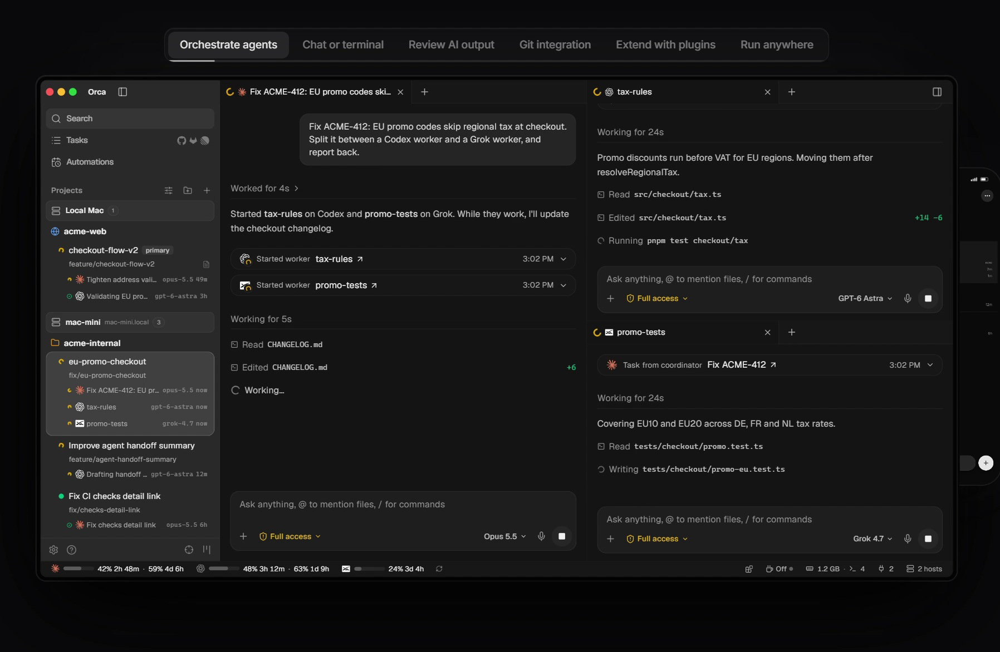

# ACS × Orca 工作台采用研究与改造边界（历史归档）

> **归档状态：已归档（2026-11-06）。**
> 归档范围覆盖本文全篇及配套研究素材。旧产品形态、UI确认、流程、Core缺口清单、确认顺序与P3／P4 Client计划均为历史记录。
> 下方原文中的“当前”“已确认”“最终确认”“应实施”“验收”和“下一阶段”保留原日期语境，不构成现行设计或开发约束。
> 现行决策见[ORCA优先采用：能力评估与路线决策](ORCA-FIRST.zh-CN.md)，完整归档范围见[历史资料清单](ORCA-FIRST.zh-CN.md#archive)。
> 事实证据可按原版本与观察范围重新评估；Core／Runtime独立现行合同继续按其自身权威解释。

---

**历史原文（保持当时表述）**

<!-- ORCA-ARCHIVE-PAYLOAD:BEGIN -->

日期：2026-11-06。状态：产品方向与采用方案，待用户确认。

ACS基线：本地`codex/core-cleanup@19d7881d49ee887315c54c5bc02e0cc424061376`，Runtime 2.3.1；本轮核对与前次源码相同。上游版本按§6固定commit解释，官网与录屏不自动等于某个已安装发行版。

本轮研究以完整的 Agent 工作台为采用单位：保留原有会话、执行、工作空间和开发工具，分别判断原版能否直接满足需求、是否需要组织扩展，以及是否值得保留ACS Core集成。具体页面改造在采用方向确认后展开。

## 1. 结论：优先评估完整 Orca 底座

建议将**完整 Orca 应用作为首选底座，T3 Code 作为完整应用级对照**。Orca 的左栏、中央原生 Chat／TUI、Tabs／分屏、浏览器、编辑器、diff、Git、远程主机与恢复机制共同构成用户的工作环境。它们应作为一套系统保留。这个UI采用判断，与是否继续使用ACS Core，是两个层次的决定。

具体需要在三个范围之间选择：

- **直接使用原版Orca**：若其工作台、组织与协作已满足任务，沿用原生合同。
- **Orca组织扩展**：保留上游协作，只增加确有需要的Project／Route视角、元数据与知识入口。
- **Orca＋ACS Core**：当跨入口通信、长期组织或其他真实任务证明有增量价值时，再接入Core与接收桥。

若保留Core，其公共接口决定ACS事实如何取得；上游工作台已有能力继续使用自己的数据源与运行时。原版采用、组织扩展与双运行时桥接，应分别评估收益和维护成本。

“小修改”适合描述**视觉与常用操作的保留比例**。实际工程量还取决于身份绑定、原生输入的唯一控制者、消息持久性与权限映射。当前证据支持采用方向，尚不足以承诺只改几个分组字段就能完成集成。

## 2. 已观察到的连续体验

两段用户录屏分别为96.77秒和157.80秒。研究对全片做稀疏定位，并对关键片段检查更密的有序帧。它们记录的是官网演示，能够说明所表达的产品操作与空间关系；实际 App 的性能、失败恢复及底层执行另有验证范围。

### 协调者、worker与报告在同一工作环境里

第一段0–12秒：主会话提出分工，出现两个Started worker入口；随后右边上下两块显示两个worker，分别有返回协调者的入口；其中一个完成后，主会话收到Update from worker。全程仍在同一项目／工作空间中。



这里有价值的并非单独一个聊天组件，而是“委派→进入worker→观察各自执行→返回报告”的连续性。若采用 Orca，这套结构与交互应优先保留。

### 原生执行、证据与反馈可以继续衔接

| 录屏片段 | 实际可见的过程 | 对ACS客户端的采用判断 |
|---|---|---|
| V2 32–42秒 | Chat菜单转入Terminal，历史与后续测试内容可见，再从终端进入Chat UI | 保留上游原生会话表面与继续入口；具体resume／fork语义依实际提供者核实 |
| V1 39–50秒 | 浏览器选中邮编字段、输入反馈、选择发送对象，Agent收到URL／selector／评论背景并继续处理 | 浏览器、选元素反馈和composer属于既有工作台能力 |
| V2 128–138秒 | 对diff具体行留下note，再发送给Agent，右侧带文件／行／评论继续 | 保留“证据→反馈→执行”的路径；ACS消息可以按需要关联原始资料 |
| V1 52–72秒 | stage、commit、PR、checks与review反馈在同一工作区衔接 | Git与托管平台数据继续由上游功能负责 |
| V2 52–64秒 | 创建工作空间时选择运行主机，本地与远程选项共用流程 | 首先复用已有主机、环境与工作空间入口 |

精确帧、源文件摘要与观察范围随[录屏研究资料](workbench-20261106/user-media/EVIDENCE-NOTE.md)保存。官网其他演示的原生观察记录与源码证据分别保存，彼此不替代。

本轮还在线查看了官网全部12项Inspect预览，实际操作前后翻页、关闭返回，以及hero的Run anywhere和Chat or terminal选择。可见的拖放、选元素、预览缩放、账号用量、定时任务和插件状态均来自预设场景。采样变化、截图与未覆盖的实际App操作见[官网行为笔记](workbench-20261106/official-research/BEHAVIOR-NOTES.md)。DOM／SVG／视频等动画实现类型尚未确定，演示中的成功状态不作为真实执行验收。

## 3. Orca是否已经覆盖ACS的初衷

如果目标限定为“一个人使用多台机器、同时运行多个编码Agent、查看结果并继续开发”，**Orca已覆盖很大一部分需求，应把直接采用原版列为真实候选**。

尤其不能将它概括成仅有原生会话的外壳。[Orchestration官方合同](https://www.onorca.dev/docs/cli/orchestration)已经包含持久Run、协调者Inbox、Task／Dispatch、worker消息、ACK／重放及跨主机worker；该结构化编排功能目前标为实验项、默认关闭。[远程服务器合同](https://www.onorca.dev/docs/remote-servers)还明确区分远程完整运行时与SSH工作空间。

ACS现行合同与之存在不同的组织选择：稳定AgentSlot、自然消息、显式多原文回复与真实参与者权限。Orca的源码也已有thread／问题回答关系、consumer fencing，以及独立于provider的Orca会话身份；`/clear`后的lineage root继续参与寻址。因此，**模型不同本身不能证明额外产品价值**。需要用实际用户任务验证保留ACS的收益。

| 用户任务 | 当前可以判断的重叠／区别 | 还需证明什么 |
|---|---|---|
| 同项目分工给多个编码Agent | Orca已有协调者／worker与原生开发闭环；重叠很高 | 原版是否已足够满足用户日常使用 |
| 跨机器继续观察和输入 | Orca已有SSH、远程服务器及手机继续路径 | 用户实际网络、系统与Harness组合中的可用性 |
| 换一次原生会话后继续联系同一长期协作者 | ACS有稳定Slot；Orca也有持久Orca会话ID和lineage寻址，PTY另有边界 | 对跨会话／provider／主机替换逐项测试；不能预设上游缺失连续身份 |
| 独立网页Agent或其他应用联系开发Agent | ACS有现行远程MCP和受信调用合同；Orca也有CLI／MCP／远程扩展 | 对指定外部调用者做完整互通、授权与恢复测试 |
| 精确追踪一条原消息的明确回复 | ACS已有`reply_to[]`；Orca已有持久消息、thread与问题回答关系 | 多原文回复、对等消息、历史和读取范围是否满足实际任务 |
| 多个独立身份的管理与私信读取 | ACS按真实绑定／Grant／参与者执行权限 | 上游的真实安全边界与所需用户场景；不能从UI角色名作结论 |

若原版Orca在这些真实任务中已满足需求，额外维护桌面分支或通信桥接的收益需要重新计算。若长期组织、跨入口身份与独立通信合同仍有明确价值，再将ACS作为工作台的协作层接入。

## 4. 应保留哪些完整能力

以下是采用范围建议，功能可用性继续以固定版本、实际平台与Harness支持条件为准。

| 能力组 | 保留方式 | 数据／控制归属 |
|---|---|---|
| Chat、TUI与会话历史 | 沿用原有transcript、composer、模型与权限控件、继续会话入口 | Orca及对应Harness |
| Tabs、分屏、布局恢复、Jump | 沿用原工作空间与面板系统；ACS内容也进入同一系统 | Orca；ACS面板保存自己的阅读状态 |
| 终端、文件树、编辑器、diff | 直接保留现有实现及互相打开／拖放关系 | Orca的实际主机文件与Git上下文 |
| 浏览器、Design Mode、富预览 | 沿用现有工具及其与原生Agent的上下文传递 | Orca浏览器／文件／会话 |
| 主机、SSH、远程服务器 | 保留连接、运行位置与恢复流程 | Orca主机及运行时；ACS接收端绑定另行核对 |
| 原生子任务／subagent观察 | 沿用已有Harness适配所取得的内容与控制 | Orca／Harness，按具体来源能力显示 |
| 账号、用量、语音输入、模拟器 | 沿用现有功能与实际支持条件 | 上游账号／模型服务／设备接口 |
| GitHub／Linear任务、PR、checks、评审 | 保留原有来源与反馈闭环 | 托管平台及上游任务功能 |
| Automations与Orca编排 | 保留上游功能，明确其Run／Task／Dispatch生命周期 | Orca；不据UI相似自动转换为ACS领域对象 |
| 插件生态与设置 | 保留原插件与设置系统，ACS按已实现的贡献面扩展 | 上游扩展系统与ACS集成模块 |

[原生Chat官方说明](https://www.onorca.dev/docs/agents/native-chat)列出的适用环境与回退条件很重要：本地及配对服务器的合格会话可以使用结构化Chat；SSH／WSL有不同表面条件。保留原生UI时也应保留这些边界，而非为统一外观改写执行事实。

## 5. 具体目标形态与最小改造范围

用户打开的应用仍是一套完整的Orca工作台：左侧定位工作环境，中央与右侧由原有Tabs／分屏承载Agent、终端、浏览器、文件和diff。下面是选择组织扩展／Core集成时的增量候选；直接采用原版时继续使用原生组织与通信。

建议先验证四项变化：

1. **项目与Route的组织视角。** 先试现有project groups、folder workspace与父子workspace，验证其能否承载两条长期开发线。若需要Core权威ID、自动关联或专用分组，再扩展现有Sidebar和store；具体层级待真实数据量确认。
2. **原生会话的协作身份。** 对已接入的会话显示其Root／Route／协作者关联，能够继续打开原来的Chat／TUI。会话换新时，稳定Agent身份按真实绑定继续。
3. **可停靠的ACS往来内容。** 本人可见的往来、明确回复及原文资料进入现有Tabs／分屏；需要时与原生会话并读。既有关联阅读研究保留为这类内容的候选。
4. **集中的接入与绑定管理。** 复用原设置系统配置ACS连接、实际身份、项目与会话关系；权限与可用性由真实接口回读。

组织映射是可持久化的关联，而不是名称替换：

| ACS对象 | 可能关联的Orca对象 | 映射原则 |
|---|---|---|
| Project／Root | 一个或多个仓库、主机上的目录或工作空间 | 同一逻辑项目可以跨多个clone和主机；当前Core的Project与Root配对关系保留 |
| Route | 项目下的一组长期工作上下文 | Route与worktree没有必然一一对应关系 |
| 稳定AgentSlot | 多次原生会话／接收位置的连续身份 | 真实授权绑定决定作者；标签、Tab标题与sessionId不足以授予身份 |
| Native接收位置 | Orca实际拥有或能够继续的原生会话 | 需要可验证的绑定、版本与唯一输入控制者 |
| ACS消息／回复 | 可停靠往来页面、源消息链接 | 保留Core原句柄与真实参与者范围 |
| OrcaRun／Task／Dispatch | 上游原生编排对象 | 沿用自己的状态和来源；与ACS通信按明确合同接合 |

点击原生会话继续读写Harness；点击ACS往来查看Core消息，面板标题与操作目的各自清楚。原生轨迹可以由上游适配器完整呈现；ACS消息的真实性继续由Core保证。

若两种资料并置，来源与授权也分别成立：原生轨迹通过Orca实际拥有的运行时／会话权限取得；ACS往来按当前认证actor的真实参与者范围读取。拥有Orca的原生观察能力，不会自动把Core里的其他参与者私信变成当前Client的消息历史。界面可共用组件与空间，数据身份和引用保持准确。

原版组织能力已经有可用基础：[Worktrees官方说明](https://www.onorca.dev/docs/model/worktrees)记录多仓库project group、group下的folder workspace，以及同仓库workspace的父子嵌套。固定源码`ProjectGroup`也有`parentGroupId`、手工／扫描来源与主机字段。现有材料尚不足以断言任意层级、跨主机逻辑Route均可原样表达；这应通过原版组织试验确认。

## 6. 源码采用路径

本轮固定的上游源码：

| 项目 | Commit | 许可依据 | 本轮判断 |
|---|---|---|---|
| [Orca](https://github.com/stablyai/orca/tree/9055eb9344dac1300311337cb1f0040d8094e3c2) | `9055eb9344dac1300311337cb1f0040d8094e3c2` | [MIT LICENSE](https://github.com/stablyai/orca/blob/9055eb9344dac1300311337cb1f0040d8094e3c2/LICENSE) | 用户提供的完整工作流与此来源最贴近，优先采用候选 |
| [T3 Code](https://github.com/pingdotgg/t3code/tree/938b4d45255fa92c11a03e0a5e946b2e438aabb3) | `938b4d45255fa92c11a03e0a5e946b2e438aabb3` | [MIT LICENSE](https://github.com/pingdotgg/t3code/blob/938b4d45255fa92c11a03e0a5e946b2e438aabb3/LICENSE) | 保留完整应用级替代，按实际所需功能与维护成本比较 |

Orca官方公开的是完整应用仓库，包含桌面、手机及cloud相关源码。采用时应保留对应许可证／第三方通知，并分别处理品牌、发行和上游托管服务的实际接入；源码可取得与一个分支已经可运行分别成立。

### 采用与扩展路径的边界

| 路径 | 可以先获得什么 | 对本轮目标的限制 |
|---|---|---|
| 原版Orca及既有组织功能 | 先验证能否直接满足完整个人开发流程 | 若已有能力足够，可以直接采用；具体Project／Route语义另看是否有真实需求 |
| 原版Orca＋配置ACS MCP／Skills | 在保留Core的候选中验证普通工具接入 | MCP工具出现不代表桌面UI已能管理和读取ACS；接收唤起、身份和读取范围仍须验证 |
| Orca插件 | 新增面板、命令、编辑器与适配功能 | 当前公开贡献面不能直接完成顶层Project／Route左栏重组 |
| Orca应用源码分支＋独立ACS集成模块 | 在完整工作台中集中修改导航、持久关联及接收桥 | 需要维护小范围上游差异，并完成运行时与权限集成 |

关键证据是当前[插件贡献点schema](https://github.com/stablyai/orca/blob/9055eb9344dac1300311337cb1f0040d8094e3c2/src/shared/plugins/contributions/plugin-contribution-points.ts)：`sidebarCards`等贡献点仍为reserved；已实现的panel入口位于右侧activity bar。这限定了插件可做的任意左栏扩展，但并不影响原版已有的分组功能。专用Route语义、自动同步和Core权威关联，需要在原版试验之后确定是否改源码。

### 完整应用级比较

| 采用条件 | Orca | T3 Code |
|---|---|---|
| 本轮体验证据 | 两段完整录屏、有序关键片段、官网其他交互演示 | 官方来源及架构／扩展合同；没有同等深度的本轮视觉与任务试验 |
| 源码采用边界 | 完整桌面／运行时／移动／CLI／插件 | 完整server／web／desktop／mobile及共享运行时 |
| 执行与协作 | 原生会话、终端、工作空间、Run／Task／Dispatch、持久mail与federation | provider driver、标准命令／事件、事务化receipt／outbox及持久投影 |
| 外部调用 | CLI／RPC、MCP配置、扩展worker；实际授权入口另验 | 官方outside-agent MCP具有OAuth、权限受限控制及撤销合同 |
| 主要采用判断 | 当前用户提供的整套工作流最贴近，优先验证原版 | 当外部控制合同或server架构更适合具体任务时，仍是有效替代 |

T3也不能简单视为一个需要ACS补齐所有运行能力的UI。其[架构文档](https://github.com/pingdotgg/t3code/blob/938b4d45255fa92c11a03e0a5e946b2e438aabb3/docs/internals/overview.md)、[provider扩展](https://github.com/pingdotgg/t3code/blob/938b4d45255fa92c11a03e0a5e946b2e438aabb3/docs/internals/adding-a-provider.md)与[外部Agent MCP](https://github.com/pingdotgg/t3code/blob/938b4d45255fa92c11a03e0a5e946b2e438aabb3/docs/user/outside-agents.md)均有实际实现合同。本轮优先Orca是证据与使用意图的匹配判断，不是对两者可靠性的排名。

### 已定位的源码责任

| 源码入口 | 已核实责任 | 后续改造原则 |
|---|---|---|
| `src/renderer/src/components/sidebar/index.tsx` | 已有workspaces／agents主体、分组状态、折叠及滚动维护 | 先扩既有组织入口；具体Route展示仍待确认 |
| `TerminalWorkbenchContainer.tsx`、`TerminalSplitWorkspaceSurfaces.tsx` | 工作台可见性、后台挂载、浏览器guest持续合成与parking | 保留整套生命周期，而非只搬静态容器 |
| `TerminalTitlebarTabs.tsx` | TabBar／store与文件、浏览器、终端等既有动作 | 新内容按原工作空间系统停靠和恢复 |
| `src/shared/project-group-types.ts`及持久状态类型 | 原版组织、层级与host关联 | 区分展示分组和权威ACS对象的外部ID关联 |
| Orca orchestration的`workers.ts`、`send-methods.ts`、`check-methods.ts` | 真实worker／mail／消费与重放入口 | 先确定现有合同是否足够，再决定是否接ACS |

固定源码、文件路径与观察范围见[采用源码报告](workbench-20261106/adoption-research/adoption-findings.md)和[呈现层定位](workbench-20261106/ui-source/README.md)。当前是选取源码的研究，完整App build、发行版运行与正式fork尚未执行。

维护范围还包括分支升级与状态迁移、发布／更新通道、签名与应用标识，以及需要沿用的插件市场／cloud／手机端服务兼容性。原版采用可继承上游发行；自行发行则需要分别验证这些路径。它们与视觉改动大小是不同成本。

## 7. 运行时分工与ACS缺口

若选择保留Core，采用建议的基本结构如下；这是集成候选，不是原版采用的前提：

```text
Orca桌面工作台
  ├─ 原生Chat / TUI / 文件 / diff / 浏览器 / 主机
  │      └─ Orca原有运行时与Harness适配
  └─ ACS组织 / 受权往来 / 资料引用
         └─ ACS连接、身份与关联模块
                └─ ACS Core现行通信与管理接口
```

| 层 | 目标职责 | 当前状态 |
|---|---|---|
| Orca呈现与工作空间层 | 保留现有开发工作台、导航与持续使用状态 | 源码及演示已研究；完整应用实机尚待采用试验 |
| Orca原生运行时 | 继续控制已有Harness会话、输入、停止、恢复和原生轨迹 | 上游已有实现；当前用户环境另验 |
| ACS客户端集成模块 | Core认证、真实作者／范围、持久关联、往来页面与错误恢复 | 需要新增；不能仅以显示名或工作目录自动认领身份 |
| ACS Core | 现行身份／Grant、Root／Route／Slot、消息、明确回复及确定性投递 | 本地2.3.1源码合同已有；本轮未调用生产消息 |
| 原生接收桥 | 将Core已提交消息交给一个确定的Orca原生会话，并回报准确接纳状态 | 需要专项验证接收合同、幂等、互斥及恢复；尚无现成Orca适配声明 |

最重要的工程验证是**同一个原生会话的输入与生命周期由谁控制**。Orca和Core若分别启动、恢复或输入同一个接收对象，会产生重复执行及状态冲突。采用完整工作台后，建议由上游原生运行时继续控制其会话，ACS通过明确的接收桥使用这份能力；这是一项集成设计，不能从MIT许可或UI相似性推导为已完成。

`message_only`可先验证持久通信而不启动原生接收，但它也不能单独证明自动唤起已成立。默认`invoke`、原生接纳、明确Agent回复与业务完成仍按各自真实来源解释。

当前Core已经有经过代码／安装身份哈希绑定的receiver factory和签名接收协议；低层Codex／OpenCode driver也有真实attach合同。因此，首先应复用这些接收扩展面，而非先增加公共invoke API。现有发布factory并未提供Orca会话采用方式；把一个Orca Session ID写进配置也不能完成实际接管。

若采用Core桥接，最小责任划分是：

- **Core**：复用现有授权、消息／operation身份、签名admission、dispatch marker及明确reply等待；只有试验发现缺口时再扩公开面。
- **Receiver／Orca adapter**：新增受信factory与实际会话映射，取得真实readiness，通过Orca自己的串行入口进行一次mutation，持久保存opid与回执／代际对应，并能在丢响应后核对同一操作。
- **Client集成**：保存跨系统关联与请求身份，为接收Agent配置其实际ACS身份，呈现真实／未知结果；Core拥有这次投递时，UI不再另发一次原生输入。

这条实现路线目前仅有源码可行性依据。静态核查、代码入口和需要真机验证的反例见[Core接收桥研究](workbench-20261106/core-bridge/acs-orca-core-feasibility.md)。

## 8. 把“小改造”变成可验收的采用试验

| 顺序 | 具体用户路径 | 完成标准 |
|---|---|---|
| A. 原版完整任务 | 本地与远程各开一个实际Harness，委派、发问、回报、查看diff并继续；重启后恢复 | 先记录原版成功项和具体缺口，再确定需要哪种扩展 |
| B. 组织需求验证 | 使用既有项目／分组／会话组织同一项目的两条长期开发线 | 判断是原生功能、手工约定、组织小fork还是Core权威对象的需求 |
| C. 普通工具接入 | 保留Core的候选中，Agent用真实身份通过ACS发消息、明确回复 | 作者与权限准确；持久记录重读可复现；与原版路径比较收益 |
| D. 双向接收 | Core发往Orca拥有的会话；忙碌、断线、结果未知后继续 | 相同消息不重复输入；句柄和接收绑定可核对；旧会话不被误唤起 |
| E. 最小UI集成 | 对已证明的缺口加入一个Project、两个Route及必要往来入口 | 原有工作台连续可用，新增能力有可辨认价值与来源 |

本轮进入的是采用方向确认。A–E是接下来必须产生真实证据的试验，不是已经运行通过的项目测试，也不预设要立即开发所有功能。

## 9. 现有设计文档的职责调整

| 材料 | 当前职责 |
|---|---|
| 本研究 | 完整工作台采用方向、竞品重叠、保留能力、对象与运行时接合，以及下一阶段验收 |
| [产品形态复核](PRODUCT-REVIEW.zh-CN.md) | 保留ACS事实、历史决策复核与背景；入口指向最新采用研究 |
| [通讯与关联阅读研究](COMMUNICATION-EXPERIENCE.zh-CN.md) | 保留本人往来、显式回复图、聚焦／原文导航的专项候选；可作为工作台内内容使用 |
| 历史UX／用户流程 | 作为已讨论过的需求与决策来源，逐项按实际底座复用关系复核 |

下一阶段先确认完整底座与集成深度，再使用上游自己的组件、状态和工作流展开页面改造。原生trace、模型选择、队列、文件与主机管理等已有能力，优先从上游采用，不要求ACS Core重新提供同一套事实。

## 10. 需要确认的产品判断

- 是否选择完整Orca作为第一底座，并用T3作对照。
- 保留ACS的必要价值，是否主要落在长期Project／Route／Agent身份，以及独立应用之间的通信。
- 第一轮采用试验做到普通MCP接入，还是同时验证双向接收桥。
- Project／Route采用增加分组／筛选还是更深的导航变化；原主机与工作空间入口继续保留。
- 原生Orca编排与ACS协作在第一阶段分别承担哪些实际任务。

采用方向确认前，本轮保持研究范围，不改生产Core、不安装或部署工作台、不运行真实Agent任务。
